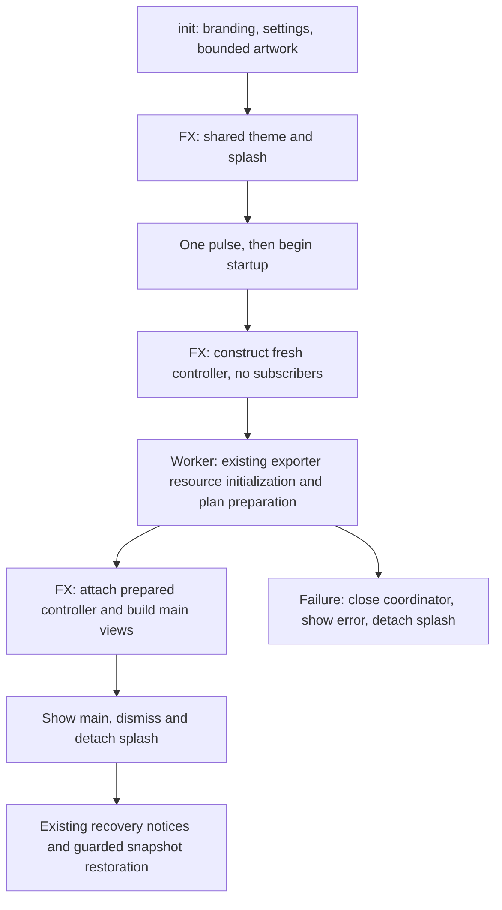

# Phase 13C — Aledrix Branding and Splash Implementation

## Executive summary and baseline

Implements authorized Stages 13C2–13C5 using the user-approved Stage 13C1 Logo #5 candidates. The primary title, splash product/tagline and resource selection now use immutable centralized branding. Deployment overrides are read-only and restart-scoped. Startup uses one application-owned settings service and theme manager; a single bounded preparation worker performs genuine initialization before views subscribe. No artificial hold time or fabricated percentage is used.

Branch `main`, HEAD `cadeb3eb9e22c543f2091dbf711c054cbcb88f25`. Index empty at entry. All existing uncommitted Phase 13B source/test/CSS changes, architecture reports, Stage 13C1 assets and review previews were preserved. Phase 13B native acceptance and Stage 13C1 artwork approval are user-confirmed; new Phase 13C native acceptance remains pending. No Phase 13D work is included.

## Branding contract

`application.branding.ApplicationBranding` is an immutable four-field record: `applicationTitle`, `productName`, `tagline`, `logoResource`. It contains no preference writers, plan objects, JavaFX nodes or financial data. `persistence.ApplicationBrandingLoader` resolves:

1. Validated emergency defaults, protecting startup if the packaged defaults are damaged/missing.
2. Packaged UTF-8 `/application-branding.properties`.
3. Valid fields from optional `${user.home}/.retirement-planner/application-branding.properties`.

```properties
app.title=Aledrix Retirement Planning Science
app.productName=Aledrix Retirement Planning
app.tagline=The Science of Retirement Planning
app.logo=images/branding/aledrix-logo.png
```

There is no current-directory/environment lookup, file watcher, branding editor or second general-purpose preference framework. Missing external file is normal and is not created. Changes are visible on the next process start. Existing loaded branding values do not change if the file is edited during a session.

Documents are bounded to 16 KiB through bounded stream reads. UTF-8 decoding reports malformed input. Duplicate decoded keys (including escaped-key duplicates), malformed properties escapes, unreadable inputs and oversized files reject the entire external document. Valid external documents apply each recognized field independently; blank/control-containing/overlong fields retain their packaged fallback with a generic warning. Unknown keys are ignored with a warning. Title/product limits are 160 characters, tagline 240 and resource name 256. No external document is rewritten or migrated.

Logo paths are case-sensitive production PNG names under `images/branding/` with letters, numbers, underscores or hyphens. Absolute paths, URI/network schemes, traversal, nested paths and the original concept-sheet filename are rejected. Only classpath streams are opened. A syntactically valid but absent/corrupt logo yields a text-only splash and a generic local diagnostic, rather than the concept sheet or an unrelated icon. Invalid path syntax retains the default logo selection. The icon is the fixed companion `images/branding/aledrix-icon.png`, not an undocumented preference.

`BrandingImages` bounds resource reads to 8 MiB and checks the PNG signature, IHDR and positive dimensions at most 4096 × 4096 before image decoding/allocation. Missing or decoder-rejected images return unavailable. Branding warnings contain no document contents, user financial data or raw path details.

## Title and preference/theme ownership

`MainWindow.updateWindowTitle` uses `branding.applicationTitle()` with the established ` - filename`, ` - Untitled` and ` *` suffixes. Open/Save/Save As and dirty-state formatting continue through that single method. Plan names/UUIDs, analyzer identities, historical labels and PDF titles/metadata are unchanged.

`MainApplication.init` loads one `JsonApplicationSettingsRepository` and one `ApplicationSettingsService`, along with resolved branding and bounded artwork. No Stage/Scene/control is created in init. `start` creates the existing `ApplicationThemeManager` with the last committed theme before showing the splash. The same service is injected into ApplicationController and the same theme manager into MainWindow. MainWindow.createScene reuses the supplied manager instead of replacing it. Production shutdown ownership belongs to MainApplication; standalone/controller-injected MainWindow constructors retain their prior self-owned test/embedding behavior.

The existing Settings dialog, immediate preview, Cancel/Esc/window-close rollback, field-level serialized persistence, corrupt-settings protection and chooser policy remain unchanged. MainWindow's settings action receives the same manager/service. Branding is never written into settings.json or a retirement plan. The default remains Light when settings cannot provide a valid saved theme.

## Startup lifecycle and safe isolation



`ApplicationController.prepareStartup` is a one-use **pre-view** method. It requires a fresh controller (initial revision 1, no current file/modified flag) and no source/binding subscribers. It rejects reuse after views subscribe. It calls the existing openLastPlan path and, only when not in saved-result restoration mode, the existing current-projection/summary/non-investable getters. No projection algorithm or acceptance guard is replaced. A recoverable ordinary projection exception is returned for the existing MainWindow error presentation after the primary window is shown; fatal initialization errors use the startup error path.

The controller is constructed on FX, not moved wholesale to a worker. Only this isolated, unsubscribed preparation is executed off FX. The completion dispatch establishes the ownership handoff before views exist. The existing saved-component worker and projection ownership/generation checks are retained. Saved legacy plans remain unavailable where their original results were not recorded; no substitute projection is run to fill them.

The prepared MainWindow constructor loads the same input views but displays existing accepted caches without invalidating them, reopening the file or rerunning the engine. Ordinary user-triggered recalculation and other MainWindow constructors retain their existing behavior. Pending saved-projection restoration still uses the existing owner/future-guarded callback and is not awaited by blocking FX.

Fresh-process inspection exposed PDFBox first-run font discovery while ResultsSummary constructs its existing ProjectionPdfExporter. The startup worker initializes that already-required exporter before constructing the views; no PDF is generated and no exporter source/palette is modified. This moves genuine font discovery off FX rather than inventing initialization work. UI control construction/CSS/layout still take FX time; no claim of continuously animated rendering is made. The splash uses neutral text rather than an animation.

`ApplicationStartupCoordinator` has one daemon worker, capacity-one queue and one admitted preparation. There is no general background scheduler, sleep or minimum-duration timer. A one-shot JavaFX pulse yields before work begins. Close cancels queued work and suppresses already-dispatched or uncooperative late completion callbacks. MainApplication also guards stopped/failed state. A failed startup closes the coordinator, prevents a later main-window publication, shows one generic error and detaches the splash. The error window remains usable until closed, then application resources are cleaned up. A recoverable plan-open error continues to the existing recovery workflow after main readiness; files are preserved.

During normal handoff the main Stage is shown before the splash is hidden, avoiding an implicit-exit gap. No repeated requestFocus/toFront call is used. Splash Scene is explicitly detached, theme listeners are removed by the existing Window lifecycle and the large splash logo reference is released. Shutdown is idempotent and closes startup/settings/theme/parameter resources plus the existing analysis shutdown paths. No late startup callback can reopen a stopped/failed application.

## Presentation and artwork

The undecorated nonmodal splash uses the approved transparent Logo #5, a separate configurable product Label, italic tagline and truthful `Initializing…` text with a muted-gold separator. Default width is 560 logical pixels and minimum height 380, with natural-height expansion for longer validated deployment text. Text wraps; the image preserves ratio. Light/Dark use existing semantic roles and common theme ownership. The main and splash Stage icons use the accepted padded icon candidate. No artwork was regenerated in Stages 13C2–13C5.

The original reference SHA-256 remains `805458B37F394CDB0C2343E53C8ECECE6CECD2857A9906F1060256E1B1E8306F`. It is never loaded by runtime branding paths. Approved assets remain raster reconstructions; approval does not imply original vector or small-native-icon certification.

## Exact implementation inventory

Modified existing production files (these already had Phase 13B edits, preserved):

- `src/main/java/com/daviddunn/retirementplanner/ui/MainApplication.java`
- `src/main/java/com/daviddunn/retirementplanner/ui/MainWindow.java`
- `src/main/java/com/daviddunn/retirementplanner/ui/controller/ApplicationController.java`

New production classes:

- `src/main/java/com/daviddunn/retirementplanner/application/branding/ApplicationBranding.java`
- `src/main/java/com/daviddunn/retirementplanner/persistence/ApplicationBrandingLoader.java`
- `src/main/java/com/daviddunn/retirementplanner/ui/startup/BrandingImages.java`
- `src/main/java/com/daviddunn/retirementplanner/ui/startup/ApplicationStartupCoordinator.java`
- `src/main/java/com/daviddunn/retirementplanner/ui/startup/StartupSplashView.java`

New resources:

- `src/main/resources/application-branding.properties`
- `src/main/resources/css/startup-splash.css`

New focused tests:

- `src/test/java/com/daviddunn/retirementplanner/persistence/ApplicationBrandingLoaderTest.java`
- `src/test/java/com/daviddunn/retirementplanner/ui/startup/ApplicationStartupCoordinatorTest.java`
- `src/test/java/com/daviddunn/retirementplanner/ui/startup/StartupProjectionRestorationTest.java`
- `src/test/java/com/daviddunn/retirementplanner/ui/startup/StartupSplashViewTest.java`

New report: this file. Stage 13C1 resources/review report and `docs/branding/13c1` remain separate previously approved work. All other Phase 13B modifications/untracked classes/resources/tests and earlier reports remain unchanged by this implementation. No domain/financial code, PDF exporter, analyzer codec/fingerprint, plan schema, golden resource, government rule, dependency or POM change is included. No staging/commit/push occurred.

Ignored exclusions: Maven logs/reports, JavaFX preview PNGs, isolated synthetic smoke-test homes/plans/font caches, and standalone smoke helpers/overlay classes under `target/`. Do not include any of those generated plans or logs in a future commit.

## Automated verification

Uses IntelliJ bundled Maven, `-Dmaven.repo.local=C:\Users\david\IdeaProjects\retirement-planner\.codex-m2\repository`, `-DargLine=-Xmx4g`. No tests disabled, assertions weakened or golden values regenerated.

During development, the new UI test initially referenced a nonexistent no-argument/AutoCloseable result store. That test compilation error was corrected by using an explicitly owned repository-backed store and its established shutdown API. No production behavior was changed to satisfy it.

Initial focused run: 42 passed, 0 failures/errors/skips, 25.703 seconds (`target/phase13c-focused-initial.log`). Expanded focused run: **120 passed, 0 failures/errors/skips**, 40.230 seconds (`target/phase13c-focused-expanded.log`). The expanded set includes branding/coordinator/splash/startup restoration, application preferences/atomic settings, recovery, MainWindow assumptions, projection snapshots/swaps, Phase 12G freshness and SS/Quick PDFs. Final verification totals appear below.

An intermediate final-focused attempt ran 121 tests with 0 assertion failures and 3 errors: two timing-sensitive fixture cleanups used shutdownIfIdle immediately after a drain barrier, and the new natural-height layout fixture measured an unshown Scene whose initial dimensions were zero. Cleanup now uses the established shutdownAfterSuccessfulDrain API; layout is verified in an actual shown Stage. Assertions remain intact. **Verified final focused run: 121 passed, 0 failures/errors/skips, 39.312 seconds**, completed 2026-10-28 10:29:25 -04:00 (`target/phase13c-focused-verified.log`).

First complete suite before the last stabilization checks: 3,629 total, **3,585 passed, 44 skipped, 0 failures/errors**, 10:47 minutes, completed 10:26:40 -04:00 (`target/phase13c-full.log`). Final-source complete-suite results appear below; this earlier run is not substituted for them. The final source includes the extra long-text test and startup failure/font-preparation safeguards. Source hashes were captured at the start of the final complete run.

### Final verification and readiness

**Final complete Maven suite: 3,630 total, 3,586 passed, 44 skipped, 0 failures, 0 errors; BUILD SUCCESS; 10:52 minutes**, completed 2026-10-28 10:40:56 -04:00, process exit 0. Log: `target/phase13c-full-verified.log`. All 14 implementation source/resource/test hashes captured before this run remain unchanged. Final focused suite: 121/121 passed, zero skips/failures/errors. No new exclusions were introduced.

The 44 existing skips comprise opt-in capacity/large replay/performance/visual/private-plan probes, one explicitly manual multi-minute benchmark and four pre-existing Mississippi worksheet cases gated pending authoritative guidance. The exact case/reason inventory is in ignored `target/phase13c-skipped-tests.csv`; these cases were not enabled or altered for this UI/application-metadata phase. Expected fault-injection warnings, native-access/classpath warnings and PDF fixture overwrite notices did not produce test failures. Existing Light/Dark PDF tests assert identical source text and rendered page pixels.

Final-class fresh-process checks passed for normal Light/default startup (170 ms preflight, 2725 ms to main), saved Dark/override startup (245 ms preflight, 2744 ms to main, original UUID and input freshness), fatal startup cleanup and early shutdown. These isolated samples do not establish general performance or native acceptance. Logs: `target/phase13c-smoke-new-current.log`, `phase13c-smoke-saved-current.log`, `phase13c-smoke-failure-current.log`, and `phase13c-smoke-shutdown-current.log`.

`git diff --check` passed. Index empty. No financial/domain, exporter, POM, rule or golden-resource changes were found. Original reference and both approved PNG digests remain unchanged. Final working-tree inventory is captured in ignored `target/phase13c-status-inventory.txt` and `phase13c-untracked-inventory.txt`; the exact in-scope production/test paths are listed above. All pre-existing work remains present.

**Ready for review and native Windows acceptance.** No Stage 13D or other feature has begun. No files were staged, committed, pushed, reset, cleaned or discarded.

Tests cover malformed/duplicate/oversized/invalid UTF-8 configuration, independent field fallback, restart-only snapshots, rejected logo paths/concept sheet, bounded image decoding, missing-logo text, exact title/dirty formatting, one shared settings authority, theme switching and cleanup, long text layout, off-caller preparation, single admission, fatal failure, queued/late shutdown callbacks, recoverable damaged-plan opening and unsubscribed-controller enforcement. Couple and individual saved-projection tests install throwing projection engines and assert the same projection UUID, input document, annual results and summary on reopening.

Separate fresh-process smoke checks use ignored synthetic fixtures, isolated user.home directories and actual JavaFX Application launch. They do not touch user preferences/plans or shut down the shared test-suite store. Checks completed so far:

- New/default plan: branded Untitled title and clean state; preflight 185 ms, main visible 3393 ms (includes the discovered first-run font scan before its relocation).
- Saved couple projection, Dark preference and external title override: preflight 247 ms, main visible 3570 ms; original snapshot UUID preserved and dirty false. This used the final guarded startup/font-preparation path; it is not a performance benchmark.
- Injected fatal-startup path: error displayed, splash detached and no main-window publication (`FAILURE_CLEANUP_OK`).
- Early application shutdown before preparation: no main-window publication (`EARLY_SHUTDOWN_OK`).

A further final-class smoke run also verifies Dark, one main icon and exact configured-input freshness after view attachment, in addition to the expected original saved snapshot UUID. Its output is retained in `target/phase13c-smoke-saved-current.log`. Startup helpers are verification-only and introduce no production test hooks or public financial lifecycle API.

Times are single local samples, excluding JVM bootstrap/source-helper compilation; they are not native acceptance or evidence of guaranteed startup duration. No artificial timing was added.

## Visual inspection and limitations

Generated and opened actual `target/phase13c-previews/splash-light.png`, `splash-dark.png`, `splash-light-2x.png`, and `splash-dark-2x.png`. Normal images are 560 × 380; 2× renderings are 1120 × 760. Logo, text hierarchy, gold separator, wrapping/spacing, transparent edges and both backgrounds were inspected. No clipped default text or logo was observed. Dark navy artwork is intentionally subdued on Dark, consistent with the accepted asset; no new palette variant was introduced.

These are JavaFX renderings, not Windows DPI/focus/taskbar certification. Native chrome and taskbar small-icon behavior remain platform-controlled. No new PDF design is introduced; existing PDF regression tests verify financial content and original print styling, while source inspection confirms no PDF palette/header/exporter changes. The full suite includes existing individual/integrated/Monte Carlo PDF checks.

Remaining boundaries:

- Splash cannot cover JVM/JavaFX bootstrap or preflight configuration/artwork reads. Noninterruptible OS/network filesystem calls may outlive interruption; callbacks remain guarded and the startup worker is daemon/bounded.
- FX control creation, CSS and layout remain FX work. No broad controller threading or financial acceptance rewrite was attempted.
- Fast startup may expose the splash only briefly. There is no minimum hold to guarantee branding exposure.
- External images are intentionally unsupported: app.logo selects a bounded packaged production PNG only.
- About, installer, shortcuts and PDF branding reuse are deferred. There is no OS-auto theme or branding editor.

## Native Windows acceptance checklist

1. Start with no external branding/settings; confirm default Light, approved mark, product/tagline, branded Untitled title, and one natural splash-to-main handoff.
2. Save Dark in Application Settings; restart and confirm splash is Dark immediately, with no initial Light flash. Preview Light/Dark then Cancel/Esc/close and confirm rollback across main/dialogs/tooltips. Save and restart again.
3. Open/save/reopen a saved couple and individual plan. Confirm correct filename/dirty-star title, unchanged Current/Baseline UUIDs/results and charts, and preserved analyzer history/accepted parameters.
4. Place partial UTF-8 overrides at the documented external path; restart and confirm only those text fields change. Edit during a session and confirm no live change. Check malformed/duplicate/oversized files fall back without being overwritten.
5. Use a valid-looking missing PNG path: confirm text-only startup and usable main window. Verify invalid/traversal/concept-sheet paths retain the approved default selection.
6. Check 100/125/150/200% Windows scaling, monitor transition, taskbar/Alt-Tab icons and focus while other apps are active. No clipped mark/text, duplicated main window or forced repeated focus.
7. Exercise missing/damaged last-plan recovery, close during startup, and a controlled initialization failure. Confirm usable recovery/error UI, no hidden orphan window and no overwritten plan file.
8. Verify normal Save, Save As, configured directory selection, unrelated dirty edits, historical result/PDF fidelity and unchanged PDF print appearance in both themes.

Stop after Phase 13C for native acceptance; do not begin Phase 13D.
