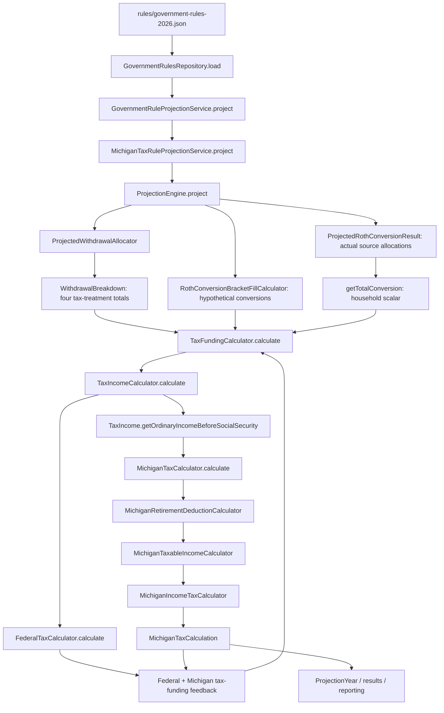

# Phase 6C.1 - Michigan production tax audit

## Status and architecture gate

Audit performed October 9, 2026. **Production correction is not implemented.**
The audit found a shared financial-data boundary that must change to implement
the requested owner/account-sensitive eligibility safely. Under sections17 and8
of the request, stop before production changes and obtain approval for that scope.
No production code, rule resources, financial expectations or existing tests changed.
The Phase6C generic calculator remains isolated.

The three original discrepancies are independently confirmed for the restricted
age60 scenarios. Correcting the numeric caps and interest getter alone would leave
the automatic subtraction for all tax-deferred distributions in place. That would
violate the requested eligibility correction rather than complete it.

## Audit findings - exact production path

Paths below are relative to the repository root.

Michigan calculation inventory, all under
`src/main/java/com/daviddunn/retirementplanner/`:

| Class/path | Responsibility and audited methods |
| --- | --- |
| `domain/tax/state/michigan/MichiganTaxCalculator.java` | `calculate(BigDecimal,FilingStatus,MichiganTaxRules)`: treats its scalar as retirement income; no owner, age, year or eligibility context |
| `domain/tax/state/michigan/MichiganRetirementDeductionCalculator.java` | `calculate`, `determineDeductionLimit`: min(income, filing-status cap), only SINGLE/MFJ supported |
| `domain/tax/state/michigan/MichiganTaxableIncomeCalculator.java` | `calculateTaxableIncome`: uses ordinary income as the retirement-subtraction amount, floors resulting income at zero |
| `domain/tax/state/michigan/MichiganIncomeTaxCalculator.java` | `calculate`: taxable income times rate; no credits/exemptions/rounding |
| `domain/tax/state/michigan/MichiganTaxCalculation.java` | Record: retirementIncome, retirementDeduction, taxableIncome, incomeTax; no unsupported status or eligibility detail |
| `domain/tax/state/michigan/MichiganTaxRuleProjectionService.java` | `project`: inflation-projects both caps from published year; holds tax rate unchanged |
| `domain/tax/state/michigan/MichiganTaxParametersUnUsed.java` | Dormant constants: BASE_YEAR2026, rate.0425, caps65897/131794. No consuming references; these are not active40762/81524 |
| `domain/rules/MichiganTaxRules.java` | Jackson constructor/getters contain only rate and two caps; no personal exemption, ages, elections or provenance |

Relevant dependencies:

- `persistence/GovernmentRulesRepository.java`, `load`: classpath Jackson loading.
- `domain/tax/GovernmentRuleProjectionService.java`, `project`: projects Michigan,
  federal and Medicare rules separately.
- `domain/tax/TaxParameterProjectionService.java`, `project`: for future years,
  compounds the configured inflation rate, rounds dollar parameters HALF_UP to
  whole dollars; years at/before the published year reuse the published value.
- `domain/projection/ProjectionEngine.java`: loads the2026 resource (line169);
  final tax funding (line731) passes actual household conversion and **zero**
  taxable interest. `getProjectionFilingStatus` (line1273) preserves configured
  status through death year, then uses SINGLE for the surviving filer.
- `domain/projection/ProjectedWithdrawalAllocator.java`,
  `allocateAdditionalWithdrawal` (line296), `allocateHouseholdRmds` (line442),
  `calculateWithdrawalBreakdown` (lines469/543): account-specific allocations
  become CASH/TAXABLE/TAX_DEFERRED/ROTH totals. The returned breakdown discards
  account identity/type/owner, including when RMD source accounts are initially known.
- `domain/withdrawal/WithdrawalBreakdown.java`: four totals and `plus`; no
  immutable source ledger. Opening/pre-projection distributions also enter tax
  funding as a single tax-deferred amount.
- `domain/tax/TaxIncomeCalculator.java`, `calculate`: sums household pensions,
  authoritative household SS and tax-deferred withdrawals plus opening distributions;
  takes conversion and interest scalars. Owner/source eligibility is not preserved.
- `domain/tax/TaxIncome.java`, `getOrdinaryIncomeBeforeSocialSecurity` (line67):
  pension + tax-deferred withdrawals + conversion + interest.
  `getMichiganRetirementIncome` (line75): excludes interest, but does not establish
  that every remaining dollar qualifies.
- `domain/tax/TaxFundingCalculator.java`, `calculate`: trial call at358-361 and
  final call at417-422 pass the ordinary aggregate to Michigan. Federal and Michigan
  taxes both determine additional portfolio withdrawal. Tolerance.01, maximum100
  iterations; no algorithm changes made.
- `domain/roth/ProjectedRothConversionResult.java`, `getAllocations`: actual execution
  retains account/owner details in `RothConversionAllocation.java`; production tax
  calls pass `getTotalConversion` instead. These existing allocations are reusable.
- `domain/roth/RothConversionBracketFillCalculator.java`, funding calls at325/378:
  proposed conversions are household scalars before execution. The federal bracket
  target is adjusted iteratively because tax-funded withdrawals raise federal taxable
  income. Michigan corrections therefore affect conversion amounts indirectly.
- `domain/projection/ProjectionYear.java`: retains Michigan calculation; UI
  `ui/views/ResultsView.java`, `ui/summary/ProjectionYearDetailsPane.java` and
  `app/export/ProjectionCsvExporter.java` consume it. Integrated analyzers and
  Monte Carlo that invoke ProjectionEngine inherit the same tax/funding path;
  Social Security-only calculations do not become state-tax calculations.

## Root causes

### Interest

The funding caller passes all ordinary income to a calculator that calls it
retirement income. Its taxable-income helper again subtracts a retirement cap
against that same ordinary total. With interest10000 and Single cap40762,
min(10000,40762)=10000, so taxable income becomes zero.
There is no age60 alternative deduction or exemption calculation explaining that
zero. Simply switching getters would exclude interest from the tax base entirely:
a correction must retain ordinary income while subtracting only eligible retirement.

### Cap provenance

`src/main/resources/rules/government-rules-2026.json`, lines83/85, contains literal
40762/81524. `git blame` attributes both to initial baseline commit
`0cc562e032a83f451184b73cc97fd35d2d3f5ba5`, August24,2026. `git show` confirms
that baseline already labels the containing resource rulesVersion2026.1/taxYear2026.
Later changes to the resource did not change these Michigan entries.

They are **legacy seed-data constants without recorded tax-law provenance**, not runtime derived values,
not the output of inflation projection, and not values from the dormant constant
class. The available Git history does not identify an original tax-law source or
historical tax year. Authoritative2026 guidance contradicts their use as2026 full
retirement limits. No evidence establishes a legitimate alternative2026 regime
for exactly these values. Do not invent an older-year provenance to fill this gap.

Only the2026 government-rule resource is present. There is no historical-year
table to preserve or silently migrate. Future projections index that base under
plan inflation assumptions, not newly enacted future tax law. The pre2026 fallback
reuses2026 parameters; it is not a verified historical-tax implementation.

### Personal exemptions

Search of production tax/rule/model classes confirms that personal exemptions are
absent from MichiganTaxRules, deduction calculation and taxable-income calculation.
Federal standard deductions do not subtract Michigan personal exemptions. No
double-counting mechanism was found. The model represents Primary and optional
Spouse, not tax dependents. Supported correction should count actual return
participants rather than manufacture spouse/dependent exemptions; death-year
return treatment must remain separate from modeled alive status.

## Independently verified rules

Phase6C JSON was not used as sole authority. Current Treasury sources establish:

- 2026 rate4.25%; personal exemption5900 per eligible taxpayer.
  [Treasury calendar-year information](https://www.michigan.gov/taxes/business-taxes/withholding/calendar-year-tax-information).
- 2026 qualifying combined retirement ceiling67610 Single/MFS,135220 MFJ.
  Special public pensions and older cohorts have different elections.
  [Treasury2026 Form446](https://www.michigan.gov/taxes/-/media/Project/Websites/taxes/Forms/SUW/TY2026/446_Withholding-Guide_2026.pdf).
- Full phase-in from2026 is independent of birth year for qualified retirement
  benefits; qualifying public/private amounts share the applicable cap. Born-before1946
  public-pension and other special provisions remain distinct. Age67 all-income
  alternatives can beat retirement subtraction;2026-2028 PA24 removes the SS offset
  for the applicable post1952 cohort, but retains personal-exemption coordination.
  [Treasury RAB2026-1](https://www.michigan.gov/taxes/rep-legal/rab/2026-revenue-administrative-bulletins/revenue-administrative-bulletin-2026-1).
- Social Security included federally is subtracted for Michigan. Ordinary taxable
  bank interest/dividends/capital gains are not qualifying retirement distributions;
  special older-cohort investment deductions are separate, not a universal retirement
  subtraction. Federally exempt government/bond income can require separate adjustments.
  [MCL206.30](https://www.legislature.mi.gov/mileg.aspx?objectName=mcl-206-30&page=getObject),
  [Treasury retirement guidance](https://www.michigan.gov/taxes/iit/tax-guidance/tax-situations/retirement-and-pension-benefits).
- Traditional IRA distributions ordinarily need age59.5 or a qualifying exception;
  death benefits require beneficiary/participant eligibility assessment. Qualified
  Roth distributions excluded federally are not added back as retirement income.
  [Treasury individual plans](https://www.michigan.gov/taxes/iit/tax-guidance/tax-situations/retirement-and-pension-benefits/qualified-pension-distribution-requirements/individual-plans).
- Employer401k/403b eligibility depends on prescribed conditions/contribution source;
  voluntary-deferral portions are not automatically qualifying.457 distributions are
  not qualifying retirement subtraction income.
  [Treasury deferred-compensation guidance](https://www.michigan.gov/taxes/questions/iit/accordion/subtract/are-distributions-from-a-deferred-compensation-plan-an-allowable-subtraction-1),
  [Treasury taxpayer manual](https://www.michigan.gov/taxes/-/media/Project/Websites/taxes/Tax-Professional/2025-Taxpayer-Assistance-Manual.pdf).
- Taxable IRA-to-Roth rollovers at59.5+ may qualify within the same retirement limit,
  not a second exclusion. Do not count conversions as both withdrawal and conversion.
  [Treasury Roth-rollover FAQ](https://www.michigan.gov/taxes/questions/iit/accordion/subtract/is-a-rollover-from-a-regular-ira-to-a-roth-ira-an-allowable-subtraction-1).

Current sources reconcile the restricted four Phase6C comparisons. They do not
justify assuming all existing plan distributions qualify.

## Eligibility/model findings and implementation choices

`domain/model/AccountType.java` distinguishes IRA, rollover IRA,401k,403b, inherited
traditional/Roth, brokerage and cash. There is no457 type. Accounts retain ownership;
Person retains DOB. That information is available **before aggregation**, but not
at the current Michigan scalar boundary. There are no employer mandated/voluntary
contribution proportions, participant retirement/disability/distribution codes or
inherited-participant eligibility fields. `domain/income/Pension.java` contains name,
owner, commencement/end, monthly/survivor benefit and COLA, not public/private source.
Annual pension/SS survivor amounts are household totals at the tax boundary.

Recommend the following bounded choices, subject to the gate approval:

| Income | Safe proposed treatment |
| --- | --- |
| Ordinary IRA/rollover IRA | Use source owner and modeled distribution date to assess59.5; flag unsupported exceptions rather than invent them |
|401k/403b without qualification metadata | Conservative zero qualifying subtraction for uncertain amounts, explicitly documented; never silently assume100% qualifying |
|457 | No type exists; do not disguise as IRA or certify it as modeled |
| Monthly Pension model | Explicit documented ordinary qualified/private-pension assumption only if approved; older/public/survivor exceptions cannot be inferred from the name |
| IRA conversion | Use existing actual source allocations; preserve source type/owner and shared cap |
| Qualified Roth | Preserve existing excluded treatment; nonqualified Roth/basis is not established by current type alone |
| Inherited retirement | Recipient account type alone does not establish qualifying spouse/participant history; conservative nonqualification or explicit unsupported result |
| Investment income | Keep in taxable base, outside retirement subtraction; dividend/gain/bond-source classes are not currently separately modeled |

Projection passes zero interest. Brokerage/cash principal withdrawals are not
automatically investment earnings; existing portfolio growth is not a taxable
interest/dividend/gain income ledger. Adding such a ledger would change financial
modeling beyond this Michigan correction. Consequently, the requested multi-year
normal-projection test containing positive investment earnings cannot be honest
without either additional approved modeling or explicitly injected tax-boundary
income. Do not relabel investment growth as interest merely to create that test.

## Independent worksheet fixtures established before implementation

**32 independently worked scenarios below;0 new runnable golden test classes.**
All2026 full-year residents, no dependents/special credits/basis differences. Default
Single age60; MFJ ages60/60. Pension/IRA/conversion entries are explicitly assessed
qualifying, except marked otherwise; conversions originate from traditional IRA.
SS is gross and excluded; qualified Roth is federally excluded. Taxable investment
income is ordinary taxable bank interest. Ages59.4/59.5 refer to distribution age.

Formula for ordinary qualified cases:
`TI=max(ordinary income-min(eligible retirement,applicable cap)-personal exemptions,0)`;
tax=`TI*.0425`, display rounded HALF_UP to cents. Alternative rows elect the
non-stacking residual all-income deduction after coordinating personal exemption.
Sources are the2026 guide, individual-plan and rollover guidance linked above;
alternative rows additionally rely on RAB2026-1. These are expected targets, not
results returned by a corrected production implementation.

| ID | Filing/ages if different | Income sources | Eligible retirement | Retirement subtraction | Personal exemption | Alternative residual | TI | Expected tax |
| --- | --- | --- | --- | --- | --- | --- | --- | --- |
| S01 | Single | Interest10000 |0|0|5900|0|4100|174.25 |
| S02 | Single | Pension100000 |100000|67610|5900|0|26490|1125.83 |
| S03 | Single | IRA100000 |100000|67610|5900|0|26490|1125.83 |
| S04 | Single | Conversion100000 |100000|67610|5900|0|26490|1125.83 |
| S05 | Single | SS40000 only |0|0|5900|0|0|0.00 |
| S06 | Single | IRA80000+interest20000 |80000|67610|5900|0|26490|1125.83 |
| S07 | Single | Pension80000+interest20000 |80000|67610|5900|0|26490|1125.83 |
| S08 | Single | Conversion40000+interest10000 |40000|40000|5900|0|4100|174.25 |
| S09 | Single | SS20000+interest10000 |0|0|5900|0|4100|174.25 |
| S10 | Single | IRA50000+conversion40000 |90000|67610|5900|0|16490|700.83 |
| S11 | Single | Pension30000+conversion50000 |80000|67610|5900|0|6490|275.83 |
| S12 | Single | IRA67609 |67609|67609|5900|0|0|0.00 |
| S13 | Single | IRA67610 |67610|67610|5900|0|0|0.00 |
| S14 | Single | IRA67611 |67611|67610|5900|0|0|0.00 |
| S15 | Single59.4, no exception | IRA20000 |0|0|5900|0|14100|599.25 |
| S16 | Single59.5 | IRA20000 |20000|20000|5900|0|0|0.00 |
| S17 | Single | Qualified Roth100000 |0|0|5900|0|0|0.00 |
| J01 | MFJ | Primary IRA100000+spouse IRA100000 |200000|135220|11800|0|52980|2251.65 |
| J02 | MFJ | Primary IRA200000; spouse none |200000|135220|11800|0|52980|2251.65 |
| J03 | MFJ | IRA140000+interest20000 |140000|135220|11800|0|12980|551.65 |
| J04 | MFJ | IRA conversion200000 |200000|135220|11800|0|52980|2251.65 |
| J05 | MFJ | SS80000+IRA200000 |200000|135220|11800|0|52980|2251.65 |
| J06 | MFJ | IRA135219 |135219|135219|11800|0|0|0.00 |
| J07 | MFJ | IRA135220 |135220|135220|11800|0|0|0.00 |
| J08 | MFJ | IRA135221 |135221|135220|11800|0|0|0.00 |
| J09 | MFJ59.4/60, no exception | Each owner IRA40000 |40000|40000|11800|0|28200|1198.50 |
| J10 | MFJ60/59.4, no exception | Each owner IRA40000 |40000|40000|11800|0|28200|1198.50 |
| A01 | Single67, born1959 | Interest30000 |0|0|5900|14100|10000|425.00 |
| A02 | MFJ67/60, older born1959 | Interest50000 |0|0|11800|28200|10000|425.00 |
| A03 | Single67, born1959 | IRA10000+interest20000 |10000|0, alternative elected|5900|14100|10000|425.00 |
| E01 | Single60 | Known voluntary-only ineligible401k50000 |0|0|5900|0|44100|1874.25 |
| E02 | Single60 | IRA50000+known ineligible401k50000 |50000|50000|5900|0|44100|1874.25 |

Boundary fixtures must assert subtraction amounts as well as tax: at cap+1,
personal exemptions can keep tax at zero while the retirement cap still binds.
J09/J10 show why household age or a single household retirement scalar is insufficient.

## Financial impact - verified targets, not implemented results

Original age60 cases, with no SS/basis/special elections:

| Scenario | Existing production tax | Independently verified target | Target minus old | Reason |
| --- | --- | --- | --- | --- |
| Single interest10000 |0.00|174.25|+174.25|Interest stays taxable;5900 personal exemption only |
| MFJ interest20000 |0.00|348.50|+348.50|Interest stays taxable;11800 household exemption |
| Single qualifying IRA100000 |2517.62|1125.83|-1391.79|2026 cap67610 plus5900 exemption |
| MFJ qualifying IRA200000 |5035.23|2251.65|-2783.58|2026 cap135220 plus11800 exemption |

Existing production values were reproduced by the unchanged Phase6C comparison
tests. Targets come from independent worksheets, not either implementation.
**No existing financial expectation changed in this audit.** No corrected projection,
strategy ranking, estate value or Monte Carlo result is claimed.

After approved correction, differences in federal tax **amounts** can legitimately
follow Michigan-funded withdrawal changes without a federal algorithm change.
Each failing golden must be traced through state tax, funding withdrawal, subsequent
federal income and portfolio growth; unexplained drift remains a stop condition.

## Concrete scope requiring approval

The gate is not inability to verify2026 rate/caps/exemptions. It is that the current
financial interfaces discard the information needed for eligibility and ownership
before the tax call. Complete correction requires a shared source-attribution
extension across withdrawals/RMDs, actual and hypothetical conversions, and both
trial/final tax-funding paths. Changing only Michigan helper signatures cannot
recover those facts. Employer/public/inherited qualification facts remain missing
even after preserving the facts that do exist.

Recommended bounded architecture, without implementing it here:

1. Preserve immutable, runtime-only account/owner/type/amount withdrawal attribution
   alongside existing WithdrawalBreakdown totals, including RMD and tax-funding flows.
   Reuse actual RothConversionAllocation records; define equivalent hypothetical
   attribution for bracket fill. Do not change allocation order or persisted balances.
2. Introduce a narrow Michigan annual context carrying ordinary income, independently
   assessed qualifying retirement, actual return participants/DOBs and projected rule
   data. Preserve the federal input path rather than redefining federal income.
3. Add personal exemption to the2026 Michigan rule data/model, and project it under
   an explicitly approved future-year policy. Correct2026 caps in that resource.
   No historical values are invented. Resolve law-date handling for alternatives
   rather than applying2026-2028 PA24 indefinitely.
4. Approve the conservative employer/inherited policy and pension assumption, with
   documented unsupported boundaries, before making formerly implicit eligibility
   assumptions into production behavior. No UI/plan JSON expansion is proposed.
5. Implement interest/base separation, eligible shared cap and primary/spouse
   exemptions. Choose whether to include ordinary age67 alternatives from existing
   DOB/income information now or explicitly defer them; do not claim age67 accuracy
   if omitted. Public/legacy/special election facts may remain unsupported.
6. Turn the32 independent scenarios into executable production fixtures, preserve
   single/couple/death-year handling, add multi-year funding/conversion/RMD tests and
   assess every changed financial expectation individually.

Likely affected shared classes: ProjectedWithdrawalAllocator, WithdrawalBreakdown,
ProjectedWithdrawalAllocation, ProjectionEngine tax-context preparation,
TaxFundingCalculator, RothConversionBracketFillCalculator, plus the existing Michigan
rules/calculator/projection classes. Existing actual conversion allocation records
reduce scope but do not cover hypothetical conversions or prior withdrawal totals.
This is the concrete financial-data scope for approval, not Phase6D integration.

## Regression results and files

IntelliJ bundled Maven with the required repository-local cache ran the audit
baseline: **283 tests,0 failures,0 errors,0 skipped**. This includes all204 Phase6B/6C
tests and79 existing Michigan/federal/funding/Roth-fill/single-person/golden/persistence
tests. Log: `target/phase6c1-audit-regression.log`.

Non-benchmark/full suites and new production golden tests were not run for a
correction, because the production-change gate was reached before implementation.
The earlier Phase6C results are historical evidence, not new6C.1 runs.

File created: `PHASE-6C1-MICHIGAN-PRODUCTION-TAX-AUDIT.md` only.
Files modified: none. No production/test/resource changes or multistate integration.
`git diff --check` and this report's new-file whitespace check: **passed**.
Nothing staged, committed or pushed.

## Phase6D recommendation

Do not proceed to Phase6D yet. Approve the bounded Michigan source-attribution and
eligibility-policy scope above, complete the production correction and traced
financial regression analysis first. The generic eight-state calculator remains
isolated. This audit does not use the production-corrected completion marker.
