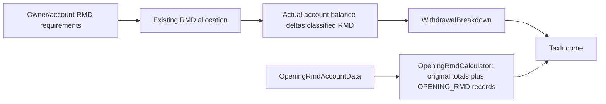

# Phase 6C.2 - Retirement income source attribution

## Existing pipeline - audited before implementation

The prior6B,6C and6C.1 reports were reviewed. Their Michigan discrepancy findings
remain unchanged; this phase must not consume source metadata to correct taxation.

- `ProjectedWithdrawalAllocator.allocateAdditionalWithdrawal`: account, type and
  owner are known in its allocation loop, then discarded into WithdrawalBreakdown.
  Normal spending, manual/fixed requested amounts and cash shortfalls use this path.
- `allocateHouseholdRmds`: owner/account RMDs remain known while executing distributions,
  then become the same four withdrawal totals. Opening RMD data retains account and
  distribution year but TaxIncomeCalculator receives only a household amount.
- `ProjectedRothConversionResult.getAllocations`: existing actual source/destination
  and owner records survive execution, but `ProjectionEngine` passes the household
  total to TaxFundingCalculator. Bracket-fill proposed totals are hypothetical and
  may exceed executable capacity; unattributed proposals must not become fake facts.
- `TaxFundingCalculator`: calculates each trial independently; only the converged
  final withdrawal should survive in the returned annual records, without trial duplicates.
- `TaxIncomeCalculator`: pension/SS amounts are summed by owner; authoritative pension
  or SS results may replace those totals. Attribution must match the existing selected
  payment and survivor semantics, not independently change the benefit calculation.
- Interest is a separate scalar in TaxIncome. Ordinary projection currently supplies
  zero; dividends and capital gains are not separately generated. Brokerage principal
  and portfolio growth must not be relabeled as investment earnings.

## New model and boundaries

Generic immutable runtime facts under domain.income, authoritative AccountType and
AccountOwnership reuse, disjoint transaction classification, optional known taxable
amount, optional year and explicit unavailable source information. Account snapshots
exclude mutable balances; opaque runtime identity must distinguish duplicate names
without adding persisted account IDs. No state eligibility flags.

Legacy scalar entry points remain compatible and explicitly unattributed. Existing
tax calculators continue to use existing aggregates; metadata cannot affect money.
No tax rules, plan schemas, wizard, UI or generic state-tax integration changes.

Implemented `domain.income.IncomeSourceAttribution`, an immutable record with:

- Kind: ordinary nonretirement withdrawal, ordinary retirement withdrawal, RMD,
  opening RMD, Roth conversion, pension, Social Security, interest, dividend,
  capital gain or other income.
- Purpose: CASH_FLOW, TAX_FUNDING, INCOME or CONVERSION. Funding a tax bill does
  not change an account's income classification.
- Optional actual owner using the authoritative AccountOwnership enum. JOINT is
  retained where supported; it is not divided into fabricated individual shares.
- Optional immutable source/destination AccountReference snapshots: name,
  authoritative AccountType, owner and existing immutable inherited-account facts.
- Gross amount, optional modeled federal taxable amount and optional calendar year.
- Optional PensionFacts: original owner, monthly benefit, survivor benefit, COLA,
  commencement and termination dates. Government/private source remains unknown.

`Account` has no persisted identifier. AccountReference uses opaque reference identity
for equality/hash code, distinguishing even same-owner duplicate account names.
It captures descriptive fields once and never exposes the underlying mutable account
or reads its changing balance. Identity is valid within a projection run; it is not
a cross-save identifier. No UUID, mutable global registry or Person identity redesign
was introduced. InheritedAccountInformation is already immutable and is retained as-is.

All collections use defensive List.copyOf or immutable stream results. Optional.empty
means unknown, not zero or qualified. No state-eligibility field exists. Amounts use
BigDecimal without additional rounding. These records do not construct federal AGI
or change any tax base; financial calculators still consume the pre-existing totals.

### Modeled taxable amounts and explicit limitations

- Tax-deferred withdrawals and executed conversions retain the amount already treated
  as fully taxable by the existing federal model. This does not establish state basis
  or retirement-subtraction eligibility.
- CASH/ROTH account withdrawals retain the current model's zero taxable treatment.
  This is not a new legal assessment of qualified versus nonqualified Roth distributions.
- Brokerage withdrawal taxable amount is unknown. Principal is not interest, dividend
  or capital gain; the existing investment model is not expanded.
- Pension payments retain the taxable amount used by the existing income calculation.
- Social Security records contain each recipient's selected gross benefit. Individual
  federally taxable shares remain unknown; the federal calculation still determines
  household taxable SS. No arbitrary owner allocation is manufactured.
- Direct interest input remains INTEREST with its known taxable amount; its owner/account
  remain unknown because that API supplies a scalar. Ordinary projection still supplies
  zero interest. Dividend/capital-gain classifications are available and tested but no
  new investment-income generator was added.

## Flow diagrams and implementation

### Ordinary withdrawal, including fixed/manual requests and cash shortfalls

`ProjectedWithdrawalAllocator.allocateAdditionalWithdrawal` captures exactly the
amount selected from each account, in existing order. Multi-account withdrawals remain
separate records. Retained non-qualified household assets have no fictitious account
or person. WithdrawalBreakdown.plus concatenates records while performing precisely
the same four additions. Existing four-argument constructors remain compatible and
have an empty source list: their callers did not provide accounts or owners.

### RMDs

`allocateHouseholdRmds` still calls the original allocation. Its private balance-delta
breakdown captures actual per-account distributions. OpeningRmdCalculator captures
the same IRA pool accounts and account-specific 401(k)/403(b) accounts used in its
existing distributed-before-projection total. OpeningRmdCalculation carries those
facts separately. Neither opening RMD cash nor statutory RMD amounts are redistributed.

Legacy portfolio-only methods (`applyAccountRmds`, `applyIraRmd`, `applyHouseholdRmds`,
`applyAdditionalWithdrawal`) keep their signatures and behavior. The production tax
pipeline uses the attributed allocation methods; an old scalar caller cannot recover
account facts it never supplied.

### Roth conversions

The actual conversion list is the authority, not a requested household target.
The snapshot records source and destination accounts and actual executed amounts.
Source exhaustion, owner continuation, partial capacity, RMD ordering and strategies
are untouched. A proposed bracket-fill scalar remains explicitly unattributed until
execution: hypothetical account transactions are not invented. Existing bracket-fill
financial trials continue unchanged and retain account-specific tax-funding sources.
Future eligibility-sensitive optimization must supply a genuine allocation preview or
apply an explicitly approved conservative policy to an unresolved proposal.

### Tax funding and tax input

`TaxFundingCalculator.calculate` has a compatible additional overload accepting
supplemental source facts. Every trial builds its own list; no history is accumulated.
Only the final recalculated withdrawal survives in TaxFundingResult and ProjectionYear.
TaxIncomeAttribution validates replacement amounts, preserves any unknown remainder,
and rejects overwriting already-attributed payments. It never changes aggregate amounts.
Known nonretirement withdrawals accompany the records without entering ordinary income.

TaxIncomeCalculator captures pension owner facts in its existing annual-income loop.
For supplied authoritative SS it uses primarySelectedBenefit/spouseSelectedBenefit,
not both own and survivor candidates. The legacy death-aware SS path obtains the
same HouseholdSocialSecurityResult from the method already called by calculateAnnualIncome;
its household amount is unchanged and replaces the preliminary SS records once.

HouseholdPensionIncomeCalculator.calculateWithSources preserves the original iteration
and addition order and returns PensionIncomeResult. Its existing calculate method
delegates and returns exactly the original total. A survivor payment identifies the
actual recipient while retaining the original pension owner and survivor election.
ProjectionEngine passes these authoritative lifetime-run facts beside their existing total.

The new getIncomeSources getters on TaxIncome, WithdrawalBreakdown, TaxFundingResult
and ProjectionYear are JsonIgnore. Plan domain types, repositories, schemas, resources,
UI and wizard are untouched. Derived annual transactions are not saved in plan JSON.

## Files changed

Created (six files):

- `PHASE-6C2-RETIREMENT-INCOME-SOURCE-ATTRIBUTION.md`
- `src/main/java/com/daviddunn/retirementplanner/domain/income/IncomeSourceAttribution.java`
- `src/main/java/com/daviddunn/retirementplanner/domain/tax/TaxIncomeAttribution.java`
- `src/test/java/com/daviddunn/retirementplanner/domain/income/IncomeSourceAttributionTest.java`
- `src/test/java/com/daviddunn/retirementplanner/domain/tax/TaxIncomeSourceAttributionTest.java`
- `src/test/java/com/daviddunn/retirementplanner/domain/projection/IncomeSourceAttributionProjectionTest.java`

Modified (twelve files):

- `src/main/java/com/daviddunn/retirementplanner/domain/income/HouseholdPensionIncomeCalculator.java`
- `src/main/java/com/daviddunn/retirementplanner/domain/withdrawal/WithdrawalBreakdown.java`
- `src/main/java/com/daviddunn/retirementplanner/domain/projection/ProjectedWithdrawalAllocator.java`
- `src/main/java/com/daviddunn/retirementplanner/domain/projection/ProjectionEngine.java`
- `src/main/java/com/daviddunn/retirementplanner/domain/projection/ProjectionYear.java`
- `src/main/java/com/daviddunn/retirementplanner/domain/rmd/OpeningRmdCalculation.java`
- `src/main/java/com/daviddunn/retirementplanner/domain/rmd/OpeningRmdCalculator.java`
- `src/main/java/com/daviddunn/retirementplanner/domain/roth/ProjectedRothConversionResult.java`
- `src/main/java/com/daviddunn/retirementplanner/domain/tax/TaxIncome.java`
- `src/main/java/com/daviddunn/retirementplanner/domain/tax/TaxIncomeCalculator.java`
- `src/main/java/com/daviddunn/retirementplanner/domain/tax/TaxFundingCalculator.java`
- `src/main/java/com/daviddunn/retirementplanner/domain/tax/TaxFundingResult.java`

The existing untracked Phase6C.1 report is preserved and was not created or edited
by this task. Temporary scripts and logs are ignored under target. No existing test
or golden fixture, tax-rule resource, Michigan calculator or generic prototype file changed.
Nothing was staged, committed or pushed.

## Tests and golden-value protection

IntelliJ bundled Maven was used throughout, always with the required project-local
`.codex-m2/repository` cache.

| Run | Tests | Skipped | Failures/errors | Log |
| --- | ---: | ---: | --- | --- |
| Before implementation, complete non-benchmark | 2001 | 11 | 0/0 | target/phase6c2-before.log |
| First affected domain regression | 38 | 0 | 0/0 | target/phase6c2-first-regression.log |
| Final targeted tax/Roth/RMD/single-person/golden and new attribution | 548 | 0 | 0/0 | target/phase6c2-targeted-final.log |
| After implementation, complete non-benchmark | 2036 | 11 | 0/0 | target/phase6c2-nonbenchmark.log |
| Complete benchmark-inclusive suite | 2057 | 15 | 0/0 | target/phase6c2-full.log |

There are **35 new focused tests**: IncomeSourceAttributionTest (20),
TaxIncomeSourceAttributionTest (10), IncomeSourceAttributionProjectionTest (5).
The targeted run contains those 35 plus 513 existing tests, including all isolated
state-tax tests selected by the Tax pattern. All new focused tests also passed in
the complete non-benchmark run. Initial new fixture/compilation errors were corrected
without changing production calculations or weakening existing expectations.

Coverage includes primary/spouse IRA withdrawals; mixed IRA/401(k) sources; both
owners' IRA/403(b) RMDs; actual single-owner and multi-owner conversions with partial
capacity; same-owner destinations; inherited facts; duplicate-name identity; retained
household funds; brokerage funding; final-only converged funding amounts; partial
legacy attribution; interest/dividend/gain separation; pension survivors; selected
SS survivor receipt; genuine single-person SS; runtime serialization exclusion;
single/couple multi-year final-tax-input reconciliation; mixed-age RMD eligibility;
and authoritative lifetime pension attribution.

The multi-year attribution tests reconcile actual source amounts independently to
annual RMD, opening RMD, conversion, SS, tax funding and total withdrawal outputs.
The couple test also compares all original financial golden rows byte-for-byte.

**No existing expected financial value was changed.** The before/after non-benchmark
suites passed the same federal and Michigan tax, total tax, RMD, conversion, withdrawal,
ending asset, net worth, after-tax estate, deterministic/longevity-weighted analyzer,
seeded Monte Carlo and reporting/PDF expectations. Saved-plan and wizard regressions
also passed unchanged. Successful regressions preserve existing Michigan behavior;
they do not certify the deferred Michigan tax defects as correct law.

The full benchmark-inclusive suite passed in 5m50s: 2042 passed, 15 skipped.
Its 2022 pre-existing tests passed without any expectation changes, including the
original isolated prototype and Michigan discrepancy-comparison fixtures.
`git diff --check` passed. All six new files also passed `git diff --no-index --check`
with CRLF recognized as line endings, retaining trailing-whitespace, blank-EOF and
space-before-tab checks. There are no staged changes.

## Performance and remaining unknowns

There is no shared mutable ledger, global source cache, network access, rule parsing
or new persistence work. Source records are created per nonzero account flow. Trial
records are bounded by the selected accounts and are discarded between iterations;
only final annual records remain. Account identity is stable for concurrent read-only
projection runs. No financial entity is mutated by source capture.

The non-benchmark baseline took 2m10s and the after run 2m11s. This is a coarse suite
observation with 35 additional tests, not an isolated performance measurement or a
claim of zero allocation cost. The full suite exercises existing analysis/Monte Carlo
benchmarks; no speculative optimization or timing-based test was introduced.
The existing inflation Monte Carlo benchmark reported fixed 16.131s / 5.40 MiB
retained heap delta and longevity 13.359s / 15.12 MiB. Those are current-workload
observations, not a controlled before/after attribution benchmark. All benchmark
checks passed; further optimization should be based on an approved measured workload
without collapsing owner/account facts.

Remaining facts not available include employer-plan separation/retirement eligibility,
government/private/military pension source, disability-specific qualifications,
state/federal IRA basis differences, qualified versus nonqualified Roth facts beyond
the existing federal approximation, and municipal-bond/investment sourcing. No 457
account type exists. Inherited status and the original owner's known dates/relationship
are preserved, but they do not automatically establish any state's eligibility.
SS taxable income remains a household federal result. Joint amounts are not silently
split between people. Hypothetical conversion proposals and legacy scalar callers
remain explicitly unattributed where actual source allocations are unavailable.

## Conservative eligibility policy and next step

Future tax calculators should apply exclusions only to known qualifying sources,
deny exclusions to known nonqualifying sources, and retain UNKNOWN as unknown.
The isolated prototype can return UNSUPPORTED for material missing facts. For the
production projection path, recommend an explicitly approved conservative fallback:
keep federally taxable unknown retirement income in the Michigan tax base and do
not grant an unproven subtraction; expose the limitation through an approved reporting
mechanism. This policy is a recommendation, not implemented financial behavior.

Phase6C.3 can now use actual account/owner facts rather than blanket household
retirement totals, subject to independent rule verification and approval of unknown
eligibility handling. An eligibility-sensitive bracket-fill trial must likewise
resolve a hypothetical source allocation or use the approved conservative policy.
Source attribution alone does not resolve the legal or historical-rule audit gates.

The original Michigan findings are deliberately preserved: ordinary interest still
reaches the production retirement-subtraction aggregate; the 2026 production resource
still uses 40762/81524 with undocumented provenance rather than the independently
published 67610/135220 limits; personal exemptions are still absent. No Michigan
correction occurred. The generic multistate calculator remains isolated.

Await separate approval before correcting Michigan taxation or integrating multistate
taxes. No Phase6D work was performed.

The isolated information-preservation implementation and regression verification are
complete. All financial golden values and production Michigan behavior are unchanged.
