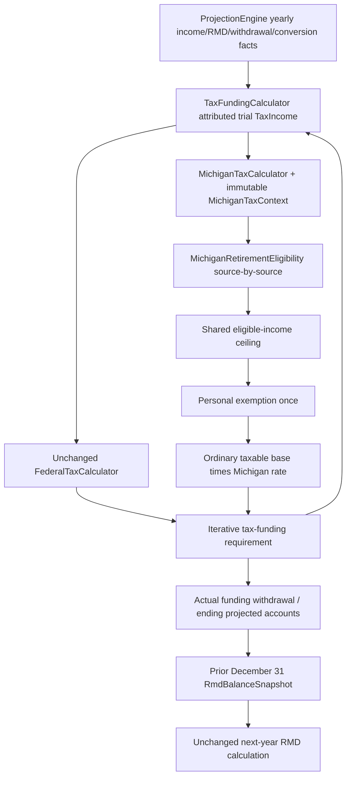

# Phase 6C.3 — Michigan production tax correction

## Status and scope

October 11, 2026. The bounded production Michigan correction is implemented.
All required verification is complete; final counts are listed below. The user approved future RMD changes only
when verified Michigan tax corrections change prior-year eligible account balances.
The earlier gate was resolved by that approval; no RMD rule or algorithm was changed.

Phase 6C1, 6C2, 6C and 6B reports were read before implementation. The existing
Michigan path remains the production calculator. The generic eight-state calculator
remains isolated. Phase 6D was not started. There are no UI, plan JSON, federal tax,
RMD, mortality, Monte Carlo sampling, or multistate-routing changes.

## Root causes and exact production path

All paths below are under `src/main/java/com/daviddunn/retirementplanner/` unless noted.

1. **Classification:** `domain/tax/TaxFundingCalculator.calculate` previously passed
   `TaxIncome.getOrdinaryIncomeBeforeSocialSecurity()` to the scalar
   `domain/tax/state/michigan/MichiganTaxCalculator.calculate`. That value includes
   pensions, tax-deferred withdrawals, conversions **and interest**. The entire value
   then received `MichiganRetirementDeductionCalculator.calculate`'s subtraction.
   Interest-only income could consequently produce zero Michigan tax. The correction
   preserves ordinary income in the taxable base and assesses a separate eligible
   retirement pool using actual Phase 6C2 attribution. Merely changing the caller to
   a retirement-only scalar would incorrectly remove interest from the tax base.
2. **Caps:** `src/main/resources/rules/government-rules-2026.json` contained literal
   40762 / 81524 values. Phase 6C1 traced them to the original seed resource, not an
   inflation calculation, supported historical-year table, or documented alternate
   election. Their legal provenance remains unknown. The 2026 baseline is corrected
   to Treasury's 67610 / 135220; no historical rule file was overwritten.
3. **Exemptions:** `domain/rules/MichiganTaxRules` and the Michigan calculation had
   no personal-exemption parameter/application. This was not supplied by federal
   standard deductions or another Michigan service. The resource now supplies 5900
   per represented filer, applied once after the qualifying retirement subtraction.

The production path is:

`RothConversionBracketFillCalculator.calculateConversion` uses the same funding
service. It now previews source allocations through the existing same-owner
`ProjectedPortfolioRothConverter.convertHousehold` solely to obtain facts for
hypothetical conversion taxes. The preview portfolio is discarded. Original trial
portfolio, proposed scalar amount, target, tolerance, iteration equations, source
ordering, capacity limit, and final actual execution remain unchanged. The caller
passes the exact existing execution-owner set, independently of Michigan eligibility.

## Verified 2026 rules and sources

- Rate **4.25%**; personal exemption **5900**; qualifying shared private-retirement
  ceiling **67610 Single / 135220 MFJ**. Treasury's 2026 withholding guide was
  independently reopened and checked, including the full 2026 phase-in for recipients
  born after 1945. [Michigan Treasury 2026 Form 446](https://www.michigan.gov/taxes/-/media/Project/Websites/taxes/Forms/SUW/TY2026/446_Withholding-Guide_2026.pdf).
- Ordinary IRA distributions generally require age **59½ at receipt**, with specified
  disability/death/periodic-payment exceptions. The application does not establish
  those exceptions. [Treasury individual-plan qualification](https://www.michigan.gov/taxes/iit/tax-guidance/tax-situations/retirement-and-pension-benefits/qualified-pension-distribution-requirements/individual-plans).
- Federally taxable IRA-to-Roth conversions may qualify at age 59½, within the same
  subtraction limit. Conversion income remains taxable before the subtraction and
  is counted once. [Treasury conversion guidance](https://www.michigan.gov/taxes/questions/iit/accordion/roth/are-conversions-from-a-regular-ira-to-a-roth-ira-subject-to-michigan-individual-income-tax-1).
- A rollover does not erase the original plan's qualification restrictions. For
  example, nonqualifying deferred compensation rolled into an IRA remains
  nonqualifying. RolloverIRA provenance is therefore UNKNOWN in this model.
  [Treasury RAB 2017-21](https://www.michigan.gov/taxes/rep-legal/rab/2017-revenue-administrative-bulletins/revenue-administrative-bulletin-2017-21),
  [Treasury RAB 2026-1](https://www.michigan.gov/taxes/rep-legal/rab/2026-revenue-administrative-bulletins/revenue-administrative-bulletin-2026-1).
- Public/private pension distinctions, contribution conditions and alternate elections
  matter; neither age nor an RMD label establishes employer-plan qualification.
  [Treasury qualified distribution guidance](https://www.michigan.gov/taxes/questions/iit/accordion/subtract/are-distributions-from-a-deferred-compensation-plan-an-allowable-subtraction-1).
- Social Security remains excluded from the Michigan base, including the federally
  taxable portion. Qualified/nontaxable Roth withdrawals are not added back. Ordinary
  taxable investment income does not enter the retirement subtraction pool.
  [Treasury retirement additions/subtractions](https://www.michigan.gov/taxes/iit/tax-guidance/tax-situations/retirement-and-pension-benefits/additions-and-subtractions).

This is a retirement-planning estimate, not a complete Michigan return or a claim
that every possible deduction/election is modeled. Alternative rules remain explicit
limitations rather than fabricated exclusions.

## Implementation and conservative assumptions

`MichiganTaxContext` snapshots date, actual household owners, owner birth dates,
active owners and optional authoritative pension facts. It contains no JavaFX objects
or mutable plan. It is captured once per annual funding calculation and reused by
trial/final taxes and bracket-fill trials. Lifetime runs supply their actual effective
owner/pension context, rather than reverting to persisted death assumptions.

`MichiganRetirementEligibility.assess` returns a source decision, eligible amount and
reason: QUALIFYING, NONQUALIFYING or UNKNOWN. Only known taxable, owner-attributed
ordinary Traditional IRA distributions/conversions at the eligible receipt age enter
the pool. Each spouse is assessed separately; only then is the shared household limit
applied. An RMD uses its actual underlying source and does not establish eligibility
by itself. Personal exemptions use represented filers: one Single, two MFJ where
both household members exist. There is no dependent model.

Conservative **no subtraction** applies to:

- 401(k)/403(b) distributions when qualifying contribution composition is unavailable.
- Rollover IRA income when original plan qualification is unavailable.
- Pensions, whose current domain has ownership/survivor terms but no public/private
  or other source-qualification facts. No new pension-source UI was invented.
- Inherited-account qualification, missing owner/date/account/taxable amount,
  legacy unattributed income, and deceased-owner/successor qualification.
- Early IRA distributions without established statutory exceptions. For annual flows,
  eligibility uses the projection receipt-date boundary; pre-projection opening RMD
  receipts use January 1 conservatively because actual historical receipt dates are
  unavailable. Becoming eligible later does not retroactively qualify earlier receipts.

Ordinary Traditional IRA records retain the application's existing ordinary-IRA
representation and modeled taxable amount; they do not certify unrecorded rollover
history or basis. Explicit RolloverIRA/inherited records are not promoted to ordinary
qualifying IRAs. State basis and exceptional histories remain modeling limitations.

`MichiganTaxCalculation` retains ordinary income, eligible income, applied exemption,
source decisions and limitation strings. `usedConservativeEligibility()` identifies
UNKNOWN decisions. `ProjectionYear.michiganTaxCalculation()` preserves that immutable
result as an optional, runtime-only diagnostic (`@JsonIgnore`), without UI changes.
The old aggregate-only API is deprecated and cannot infer qualification/exemptions.
Its callers must supply attributed income and context for household calculations.

## Tax years, deaths, pensions and rounding

Only the 2026 government-rule resource is supported. Existing
`MichiganTaxRuleProjectionService.project` and `TaxParameterProjectionService.project`
index dollar parameters by the existing plan inflation assumption, rounded to whole
dollars, holding the rate constant. The new exemption follows the same policy.
For example, 2.5% indexing in 2027 produces Single cap 69300, MFJ cap 138601 and
personal exemption 6048. Years at/before 2026 reuse the baseline under the existing
policy; this is **not verified historical-year taxation**. Future indexed numbers are
planning assumptions rather than a claim about enacted future law. The resource
retains the existing rulesVersion label; this report records the correction revision.

The configured filing status applies through the modeled death year; later years use
Single under existing engine semantics. A deceased owner's distribution is not
silently reassigned to a survivor for eligibility. Michigan pension amounts use the
existing `HouseholdPensionIncomeCalculator.calculateWithSources` for actual survivor
cash where needed. In legacy deterministic death paths, the existing federal pension
scalar can still differ from actual survivor cash; that federal limitation is **not
corrected here**. Michigan's state-only adjustment avoids taxing a vanished original
pension. Lifetime runs already supply authoritative pension income to both taxes.

Michigan multiplication retains existing BigDecimal precision, with no new return-style
rounding. Fixture comparisons and displayed report values use HALF_UP cents. Funding
retains its existing 0.01 convergence tolerance and 100-iteration bound.

## Original comparison results

| Scenario | Old tax | Corrected tax | Verified target |
| --- | ---: | ---: | ---: |
| Single, interest 10000 | 0.00 | 174.25 | 174.25 |
| MFJ, interest 20000 | 0.00 | 348.50 | 348.50 |
| Single, qualifying IRA 100000 | 2517.62 | 1125.83 | 1125.83 |
| MFJ, qualifying IRA 200000 | 5035.23 | 2251.65 | 2251.65 |

The four independent targets are unchanged. Prototype Michigan validation remains
independent, and its original discrepancy columns remain in the comparison fixture
for traceability. No generic calculator rules or other-state behavior were changed.

## Golden fixtures and regression safeguards

**40 independent production worksheet fixtures** in `MichiganAttributedGoldenTest`
start from the 32 Phase 6C1 scenarios, covering interest, qualifying IRA/conversions,
Social Security, mixed incomes, Single/MFJ limits ±1, large distributions and mixed
owner ages around 59½. Unknown pension/employer cases use explicit conservative
worksheets rather than pretending the old assessed-qualifying pension worksheets
establish missing source facts. Four additional mixed pension/conversion/interest
worksheets verify only proven IRA income shares the limit.

Additional focused tests:

- `MichiganEligibilityBoundaryTest`: 10 classification/eligibility/configuration tests,
  including interest/dividend/gain/other, ordinary/RMD/opening/conversion shared limits,
  rollover UNKNOWN, qualified Roth, and missing/negative exemption rejection.
- `MichiganRmdFeedbackTest`: 5 tests (including Single/couple parameterization) prove
  identical-input RMD invariance, the numeric divisor example, actual funding feedback,
  opening-RMD invariance, owner preservation and RMD-before-conversion ordering.
- `MichiganAttributedProjectionTest`: 4 tests cover realistic Single/couple multi-year
  pension/SS/IRA/conversion/RMD projections, indexed exemptions, interest injected only
  at the tax boundary, death/exemption transitions, and fixed-input federal invariance.
- `MichiganTaxFeedbackRegressionTest`: 1 seeded fixed/longevity regression checks over
  1000 annual outcomes with independent Michigan worksheets, reconstructed federal
  facts and prior-account-balance RMD/divisor checks.

Total new focused tests: **60**. No normal projection investment ledger was expanded:
the current engine does not separately generate positive interest/dividend/gain flows.
The mixed-interest multi-year check explicitly tests the attributed annual tax boundary.

## Financial changes and traceability

[PHASE-6C3-FINANCIAL-IMPACT.csv](PHASE-6C3-FINANCIAL-IMPACT.csv) records every reviewed
updated expectation cell: Scenario/Test, Metric, Old, New, Difference,
DirectOrFeedback, Cause and UpdatedExpectation. The ledger has **733 rows**. There are **97 reviewed expectation
cells**, including 3 nonnumeric complete financial fingerprints. Counts include
parameterized comparison cells and duplicated UI assertions, not 97 independent
plans. The ledger also contains **316 individual downstream RMD changes** captured
from paired seeded projections and the rounding-plan fixture. Every one is categorized
BALANCE_FEEDBACK_EFFECT, never an RMD rule correction.

The four categories are DIRECT_MICHIGAN_TAX_CORRECTION, TAX_FUNDING_FEEDBACK,
BALANCE_FEEDBACK_EFFECT and LATER_YEAR_TAX_FEEDBACK. Later-year paired tax rows may
combine the direct new-rule effect with feedback from changed income/RMD/funding;
the label flags the feedback year and does not attribute the entire difference solely
to an RMD. Categories are causal labels, not additive decomposition amounts.

Before changing expectations, original production classes and the original government
resource were extracted read-only from HEAD and compiled into ignored target override
classes. They reproduced all original seeded fingerprints and UI tail values. Paired
captures then used the same scenarios, seeds, income, market paths and mortality
streams with corrected classes. No Git history or workspace source was restored/reset.

Selected impacts (cents displayed):

| Scenario/Test | Metric | Old | New | Difference | Direct/Feedback | Cause |
| --- | --- | ---: | ---: | ---: | --- | --- |
| Approved Single worksheet | MI tax | 2269.10 | 797.11 | -1471.99 | DIRECT_MICHIGAN_TAX_CORRECTION | Cap/exemption |
| Approved Single worksheet | Funding | 14152.70 | 12265.52 | -1887.18 | TAX_FUNDING_FEEDBACK | Lower combined tax |
| Approved Single worksheet | Federal tax | 11883.59 | 11468.42 | -415.17 | TAX_FUNDING_FEEDBACK | Smaller taxable funding withdrawal |
| Approved Single worksheet | Ending IRA | 905847.30 | 907734.48 | 1887.18 | BALANCE_FEEDBACK_EFFECT | Funding balance |
| Approved Single worksheet | Next RMD | 39556.65 | 39639.06 | 82.41 | BALANCE_FEEDBACK_EFFECT | Same divisor 22.9 |
| 22% bracket fill | Conversion | 200779.78 | 203563.35 | 2783.57 | TAX_FUNDING_FEEDBACK | Same federal target, smaller tax cost |
| Pension-only cash settlement | Total tax | 4280.00 | 6838.50 | 2558.50 | DIRECT_MICHIGAN_TAX_CORRECTION | Unknown pension no unproven subtraction |
| Couple golden 2030 | MI tax | 4500.31 | 4977.59 | 477.28 | DIRECT_MICHIGAN_TAX_CORRECTION | Pension conservative; IRA qualified |
| Couple golden 2030 | Ending assets | 1813387.61 | 1811878.34 | -1509.27 | BALANCE_FEEDBACK_EFFECT | Retained cash and growth |
| Couple golden 2030 | After-tax estate | 1618449.75 | 1616940.49 | -1509.26 | BALANCE_FEEDBACK_EFFECT | Existing estate calculation |
| Single representative 2030 | Ending assets | 1287329.23 | 1290236.45 | 2907.22 | BALANCE_FEEDBACK_EFFECT | Lower tax and retained-cash growth |
| Chart rounding plan 2038 | RMD | 49307.01 | 49459.60 | 152.59 | BALANCE_FEEDBACK_EFFECT | Different prior IRA balance, same divisor |

In the 22% fixture, the unchanged federal target is 211400 taxable / 243600 ordinary.
Federal tax is approximately 35932; corrected MI is
`(243600 - 135220 - 11800) * .0425 = 4104.65`.
Approximately 40036.65 pays tax, leaving 203563.35 to convert. The target is still met
within the original tolerance. Ending Roth changes by that actual conversion amount.

For the federal-funding fixture, the known IRA qualifies but its 18000 pension has
unknown qualification. MI is `(18000 - 11800) * .0425 = 263.50`.
Funding solves `W = (43000 + W - 32200) * .10 + 263.50`.
Thus W becomes 1492.78, AGI 44492.78, federal taxable 12292.78 and federal tax 1229.28.
Those federal changes are funding feedback, not federal rule changes.

The representative couple has ample guaranteed cash/retained brokerage assets.
Its federal taxes, fixed conversions and RMD dollar values stay exactly unchanged;
only state tax and retained-cash/balance/estate derivatives change. Small later heir-tax
precision differences come from the unchanged proportional estate calculation.
SS-only golden files, benefit calculations and mortality weights were not changed.
Seeded integrated financial outcomes legitimately change; random streams do not.
The mixed poor-plan complete Monte Carlo fingerprint remains exactly unchanged.
PDF/export and chart algorithms were not changed; their affected financial inputs
were reviewed, while existing structural/rendering/report tests remain in force.

## RMD protection

For the documented example, `905847.30 / 22.9 = 39556.65` and
`907734.48 / 22.9 = 39639.06`, using the same existing HALF_UP cents calculation.
The unchanged `RmdCalculator` also produces identical results for identical balances
at ages 73, 76, 77 and 85 with old versus corrected Michigan rule objects.

No file under `domain/rmd` was modified. Start-age tables, factor tables, owner
aggregation, prior December 31 snapshots, opening distributions, statutory annual
versus pre-projection/remaining amounts, FIRST_HOUSEHOLD_RMD and RMD-before-conversion
remain unchanged. Existing owner/couple/opening/Roth regression tests are retained.
Future RMD changes in the impact ledger follow changed eligible balances only.

## Performance

Same sequential seed 417, same two-person fixture, 5000 scenarios per mode:

| Mode | Before | After | Change | Retained heap before/after |
| --- | ---: | ---: | ---: | --- |
| Fixed Monte Carlo | 17.877s | 17.747s | -0.73% | 5.42 / 5.42 MiB |
| Longevity Monte Carlo | 14.023s | 14.788s | +5.46% | 15.13 / 15.13 MiB |

These are single-run observations, not a statistically controlled performance claim.
No major repeated-scan/runtime regression was observed. The immutable Michigan
context is reused per funding calculation; rules are loaded through the existing
repository, not per tax trial. A reusable converter obtains bracket-fill trial facts.
No mutable global calculation state or network tax dependency was introduced.

## Exact files created

- `PHASE-6C3-MICHIGAN-PRODUCTION-TAX-CORRECTION.md`
- `PHASE-6C3-FINANCIAL-IMPACT.csv`
- `src/main/java/com/daviddunn/retirementplanner/domain/tax/state/michigan/MichiganTaxContext.java`
- `src/main/java/com/daviddunn/retirementplanner/domain/tax/state/michigan/MichiganRetirementEligibility.java`
- `src/test/java/com/daviddunn/retirementplanner/domain/tax/state/michigan/MichiganAttributedGoldenTest.java`
- `src/test/java/com/daviddunn/retirementplanner/domain/tax/state/michigan/MichiganEligibilityBoundaryTest.java`
- `src/test/java/com/daviddunn/retirementplanner/domain/projection/MichiganAttributedProjectionTest.java`
- `src/test/java/com/daviddunn/retirementplanner/domain/projection/MichiganRmdFeedbackTest.java`
- `src/test/java/com/daviddunn/retirementplanner/app/montecarlo/MichiganTaxFeedbackRegressionTest.java`

## Exact existing files modified

Production/resource:

- `src/main/java/com/daviddunn/retirementplanner/domain/rules/MichiganTaxRules.java`
- `src/main/resources/rules/government-rules-2026.json`
- `src/main/java/com/daviddunn/retirementplanner/domain/tax/state/michigan/MichiganTaxCalculator.java`
- `src/main/java/com/daviddunn/retirementplanner/domain/tax/state/michigan/MichiganTaxCalculation.java`
- `src/main/java/com/daviddunn/retirementplanner/domain/tax/state/michigan/MichiganTaxableIncomeCalculator.java`
- `src/main/java/com/daviddunn/retirementplanner/domain/tax/state/michigan/MichiganTaxRuleProjectionService.java`
- `src/main/java/com/daviddunn/retirementplanner/domain/tax/TaxFundingCalculator.java`
- `src/main/java/com/daviddunn/retirementplanner/domain/roth/RothConversionBracketFillCalculator.java`
- `src/main/java/com/daviddunn/retirementplanner/domain/projection/ProjectionEngine.java`
- `src/main/java/com/daviddunn/retirementplanner/domain/projection/ProjectionYear.java`

Tests/fixtures, changed only for attributed setup or traced Michigan financial effects:

- `src/test/java/com/daviddunn/retirementplanner/domain/tax/state/michigan/MichiganTaxCalculatorTest.java`
- `src/test/java/com/daviddunn/retirementplanner/domain/tax/TaxFundingCalculatorTest.java`
- `src/test/java/com/daviddunn/retirementplanner/domain/tax/state/simplified/MichiganPrototypeComparisonTest.java`
- `src/test/java/com/daviddunn/retirementplanner/domain/projection/ProjectionEngineTest.java`
- `src/test/java/com/daviddunn/retirementplanner/domain/projection/SinglePersonCoreProjectionTest.java`
- `src/test/resources/single-person-stage2-couple-golden.txt`
- `src/test/java/com/daviddunn/retirementplanner/domain/projection/HouseholdCashSettlementProjectionTest.java`
- `src/test/java/com/daviddunn/retirementplanner/domain/projection/SurvivorMechanicsCharacterizationTest.java`
- `src/test/java/com/daviddunn/retirementplanner/ui/charts/ProjectionChartReconciliationTest.java`
- `src/test/java/com/daviddunn/retirementplanner/ui/charts/ProjectionChartViewTest.java`
- `src/test/java/com/daviddunn/retirementplanner/app/montecarlo/MonteCarloInflationRegressionTest.java`
- `src/test/java/com/daviddunn/retirementplanner/app/montecarlo/MonteCarloMortalityResultsTest.java`
- `src/test/java/com/daviddunn/retirementplanner/ui/montecarlo/MonteCarloMortalityUiFixtures.java`

Ignored `target` holds audit source copies, paired captures, Maven logs, benchmark
outputs and preview artifacts. Those are diagnostic outputs, not additional shipped
production models or persistence fields.

## Remaining limitations and Phase 6D recommendation

Age-67 alternative deductions, public-pension elections/unlimited categories,
pre-1946 investment-income alternatives, employer contribution qualification,
rollover origin, inherited/successor eligibility, state-specific basis and early
receipt exceptions remain unmodeled or conservatively treated. No dependent inputs
were invented. Detailed transaction dates and state-basis facts are unavailable.
Existing deterministic post-death account execution still may use deceased-owned
accounts; this phase neither transfers ownership nor grants unproven survivor
qualification. Existing federal legacy pension/death semantics are a separate issue.

Michigan is suitable for a **bounded** next integration design after review of these
explicit conservative limitations. Phase 6D should introduce state selection/routing
only with clear state readiness and diagnostic/fallback behavior, retaining this
Michigan production path and the verified generic-prototype boundaries. It must not
silently claim full Michigan return accuracy or promote unsupported states/scenarios.
No Phase 6D implementation has begun. Await user approval before integration.

## Verification results

- Pre-change affected baseline: 548 passed, 0 failures/errors/skips.
- New focused coverage: 60 passed, 0 failures/errors/skips.
- Directly affected selection: **717 passed**, 0 failures/errors/skips.
- Complete non-benchmark suite: 2096 run, **2085 passed, 11 skipped**, 0 failures/errors.
- Complete benchmark-inclusive suite: 2117 run, **2102 passed, 15 skipped**, 0 failures/errors.
- Dedicated before/after benchmark: 1 passed each, 0 failures/errors/skips.
- `git diff --check`: passed (exit 0). New-file whitespace checks: no diagnostics.

All regressions passed with no unexplained financial drift. Nothing was staged, committed or pushed.
