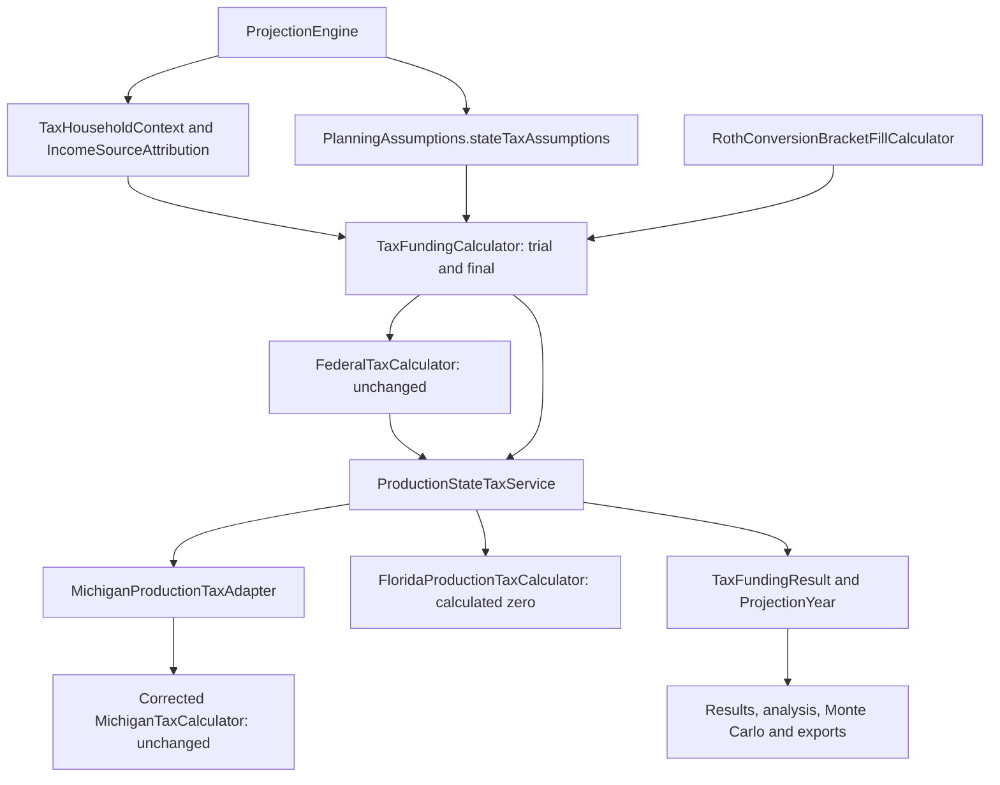

# Phase 6D Stage 1 — Michigan and Florida production state taxes

## Scope and architecture audit

Production selection is limited to Michigan and Florida, for full-year residence in
the selected state throughout the projection. The other six research states remain
disabled in production. Effective-rate override is deferred. This is a retirement
planning estimate, not a tax return.

The seven requested prior reports/impact artifacts were reviewed. The Phase 6C3
impact ledger contains 733 rows, including 97 reviewed expectation cells; it was
not changed. The corrected Michigan implementation and its expectations are the
baseline for this stage.

The live annual boundary was `domain/tax/TaxFundingCalculator.calculate`: both
trial and final taxes called `FederalTaxCalculator` and `MichiganTaxCalculator`.
`domain/roth/RothConversionBracketFillCalculator.calculateConversion` uses another
instance of that same funding service, so changing only the final annual caller
would have left conversion targeting on Michigan. Both paths now carry the same
state configuration and household facts.

`domain/projection/ProjectionEngine.calculateProjectionYear` already preserves
`IncomeSourceAttribution`, authoritative annual Social Security, opening RMD facts,
and lifetime-run pension/death facts. These facts and all funding arithmetic remain
unchanged. Government-rule projection still indexes Michigan rules under the
existing policy; neither the 2026 resource nor the Michigan rule projector changed.

The existing `domain/tax/state/StateIncomeTaxCalculator` had no implementation or
live caller. It now defines the production request/result contract. The standalone
eight-state calculator remains separate research functionality; it is not a second
production route and does not determine which states the application exposes.

All Java paths below are under
`src/main/java/com/daviddunn/retirementplanner/` unless explicitly stated otherwise.

## Common production boundary



- `domain/tax/state/TaxHouseholdContext` is an immutable snapshot of receipt date,
  owner DOBs, actual household owners, active owners, and optional authoritative
  pension facts. Its capture policy matches the existing Michigan context. It owns
  no mutable Person, Account, RetirementPlan, or JavaFX control.
- `StateTaxCalculationRequest` contains tax year, canonical
  `domain.rules.FilingStatus`, household facts, attributed `TaxIncome`, the federal
  result from that same trial, projected government rules and state assumptions.
- `ProductionStateTaxService.calculate` uses an immutable MI/FL registry. No state
  branch was added to withdrawal, RMD, Monte Carlo, or analyzer algorithms.
- `MichiganProductionTaxAdapter.calculate` translates the generic facts to the
  existing Michigan context and calls the unchanged four-argument calculator.
- `FloridaProductionTaxCalculator.calculate` returns a structured `CALCULATED`
  zero, method and residency limitation. It does not manufacture Michigan deduction
  or taxable-income details.
- `ProductionStateTaxResult` carries jurisdiction, method, status, tax and immutable
  limitations. Optional Michigan diagnostics preserve the full existing eligibility
  decisions for report/compatibility consumers, rather than fabricating them for
  Florida. Generic financial callers consume only the state tax amount.
- `TaxFundingResult.getStateTaxCalculation` and
  `ProjectionYear.getStateIncomeTax/getStateTaxJurisdiction/stateTaxCalculation`
  expose the common result. Legacy Michigan constructors/accessors remain for
  existing Michigan fixtures and compatibility. New production/report consumers
  use the generic accessors; `michiganTaxCalculation()` is empty for Florida.

The compatibility funding/bracket-fill overloads default explicitly to Michigan and
delegate through the same production service. There is no retained independent
legacy production routing path.

Funding still uses its existing 100-iteration limit, 0.01 tolerance, allocation
ordering, dry trial source records and one final allocation. Additional withdrawals
enter the next federal/state trial normally. No extra state-specific funding loop
or duplicate attribution record was introduced.

## Domain, persistence and legacy plans

`domain/model/StateTaxAssumptions` is an immutable value stored once on
`PlanningAssumptions`. `StateTaxJurisdiction` contains only MI and FL. The method
enum reserves `EFFECTIVE_RATE_OVERRIDE`, but constructing/loading that method is
rejected in this release. Simplified mode rejects a non-null override rate.

Illustrative JSON, with unrelated assumption fields omitted:

```json
{
  "planningAssumptions": {
    "stateTaxAssumptions": {
      "jurisdiction": "FL",
      "calculationMethod": "SIMPLIFIED_STATE_ESTIMATE",
      "effectiveRateOverride": null
    }
  }
}
```

An absent group in legacy plans defaults to MI/simplified/null. Explicit unknown
states (including numeric enum ordinals), missing required fields in a supplied group, unsupported methods, or a
supplied override fail validation. `JsonRetirementPlanRepository.load` rejects an
explicit null group, including one in a baseline snapshot. It validates a tree but
deserializes the original byte tokens to preserve the existing BigDecimal precision
and scale; an intermediate tree conversion caught by the existing persistence test
was corrected, with no expectation update.

The legacy state/local percentage fields remain readable for compatibility. They
are not an override or a second functional state setting. The existing state-rate
label/help now explicitly identifies its legacy role.

`RetirementPlanScenarioCopyService.copy` naturally includes the new group in its
existing Jackson copy. `RetirementPlanSnapshot` and `BaselineProjectionService`
retain it through existing assumptions ownership. Existing baseline deep-isolation
limitations were not redesigned. State selection survives both reconstruction
sites in `ResultsSummaryView` and the survivor-age reconstruction in
`MonteCarloStrategyComparisonRunService`.

## Wizard, existing editor and reporting

`AssumptionsView` provides the same MI/FL `State of Residence *` control in its
normal editor and compact wizard presentation. Required explanation, inline
validation/focus, direct-control tooltip and existing atomic Apply/Cancel semantics
are retained. Selection changes reach the existing dirty/cache-invalidating callback
only after Apply. No help icon was added. `ReviewWizardStep` displays the actual draft
state and the full-year/simplified interpretation.

File → New still uses the isolated wizard draft. Tests exercise genuine Single and
couple Florida creation through that menu, commit to the controller, existing tabs,
explicit save/reload and projection. Creation does not auto-save. Canceling a
substantially populated Florida draft preserves the active Michigan plan, dirty flag
and source revision.

Results/Yearly Detail identify the jurisdiction and state income-tax amount; Florida
details display `Florida State Income Tax` with zero. Results Summary identifies the
state from the completed projection rather than an unrelated mutable selection.
The console report uses the generic label. Projection PDFs add state/method
assumptions and a compact annual state-tax table. CSVs use `State Income Tax`, append
state/method columns, and leave Michigan-only detail cells blank for Florida. CSV
consumers should account for the renamed header and appended metadata columns.

`SocialSecurityAnalyzerInputSummary`, `IndividualReportContext`,
`MonteCarloRunService` and paired comparison run metadata capture jurisdiction/method
with the existing frozen result-time metadata. General Monte Carlo descriptions now
say federal plus selected-state taxes. SS-only benefit analysis remains independent
of taxes; integrated/weighted analysis and all Monte Carlo projections continue
through the same engine/service. No benefit, market or mortality algorithm changed.

## Michigan preservation

No Michigan calculator, eligibility class, rules, rate, exemption, subtraction,
government resource, prototype dataset or existing financial expectation changed. The 2026 4.25% rate, 5,900 personal exemption and 67,610/135,220 Single/MFJ retirement caps remain unchanged.
The adapter retains source/owner-specific qualification, conservative unknown
pension/employer treatment, interest separation and the existing projection-indexing
and survivor filing-status policies.

| Original independent case | Phase 6C3 baseline | This stage |
| --- | ---: | ---: |
| Single, interest 10,000 | 174.25 | 174.25 |
| MFJ, interest 20,000 | 348.50 | 348.50 |
| Single, qualifying IRA 100,000 | 1,125.83 | 1,125.83 |
| MFJ, qualifying IRA 200,000 | 2,251.65 | 2,251.65 |

Existing complete financial fingerprints, couple golden rows, independent Michigan
worksheets, source-attribution, RMD and funding regressions remain in force. **Zero
existing financial expected values were updated.** One existing UI assertion changed
from absence of a named jurisdiction to Michigan/full-year presentation.

## Florida scope and authoritative basis

Florida's individual income-tax estimate is zero for the modeled Social Security,
pension, IRA/employer distributions, RMDs, conversions, Roth distributions,
interest/dividend/capital-gain and mixed-income facts. No exemption is needed to
obtain that zero. The federal calculation remains independent at fixed income.

The [Florida Department of Revenue personal-income-tax FAQ](https://floridarevenue.com/faq/Pages/FAQDetails.aspx?FAQID=1466)
states there is no personal income tax. Its
[capital-gains FAQ](https://floridarevenue.com/faq/Pages/FAQDetails.aspx?FAQID=1307&IsDlg=1)
confirms no individual capital-gains tax. The
[2026 Florida Statutes, Chapter 220](https://www.flsenate.gov/Laws/Statutes/2026/Chapter220/All)
distinguish corporate taxation from the protection of natural persons. Reviewed
2026-10-12. These support the individual/full-year scope, not business, property,
sales, domicile, part-year or other tax estimates. Future projection years extrapolate
the current no-individual-tax policy; no future law prediction is asserted.

There are **20 independent Florida income-category fixtures**: ten category/mixed
cases for each of Single and couple, plus production projection/funding/conversion,
persistence, wizard, analysis and export integration tests. Current projection does
not generate a separate positive dividend/capital-gain ledger; those are classified
boundary tests, not an expansion of investment-tax modeling.

## A/B financial results

All comparisons differ only in the selected state. Amounts are displayed at cents;
differences are rounded from raw values, so separate displayed rounding/funding
tolerance can cause a one-cent difference from subtracting displayed cells.

Realistic couple, opening 2027 year, existing Phase 6C3 representative fixture:

| Metric | Michigan | Florida | Florida − Michigan |
| --- | ---: | ---: | ---: |
| State tax | 4,690.47 | 0.00 | -4,690.47 |
| Federal tax | 34,444.39 | 34,444.39 | 0.00 |
| Total tax | 39,134.86 | 34,444.39 | -4,690.47 |
| Tax-funding withdrawal | 0.00 | 0.00 | 0.00 |
| Fixed Roth conversion | 30,000.00 | 30,000.00 | 0.00 |
| RMD | 36,603.77 | 36,603.77 | 0.00 |
| Ending investable assets | 1,558,976.66 | 1,563,667.13 | 4,690.47 |
| After-tax estate | 1,341,127.60 | 1,345,818.07 | 4,690.47 |

Guaranteed cash/brokerage capacity means federal income, fixed conversions and
eligible IRA balances/RMDs are identical. Lower Florida tax increases retained
household cash. The unchanged heir-tax proxy is not a state-tax calculation.

MFJ 2026 bracket-fill fixture, same 211,400 federal taxable target:

| Metric | Michigan | Florida | Florida − Michigan |
| --- | ---: | ---: | ---: |
| State tax | 4,104.65 | 0.00 | -4,104.65 |
| Total tax | 40,036.65 | 35,932.00 | -4,104.65 |
| Tax-funding withdrawal | 40,036.65 | 35,932.00 | -4,104.65 |
| Roth conversion | 203,563.35 | 207,668.00 | 4,104.64 |
| Ending assets | 1,059,963.35 | 1,064,068.00 | 4,104.65 |
| After-tax estate | 870,863.35 | 874,968.00 | 4,104.65 |

Independent federal worksheet: 2,480 + 76,000×.12 + 110,600×.22 = 35,932.
Ordinary income is 243,600. Florida conversion is 243,600 − 35,932 = 207,668;
Michigan's original 203,563.35 remains unchanged. Federal bracket logic did not change.

Single tax-funding worksheet, 80,000 initial IRA spending:

| Metric | Michigan | Florida | Effect |
| --- | ---: | ---: | --- |
| State tax | 797.11 | 0.00 | Selected-state tax |
| Total tax | 12,265.53 | 11,243.59 | TAX_FUNDING_FEEDBACK |
| Funding withdrawal | 12,265.52 | 11,243.59 | TAX_FUNDING_FEEDBACK |
| Ending IRA | 907,734.48 | 908,756.41 | BALANCE_FEEDBACK_EFFECT |
| Following RMD | 39,639.06 | 39,683.69 | BALANCE_FEEDBACK_EFFECT |

Florida funding solves W = 8,770 + .22W, or W = 8,770/.78. The same 22.9 divisor
applies to both subsequent RMDs. No divisor, timing, owner, opening-RMD, start-age,
ordering or conversion algorithm changed. Any federal change in this worksheet is
from the changed taxable funding withdrawal, not a state-dependent federal rule.

## Effective-rate override decision

Deferred to Stage 2 to keep this activation proof bounded. No override UI,
persistence-enabled mode, or effective-rate calculation was added. The future enum
identifier is reserved and rejected explicitly, rather than accepting an inert mode.

Recommended future semantics: replace the calculated state tax with
`max(federal AGI, 0) × user effective rate`, with explicit bounds and funding stress
tests before activation. It is a user planning approximation, **not a marginal rate**.
The user rate belongs in the plan, never in read-only state-law JSON.

| Possible base | Advantage | Limitation |
| --- | --- | --- |
| Federal AGI (recommended) | Already authoritative in every tax trial; stable across states and unsupported detailed rules | Includes federally taxable SS and retirement income a state may exclude; user must calibrate to this base |
| Simplified state AGI | Closer to state income adjustments | Depends on rules/qualification and may be unavailable in unsupported scenarios |
| Simplified state taxable income | Reflects deductions | Less stable across states/ages/years; cannot supply a reliable fallback when rules are unsupported |

Override replaces, never adds to, the simplified tax. Rate bounds, calibration
guidance and method-specific UI/diagnostics remain Stage 2 work.

## Verification and visual acceptance

Pre-change selection: 89 passed, no failures/errors/skips. Dedicated pre-change
benchmark: 1 passed. New focused selection: **52 passed**, no failures/errors/skips,
including opt-in screenshots. Directly affected selection: **1,013 run, 1,005 passed,
8 skipped**, no failures/errors. Complete non-benchmark suite: **2,148 run, 2,136
passed, 12 skipped**, no failures/errors.

Complete benchmark-inclusive suite: **2,169 run, 2,153 passed, 16 skipped**, no failures/errors. All **204** standalone prototype/dataset tests passed unchanged. Dedicated after benchmarks: 1 passed in each of two runs. Final full/non-benchmark verification also passed after strict named-code deserialization was added. Numeric enum ordinals are rejected, not interpreted as a valid state or method.

Focused files cover four original MI targets, 20 Florida category cases, fixed-input
federal invariance, genuine Single/couple projections, owner/RMD/conversion facts,
bracket fill, large/partial/multi-owner conversions, funding convergence and unique
source records, state-driven future RMD balance feedback, MI/FL/legacy save/reload,
invalid/explicit-null rejection, baseline state retention, PDF/CSV, fixed/longevity
seed-417 worlds and deterministic/weighted integrated A/B evaluations.

The 8 wizard integration cases include both full File → New Florida workflows,
MI/FL Single/couple save/reload/projection, shared tab validation/dirty/cancel and
substantial-draft cancel isolation. These are driven desktop acceptance tests, not
a claim about unattended human manual testing. Both household workflows passed.

Seven actual JavaFX screen states, plus the state-input hover tooltip (eight visual artifacts), were inspected at normal and narrower sizes:
wizard MI, wizard FL, wizard required-selection error, 510×620 FL wizard, assumptions
MI, assumptions FL, and Florida $0 tax details. Inputs/labels align; normal wizard
fits; narrower presentation scrolls with navigation visible. Tooltips are attached
to the input and no duplicate icons appear. A separate desktop hover capture verified the new state tooltip actually opens and displays the full-year scope. Snapshots were captured after FX pulses
to avoid stale combo-box rendering. Artifacts are under ignored `target/phase6d1-preview`.

No existing financial value/expected value changed: federal/Michigan/total taxes,
funding, conversions, RMDs, balances, net worth, estate, integrated/weighted outcomes
and seeded Michigan fingerprints remain unchanged. PDF/CSV text and metadata changes
are intentional; underlying Michigan values are unchanged. SS/mortality/market
algorithms and the standalone eight-state rules/calculator were not modified.

## Performance

Same dedicated sequential seed 417 two-person fixture, 5,000 scenarios per mode:
pre-change fixed 17.115s, longevity 13.624s; retained heap 5.42/15.13 MiB.

| Mode | Before | After run 1 | After run 2 | Observed change | Retained heap before/after |
| --- | ---: | ---: | ---: | --- | --- |
| Fixed Monte Carlo | 17.115s | 17.937s | 17.891s | +4.5% to +4.8% | 5.42 / 5.42 MiB |
| Longevity Monte Carlo | 13.624s | 15.056s | 15.102s | +10.5% to +10.8% | 15.13 / 15.13 MiB |

There is measurable routing/request/diagnostic overhead in these observations; no
zero-overhead claim is made. These are sequential single-process measurements, not
a statistically controlled attribution of runtime. Retained heap is unchanged. No
repeated rule parsing or source-attribution derivation was added. Before enabling
more expensive state rules, profile per-year adapter preparation and allocations if
this overhead remains relevant to the target analysis workload.

Routing uses immutable cached calculator instances, no network, and no per-year
state JSON parsing. Household facts are captured once per annual funding context.
All calculators are deterministic with no shared mutable calculation state. Narrow
request/result allocations preserve attribution and diagnostics. Plan-load validation
parses the saved byte buffer twice to preserve numeric tokens; that cost is outside
annual calculation loops.

## Remaining limitations and Stage 2 recommendation

- Full-year selected residence for all years; no relocation, sourcing, domicile,
  part-year, multiple returns or local/non-income taxes.
- Only MI/FL production enabled; the other six research states remain intact and
  cannot be selected or loaded as production jurisdictions.
- Michigan's Phase 6C3 conservative eligibility and omitted alternative deductions,
  pension/employer classification, inherited eligibility and basis limitations remain.
  Historical-year and future indexed-rule policies are unchanged.
- No effective override is enabled. Legacy percentage fields do not implement one.
- No new investment-income ledger, heir-tax model, federal death/pension correction,
  or baseline ownership redesign was undertaken.

Recommend California next as a bounded progressive-tax integration, after validating
the attributed-income adapter, future-year rule projection and unsupported-scenario
policy. Illinois can follow with explicit retirement qualification/exemption
boundaries. Enable each state deliberately through the production registry/config,
with funding, bracket-fill, persistence, reporting and seeded analysis tests. Do not
enable all six simply because the research dataset parses. User approval is required
before activating additional states.

## Exact file inventory

Created (17 files):

- `PHASE-6D1-MULTISTATE-PRODUCTION-MI-FL.md`
- `src/main/java/com/daviddunn/retirementplanner/domain/model/StateTaxAssumptions.java`
- `src/main/java/com/daviddunn/retirementplanner/domain/model/StateTaxJurisdiction.java`
- `src/main/java/com/daviddunn/retirementplanner/domain/tax/state/FloridaProductionTaxCalculator.java`
- `src/main/java/com/daviddunn/retirementplanner/domain/tax/state/MichiganProductionTaxAdapter.java`
- `src/main/java/com/daviddunn/retirementplanner/domain/tax/state/ProductionStateTaxResult.java`
- `src/main/java/com/daviddunn/retirementplanner/domain/tax/state/ProductionStateTaxService.java`
- `src/main/java/com/daviddunn/retirementplanner/domain/tax/state/StateTaxCalculationRequest.java`
- `src/main/java/com/daviddunn/retirementplanner/domain/tax/state/TaxHouseholdContext.java`
- `src/test/java/com/daviddunn/retirementplanner/app/montecarlo/FloridaMonteCarloIntegrationTest.java`
- `src/test/java/com/daviddunn/retirementplanner/app/socialsecurity/FloridaIntegratedAnalysisTest.java`
- `src/test/java/com/daviddunn/retirementplanner/domain/model/StateTaxAssumptionsTest.java`
- `src/test/java/com/daviddunn/retirementplanner/domain/projection/FloridaProductionProjectionTest.java`
- `src/test/java/com/daviddunn/retirementplanner/domain/projection/StateTaxFundingFeedbackTest.java`
- `src/test/java/com/daviddunn/retirementplanner/domain/tax/state/ProductionStateTaxServiceTest.java`
- `src/test/java/com/daviddunn/retirementplanner/ui/wizard/StateTaxVisualPreviewTest.java`
- `src/test/java/com/daviddunn/retirementplanner/ui/wizard/StateTaxWizardIntegrationTest.java`

Modified (25 files):

- `src/main/java/com/daviddunn/retirementplanner/app/export/ProjectionCsvExporter.java`
- `src/main/java/com/daviddunn/retirementplanner/app/export/ProjectionPdfExporter.java`
- `src/main/java/com/daviddunn/retirementplanner/domain/model/PlanningAssumptions.java`
- `src/main/java/com/daviddunn/retirementplanner/domain/projection/ProjectionEngine.java`
- `src/main/java/com/daviddunn/retirementplanner/domain/projection/ProjectionYear.java`
- `src/main/java/com/daviddunn/retirementplanner/domain/roth/RothConversionBracketFillCalculator.java`
- `src/main/java/com/daviddunn/retirementplanner/domain/tax/TaxFundingCalculator.java`
- `src/main/java/com/daviddunn/retirementplanner/domain/tax/TaxFundingResult.java`
- `src/main/java/com/daviddunn/retirementplanner/domain/tax/state/StateIncomeTaxCalculator.java`
- `src/main/java/com/daviddunn/retirementplanner/persistence/JsonRetirementPlanRepository.java`
- `src/main/java/com/daviddunn/retirementplanner/ui/console/ConsoleReportPrinter.java`
- `src/main/java/com/daviddunn/retirementplanner/ui/help/PlanningInputHelp.java`
- `src/main/java/com/daviddunn/retirementplanner/ui/montecarlo/MonteCarloAnalysisView.java`
- `src/main/java/com/daviddunn/retirementplanner/ui/montecarlo/MonteCarloMortalityPresentation.java`
- `src/main/java/com/daviddunn/retirementplanner/ui/montecarlo/MonteCarloPdfReportAdapter.java`
- `src/main/java/com/daviddunn/retirementplanner/ui/montecarlo/MonteCarloRunService.java`
- `src/main/java/com/daviddunn/retirementplanner/ui/montecarlo/MonteCarloStrategyComparisonRunService.java`
- `src/main/java/com/daviddunn/retirementplanner/ui/socialsecurity/IndividualReportContext.java`
- `src/main/java/com/daviddunn/retirementplanner/ui/socialsecurity/SocialSecurityAnalyzerInputSummary.java`
- `src/main/java/com/daviddunn/retirementplanner/ui/summary/ProjectionYearDetailsPane.java`
- `src/main/java/com/daviddunn/retirementplanner/ui/views/AssumptionsView.java`
- `src/main/java/com/daviddunn/retirementplanner/ui/views/ResultsSummaryView.java`
- `src/main/java/com/daviddunn/retirementplanner/ui/views/ResultsView.java`
- `src/main/java/com/daviddunn/retirementplanner/ui/wizard/ReviewWizardStep.java`
- `src/test/java/com/daviddunn/retirementplanner/ui/socialsecurity/SocialSecurityAnalyzerInputPresentationTest.java`

`target` artifacts (logs, snapshots, A/B captures, benchmark outputs) are ignored diagnostic outputs, not additional shipped files.

`git diff --check` passed (exit 0). All new files were checked for trailing whitespace with no diagnostics. The staged diff is empty.

Nothing was staged, committed or pushed.
