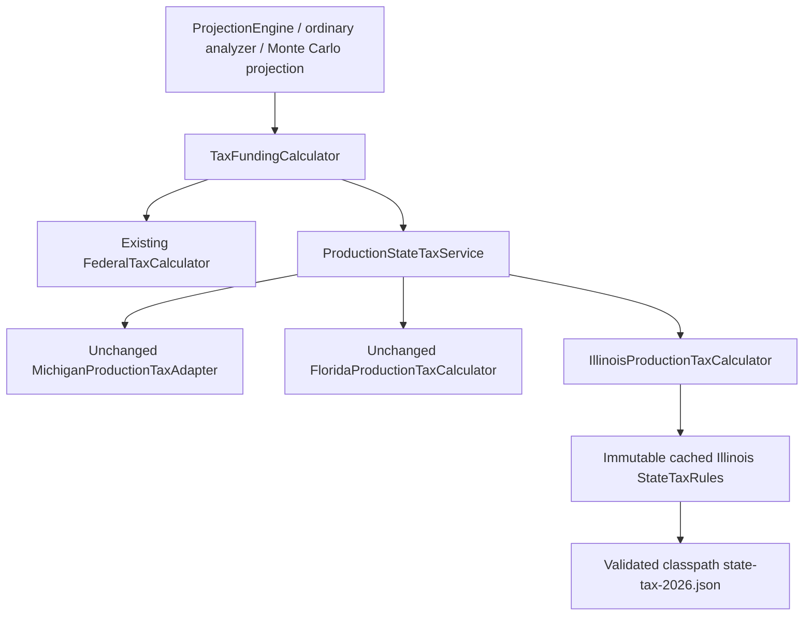

# Phase 6D.2 — Illinois production integration

## Scope and status

Illinois is registered alongside Michigan and Florida through the existing production
boundary. Focused, affected, complete non-benchmark and full-suite verification passed.
No other jurisdiction or effective-rate
override is enabled. No existing financial expectation has been edited.

The six requested predecessor reports were read, including the accepted 16-workload
performance characterization. The initial workspace was clean at `7161e76`.

## Authoritative Illinois validation

Reviewed the actual validated Illinois resource and Phase 6C fixtures, then reopened
official IDOR guidance before production activation:

- The individual rate is **4.95%**. The 2026 withholding publication independently
  confirms its effective year and the basic allowance.
  [Current individual rates](https://tax.illinois.gov/research/taxrates/income.html),
  [2026 IL-700-T](https://tax.illinois.gov/forms/withholding/currentyear/il-700-t-withholding-guide-tables.html).
- For 2026 the basic exemption is **2,925 per represented filer**, with **1,000
  additional allowance for age 65+**. Federal AGI above **250,000 Single / 500,000
  MFJ** denies these allowances; the exact ceiling still qualifies. A living filer
  turning 65 during the year qualifies.
  [IDOR exemption guidance](https://tax.illinois.gov/questionsandanswers/answer.851.html).
- Retirement subtraction covers the federally taxed portion of qualifying IRA and
  employee-plan income, including eligible IRA-to-Roth conversions and early
  distributions. Federally included Social Security is subtracted. Nonqualified
  deferred compensation is excluded from this permission.
  [IDOR Publication 120, December 2025](https://tax.illinois.gov/research/publications/pubs/retirement-income.html).

The ordinary taxable investment categories remain in the federal AGI starting base;
the flat individual rate supplies no preferential capital-gain rate. Qualified Roth
distributions already excluded federally are not added or subtracted again.
These findings support the bounded model, not complete return preparation.

## Production architecture

Paths below are relative to `src/main/java/com/daviddunn/retirementplanner/`.



`domain/tax/state/ProductionStateTaxService.calculate` resolves the calculator through
its immutable registry. `IllinoisProductionTaxCalculator.calculate` consumes the
existing immutable `StateTaxCalculationRequest`: household/owner facts, attributed
income, federal result, filing status and state assumptions. No JavaFX, mutable plan,
network, or second funding pipeline enters the calculator.

`IllinoisProductionTaxCalculator.loadRules` obtains the immutable Illinois record
from `persistence/StateTaxDatasetRepository`'s once-loaded cache. Unexpected base,
system, deduction/exclusion method, age restriction, surcharge or unsupported
boundary requires adapter review instead of silently applying an incompatible rule.
Rate, exemption amounts, senior allowance and income ceilings come from JSON.
No dollar thresholds or rates were introduced in Java production code.

The standalone `SimplifiedStateTaxCalculator` remains separate; production does not
invoke its research request/qualification model. Its dataset and tests are unchanged.
The production adapter reuses immutable rule data rather than duplicating it.

## Calculation and qualification boundary

1. Start with the authoritative federal AGI, not federal taxable income.
2. Remove only authoritative **federally taxable** Social Security.
3. Assess each actual retirement source. Traditional IRA, rollover IRA, traditional
   401(k) and traditional 403(b) classifications support the modeled qualified-plan
   subtraction. IRA early-distribution eligibility is not subjected to Michigan's
   age test. RMD/opening-RMD classification retains the underlying account facts.
4. Sum the known federally taxable amounts separately for withdrawals and
   conversions. Each must fit its actual federally included aggregate. Excess,
   duplicated eligible amounts and a mismatched known source year are rejected.
   Total subtractions cannot exceed AGI. No gross-amount subtraction or extra RMD
   addition occurs.
5. Preserve investment income and conservatively taxable unknown retirement income.
6. Apply the JSON basic/senior allowances only below or at the **federal AGI** ceiling,
   tested before retirement subtraction. Single gets one filer allowance; MFJ gets
   represented primary/spouse allowances. Only applicable filer ages contribute.
7. Floor income after allowances at zero, apply the JSON flat rate, round the final
   Illinois estimate to cents using `HALF_UP`.

An account type explicitly representing a qualified 401(k)/403(b) plan is useful
Illinois qualification information. Michigan's extra contribution/receipt tests
are not transplanted into Illinois. There is no existing 457 account category.

**Pension qualification is unavailable:** existing `Pension` and
`IncomeSourceAttribution.PensionFacts` contain ownership, payment, dates and survivor
facts, but no qualified-plan/government classification. The adapter therefore taxes
these amounts conservatively and returns a specific limitation. It does not infer
qualification from a pension name, recipient age, or monthly amount. Unknown,
unattributed, inherited or inactive-original-owner retirement qualification likewise
receives no assumed subtraction. This can overstate tax on legally qualifying
pensions/inherited distributions. A qualified-pension subtraction is a documented
future input enhancement, not a claim made by this integration.

The structured result identifies IL, simplified mode, calculated estimate, tax,
immutable limitations and empty Michigan-only details. Result labels expose the
limitations through a direct tooltip. CALCULATED means the documented conservative
estimate was computed, not that unknown eligibility was certified.

## Tax-year and residency policy

The supplied rules represent **2026**. Future projections deliberately hold Illinois
rate, exemptions and ceilings **constant in nominal dollars**. The state selector
help and annual result limitations state this policy. No Michigan indexing factor
or federal deduction-growth assumption is repurposed as Illinois law. Pre-2026
Illinois requests are rejected; no historical table is fabricated.

Living filer senior eligibility uses December 31. For the existing January 1 modeled
death, the deceased filer's age is evaluated at that boundary: a later birthday
cannot be attained after death. Existing configured filing status through the death
year and Single in subsequent survivor years remains unchanged.

Residence applies to all projection years. No moves, split-year residence,
nonresident sourcing, domicile decisions or local taxes are modeled.

## Persistence, wizard, tabs and reporting

`domain/model/StateTaxJurisdiction` now contains only MI, FL and IL. Jackson persists
the same existing `planningAssumptions.stateTaxAssumptions` group:

```json
"stateTaxAssumptions": {
  "jurisdiction": "IL",
  "calculationMethod": "SIMPLIFIED_STATE_ESTIMATE",
  "effectiveRateOverride": null
}
```

No schema, serializer, snapshot ownership or controller lifecycle change was needed.
Legacy absent configuration still defaults to MI. Explicit unsupported jurisdictions
remain rejected. Scenario copies and baseline projections preserve the selected state.

The wizard uses the existing guided `AssumptionsView`, so the third enum choice edits
the same draft object as the tab editor. Required indication, direct help, inline
validation, atomic Apply/Cancel, dirty callbacks, isolated wizard Cancel, File/New
creation and no-auto-save semantics are exercised. No duplicate help icon was added.

Existing generic Results, analyzer metadata, CSV and PDF paths render Illinois
without state-specific projection/analyzer branches. CSV retains its compatible
Michigan diagnostic columns, blank for Illinois. PDF includes Illinois in the
full-year residency state-tax table. Only the year-detail tooltip and selector help
needed production UI changes.

## Independent production fixtures

`IllinoisProductionTaxCalculatorTest` contains **39 independently worked tax cases**.
Expected values are literal worksheet results, not calculator output. They include
explicit conservative-policy cases, which assert an estimate rather than legal
qualification of the unknown income. The authoritative sources above supply the
rate/exemption/subtraction premises.

| Group | Cases | Independent expected result / worksheet |
| --- | ---: | --- |
| Basic/senior exemptions, retirement plus investments, large income and ceilings | 17 | Single age60, interest10000: `(10000-2925)*.0495 = 350.21`; age65:300.71; MFJ age65 interest20000:601.43 |
| Ordinary withdrawal, RMD, opening RMD, conversion; gross100000 but taxable60000 | 4 | Included retirement60000 excluded; investment10000 less3925:300.71 |
| Interest/dividend/capital-gain classifications | 3 | Investment10000 remains taxable:300.71 |
| SS40000, alone or with interest10000 | 2 | 0 /300.71; subtract only federally included SS |
| Unknown pension and missing retirement attribution | 2 | Taxable20000 plus interest10000 less3925:1290.71, with limitations |
| Primary RMD60000, spouse conversion40000, SS40000, investment20000 | 1 | Investment20000 less7850:601.43 |
| December31 age65 eligibility / January1 following-year birthday | 2 | 300.71 /350.21 |
| IRA, rollover IRA, 401(k), 403(b) source classifications | 4 | Retirement100000 plus investment10000:300.71 |
| Withdrawal40000 plus conversion60000; duplicate rejection also asserted | 1 | Investment10000 less3925:300.71 |
| Qualified Roth gross100000, federally included zero | 1 | Investment10000 less3925:300.71 |
| Single filing with two actual household members | 1 | Only one senior/basic allowance:795.71 on interest20000 |
| Joint death year; deceased age64, surviving spouse65+ | 1 | Interest20000 less5850 and one1000:650.93 |

Threshold cases explicitly include AGI250000/250001 Single and500000/500001 MFJ,
zero and one dollar above allowed deductions. Large qualifying conversion with
investment income denies exemptions based on pre-subtraction federal AGI.

Integration coverage adds single/couple projection, actual partial multi-owner
conversion capacity, fixed and bracket-fill schedules, tax funding from IRA or
brokerage, source counts/ownership, opening RMDs, save/reload/clone/baseline,
deterministic/weighted integrated analysis, fixed/longevity seed417 Monte Carlo,
wizard lifecycle/dirty state, CSV and PDF.

## Three-state comparison

Otherwise-identical four-year core retirement fixtures: pension, Social Security,
opening/annual RMD, annual30000 conversion, expenses and existing accounts. Final
year2030 values below are rounded only for presentation. There are no non-investable
assets, so net worth equals ending investable assets. Illinois pension qualification
is deliberately conservative; it is the reason IL can exceed MI here.

| Couple metric | Michigan | Florida | Illinois |
| --- | ---: | ---: | ---: |
| Federal tax | 35,136.26 | 35,136.26 | 35,136.26 |
| State tax | 4,977.59 | 0.00 | 6,041.07 |
| Total tax | 40,113.86 | 35,136.26 | 41,177.33 |
| Tax-funding withdrawal | 0.00 | 0.00 | 0.00 |
| Roth conversion | 30,000.00 | 30,000.00 | 30,000.00 |
| Ending investable assets / net worth | 1,811,878.34 | 1,832,381.97 | 1,807,547.08 |
| After-tax estate | 1,616,940.49 | 1,637,444.12 | 1,612,609.23 |

| Single metric | Michigan | Florida | Illinois |
| --- | ---: | ---: | ---: |
| Federal tax | 38,810.55 | 38,810.55 | 38,810.55 |
| State tax | 5,249.00 | 0.00 | 6,235.36 |
| Total tax | 44,059.54 | 38,810.55 | 45,045.91 |
| Tax-funding withdrawal | 0.00 | 0.00 | 0.00 |
| Roth conversion | 30,000.00 | 30,000.00 | 30,000.00 |
| Ending investable assets / net worth | 1,290,236.45 | 1,311,858.07 | 1,286,198.14 |
| After-tax estate | 1,169,875.71 | 1,191,497.33 | 1,165,837.40 |

Existing guaranteed/RMD cash covers taxes in these fixtures. Different state tax
reduces retained non-qualified cash; the ensuing return on that balance accounts
for cumulative asset differences. Federal tax, SS benefits, actual conversions and
eligible RMD account balances remain identical here.

## Roth and funding feedback

Pension-free single/couple 22%-bracket-fill scenarios produce identical Illinois
and Florida conversion and ending-asset values: the actual qualified retirement
amounts are excluded, SS is excluded and Illinois state tax is zero. The optimizer
and federal target are unchanged. Five-million requested fixed-conversion cases
prove partial capacity fulfillment, same-owner destinations, spouse continuation
and RMD-before-conversion handling; taxes use actual execution.

The independent one-year joint IRA/Roth bracket-fill worksheet is also exercised:

| Metric | Michigan | Florida | Illinois |
| --- | ---: | ---: | ---: |
| Federal taxable income target | 211,400.00 | 211,400.00 | 211,400.00 |
| Federal tax | 35,932.00 | 35,932.00 | 35,932.00 |
| State tax | 4,104.65 | 0.00 | 0.00 |
| Actual conversion | 203,563.35 | 207,668.00 | 207,668.00 |
| Tax-funding withdrawal | 40,036.65 | 35,932.00 | 35,932.00 |
| Ending assets | 1,059,963.35 | 1,064,068.00 | 1,064,068.00 |
| After-tax estate | 870,863.35 | 874,968.00 | 874,968.00 |

Only state treatment changes the conversion/funding allocation here. The unchanged
federal bracket-fill algorithm still reaches the same federal taxable-income target.

The independent funding worksheet with80000 IRA spending withdrawal shows:

| Metric | Michigan | Florida | Illinois | Causal classification |
| --- | ---: | ---: | ---: | --- |
| State tax | 797.11 | 0.00 | 0.00 | Selected-state calculation |
| Tax-funding withdrawal | 12,265.52 | 11,243.59 | 11,243.59 | TAX_FUNDING_FEEDBACK |
| Ending eligible IRA | 907,734.48 | 908,756.41 | 908,756.41 | BALANCE_FEEDBACK_EFFECT |
| Next RMD, same age77/divisor22.9 | 39,639.06 | 39,683.69 | 39,683.69 | BALANCE_FEEDBACK_EFFECT |

For additional ordinary interest10000 /100000, single age60 Illinois state tax is
350.21 /4805.21 through convergence, whether IRA or brokerage funds the tax. The
final source amount equals the actual funding withdrawal, with one funding record
in each tested case. Investment income cannot be consumed by retirement subtraction.
Two additional cutoff cases use interest150000: IRA funding pushes federal AGI above
250000 and denies the exemption (state tax7425.00); brokerage principal funding
leaves AGI230000 and retains it (state tax7280.21). These are explicitly traced
TAX_FUNDING_FEEDBACK effects, not a different exemption formula.

No federal, funding, RMD or Roth algorithm changed. Later federal tax can differ
only through changed taxable funding withdrawals, not a state-dependent federal rule.

## Michigan and Florida freeze

The four MI targets remain174.25 /348.50 /1125.83 /2251.65. All20 Florida category
fixtures remain calculated zero. The original16 workload fingerprint resource is
unchanged. The oracle explicitly retains MI/FL even when optional IL benchmarking
is requested; eight new IL workloads are separate.

No Michigan or Florida financial expectation was changed. Their state/federal/total
tax, withdrawals, RMDs, conversions, balances, estate, analyzer and seeded Monte Carlo
financial fingerprints continue to match the accepted Phase6D.1A baseline exactly.

## Performance and profiling

Reused the eight workloads per state from Phase6D.1A:150 four-year Single/couple
projections,50 fixed30-year projections,10 bracket-fill30-year projections,81-cell
integrated grid plus baseline, two nine-scenario weighted evaluations, and fixed/
longevity500-trial seed417 Monte Carlo. JVM25.0.4.1, eight reported processors,
`-Xms512m -Xmx1536m`; three warm-up batches and five measured batches per workload.
Timing/allocated-byte measurement excludes financial hashing and output writes.
Benchmarks were sequential, with no concurrent test/benchmark workload.

For a direct matched reference, compiled only the committed pre-IL registry and
jurisdiction enum from `7161e76` into an ignored `target` classpath overlay. The
unchanged rest of production and the same modern benchmark harness were used for
both runs. No checkout, history/index operation or production-source replacement
was performed. This is a two-class activation-boundary comparison, not a claim
of rebuilding every historical module. All80 measured old/new financial hashes
matched; the separate original16-workload oracle also passed.

| Workload batch | Matched pre-IL median ms | Post-IL median ms | Change |
| --- | ---: | ---: | ---: |
| MI Single | 59.17 | 63.30 | +7.0% |
| MI couple | 63.60 | 65.11 | +2.4% |
| MI fixed30years | 195.95 | 180.05 | -8.1% |
| MI bracket30years | 43.44 | 41.41 | -4.7% |
| MI grid81 | 167.74 | 166.68 | -0.6% |
| MI weighted9 | 26.98 | 32.36 | +20.0% |
| MI fixedMC500 | 1882.61 | 1710.71 | -9.1% |
| MI longevityMC500 | 1389.86 | 1408.49 | +1.3% |
| FL Single | 23.62 | 23.47 | -0.6% |
| FL couple | 36.48 | 36.97 | +1.4% |
| FL fixed30years | 152.18 | 150.81 | -0.9% |
| FL bracket30years | 35.64 | 34.89 | -2.1% |
| FL grid81 | 88.68 | 85.80 | -3.2% |
| FL weighted9 | 18.91 | 17.27 | -8.7% |
| FL fixedMC500 | 1590.39 | 1562.47 | -1.8% |
| FL longevityMC500 | 1318.83 | 1264.67 | -4.1% |

Compared with the accepted earlier Phase6D.1A medians, current MI fixed/longevity
Monte Carlo is +3.1%/+0.2%; FL is -0.8%/-2.7%. Current fixed/bracket/grid heavy
batches are also close to or below that reference. Short batches show more variation;
the MI weighted increase is reported rather than suppressed. Five samples in one
fresh JVM per matched version do not establish a precise percentage regression.

Two preliminary default-heap Maven runs used an8GiB maximum heap and produced
inconsistent apparent slowdowns across unchanged states. These observations prompted
the matched512MiB/1536MiB comparison and profiling; they are not used as the accepted
timing table. No sustained heavy-workload architecture penalty was demonstrated.
No speculative optimization, convergence change or tax result cache was introduced.

| New IL workload | Median ms | Mean allocated bytes per batch |
| --- | ---: | ---: |
| Single150 | 50.97 | 98,507,171 |
| Couple150 | 58.18 | 140,454,118 |
| Fixed30years x50 | 170.78 | 620,243,144 |
| Bracket30years x10 | 40.05 | 143,528,114 |
| Grid81 | 144.61 | 93,541,880 |
| Weighted9 x2 | 27.73 | 49,926,504 |
| FixedMC500 | 1650.71 | 6,248,489,509 |
| LongevityMC500 | 1403.63 | 4,880,604,246 |

Every IL workload's five measured outputs had one identical fingerprint. IL outputs
are newly characterized; they are not substituted for the frozen MI/FL oracle.

MI/FL fixed/longevity allocation changes in the matched runs were between -0.028%
and -0.067%, consistent with unchanged application workloads. Retained heap was not
remeasured, so no claim of exact retained-heap equality is made.

Additional JFR profiling used two measured IL fixed500 batches after warm-up,
separately from unprofiled timings. Of1085 execution samples,25 contained the
Illinois calculator and16 the production service; none contained the state dataset
repository. These are inclusive sample counts, not precise cost percentages.
BigInteger/BigDecimal arithmetic dominated leaf samples; allocation samples were
primarily integer arrays, BigInteger and BigDecimal. Source inspection confirms
rule loading/validation occurs once at class initialization, not in annual loops.
No repeated parsing or architectural hot-path problem was identified.

Useful ignored artifacts:
`target/phase6d2-controlled-before`, `target/phase6d2-controlled-after`,
`target/phase6d2-illinois-performance` and `target/phase6d2-illinois-profile`.
The JFR/JSON summaries and raw measurements remain local diagnostics.

## Visual acceptance

Inspected rendered Illinois wizard, Illinois Assumptions editor, Illinois year-detail
tax rows, PDF summary and the PDF page explicitly showing the Illinois tax table.
Controls fit, required labels remain visible, and input/result tooltips use the
controls/labels directly without duplicate help graphics. The opt-in preview also
generates MI/FL states, blank required validation, a narrower wizard, Florida zero
and Illinois tax. `target/phase6d2-preview` contains the screenshots and18-page PDF.
This is rendered JavaFX/PDF inspection and automated UI interaction, not a claim of
an additional unrecorded human click-through session.

## Verification

Every Maven invocation used IntelliJ bundled Maven and the required project-local
`.codex-m2/repository`. There were no failures/errors in any verification run.

| Selection | Run | Passed | Failed | Errors | Skipped | Log |
| --- | ---: | ---: | ---: | ---: | ---: | --- |
| Pre-edit MI/FL targets,20 FL categories and16 financial fingerprints | 27 | 26 | 0 | 0 | 1 | `target/phase6d2-baseline.log` |
| Complete focused IL/MI/FL/wizard/funding/fingerprint + rendered previews | 111 | 110 | 0 | 0 | 1 | `target/phase6d2-focused-complete.log` |
| Affected tax/attribution/withdrawal/RMD/Roth/projection/analyzer/MC/persistence/UI/report selection | 1333 | 1324 | 0 | 0 | 9 | `target/phase6d2-affected-final.log` |
| Complete final non-benchmark | 2211 | 2198 | 0 | 0 | 13 | `target/phase6d2-nonbenchmark-final.log` |
| Complete benchmark-inclusive | 2232 | 2215 | 0 | 0 | 17 | `target/phase6d2-full.log` |

The affected wildcard selection does not include the separately named
`IllinoisFundingTest`; all seven of those cases passed in focused and both complete
suites. The last additional IL bracket-fill assertions passed in the affected and
complete suites. Optional performance/preview tests are normally skipped; preview
was explicitly enabled for focused acceptance, and warmed benchmarks were executed
separately. Source-attribution regressions comprise35 passing tests; the unchanged
standalone eight-state prototype comprises204 passing tests in the full suite.

**Existing financial expectations changed: zero.** Michigan/Florida state and federal
taxes, conversion/RMD/funding logic, deterministic and weighted analysis, seeded
Monte Carlo, JSON and CSV/PDF expectations passed unchanged. Illinois differences
are new supported-state outputs with the causal explanations above.

Final `git diff --check` and checks of new files for trailing whitespace passed.
The staged diff remains empty. Nothing was staged, committed or pushed.

## Exact file inventory

Created (7):

- `PHASE-6D2-ILLINOIS-PRODUCTION-INTEGRATION.md`
- `src/main/java/com/daviddunn/retirementplanner/domain/tax/state/IllinoisProductionTaxCalculator.java`
- `src/test/java/com/daviddunn/retirementplanner/domain/tax/state/IllinoisProductionTaxCalculatorTest.java`
- `src/test/java/com/daviddunn/retirementplanner/domain/projection/IllinoisProductionProjectionTest.java`
- `src/test/java/com/daviddunn/retirementplanner/domain/projection/IllinoisFundingTest.java`
- `src/test/java/com/daviddunn/retirementplanner/app/montecarlo/IllinoisMonteCarloIntegrationTest.java`
- `src/test/java/com/daviddunn/retirementplanner/app/socialsecurity/IllinoisIntegratedAnalysisTest.java`

Modified (9):

- `src/main/java/com/daviddunn/retirementplanner/domain/model/StateTaxJurisdiction.java`
- `src/main/java/com/daviddunn/retirementplanner/domain/tax/state/ProductionStateTaxService.java`
- `src/main/java/com/daviddunn/retirementplanner/ui/views/AssumptionsView.java`
- `src/main/java/com/daviddunn/retirementplanner/ui/summary/ProjectionYearDetailsPane.java`
- `src/test/java/com/daviddunn/retirementplanner/app/socialsecurity/StateTaxPerformanceAuditTest.java`
- `src/test/java/com/daviddunn/retirementplanner/domain/projection/FloridaProductionProjectionTest.java`
- `src/test/java/com/daviddunn/retirementplanner/domain/projection/StateTaxFundingFeedbackTest.java`
- `src/test/java/com/daviddunn/retirementplanner/ui/wizard/StateTaxWizardIntegrationTest.java`
- `src/test/java/com/daviddunn/retirementplanner/ui/wizard/StateTaxVisualPreviewTest.java`

No dataset, schema, existing tax-law expectation, funding/projection/RMD/Roth
implementation, simulation model, saved-plan serializer, CSV exporter or PDF layout
file changed. The generated logs/CSV/PDF/JFR/baseline class overlays are ignored
diagnostic outputs. No Git history or index operation was performed.

## Limitations and Pennsylvania recommendation

- Full-year resident only, simplified planning estimate, Single/MFJ only.
- Unknown pension/inherited/successor qualification remains conservatively taxable.
  Ordinary qualified-plan account classifications are supported; no457 type is
  invented and no unusual nonqualified compensation is silently exempted.
- Exemptions cover represented independent primary/spouse filers, not dependents;
  blindness, special credits, itemizing and basis reconstruction are not modeled.
- Nominal2026 future baseline; no fabricated historical Illinois tables.
- No local tax, part-year/nonresident returns, income sourcing or residency timeline.
- No effective-rate override; production states remain MI/FL/IL only.

Pennsylvania should receive a separate admission/design review before activation.
Its state-defined income, early-distribution basis recovery and complete-conversion
conditions require reliable supported-case boundaries. Do not infer PA income from
federal AGI or automatically exempt every IRA distribution. The existing standalone
PA unsupported cases are intentional. Obtain approval before enabling it.
