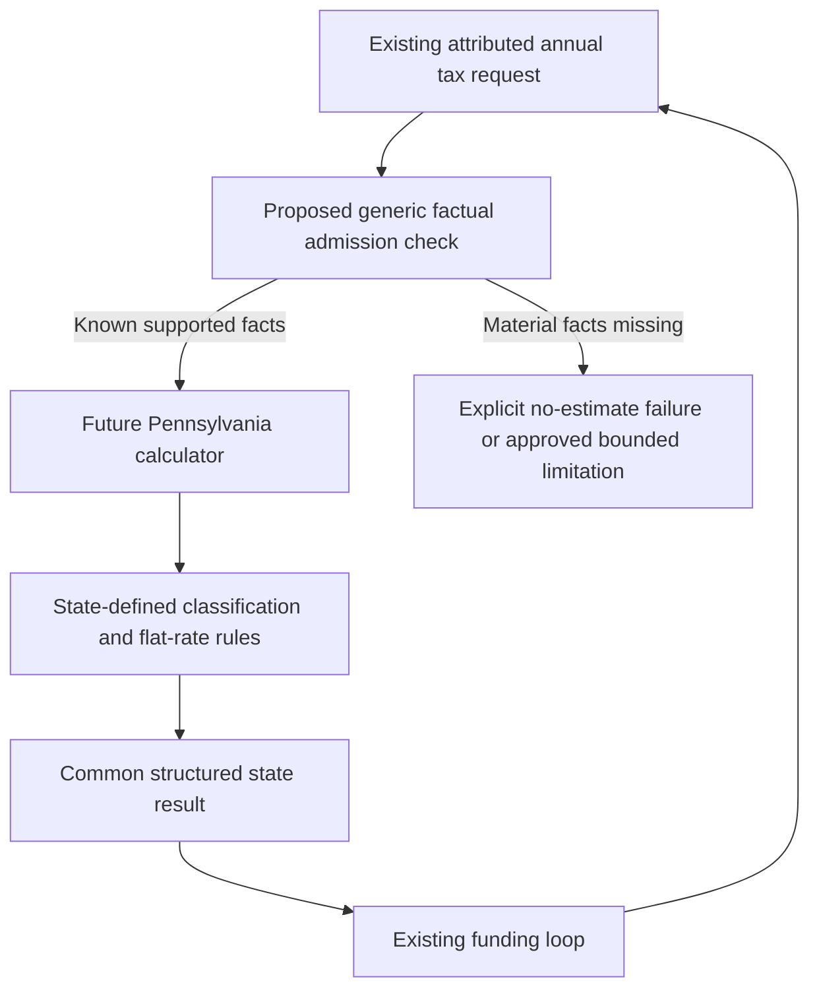

# Phase 6D.3A — Pennsylvania production admission audit

## Executive recommendation

**C — DOMAIN EXTENSION REQUIRED: `PENNSYLVANIA_REQUIRES_DOMAIN_EXTENSION`.**

The common production tax boundary fits Pennsylvania, but the current financial
facts do not satisfy all admission criteria. Ordinary individual IRA retirement
receipts and the engine's complete IRA-to-Roth IRA transfers have a defensible
supported boundary. Employer-plan and pension retirement qualification cannot be
established from current records. Early/nonqualified distributions cannot be
assigned a reliable Pennsylvania taxable amount from the federal amount. Production
also lacks an explicit no-estimate result contract for materially unknown cases.

Do not production-enable Pennsylvania in Phase 6D.3B yet. First approve a small,
generic factual qualification/admission extension and its handling of unsupported
projections. This report does not implement that extension, a basis ledger, or an
effective-rate override. Gross taxation of every unknown pension is not recommended
as a sufficiently reliable default for Pennsylvania conversion comparisons.

Audit date: October 12, 2026. Initial workspace was clean at `c0d9ce7`. All seven
requested predecessor reports were read completely. Their historical findings are
preserved; later Michigan corrections and MI/FL/IL activation supersede their earlier
statements about isolation or deferred Michigan defects.

## Pennsylvania tax model and official rule validation

This audit concerns **2026 full-year residents**, Single/MFJ, nonnegative ordinary
retirement/investment flows. Future-year law reuse is a separate approval decision.
It estimates state personal income tax, not a PA-40 return, local tax, residency
sourcing, or contribution/security-basis reconstruction.

Conceptually: classify Pennsylvania income, omit verified exempt receipts, apply
any admitted exclusions, and multiply the remaining taxable categories by the
flat rate. Do not start from federal AGI or federal taxable income and subtract
arbitrary gross amounts. Federal results remain independent inputs for reconciliation.

| Material rule | Verified treatment | Applicable year / provenance | Planner implication |
| --- | --- | --- | --- |
| Rate | 3.07% of PA taxable income | Explicit 2026 REV-413(I) worksheet | Flat calculation; no federal bracket inheritance |
| Income base | Eight separate PA income classes; cross-class loss offsets are restricted | Current Revenue PIT overview | State-defined components; negative/loss cases outside this prototype |
| Standard deduction / personal exemption | Neither applies | Current Revenue PIT overview | Do not import federal deductions or MI/IL allowances |
| Social Security retirement and survivor benefits | Excluded | Current regulation and Revenue FAQ updated March 2026 | Omit the SS category, regardless of its federally taxable portion |
| Individual traditional IRA | Normal receipts after age 59½ exempt even when still employed; early receipts need cost recovery | Revenue FAQ 1470, March 11, 2026; Bulletin 2008-1 section 8 | DOB and actual receipt eligibility suffice for ordinary individual IRA; federal basis is not PA basis |
| Employer plan / pension | Eligible-plan terms and retirement/service conditions matter | Current Gross Compensation guide; 61 Pa. Code 101.6 | Account label, age, pension start date and RMD flag alone insufficient |
| IRA-to-Roth IRA transfer | Entire distributed amount transferred directly or timely rolled over can be nontaxable; untransferred portions and basis allocation require separate assessment | FAQs 1470 and 274, updated March/August 2026 | Bound support to proven actual transfers; no blanket conversion exemption |
| Roth IRA cash receipts | Normal eligible retirement receipt can be exempt; early receipts need previously taxed contribution recovery | FAQ 1470 / current guide | Modeled federal zero does not establish PA qualification |
| Inherited IRA | Beneficiary death distributions generally excluded; spouse own-account elections differ | Bulletin 2008-1 section 10; current FAQ 1470 | Use retained inherited account/death facts; never infer a spouse election |
| Ordinary interest | Generally taxable; US and PA direct-obligation exceptions exist | Current Interest guide | Ordinary bank interest is tractable; unidentified bond-source interest is not |
| Dividends | Taxable income category | Current Dividends guide | Federal qualified-dividend rate does not control PA |
| Investment gains | No preferential short/long-term rate; PA gain/basis must be established | Current Net Gains guide | Positive assessed securities gains tractable, brokerage proceeds not synonymous with gain |

Authoritative sources reopened during this audit:

- [2026 REV-413(I), worksheet and rate](https://www.pa.gov/content/dam/copapwp-pagov/en/revenue/documents/formsandpublications/formsforindividuals/pit/documents/2026/2026_rev-413i.pdf).
- [Revenue PIT overview: classes, no standard deduction or personal exemption](https://www.pa.gov/agencies/revenue/resources/tax-types-and-information/personal-income-tax).
- [61 Pa. Code 121.10(c)(7): Social Security](https://www.pacodeandbulletin.gov/secure/pacode/data/061/chapter121/s121.10.html),
  [Revenue FAQ 1480, March 5, 2026](https://revenue-pa.custhelp.com/app/answers/detail/a_id/1480).
- [Revenue FAQ 1470, March 11, 2026: distribution codes and IRA rules](https://revenue-pa.custhelp.com/app/answers/detail/a_id/1470).
- [PIT Bulletin 2008-1, sections 7–10](https://www.pa.gov/content/dam/copapwp-pagov/en/revenue/documents/taxlawpoliciesbulletinsnotices/taxbulletins/pit/documents/pit_bulletin_2008-01.pdf).
- [Gross Compensation: eligible plan criteria and distributions](https://www.pa.gov/agencies/revenue/forms-and-publications/pa-personal-income-tax-guide/gross-compensation),
  [61 Pa. Code 101.6(c)(8)](https://www.pacodeandbulletin.gov/secure/pacode/data/061/chapter101/s101.6.html).
- [Revenue FAQ 274, August 14, 2026: Roth transfers and allocation](https://revenue-pa.custhelp.com/app/answers/detail/a_id/274/kw/retirement).
- [Interest](https://www.pa.gov/agencies/revenue/forms-and-publications/pa-personal-income-tax-guide/interest),
  [Dividends](https://www.pa.gov/agencies/revenue/forms-and-publications/pa-personal-income-tax-guide/dividends),
  [Net Gains](https://www.pa.gov/agencies/revenue/forms-and-publications/pa-personal-income-tax-guide/net-gains-losses-from-the-sale,-exchange,-or-disposition-of-property).

The 2008 bulletin is used for its enduring IRA classification, not obsolete federal
RMD ages or inherited payout schedules. Its statement that a conversion is a
distribution does not alone establish taxable PA income; current conversion-specific
guidance supplies the transfer boundary. Bulletin 2005-05 was also inspected: its
stated scope excludes retirement benefit plans/IRAs, so its federal qualified-plan
definition is not accepted as sufficient evidence of exempt retirement receipts.
[Bulletin 2005-05 scope](https://www.pa.gov/content/dam/copapwp-pagov/en/revenue/documents/taxlawpoliciesbulletinsnotices/taxbulletins/pit/documents/pit_bulletin_2005-05.pdf).

**Unresolved early-exception wording:** FAQ 1470 rejects federal-like early IRA
exceptions and substantially equal payments, whereas the general guide describes
death/disability and other penalty-free events. Do not generalize a federal penalty
exception into PA exemption. The isolated disability assertion remains a research
input, not production admission proof. Disability/other unusual early exceptions
need scenario-specific reconciliation before activation. Ordinary age-eligible IRA
and complete-transfer findings do not rely on those exceptions.

## Current implementation inventory

All Java paths in the next tables are relative to
`src/main/java/com/daviddunn/retirementplanner/`.

| Class / method | Facts available and boundary |
| --- | --- |
| `domain/model/AccountType` | Traditional/rollover IRA, traditional 401(k)/403(b), Roth IRA/401(k), inherited traditional/Roth IRA, brokerage/checking/savings. No 457 or inherited employer account category |
| `domain/financial/Account` | Owner, type, current balance, opening RMD data; no contribution ledger, service separation or retirement-plan terms |
| `domain/income/IncomeSourceAttribution` | Immutable source/destination references, owner, kind, purpose, gross, optional modeled federal taxable amount, year, optional pension facts |
| `IncomeSourceAttribution.AccountReference.capture` | Type/owner and opaque run identity; inherited DOB/death/relationship copied without mutable balance exposure |
| `IncomeSourceAttribution.withdrawal` | Deferred amount modeled fully federal-taxable; Roth/cash modeled zero; brokerage taxable amount unknown |
| `IncomeSourceAttribution.PensionFacts` / `domain/income/Pension` | Original owner, recipient, benefit, survivor benefit, dates, COLA; no eligibility/plan/source classification |
| `domain/financial/InheritedAccountInformation` | Original owner DOB/date of death and beneficiary relationship; no spouse election, successor history, contribution/basis record |
| `domain/roth/ProjectedPortfolioRothConverter.convertHousehold` | Actual per-source debit and equal same-owner Roth credit; source order/capacity retained |
| `domain/roth/ProjectedRothConversionResult.getIncomeSources` | One record per actual allocation, source/destination types and amount; requested shortfall not recorded as distributed income |
| `domain/projection/ProjectedWithdrawalAllocator` | Separate ordinary/RMD/tax-funding account sources; tax funding does not change kind |
| `domain/rmd/OpeningRmdCalculator` | Opening distributions retain account/year; detailed historical receipt dates unavailable |
| `domain/tax/TaxIncome` | Pension, SS, deferred withdrawal, conversion, taxable-interest scalars plus source list; no generated dividend/gain ledger |
| `domain/tax/TaxIncomeAttribution.attach` | Reconciles actual supplemental facts with aggregates; does not establish state basis or eligibility |
| `domain/tax/state/TaxHouseholdContext` | Owner DOBs, modeled active/deceased status, annual distribution boundary, authoritative pension sources |
| `domain/tax/state/StateTaxCalculationRequest` | Narrow immutable household/income/federal/rules/assumptions request; no mutable plan or JavaFX |
| `domain/tax/state/ProductionStateTaxService.calculate` | Immutable MI/FL/IL registry; PA cannot be supplied by the production jurisdiction enum |
| `domain/tax/state/ProductionStateTaxResult` | Status currently only CALCULATED, required nonnegative tax; cannot encode UNSUPPORTED with no numeric estimate |
| `domain/tax/TaxFundingCalculator.calculate` | Recalculates attributed dynamic federal/state trial inputs; 100 iterations, existing cent tolerance, final-only allocations |
| `domain/roth/RothConversionBracketFillCalculator.calculateConversion` | Genuine conversion allocation previews use the same funding service and state boundary |
| `domain/projection/ProjectionEngine.calculateProjectionYear` | Same path for deterministic/weighted/Monte Carlo; normal interest argument remains zero |

Attribution now survives the runtime pipeline. The gaps are facts never recorded,
not a renewed loss of owner/account identity. Stable PRIMARY/SPOUSE attribution
remains sufficient; JOINT investment money need not be artificially divided for a
flat household estimate, but owner-specific retirement eligibility must be retained.

## Domain capability matrix

| PA-required fact | Planner field / source | Available? | Reliable? | Supported/action |
| --- | --- | --- | --- | --- |
| Owner / account identity | Attribution owner and AccountReference | Yes | Yes within run | Use directly, not amounts or account names |
| Owner age | TaxHouseholdContext DOB and distribution date | Yes | Annual boundary only | Evaluate each owner; birthday-crossing receipts need bounded policy |
| Account type / traditional or Roth | AccountType | Yes | Yes within modeled category | Distinguish individual IRA from employer plan |
| Employer type | Traditional 401(k)/403(b), Roth 401(k) | Partial | Does not certify PA terms | No invented 457 support |
| Pension amount/recipient/original owner | PensionFacts | Yes | Cash-flow facts | Cannot infer plan qualification |
| RMD subtype | RMD/OPENING_RMD kind, account | Yes | Yes | Apply underlying tax classification |
| Conversion subtype | ROTH_CONVERSION and destination | Yes | Executed engine records | Never exempt an aggregate legacy proposal |
| Entire actual transfer amount | Converter debit equals destination credit | Yes in generated transactions | Proven by four runtime tests | Restrict IRA rule to IRA source and Roth IRA destination |
| Withholding/retained amount / transfer channel | Not modeled explicitly | No for external/imported transactions | Engine generates neither diversion | Generated path bounded; unknown external records unsupported |
| Federal taxable amount | modeledTaxableAmount and federal result | Yes/unknown for brokerage | Existing approximation | Not interchangeable with PA taxable income |
| PA contribution basis/cost recovery | None | No | No | Early/nonqualifying distributions unsupported, not zero-basis assumed |
| Inherited account/death/relationship | InheritedAccountInformation | Yes for IRA | Typed beneficiary model | Limited known beneficiary treatment; elections/history unknown |
| Retirement eligibility age/service | No plan-specific terms | No | No | Generic factual extension needed for employer/pension |
| Separation from employer service | None | No | No | Pension commencement is not proof |
| Eligible retirement-plan features | None | No | No | Written terms, payment provisions, access restrictions missing |
| Pension public/private/government origin | None | No | No | Name cannot establish source; source label alone would not establish all eligibility |
| Survivor entitlement/source | PensionFacts original owner and survivor benefit | Partial | Actual cash, not legal qualification | Unknown qualifying plan remains unsupported |
| Interest | TaxIncome scalar/INTEREST kind | Boundary input only | Ordinary taxable-interest assertion | Normal engine supplies zero; bond source unclassified |
| Dividends | DIVIDEND kind | Representable, not generated | Caller-established only | No portfolio-yield inference |
| Capital gains / basis | CAPITAL_GAIN kind, no security ledger | Amount can be asserted | No realized/basis proof | Known positive gain fixtures supported; unknown brokerage gain unsupported |
| Qualified Roth cash receipt | Type, age; no qualification assertion | Partial | Federal zero insufficient | Normal age-eligible IRA boundary or explicit qualification; early cost recovery unavailable |
| Tax Forgiveness eligibility income/dependents | No complete model | No | No | Explicit omitted credit; low-income estimate warning required |

### Required employer facts compared directly with attribution

| Required PA fact | Available today? | Source | Reliable? | Needed for production? |
| --- | --- | --- | --- | --- |
| Written plan and communicated terms | No | Neither account nor attribution | No | Yes, or a reviewed source classification backed by facts |
| Retirement age/service conditions | No | Owner age is available, plan terms are not | No | Yes |
| Actual retirement/separation date | No | Pension start date is unrelated | No | Yes |
| Recurring-payment provision and lump-sum option | No | Current pension monthly amount does not establish plan provisions | No | Yes for qualification |
| Limits on benefit access before termination | No | Account type alone | No | Yes for qualification |
| Underlying account and owner | Yes | AccountReference | Yes | Yes |
| Previously taxed contributions if nonqualifying | No | No basis ledger | No | Required for numeric early/nonqualifying treatment |

The four eligibility features above follow the current Revenue eligible-plan guide.
A lump sum does not itself disqualify a plan that otherwise meets the requirements.
Do not substitute a generic age 59½ rule for employer-specific conditions.

## Supported scenario matrix

These labels assess **current production facts**, not whether an externally completed
research request can produce arithmetic. SUPPORTED_WITH_LIMITATIONS assumes the
stated ordinary category/history, known amount and eligible receipt date. A complete
plan still fails admission if another source is materially unknown.

| Income / transaction | Status | Reason / required facts |
| --- | --- | --- |
| SS retirement / survivor only | SUPPORTED | Actual selected SS category/recipient sufficient; federal SS unchanged |
| Ordinary individual IRA after 59½ | SUPPORTED_WITH_LIMITATIONS | Known IRA type/DOB, post-eligibility receipt; no early exception or employer-sponsored IRA history |
| Rollover IRA normal receipt | SUPPORTED_WITH_LIMITATIONS | It must actually be an individual IRA; unrecorded exceptional history remains outside boundary |
| Traditional IRA RMD | SUPPORTED_WITH_LIMITATIONS | Same normal IRA classification; no extra RMD exclusion |
| Ordinary bank interest | SUPPORTED_WITH_LIMITATIONS | Explicit ordinary amount; no bond exception; Tax Forgiveness omitted |
| Ordinary/qualified dividends | SUPPORTED_WITH_LIMITATIONS | Assessed cash dividends, no source exceptions; current production generator absent |
| Positive short/long securities gain | SUPPORTED_WITH_LIMITATIONS | Explicit PA gain and ordinary basis; no principal-as-gain inference |
| Generated ordinary IRA → same-owner Roth IRA, whole actual transfer | SUPPORTED_WITH_LIMITATIONS | Proven equal debit/credit; no withholding/retention; channel interpreted as modeled direct transfer |
| Convert only part of an IRA account, entire selected distribution transferred | SUPPORTED_WITH_LIMITATIONS | Remaining unwithdrawn account balance is not retained distribution |
| Target only partly executed | SUPPORTED_WITH_LIMITATIONS | Actual execution fully transferred; unfulfilled target not taxable receipt |
| Unknown/partial rollover with retained or withheld distribution | UNSUPPORTED | Transfer split and PA basis unavailable; no fabricated estimate |
| Employer → Roth rollover/conversion | UNSUPPORTED | IRA-only rule cannot establish this source's complete legal boundary |
| IRA → Roth 401(k) destination | UNSUPPORTED | Current converter can select a Roth asset generally; not the verified IRA-to-Roth IRA boundary |
| Early ordinary IRA, including basis-containing receipt | UNSUPPORTED | Previously taxed contributions and exceptions unavailable |
| Employer 401(k)/403(b) withdrawal or RMD | UNSUPPORTED | Plan eligibility and retirement/service facts absent |
| Ordinary private/employer/government pension | UNSUPPORTED | Qualification missing; a legally qualified hypothetical pension is exempt, but domain cannot establish it |
| Survivor pension | UNSUPPORTED | Recipient and original owner preserved; eligible plan/death-benefit classification missing |
| Early pension / employer receipt | UNSUPPORTED | Qualification and cost recovery missing |
| Normal eligible Roth IRA receipt after 59½ | SUPPORTED_WITH_LIMITATIONS | PA age/eligible-IRA assessment independent of federal five-year qualification |
| Early/nonqualified Roth receipt | UNSUPPORTED | Contribution recovery unavailable; federal modeled zero cannot prove exemption |
| Nonspouse inherited IRA beneficiary receipt after recorded death | SUPPORTED_WITH_LIMITATIONS | Explicit inherited type/death/relationship, ordinary beneficiary history; no own-account election |
| Complex inherited/successor/spouse-election distribution | UNSUPPORTED | History/election facts absent |
| Inherited employer plan | UNSUPPORTED | Not a current account category; cannot manufacture it |
| Unknown brokerage withdrawal gain or municipal-source income | UNSUPPORTED | Missing actual income/basis/source facts |

## Roth conversion analysis — critical gate

The current engine can prove a bounded transaction: `convertHousehold` withdraws
`converted` and adds exactly `converted` to its selected same-owner Roth account.
`getIncomeSources` captures that actual allocation. No withholding step occurs.
Separate withdrawals to fund federal/state taxes are separate CASH_FLOW/TAX_FUNDING
records, not hidden conversion withholding. Requested capacity shortfall is never
distributed. Four new tests prove these invariants for 25,000, 100,000, 250,000 and
a 600,000 request limited to 500,000 capacity, without mutating live accounts.

| Hypothetical actual IRA-to-Roth IRA transfer | Federal treatment in current model | PA supported treatment | Current facts establish conditions? |
| --- | --- | --- | --- |
| 25,000 | Included taxable conversion 25,000 | Zero PA tax on proven transferred amount | Yes for generated ordinary IRA/Roth IRA pair |
| 100,000 | Included taxable conversion 100,000 | Zero PA tax on proven transferred amount | Same bounded generated pair |
| 250,000 | Included taxable conversion 250,000 | Zero PA tax on proven transferred amount | Same bounded generated pair |

These are conversion-income fixtures, not total annual federal-tax estimates. The
federal model currently treats the entire converted amount as taxable; no new basis
reconciliation is claimed. Conversion plus 20,000 ordinary PA investment income
would leave 614 of gross PA state tax, not necessarily zero annual state tax.

Answers to the admission questions:

1. **Full direct/trustee transfer:** viable supported boundary for ordinary IRA to
   same-owner Roth IRA generated by this engine.
2. **Entire amount:** entire selected distribution, not entire account balance.
3. **Withholding/retention:** untransferred amounts require separate PA assessment;
   missing basis/splits remain unsupported. Do not call the whole converted amount
   taxable, or declare withheld cash exempt, without assessment.
4. **PA basis:** affects split/early taxable amounts and allocation; a complete
   admitted transfer does not require calculating taxable retained income.
5. **Age:** complete admitted transfer exclusion is not conditioned on age 59½;
   separate cash withdrawals remain subject to their own receipt rules.
6. **Current transaction facts:** sufficient only for trusted generated IRA/Roth IRA
   pairs; an arbitrary constructed attribution record has no explicit transfer proof.
7. **Partial/retained distinction:** generated shortfall can be distinguished;
   external retained/withheld transactions are not represented and must be rejected.
8. **Additional input:** none for bounded generated complete transfers; external
   splits or employer conversions require facts/research before support.

FAQ 274 describes pro-rata allocation for split conversions. The prototype's
complete-transfer guard intentionally rejects the entire unassessed scenario; it
does not implement that allocation. No production optimizer, target, owner order,
RMD-before-conversion sequence or tolerance changes are proposed.

## RMD, employer and pension analysis

An RMD is a transaction label, not a Pennsylvania exemption certificate. Ordinary
traditional/rollover IRA RMDs at eligible receipt ages are tractable. Employer RMDs
still need plan/service qualification; inherited RMDs require their beneficiary
history. Opening receipts lack an exact historical payment date: do not infer an
early receipt's eligibility from the person's later age. No RMD factor, algorithm,
ordering, opening handling or FIRST_HOUSEHOLD_RMD code changed.

For 401(k)/403(b), no current plan-specific retirement date, service requirement or
eligible-plan feature set exists. A federal qualified account type is not enough.
There is no 457 domain category to admit. A future factual model can remain generic:
plan arrangement, payment provisions, permitted access, service/retirement conditions
and actual separation facts, with unknown values retained. The tax calculator should
derive jurisdiction qualification; core accounts must not store `paTaxExempt`.

Pension benefits and survivor recipients are preserved accurately as cash facts.
Adding only a public/private label would not establish retirement qualification.
Pension commencement may precede qualifying retirement or describe a nonqualified
arrangement. Until the missing facts are supplied, leave pension scenarios explicitly
unsupported for PA strategy comparisons instead of silently exempting them.

## Investment and inherited-account analysis

Ordinary interest, dividends and positive securities gains can use prepared flat-rate
rules after their amounts and categories are established. No preferential federal
dividend/capital-gain rate is imported. US/PA obligation interest exceptions and
other-state municipal interest cannot be inferred from the current INTEREST scalar.
No security-basis ledger or realized-income generator exists. Normal projection
currently passes zero interest and does not generate dividend/capital-gain flows;
these fixtures validate explicit boundary amounts, not newly modeled annual earnings.
Portfolio growth and brokerage principal must not be renamed income to fill that gap.

Inherited IRA references preserve original owner birth/death and beneficiary
relationship. Known nonspouse death distributions can be bounded without a basis
engine. Own-account spouse elections, successor changes and unrecorded histories
cannot. A modelled death does not automatically reclassify every account previously
owned by that person as an inherited beneficiary account. Do not modify ownership or
existing survivor cash semantics during state admission.

## Tax Forgiveness, local taxes and residency

Tax Forgiveness can materially reduce small investment-income tax even when
retirement benefits are excluded. Eligibility includes additional taxable/nontaxable
income, marital/dependent information and exclusions. Current records are incomplete.
Recommend an **explicit omitted-credit limitation**, plus a low-income diagnostic,
and a future bounded eligibility feature if wanted. Do not claim low-income gross
rate fixtures are final post-forgiveness tax. For context, published no-dependent
Single/MFJ full-forgiveness ceilings are 6,500/13,000, with partial ranges extending
to 8,750/15,250. Do not implement them here.
[Revenue Tax Forgiveness guide](https://www.pa.gov/agencies/revenue/forms-and-publications/pa-personal-income-tax-guide/tax-forgiveness).

Local earned-income tax generally addresses compensation/net profits rather than
ordinary investment classes; qualifying exempt retirement benefits do not become
earned wages merely because distributed. Taxable early compensation can require
local review. This is not permission to claim all PA local taxes are zero.
[Local Tax Enabling Act, section 501 definitions](https://www.legis.state.pa.us/WU01/LI/LI/US/HTM/2008/0/0032..HTM).
Philadelphia's School Income Tax expressly reaches dividends, short-term gains and
some interest/annuities, making the omission material for some retirees.
[Philadelphia School Income Tax](https://www.phila.gov/services/payments-assistance-taxes/taxes/income-taxes/school-income-tax/).

**A future Pennsylvania production estimate would represent Pennsylvania state
personal income tax only.** Full-year residence avoids this phase's split-year and
nonresident allocation work; it does not eliminate basis, source-category or credit
questions. No state moves, snowbird allocation, local/property/sales/inheritance tax
or multistate sourcing is designed or implemented here.

## Isolated calculator fit and comparison

Resource: `src/main/resources/tax/state/state-tax-2026.json`, PA record:
STATE_DEFINED_INCOME; FLAT .0307; no standard deduction/personal exemption;
SS/qualified Roth omitted from starting base. Three unlimited per-person rules:
`PA_QUALIFYING_IRA` at 59.5 with declared death/disability events;
`PA_QUALIFYING_PENSION` requiring `ELIGIBLE_PLAN_AND_RETIRED`;
`PA_COMPLETE_IRA_TO_ROTH` requiring `COMPLETE_IRA_TO_ROTH_CONVERSION`.
The conversion scenario boundary rejects unassessed qualification. Readiness is
READY_WITH_LIMITATIONS, independent of a particular request's status.

`domain/tax/state/simplified/StateTaxRequest.Income` accepts caller-established
`stateDefinedAmount`, `federalIncluded`, qualification and pension source. The
calculator checks complete classified federal AGI, then uses state amounts. That
reconciliation does not prove the state amounts or discover unreported income.
`SimplifiedStateTaxCalculator.exclude` rejects unknown/nonqualifying retirement
and early basis cases with no numeric estimate. Missing AGI classification is also
unsupported. Its generic interface is a good rule interpreter, not a source-fact oracle.

All six existing PA Phase 6C goldens retain their values/statuses. New comparisons:

- Qualified hypothetical pension/employer requests calculate zero, but current
  production facts cannot supply their qualification assertions. Admission is
  UNSUPPORTED even though externally assessed prototype arithmetic is CALCULATED.
- Known full IRA conversion remains calculated zero; unknown splits are unsupported.
  The legacy age65 unassessed-conversion fixture is deliberately restrictive, not
  a claim that every incomplete transfer after59½ is taxable.
- Normal IRA plus investments preserves investment tax; federal/PA component amounts
  may differ without replacing the PA base with AGI.
- Nonqualified Roth is not a request category. Passing it as QUALIFIED_ROTH would
  silently exempt it. The adapter must gate it before translation, not fabricate a
  research line. Likewise no general inherited subtype is inferred by the prototype;
  a DEATH assertion must be justified by the adapter.

No isolated calculator/schema/data hardening was necessary to complete the audit.
Caller-established normal-IRA eligibility and state-basis prerequisites remain
explicit. The disability/early-exception source wording needs review before those
research assertions are promoted. No existing dataset rule or fixture was changed.

## Architecture fit and funding implications

This is an illustrative design, not implemented routing. Pennsylvania-specific
classification belongs behind StateIncomeTaxCalculator. No PA branches are needed
in projections, funding, Roth optimizer, analyzers or Monte Carlo. Immutable rules
can be loaded once and reused; classification is linear in actual source records.
No tax-return reconstruction or speculative optimization is required.

**Result-contract gate:** ProductionStateTaxResult currently requires numeric tax
and only CALCULATED status. The research result supports UNSUPPORTED/no estimate,
but is not the production result. Before activation, approve a generic failed/no-
estimate route with structured propagation through existing projection/analyzer
failure handling, or an explicitly bounded conservative estimate. Unsupported
must never mean zero tax. Do not widen all callers during this audit.

Funding naturally recalculates changed attribution in each trial. Additional known
age-eligible IRA funding can remain exempt for PA but increase federal tax. Additional
early/employer funding can make the scenario unsupported; exemptions cannot be
cached across changed sources. Known taxable investment income remains taxable;
brokerage principal cannot be taxed as gross gain. Future implementation must keep
one final ledger, no duplicate trial sources, existing convergence tolerance and
separate conversion/funding transactions. Current architecture is sufficient for
supported inputs; this audit does not prove PA convergence with missing tax bases.

Unknown qualification plus known state taxable amount could permit a clearly labeled
conservative numeric policy. Missing state basis makes that policy unsafe for early
or unusual distributions: prefer UNSUPPORTED. Normal IRA basis reconstruction is
unnecessary once the receipt is independently exempt. No comprehensive basis engine
is recommended.

## Independent audit fixtures and test evidence

Created `src/test/java/com/daviddunn/retirementplanner/domain/tax/state/simplified/PennsylvaniaProductionAdmissionAuditTest.java`.
It is an audit worksheet class, not executable production qualification logic.
Literal admission labels are reviewed conclusions; tests compare independent amount
worksheets with the isolated calculator and separately prove actual transfer facts.
Expected amounts are not generated by that calculator or its JSON.

**32 calculation/admission worksheets:** 29 named scenarios plus three dedicated
joint/base scenarios. 23 produce bounded CALCULATED research estimates; nine return
UNSUPPORTED/no estimate. Two calculated legal hypothetical pension/employer cases
are nevertheless production-UNSUPPORTED because their assumed facts are missing.
**Six additional checks:** four actual conversion transactions, one nonqualified
Roth representation gap, and one frozen MI/FL/IL production admission test. Total:
38 new test executions.

| Fixture IDs / group | Independent PA taxable income / tax | Admission observation |
| --- | --- | --- |
| SS-RETIREMENT, SS-SURVIVOR | 0 /0 | Supported category; federally included25000 does not enter PA base |
| INTEREST, DIVIDENDS, QUALIFIED-DIVIDENDS, SHORT-GAINS, LONG-GAINS | 20000 /614.00 each | Explicit ordinary investment amounts; .0307 rate |
| IRA-NORMAL, IRA-RMD, IRA-WITH-BASIS-AFTER-AGE | 0 /0 | Known normal receipt, no gross/federal basis assumption |
| PENSION-EXPLICITLY-QUALIFIED, EMPLOYER-EXPLICITLY-QUALIFIED | 0 /0 research | Current production admission unsupported |
| CONVERSION-25000, CONVERSION-100000, CONVERSION-250000 | 0 /0 | Complete ordinary IRA-to-Roth IRA transfer |
| MIXED-INTEREST, MIXED-DIVIDENDS, MIXED-GAINS | 20000 /614.00 | Eligible80000 IRA does not shelter investments |
| EARLY-IRA, EARLY-IRA-PA-BASIS-UNKNOWN | No estimate | Early age59.4/40, missing state cost recovery |
| IRA-EXACT-AGE | 0 /0 | Explicit post-59.5 receipt; not year-end inference |
| EARLY-EMPLOYER, EMPLOYER-RMD-UNKNOWN, PENSION-UNKNOWN | No estimate | Missing plan/service facts |
| CONVERSION-PARTIAL-ROLLOVER-UNKNOWN, CONVERSION-WITHHOLDING, CONVERSION-RETAINED | No estimate | Unknown split/basis; no zero substitution |
| INHERITED-IRA-DEATH-ASSERTED | 0 /0 | Assessed ordinary beneficiary after death, not spouse election |
| ROTH-EXPLICITLY-QUALIFIED | 0 /0 | Explicit supported qualification, not inferred federal zero |
| Joint65/59.4, each IRA income | No estimate | Older primary cannot qualify younger spouse |
| Joint65/65, IRA40000/30000 plus interest10000 each | 20000 /614.00 | Per-owner eligibility, investments retained |
| Federal gain30000 / independently established PA gain20000 | 20000 /614.00 | State-defined base, not federal taxable income |

Nonqualified Roth, complex inherited history, unknown survivor pension and employer
conversion edge candidates are UNSUPPORTED audit conclusions where no complete
research request can safely be constructed. Do not mislabel those as independently
calculated law fixtures. Age-boundary assumptions use eligible receipt dates, not
annual end-age alone. Ordinary flat-rate/normal-IRA/complete-transfer fixtures have
HIGH confidence within their explicit premises; missing-fact fixtures are
UNSUPPORTED/AMBIGUOUS for numeric admission. Investment figures are gross estimates
before omitted Tax Forgiveness and local taxes.

All 29 named scenarios use 2026 Single returns; the additional owner tests use
2026 MFJ. Ages and separately supplied state/federal components are literal in the
fixture definitions. No output-to-expectation generation or production gate was added.

Verification used IntelliJ bundled Maven and the required project-local
`.codex-m2/repository` throughout:

| Selection | Run | Passed | Failed | Errors | Skipped | Evidence |
| --- | ---: | ---: | ---: | ---: | ---: | --- |
| Initial new audit fixtures, before adding three joint/base cases | 35 | 35 | 0 | 0 | 0 | `target/phase6d3a-audit-fixtures.log` |
| Final focused audit plus MI/FL/IL/attribution/generic/persistence/wizard/fingerprint regressions | 478 | 476 | 0 | 0 | 2 | `target/phase6d3a-regressions.log` |
| Complete benchmark-inclusive Maven suite | 2270 | 2253 | 0 | 0 | 17 | `target/phase6d3a-full.log` |

The final selection contains all 38 new executions, 40 Michigan attributed goldens,
39 Illinois production worksheets, 35 attribution tests and all 204 unchanged
isolated calculator/dataset tests. ProductionStateTaxServiceTest supplies the four
original MI targets (174.25 /348.50 /1125.83 /2251.65), 20 calculated-zero Florida
income fixtures and fixed-input federal invariance. Existing Single/couple, tax
funding, RMD/Roth, deterministic/weighted/seeded Monte Carlo, persistence, wizard,
CSV/PDF and 16-workload MI/FL financial fingerprints passed unchanged. Optional
timing/visual preview skips remain intentional. The full suite took 6m31s; no
separate non-benchmark run was needed for this audit-only change.

**No existing financial value or expectation changed.** No production executable
code changed. Michigan, Florida and Illinois outputs remain frozen; PA remains
non-production. These regressions prove preservation, not legal certification of
unsupported Pennsylvania scenarios. No new performance optimization or allocation/
retained-heap comparison was attempted; production hot paths are identical.

`git diff --check` passed. Both new files also passed `git diff --no-index --check`
against NUL with CRLF recognized; independent trailing-whitespace scans found zero
issues. Git reports only the two new audit files, no tracked modifications and no
staged diff. Nothing was staged, committed or pushed.

## Production changes and exact file inventory

**Production changes: None.** Existing production tests/expectations, tax-law JSON,
research calculator, registry, jurisdiction enum, plan persistence, wizard, UI,
funding, RMD, optimizer, analyzers, simulations and exports were not modified.

Created (2):

- `PHASE-6D3A-PENNSYLVANIA-PRODUCTION-ADMISSION-AUDIT.md`
- `src/test/java/com/daviddunn/retirementplanner/domain/tax/state/simplified/PennsylvaniaProductionAdmissionAuditTest.java`

Modified existing files: **None**. Ignored Maven logs under `target/phase6d3a-*`
are local verification artifacts. Nothing staged, committed or pushed.

## Admission criteria and Phase 6D.3B recommendation

| Admission criterion | Finding |
| --- | --- |
| Ordinary retirement scenarios reliable | Partial: individual IRA, not unknown pension/employer |
| SS established | Yes |
| Ordinary IRA classified | Yes within age/receipt/individual-plan boundary |
| RMD classified | IRA yes, employer qualification missing |
| Ordinary pension sufficient | No |
| Safe conversion boundary | Yes for generated ordinary IRA → Roth IRA; other sources/splits gated |
| Investment income modeled | Assessed ordinary amounts yes; generated gain/source data incomplete |
| Unknown scenarios detectable | Categories recognizable; no current production no-estimate contract |
| No PA branches outside calculator | Yes, architecture fits |
| No basis engine for supported boundary | Yes |
| Existing funding architecture usable | Yes once all source bases/qualification admitted |
| Attribution sufficient | Identity/flow yes; plan/service/basis facts and admission handling missing |

Recommend a **separate approved prerequisite** before activation: choose a compact,
generic retirement-source factual descriptor (individual vs employer arrangement,
retirement/service condition and actual separation facts, relevant payment/access
features, explicit unknowns) and preserve it in runtime attribution. Approve how a
materially unsupported state-tax scenario aborts/flags a projection without zero tax.
Keep early distributions, complex basis, externally split conversions and unusual
inherited histories unsupported instead of building a basis subsystem.

Only after that prerequisite passes its MI/FL/IL freeze should Phase 6D.3B implement
a prepared PA calculator/adapter, approved nominal future-year policy, registry/UI
activation, save/reload, warning/unsupported presentation, convergence and bracket-fill
tests, seeded analysis and reporting. It should not change federal/RMD/Roth algorithms,
enable any other state, add override/local/sourcing/basis features, or exempt unknown
pension/employer receipts. This audit stops at the requested architecture gate.
