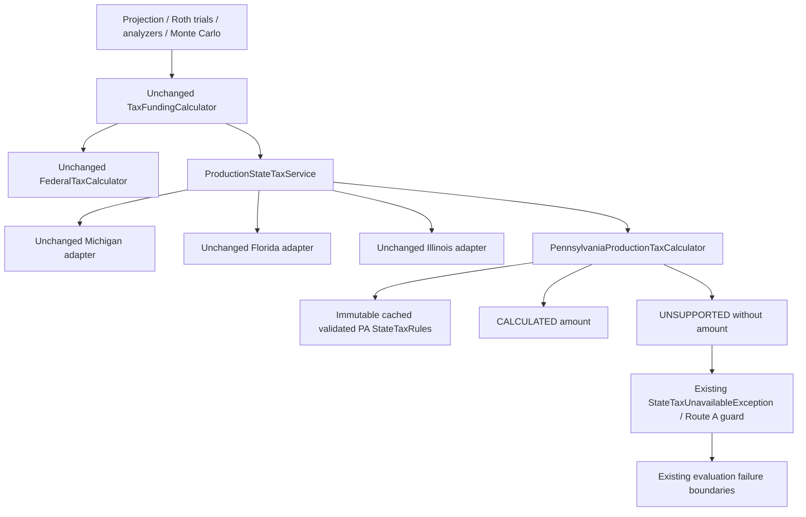

# Phase 6D.3B — Bounded Pennsylvania production integration

## Executive summary

Pennsylvania is registered through the existing production state-tax service, alongside Michigan, Florida and Illinois. Supported projections calculate normally. Material missing qualification, basis, transfer or successor facts return typed unavailability, without a numeric tax estimate. No other state or effective-rate override is enabled.

Verification date: October 13, 2026. The eight requested predecessor reports and the participant-facts / Route A implementation were reviewed. Focused, affected, non-benchmark and full-suite verification completed successfully. Existing financial expectations remain frozen.

## Official rules and source traceability

The packaged PA record was re-reviewed; no JSON, schema, rate, threshold or research-calculator rule changed. Official sources were reopened during this phase, not replaced by the dataset as legal authority.

| Rule | Bounded treatment | Source / applicable year |
| --- | --- | --- |
| Flat individual tax | 3.07% of admitted state-defined taxable income | [2026 REV-413(I)](https://www.pa.gov/content/dam/copapwp-pagov/en/revenue/documents/formsandpublications/formsforindividuals/pit/documents/2026/2026_rev-413i.pdf) |
| Income base / deductions | Separate PA categories; no federal-AGI starting base, standard deduction or personal exemption | [Revenue PIT overview](https://www.pa.gov/agencies/revenue/resources/tax-types-and-information/personal-income-tax) |
| Social Security | Retirement/survivor benefits excluded independently of federal inclusion | [61 Pa. Code 121.10(c)(7)](https://www.pacodeandbulletin.gov/secure/pacode/data/061/chapter121/s121.10.html) |
| Individual IRA / Roth IRA receipts | Ordinary normal-age receipts excluded; early receipts need cost recovery | [Revenue FAQ 1470, updated March 11, 2026](https://revenue-pa.custhelp.com/app/answers/detail/a_id/1470) |
| Complete IRA-to-Roth IRA transfers | Entire actual selected distribution must be transferred; retained/withheld portions require assessment | [Revenue FAQ 274, updated August 14, 2026](https://revenue-pa.custhelp.com/app/answers/detail/a_id/274) |
| Employer / pension qualification | Legal plan requirements plus participant retirement/service conditions; federal account label alone does not establish exemption | [Gross Compensation guide](https://www.pa.gov/agencies/revenue/forms-and-publications/pa-personal-income-tax-guide/gross-compensation) |
| Ordinary investment income | Ordinary bank interest, dividends and positive assessed investment gains remain taxable; no federal preferential rate | [Interest guide](https://www.pa.gov/agencies/revenue/forms-and-publications/pa-personal-income-tax-guide/interest), [Dividends guide](https://www.pa.gov/agencies/revenue/forms-and-publications/pa-personal-income-tax-guide/dividends), [Net Gains guide](https://www.pa.gov/agencies/revenue/forms-and-publications/pa-personal-income-tax-guide/net-gains-losses-from-the-sale,-exchange,-or-disposition-of-property) |

These sources support the stated retirement-planning boundary, not a complete PA-40 return. Ordinary IRA facts refer to the domain's individual-account representation; unrecorded exceptional arrangement/history is not certified. The prior audit's unusual early-exception ambiguity is not generalized into an exemption.

## Architecture

Production paths below are relative to `src/main/java/com/daviddunn/retirementplanner/`.

`StateTaxJurisdiction` permits exactly MI / FL / IL / PA. `ProductionStateTaxService` adds one immutable-registry entry. No PA branch was added to projection, funding, RMD, Roth optimization, analyzers, Monte Carlo or reporting pipelines. The single new financial implementation is `domain/tax/state/PennsylvaniaProductionTaxCalculator`.

`loadRules` obtains PA from the existing once-loaded `StateTaxDatasetRepository` cache. It checks the declared state-defined flat model, absence of deductions/exemptions/surcharges, three unlimited per-person rules, normal IRA age parameter, conversion qualification/boundary and expected income treatments. Unexpected rule shape requires adapter review. The eligibility age and rate come from JSON, not Java dollar/age/rate constants. Initialization is immutable and thread-safe; requests/results remain per evaluation.

The production adapter interprets actual runtime facts. It does not invoke the research calculator with invented qualification assertions. The isolated eight-state calculator and its data remain unchanged.

## Supported boundary

| Income / transaction | Production handling | Required facts / limitation |
| --- | --- | --- |
| Social Security retirement/survivor | Excluded | Authoritative category/aggregate; no invented taxable-owner split |
| Normal Traditional / Rollover individual IRA receipt | Excluded | Actual individual IRA, active owner, DOB, receipt boundary at/after dataset eligibility age |
| Individual IRA RMD / opening RMD | Same underlying IRA treatment | RMD label alone adds no exemption; opening historical receipt assessed conservatively at January 1 |
| Generated complete Traditional / Rollover IRA → same-owner Roth IRA | Excluded | Actual CONVERSION transaction with source/destination, full modeled executed amount, no generated withholding/retention |
| Normal eligible Roth IRA receipt | Excluded | PA normal-receipt age boundary established; federal modeled zero alone is not proof |
| Ordinary taxable interest | Taxable | Explicit ordinary income scalar / attributed amount, not unclassified bond income |
| Ordinary dividends / positive gains | Taxable | Explicit assessed ordinary amounts reconciled to the existing investment-income aggregate |
| Known cash / retained post-tax principal | Not income | Existing modeled nonretirement principal facts; not brokerage proceeds relabeled as exempt income |

The generated conversion engine is unchanged: actual source debit equals same-owner destination credit. A partially fulfilled requested target still transfers every executed dollar. Only trusted generated transaction facts meet this contract; arbitrary imported/external attributions are not transfer evidence. No external import, withholding or retention functionality was added.

## Unsupported boundary and reasons

| Material scenario | Generic reason |
| --- | --- |
| Employer-plan withdrawal / RMD / conversion with unavailable legal-plan qualification | MISSING_RETIREMENT_QUALIFICATION |
| Pension or survivor pension with unavailable original-plan qualification | MISSING_RETIREMENT_QUALIFICATION |
| Missing active recipient/account facts, including unassessed deceased-owner successor receipts | MISSING_RETIREMENT_QUALIFICATION |
| Early ordinary individual IRA receipt requiring contribution/history recovery | MISSING_DISTRIBUTION_BASIS |
| Unknown brokerage withdrawal gain or state investment basis | MISSING_DISTRIBUTION_BASIS |
| Early/nonqualified Roth IRA receipt requiring basis/order history | NONQUALIFIED_ROTH_BASIS_REQUIRED |
| Inherited IRA/election/successor history not admitted by this adapter | INHERITED_DISTRIBUTION_HISTORY_REQUIRED |
| External conversion without established complete transfer, IRA-to-Roth employer destination, unattributed retirement income or unclassified other income | UNSUPPORTED_TRANSACTION_TYPE |
| Pre-2026 PA rules | UNSUPPORTED_MODEL_RULE |

Participant separation and retirement-condition facts remain immutable and date-aware. They do **not** establish the rejected legal-plan characteristics. Filling those optional controls does not make PA employer/pension income exempt or calculable. There is no 457 domain category to invent. Ordinary inherited beneficiary exceptions may be legally tractable, but this stage deliberately does not admit inherited histories/elections; it does not claim those receipts are necessarily taxable.

Unsupported results carry PA/method/status/reasons/explanation and **no amount**. CALCULATED zero is distinct from UNSUPPORTED. Malformed contradictory source/category totals or a known wrong source year reject as input contracts; they are not normal unsupported taxpayer cases.

## State-defined calculation and reconciliation

The adapter first assesses each positive attributed source by type, transaction, owner and actual modeled receipt boundary. Each spouse is assessed separately. Qualified normal receipts do not consume a household exclusion cap. Opening RMD receipts are not retroactively qualified by a later birthday.

Actual modeled federal-included withdrawal/conversion amounts reconcile to their existing aggregates; duplicated excess and unattributed positive remainders cannot become exemptions. Gross cash is not summed into federal AGI or subtracted from an invented PA AGI. A normal IRA gross100000 / federal-included60000 receipt can be excluded at an eligible age without deriving PA basis; the same early receipt is unsupported.

Within the admitted model, remaining PA taxable components are explicit ordinary investment amounts. `TaxIncome.getTaxableInterestIncome` is the existing scalar carrying those boundary amounts; INTEREST/DIVIDEND/CAPITAL_GAIN records classify/reconcile it and are not added twice. A residual explicit ordinary-interest scalar is supported. This scalar is not federal AGI or taxable income. No federal deduction/exemption is imported. Final tax is admitted income × JSON rate, rounded once HALF_UP to cents.

Normal projection currently supplies zero separate investment-income scalar and generates no dividend/realized-gain ledger. Portfolio growth and brokerage principal remain unchanged. Positive investment fixtures validate the annual tax/funding boundary, not a new investment-income generator. Unknown brokerage proceeds are explicitly unsupported rather than gross-taxed or silently assigned zero gain.

## Tax year and residency

Validated rule year is 2026, with dataset version in calculated limitations. Future years reuse the nominal 2026 baseline under the existing Illinois-style planning convention, with explicit warning; no permanent legal validity or enacted future-law prediction is asserted. Historical pre-2026 PA rules are unavailable. Michigan's existing indexing policy is untouched.

Full-year selected residence applies throughout the projection. No moves, part-year/nonresident sourcing, multiple returns, local/property/sales/inheritance tax, Tax Forgiveness, detailed IRA/security basis, unusual early exceptions or specialized credits are modeled. Calculated limitations state state personal income tax only and omitted relief/local taxes. These omissions can matter, especially low-income relief and special bond sourcing.

## Funding, RMD and Roth behavior

The existing trial/final Route A guards detect unsupported before numeric tax arithmetic. No fabricated state-tax payment, successful funding result, insufficient-funds result or duplicate final source ledger is produced. Convergence settings, trial allocation, final allocation and ordering are unchanged.

For admitted IRA funding, additional withdrawals remain PA-exempt but can increase federal taxable income. Explicit investment income10000/100000 produces PA tax307/3070 through convergence, including cash/IRA funding cases. Mixed IRA→employer funding becomes unavailable as soon as the material employer source appears. The original live accounts remain unchanged.

Independent 80000 IRA spending worksheet: federal funding solves W = 8770 + .22W. PA funding is11243.59; year-end eligible IRA908756.41; next RMD39683.69 using the unchanged22.9 divisor. Michigan's corresponding12265.52 funding /907734.48 balance /39639.06 next RMD is unchanged. Differences are TAX_FUNDING_FEEDBACK and BALANCE_FEEDBACK_EFFECT, not rule changes.

Single/couple multi-year cases retain opening/annual owner RMD facts, complete conversions, actual source owners and untouched persisted balances. No file under `domain/rmd`, `domain/roth`, withdrawal/funding implementation, federal tax or projection implementation changed.

## Independent golden fixtures

`PennsylvaniaProductionTaxCalculatorTest` contains **35 JUnit worksheet/contract executions**. Expected tax amounts are independently literal arithmetic or verified exclusions/refusals, not calls to the implementation to generate expectations. All use 2026 Single/MFJ, specified DOB/receipt boundary and source allocation. Tax Forgiveness/local taxes are explicitly omitted from these gross state-tax worksheets.

| Group | Executions | Independent expected base / result |
| --- | ---: | --- |
| Single/MFJ ordinary investment and IRA mixtures | 8 | Investment0/1/10000/20000/1000000; ×.0307 gives0/.03/307/614/30700; IRA does not shelter investments |
| Interest/dividend/gain plus IRA80000 | 3 | Investment20000 remains base; tax614 |
| SS40000 alone / interest10000 | 2 | PA base0/10000; tax0/307, independent of federal SS inclusion |
| IRA ordinary / RMD / opening RMD | 3 | Eligible100000 receipt; base0/tax0 |
| Complete IRA conversion25000/100000/250000 | 3 | Complete transferred amount excluded; base0/tax0 even at age40 |
| Employer ordinary / RMD / conversion | 3 | Explicit affirmative participant facts still insufficient; no estimate |
| Pension / survivor pension | 2 | Missing original legal-plan qualification; no estimate |
| Early IRA / early Roth / normal Roth | 1 combined execution | Early cases unavailable; normal Roth zero |
| External conversion / unknown brokerage basis | 1 combined execution | No estimate; distinct transaction/basis reasons |
| Eligibility date minus day / exact / plus day | 3 | Under boundary unavailable; exact/above excluded |
| Couple both/one/neither owner age-eligible | 4 | Older spouse cannot qualify younger owner's receipt |
| Inherited and unattributed income | 1 combined execution | No estimate, history/transaction reasons |
| Gross/federal-included difference | 1 combined execution | Normal gross100000/included60000 +interest10000:307; early scenario unavailable |

Actual production conversion examples separately execute25000 /100000 /250000, reconcile complete actual source records, and compare every available monetary projection getter numerically against otherwise-identical Florida. No federal logic changes. Additional projection/funding/analyzer/Monte Carlo/persistence/UI cases test whole-plan behavior rather than tax-return certification.

## Four-state comparison

Independent MFJ2026 22%-bracket-fill worksheet, same facts and federal taxable target211400:

| Metric | Michigan | Florida | Illinois | Pennsylvania |
| --- | ---: | ---: | ---: | ---: |
| Federal tax | 35932.00 | 35932.00 | 35932.00 | 35932.00 |
| State tax | 4104.65 | 0.00 | 0.00 | 0.00 |
| Total tax | 40036.65 | 35932.00 | 35932.00 | 35932.00 |
| Tax-funding withdrawal | 40036.65 | 35932.00 | 35932.00 | 35932.00 |
| Actual conversion | 203563.35 | 207668.00 | 207668.00 | 207668.00 |
| Ending assets / net worth | 1059963.35 | 1064068.00 | 1064068.00 | 1064068.00 |
| After-tax estate | 870863.35 | 874968.00 | 874968.00 | 874968.00 |

Federal worksheet2480 +76000×.12 +110600×.22 =35932. PA's admitted complete conversion and IRA funding are exempt. The same federal target/search produces the larger conversion after lower state-tax funding. Values display cents; existing convergence tolerance can leave small raw residuals. This does not alter the optimizer.

Four-year single case with annual100000 conversion, final2030:

| Metric | Michigan | Florida | Illinois | Pennsylvania |
| --- | ---: | ---: | ---: | ---: |
| Federal tax | 22310.28 | 22310.28 | 22310.28 | 22310.28 |
| State tax | 1410.96 | 0.00 | 0.00 | 0.00 |
| Total tax / funding | 23721.25 | 22310.28 | 22310.28 | 22310.28 |
| Conversion | 100000.00 | 100000.00 | 100000.00 | 100000.00 |
| Ending assets | 840828.33 | 848290.88 | 848290.88 | 848290.88 |
| After-tax estate | 790343.37 | 797805.92 | 797805.92 | 797805.92 |

Cash funding preserves identical federal income here; different state tax reduces available cash and its later returns. Couple2030 values are equal in this admitted below-MI-cap case: federal/total tax20011.02, state0, conversion100000, ending assets1364299.99 and estate1239237.92. Evidence: `target/phase6d3b-*-abcd.txt`.

## Analyzer and Monte Carlo behavior

Single current/alternate strategies, couple81-cell integrated grid and longevity-weighted scenarios run through the same tax service. A pension-unsupported baseline aborts; unsupported alternate grid cells retain EVALUATION explanations, no metrics and no baseline differences. They cannot rank as valid calculated strategies. The existing weighted wrapper retains the typed cause; one common presentation helper now recognizes it and preserves jurisdiction/reason rather than showing only a generic failure. This change is generic, not PA routing/scoring logic.

Fixed and longevity seeded supported couple analyses repeat exactly. Single fixed seeded coverage also passes. Unsupported deterministic reference or extended simulation world aborts the entire affected analysis; no partial success/failure rates, means or percentiles are returned. Existing wrappers retain year/jurisdiction/reason. No mortality, market, insolvency or statistical semantics changed.

An exploratory500-world longevity run on the ordinary lower-cash fixture refused world29 in2061: the unchanged withdrawal path accessed a deceased owner's IRA without established successor entitlement. A permanent test preserves that typed refusal. It is not silently exempted or counted as failed/successful retirement. The successful comparative longevity performance fixture uses an explicitly disclosed20000000 checking buffer to remain within known cash/active-owner receipts across all500 worlds. This is a supported stress workload, not evidence that every long-lived PA household is calculable. No ownership/successor redesign was made.

## Persistence, wizard and assumptions

PA uses the unchanged `planningAssumptions.stateTaxAssumptions` group with jurisdictionPA, simplified method and null override. JSON repository, scenario copy and legacy missing-field→MI behavior remain intact. Explicit other/unknown jurisdictions remain rejected. Participant fields/default UNKNOWN/date policy are unchanged.

Both selectors derive their four choices from the production enum. The wizard keeps isolated draft, required indicator, inline validation, direct tooltip, Create/no-auto-save and Cancel/dirty-state semantics. Single/couple File→New→PA→Create→Save→Reload→Projection workflows use the admitted IRA/cash subset. No PA-specific questions or plan-document assertions were added. Existing tab Apply/Cancel/dirty behavior is exercised for PA. Selector help explains the supported boundary and nominal rule-year policy.

## Results, CSV, PDF and visual acceptance

Calculated results use the existing generic jurisdiction/amount rows and limitation tooltip. CSV retains its format, PA/method columns and blank Michigan-only diagnostics. PDF uses the existing full-year state table; one generic note clarifies state personal income tax only, local taxes and omitted credits/relief. No PA-specific report branch or layout redesign was added.

Unsupported projection never supplies rows to a successful export. Existing application warning says no reliable estimate / no completed projection and preserves the user's plan; it does not show$0. Analyzer and Monte Carlo unavailable paths are tested independently.

Six rendered states were generated and directly inspected under `target/phase6d3b-preview`: wizardPA, assumptionsPA, supportedPA year details, PDF summary, PDF state-tax page and PA unavailable warning. CSV header/data were inspected. Layout fits, the four-state selector is readable and direct input/result tooltips are present without duplicate help icons. This is automated desktop/PDF rendering and interaction, not an unrecorded human manual click-through session.

## Existing-state freeze

Michigan targets remain174.25 /348.50 /1125.83 /2251.65. Florida's20 zero-tax cases and Illinois's39 worksheets remain unchanged. All16 original financial fingerprints match, including deterministic/fixed/bracket-fill/grid/weighted/seeded Monte Carlo metrics. An additional direct comparison against the eight captured Phase6D2 Illinois workload hashes also matches exactly, including both500-trial seeded modes. No numeric financial expectation or financial oracle resource was updated.

Old tests that iterated all production enums over pension/brokerage fixtures now explicitly retain their original MI/FL/IL scope; PA has separate admitted/refusal fixtures. This preserves every original scenario instead of weakening its expectations. Historical audit admission-set assertions are updated to four states; their tax worksheets are unchanged. PDF explanatory text changes, not financial values.

## Performance

JDK25.0.4.1, eight reported processors, sequential workloads,512MiB initial/1536MiB maximum heap, three warm-up batches and five measured batches. Timing excludes hashing/output. The existing16-workload fingerprint oracle remains separate and unchanged.

Eight admitted workloads per MI/IL/PA use identical facts across states. Four-year Single/couple batches150; fixed30years×50; bracket30years×10; grid81+baseline; weighted9×2; fixed/longevity500 trials, seed417. The long Monte Carlo fixture uses the disclosed large cash buffer. One stable fingerprint per workload across five measured runs.

| Batch | Michigan median ms | Illinois median ms | Pennsylvania median ms |
| --- | ---: | ---: | ---: |
| Single150 | 54.67 | 30.99 | 28.95 |
| Couple150 | 74.44 | 44.98 | 42.62 |
| Fixed30years×50 | 216.27 | 148.47 | 148.98 |
| Bracket30years×10 | 41.44 | 35.02 | 34.18 |
| Grid81 | 193.07 | 98.81 | 86.60 |
| Weighted9×2 | 40.44 | 21.36 | 18.67 |
| FixedMC500 | 1573.84 | 1548.34 | 1535.06 |
| LongevityMC500 | 1329.39 | 1262.11 | 1246.79 |

PA allocated bytes per500 fixed/longevity batch: approximately5.785/4.588 billion, versus IL5.792/4.595 billion. These are cumulative allocation, not retained heap. Retained heap is not independently compared in this phase. No repeated parsing, mutable cache, pooling, financial arithmetic/convergence shortcut or speculative optimization was introduced.

A direct pre/post activation comparison also uses only the committed prior enum/registry compiled into an ignored leading classpath, with unchanged financial classes and the same current harness. No checkout, source replacement, index/history operation or risky branch was used. All measured original16 financial hashes agree. The matched fresh-JVM results are below; changes in short batches are observations, not precise incremental routing costs.

| Original workload | Pre-activation median ms | Post-activation median ms | Change |
| --- | ---: | ---: | ---: |
| MI Single150 | 62.06 | 48.20 | -22.34% |
| MI couple150 | 60.63 | 63.85 | +5.32% |
| MI fixed30years×50 | 188.26 | 205.25 | +9.03% |
| MI bracket30years×10 | 41.47 | 52.36 | +26.25% |
| MI grid81 | 181.44 | 163.31 | -9.99% |
| MI weighted9×2 | 34.58 | 42.99 | +24.31% |
| MI fixedMC500 | 1660.39 | 1652.67 | -0.47% |
| MI longevityMC500 | 1442.90 | 1372.95 | -4.85% |
| FL Single150 | 25.19 | 24.04 | -4.56% |
| FL couple150 | 39.24 | 38.71 | -1.36% |
| FL fixed30years×50 | 159.07 | 155.65 | -2.15% |
| FL bracket30years×10 | 37.09 | 35.67 | -3.84% |
| FL grid81 | 102.91 | 91.79 | -10.81% |
| FL weighted9×2 | 18.84 | 19.07 | +1.22% |
| FL fixedMC500 | 1615.64 | 1607.67 | -0.49% |
| FL longevityMC500 | 1272.30 | 1309.61 | +2.93% |

The larger MI short-batch increases were investigated, not hidden. Separate isolated confirmations with five warm-ups/seven measurements give bracket51.648→49.750ms (-3.67%) and weighted54.454→52.480ms (-3.63%). The first weighted confirmation overlapped regression work; it is excluded from timing conclusions and replaced by the isolated run. Cross-JVM short-batch variation is substantial; no sustained material activation penalty is established by these observations. No optimization or correctness tradeoff was made.

JDK Flight Recorder profiling is separate from unprofiled comparisons. Twenty timed MI bracket batches contained277 execution samples: production service5, MI adapter6, existing MI calculator7, funding25, BigDecimal113 and BigInteger50 inclusive stack occurrences. Dataset repository0 and PA calculator0. Counts overlap and are not exclusive percentages. This does not show repeated rule parsing or PA work in Michigan's hot calculation path. Static source inspection also confirms immutable rule loading/validation outside annual loops. Profiling summaries/raw measurements are under ignored `target/phase6d3b-bracket-profile`, `phase6d3b-performance-*` and `phase6d3b-*-isolated` artifacts.

Full-suite existing5000-trial benchmarks additionally observed5.40MiB fixed /15.13MiB longevity retained heap; these are uncontrolled suite observations, not a matched PA retained-memory comparison.

## Verification

Every Maven command uses IntelliJ's bundled executable and the mandatory project-local `.codex-m2/repository`. Logs/artifacts are ignored under `target/phase6d3b-*`.

| Selection | Run | Passed | Failed | Errors | Skipped |
| --- | ---: | ---: | ---: | ---: | ---: |
| Pre-edit frozen targets / IL worksheets / original16 fingerprints | 106 | 105 | 0 | 0 | 1 |
| Final focused, visual previews enabled | 272 | 270 | 0 | 0 | 2 |
| Final affected | 1442 | 1431 | 0 | 0 | 11 |
| Complete non-benchmark | 2359 | 2344 | 0 | 0 | 15 |
| Complete benchmark-inclusive | 2380 | 2361 | 0 | 0 | 19 |
| BenchmarkTest subset within full suite | 21 | 17 | 0 | 0 | 4 |
| Dedicated warmed original16 workload benchmark | 1 | 1 | 0 | 0 | 0 |
| Dedicated warmed admitted24 workload benchmark | 1 | 1 | 0 | 0 | 0 |

Final logs: `target/phase6d3b-focused-complete.log`, `phase6d3b-affected-complete.log`, `phase6d3b-nonbenchmark.log` and `phase6d3b-full.log`. Complete non-benchmark took2m30s; full took6m26s. Dedicated benchmarks: `phase6d3b-performance-frozen.log` / `phase6d3b-performance-bounded-final.log`; they are separate runs, not added to full-suite counts. Original prototype/dataset tests pass unchanged.

There are61 new JUnit executions across seven new test classes, including the normally opt-in visual execution. Six additional existing wizard executions and one automatic PA participant-persistence parameterization account for the68-test increase over the Phase6D3A1 baseline. Existing financial numbers and oracle resources have zero expectation updates.

Initial new-test comparisons used string0 versus0.00 and were corrected to numeric comparisons without changing amounts. The initial lower-cash longevity benchmark refusal is preserved as an intentional unavailable scenario; it is not a passing performance run or fabricated statistics.

## Exact file inventory

Created:

- `PHASE-6D3B-PENNSYLVANIA-PRODUCTION-INTEGRATION.md`
- `src/main/java/com/daviddunn/retirementplanner/domain/tax/state/PennsylvaniaProductionTaxCalculator.java`
- `src/test/java/com/daviddunn/retirementplanner/domain/tax/state/PennsylvaniaProductionTaxCalculatorTest.java`
- `src/test/java/com/daviddunn/retirementplanner/domain/projection/PennsylvaniaProductionProjectionTest.java`
- `src/test/java/com/daviddunn/retirementplanner/domain/projection/PennsylvaniaFundingTest.java`
- `src/test/java/com/daviddunn/retirementplanner/app/montecarlo/PennsylvaniaMonteCarloIntegrationTest.java`
- `src/test/java/com/daviddunn/retirementplanner/app/socialsecurity/PennsylvaniaIntegratedAnalysisTest.java`
- `src/test/java/com/daviddunn/retirementplanner/ui/socialsecurity/PennsylvaniaAnalysisUnavailablePresentationTest.java`
- `src/test/java/com/daviddunn/retirementplanner/ui/wizard/PennsylvaniaProductionVisualTest.java`

Modified:

- `src/main/java/com/daviddunn/retirementplanner/domain/model/StateTaxJurisdiction.java`
- `src/main/java/com/daviddunn/retirementplanner/domain/tax/state/ProductionStateTaxService.java`
- `src/main/java/com/daviddunn/retirementplanner/ui/views/AssumptionsView.java`
- `src/main/java/com/daviddunn/retirementplanner/ui/socialsecurity/SocialSecurityAnalysisFailurePresentation.java`
- `src/main/java/com/daviddunn/retirementplanner/app/export/ProjectionPdfExporter.java`
- `src/test/java/com/daviddunn/retirementplanner/app/socialsecurity/StateTaxPerformanceAuditTest.java`
- `src/test/java/com/daviddunn/retirementplanner/domain/projection/FloridaProductionProjectionTest.java`
- `src/test/java/com/daviddunn/retirementplanner/domain/projection/IllinoisProductionProjectionTest.java`
- `src/test/java/com/daviddunn/retirementplanner/domain/projection/StateTaxUnavailableProjectionTest.java`
- `src/test/java/com/daviddunn/retirementplanner/domain/tax/state/StateTaxUnavailableContractTest.java`
- `src/test/java/com/daviddunn/retirementplanner/domain/tax/state/simplified/PennsylvaniaProductionAdmissionAuditTest.java`
- `src/test/java/com/daviddunn/retirementplanner/domain/tax/state/simplified/PennsylvaniaParticipantFactsAuditTest.java`
- `src/test/java/com/daviddunn/retirementplanner/ui/wizard/CompleteWizardFixtures.java`
- `src/test/java/com/daviddunn/retirementplanner/ui/wizard/StateTaxWizardIntegrationTest.java`

No resource/schema, persisted domain field, participant fact, Michigan/Florida/Illinois tax implementation, projection/funding/RMD/Roth algorithm, mortality/market model or expected financial value changed. Local benchmark overlays, CSV/PDF/images and logs remain ignored artifacts. Nothing staged, committed or pushed.

## Remaining limitations and recommendation

Pennsylvania is useful for the bounded individual-IRA / SS / known ordinary-investment subset. It is intentionally unavailable for material pension/employer legal-plan gaps, early/basis-dependent receipts, unassessed Roth/history, inherited/successor receipts and unknown external conversion splits. Selection is not a guarantee that every plan source is admitted.

No PA-40, basis engine, local tax, Tax Forgiveness, employment-history or rejected plan-document questions were added. Effective-rate override and every other researched state remain disabled. Obtain separate approval before enabling another state or expanding PA's boundary.

Final tracked `git diff --check` passes. All nine new files were independently checked for trailing whitespace and blank EOF; zero issues. The staged diff is empty. No files were staged, committed or pushed.

PHASE-6D3B-PENNSYLVANIA-PRODUCTION-INTEGRATION-IMPLEMENTED
