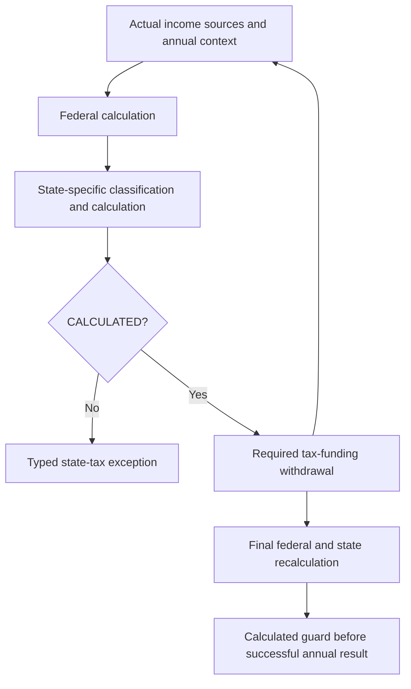

# Phase 6D.5A — Iowa and Mississippi production admission audit

Audit date: October 14, 2026. Audit only. IA and MS remain absent from both the
production enum/registry and the eight-state research catalog. No production,
persistence, UI, funding, optimizer, analyzer, Monte Carlo or financial golden file
was edited. No staging, commit or push.

## Executive summary

| State | Exactly one admission category | Recommendation |
| --- | --- | --- |
| Iowa | **C — REQUIRES_SMALL_GENERIC_EXTENSION** | A useful own-IRA/SS/ordinary-investment subset is defensible, but a truthful federal-taxable-income bridge and relief/credit calculation are required. Do a small, separately approved architecture gate before bounded integration; refuse missing plan, survivor, disability and basis facts. |
| Mississippi | **D — NOT_READY** | Retirement eligibility and conversion interpretation remain insufficiently verified for ordinary retirement projections. A separate effective-year rule gate is also necessary because enacted reductions make a static 2026 rate misleading. Obtain official clarification before a retirement production stage. |

Do not take the jurisdictions together into Phase 6D.5B. Iowa has a narrower,
more concrete route; Mississippi should remain a separate research/admission stage.
D does not mean Mississippi needs a tax-preparation engine: investment-only
worksheets are possible, and missing retirement facts can be refused. It means
this audit cannot certify a useful ordinary retirement admission merely by
implementing the year schedule or using age 59½ as a substitute for eligibility.

The stop conditions were honored: legal qualification, uncertain MS conversions,
effective-year dispatch, and Iowa tax-base differences are documented below.
No workaround or new qualification assertion was implemented.

## Context and authoritative implementation

Reviewed the nine requested predecessor reports, their admission/qualification,
attribution, financial-freeze and verification sections, and the current classes
listed below. Historical report registry counts describe their own phases, not
today's coverage. In particular, the Phase 6D.3A report's statement that separation
facts did not exist is superseded by Phase 6D.3A.1 and actual code.

Paths in this section are below `src/main/java/com/daviddunn/retirementplanner/`.

| Current code | Audit finding |
| --- | --- |
| `domain/model/StateTaxJurisdiction`; `domain/tax/state/ProductionStateTaxService` | Exactly 11 enabled states: AK/FL/IL/MI/NV/NH/PA/SD/TN/TX/WY. Immutable enum-map dispatch; MI adapter, IL calculator, PA bounded calculator, shared zero-tax strategy. IA/MS names reject. |
| `domain/model/StateTaxAssumptions` | One full-year residence for every year; simplified only; override rejects. No move/residency timeline. Legacy defaults remain unchanged. |
| `domain/tax/state/StateTaxCalculationRequest`; `TaxHouseholdContext` | Immutable annual tax year, filing status, owner DOBs, actual/active owners, annual distribution boundary, pension facts, attributed income, federal result and projected government rules. Year must match boundary. |
| `ProductionStateTaxResult`; `StateTaxUnavailableException` | CALCULATED has an amount; UNSUPPORTED has none and must have stable reasons/explanation. Numeric accessor throws. PROVISIONAL is rejected in production. |
| `domain/tax/state/simplified/SimplifiedStateTaxCalculator`; `StateTaxRules`; `StateTaxRequest` | Research calculator supports flat/progressive rates, AGI/FTI/state-defined bases, category subtractions, per-person ages and qualified events, deductions, fixed credits, income boundaries. Supplied qualification assertions in research requests are not production facts. |
| `persistence/StateTaxDatasetRepository`; `resources/tax/state/state-tax-2026.json` | Cached immutable eight-state 2026 catalog; fixed code count, year and qualification vocabulary. No IA/MS rules, effective-year series or generic law selector. Not the production activation registry. |
| `domain/income/IncomeSourceAttribution`; `domain/tax/TaxIncomeAttribution` | Actual account identity/type/owner, gross, optional modeled federal amount, transaction purpose/year, conversion destination, original pension owner/recipient and participant facts. Reconciles metadata without adding income twice. |
| `domain/financial/Account`; `domain/model/AccountType`; `InheritedAccountInformation` | Own traditional/rollover IRA, 401(k), 403(b), Roth IRA/401(k), inherited traditional/Roth IRA, brokerage/cash. No 457, separate annuity type, basis ledger or account-specific Roth five-year history. Inherited DOB/death/relationship exists. |
| `domain/income/Pension`; `HouseholdPensionIncomeCalculator`; Social Security models/provider | Benefit amounts, ownership, dates/COLA/survivor benefit. Survivor attribution preserves original owner separately. No legal pension plan/source certification. Annual authoritative SS supplies tax cash flow; no state qualification inferred from SS retirement election. |
| `domain/model/RetirementParticipantFacts` | Two arrangement-specific assertions and optional dates, not legal-plan qualification; applied through explicit boundary methods. |
| `domain/tax/FederalTaxCalculator`; `FederalTaxCalculation`; `TaxIncome` | Federal model sums pensions/deferred/conversion/ordinary-investment scalar plus taxable SS, then applies projected standard deduction. Result stores AGI, taxable SS, standard deduction and clamped taxable income. No separate itemization, enhanced senior deduction, owner-based additional standard deduction or deduction decomposition. |
| `domain/tax/TaxFundingCalculator`; `domain/roth/RothConversionBracketFillCalculator`; `ProjectedPortfolioRothConverter` | Trial and final federal/state calculations share source facts; calculated guard before arithmetic. Conversion previews retain actual same-owner sources; actual transfers and shortfalls remain distinct. |
| `domain/projection/ProjectionEngine`; integrated evaluation services; `app/montecarlo/MonteCarloAnalyzer` | Unsupported exceptions propagate through existing evaluation/failure boundaries, not insolvency or fabricated tax-zero results. |

The ordinary projection currently supplies zero separate investment income. There
is no generated dividend/gain ledger: portfolio return and brokerage principal
must not become income. Independent investment worksheets concern the tax-service
boundary, not newly supported investment cash-flow generation.

## Official source register

All sources below were checked October 14, 2026. Current guidance is not automatically
a tax-year-2026 instruction booklet. IDs used in worksheets/matrices resolve here.
Sources support legal conclusions; admission restrictions are audit inferences.

| ID / official source and URL | Year / effective date | Specific rule and modeling implication | Uncertainty |
| --- | --- | --- | --- |
| IA-T — [IDR 2026 rate announcement](https://revenue.iowa.gov/press-release/2025-10-21/idr-announces-2026-individual-income-tax-and-interest-rates) | Tax year 2026; published October 21, 2025; SF2442 enacted May 2024 | Individual rate 3.8%; no investment preferential rate in this flat system | Does not certify deductions or qualification |
| IA-B — [IDR federal taxable income instructions](https://revenue.iowa.gov/taxes/tax-guidance/individual-income-tax/1040-expanded-instructions/federal-taxable-income) | Explicitly 2025, latest expanded instructions located | Starts at federal taxable income; can reconstruct a negative starting amount where federal form clamps at zero | Final 2026 expanded instructions not located; enduring base independently checked in IA-N |
| IA-N — [2026 Iowa Code §422.7](https://www.legis.iowa.gov/docs/code/2026/422.7.pdf) | 2026 codification, generated December 2025 | Federal §63 base; state modifications, retirement/SS subtractions; securities adjustments; health coverage deduction | Comprehensive return adjustments remain outside bounded planning |
| IA-S — [2026 Code Chapter 422, §422.7(8)](https://www.legis.iowa.gov/docs/code/2026/422.pdf) | 2026 | Removes federally taxable SS; subtract included portion only | No uncertainty for ordinary modeled SS |
| IA-R — [IDR retirement income guidance](https://revenue.iowa.gov/taxes/tax-guidance/individual-income-tax/retirement-income-tax-guidance) | Published March 13, 2025; full exclusion effective tax years beginning January 1, 2023; occupational survivor addition from 2024 | Year-end age 55, disability and survivor alternatives; per-spouse eligibility; includes IRA/Roth conversion income | Unusual survivor wording needs reconciliation with IA-A; no invented survivor admission |
| IA-A — [IAC 701—302.47, February 5, 2025 compilation](https://www.legis.iowa.gov/docs/iac/rule/02-05-2025.701.302.47.pdf) | Rule amendment effective February 14, 2024; applies from 2023 | Documented qualified arrangements; own IRA and Roth conversion listing; excludes nonqualified annuities/deferred plans; survivor relationship/insurable interest and disability criteria | DOB/account label alone cannot certify employer/pension legal plan |
| IA-Q — [IDR Schedule 1](https://revenue.iowa.gov/taxes/tax-guidance/individual-income-tax/1040-expanded-instructions/ia-1040-schedule-1) | 2025 instructions; current enduring modifications checked against IA-N | Expressly lists 403(b)/457(b); senior health-insurance deduction worksheet adds retirement/SS and deduction items back for its $100,000 test | Payer/post-tax/reimbursement details unavailable |
| IA-C — [2026 Code §422.12](https://www.legis.iowa.gov/docs/code/2026/422.12.pdf) | 2026 | Nonrefundable $40 Single/$80 MFJ personal credit; $20 age-65 credit per eligible filer, including first day after tax year; dependent/blind credits | Dependents/blindness omitted in household model, not invented |
| IA-L — [2026 Code §422.5](https://www.legis.iowa.gov/docs/code/2026/422.5.pdf) | 2026 | Low-income exemption/reduction: $9,000 Single/$13,500 joint; $24,000/$32,000 senior; non-Single alternative tax 4.3% of excess; deduction addbacks | Cannot test thresholds on clamped FTI alone |
| IA-X — [IDR Iowa tax instructions](https://revenue.iowa.gov/taxes/tax-guidance/individual-income-tax/1040-expanded-instructions/iowa-tax) | 2025 | Shows alternate-tax comparison and applicable addbacks | Recheck final 2026 worksheet before integration |
| IA-E — [IDR What's New](https://revenue.iowa.gov/taxes/tax-guidance/individual-income-tax/1040-expanded-instructions/whats-new) | 2025 with explicit 2026 upcoming section | Enhanced federal senior deduction flows through FTI but is added back in relief/health tests; 2026 estimated-payment threshold $1,000 | Estimated payment threshold is not an income-tax exemption |
| FED-E — [IRS enhanced senior deduction](https://www.irs.gov/newsroom/check-your-eligibility-for-the-new-enhanced-deduction-for-seniors) | 2025–2028, current March 2026 guidance | $6,000 eligible senior deduction with MAGI phaseout; scheduled expiration relevant to an Iowa FTI bridge | Full federal verification/redesign is outside this audit |
| MS-G — [MS DOR General Information](https://www.dor.ms.gov/general-information) | Current page; expressly labels 2026 rate; latest deduction table | 2026 4% over $10,000; deductions $2,300/$4,600; exemptions $6,000/$12,000; age allowance $1,500; spouse allocation | Mixed page still shows 2025 4.4% elsewhere; use tax-year table, not filing-calendar heading; exact age boundary recheck needed |
| MS-F — [MS individual FAQ](https://www.dor.ms.gov/individual/individual-income-tax-frequently-asked-questions) | Current but rate paragraph refers to 2025 return season | SS excluded; retirement conditional on requirements; investments taxable; special financial-institution capital gain exception; spouse death filing context | FAQ says informal interpretation; its 4.4% paragraph is not 2026 law |
| MS-R — [MS DOR Title 35, Part III, Subpart 2 Chapter 07](https://www.dor.ms.gov/sites/default/files/Individual/Part%20III%20Income%20and%20Franchise.pdf) | Current DOR-hosted compilation, indexed as published 2025; chapter p.18 | Retirement allowance/IRA categories, deferred compensation eligibility at receipt, Roth follows IRC, early distributions excluded, extension to retiree's beneficiaries | Full PDF direct fetch repeatedly failed; official indexed chapter text inspected; no conversion-specific determination found |
| MS-Y — [MS DOR enacted 2025 legislation, HB1](https://www.dor.ms.gov/forms-resources/laws-regulations/2025-legislation) | Enacted 2025; calendar rates effective 2027/2028/2029/2030; conditional cuts 2031+ | Known fixed reductions and contingent later reductions; future-year selector required | Cannot forecast revenue certification or rate-zero year |
| MS-I — [DOR Form 80-100 entry](https://www.dor.ms.gov/node/6380), [2025 instructions PDF](https://www.dor.ms.gov/sites/default/files/tax-forms/individual/80100251%202.pdf) | Form year 2025; posted January 21, 2026 | Confirms booklet is 2025, not 2026 merely because posted in 2026 | PDF fetch unavailable; final 2026 instructions not located |
| MS-D — [DOR 1099 reporting guidance](https://www.dor.ms.gov/news/1099-guidance-recipients), [official recipient PDF](https://www.dor.ms.gov/sites/default/files/news/1099%20guidance%20for%20recipients.pdf) | February 2025 current guidance | Interest/dividend reporting separate from retirement receipts | Does not resolve basis or retirement conversion exemptions |
| MS-H — [DOR 2022 instructions](https://www.dor.ms.gov/sites/default/files/tax-forms/individual/80100221.pdf), [2021 instructions](https://www.dor.ms.gov/sites/default/files/tax-forms/individual/80100211_0.pdf) | Explicitly historical, not numerical 2026 authority | Ordinary/qualified dividends included; gains have no preferential tax rate; supports category mechanics | Current guidance/2026 instructions must control any changed rule |
| MS-26 — [MS DOR enacted 2026 legislation](https://www.dor.ms.gov/forms-resources/laws-regulations/2026-legislation) | 2026 session summary, current October 2026 | No replacement individual-rate schedule listed; HB4073 changes service requirements for certain new state employees; targeted charitable/business credits remain separate | Summary is not comprehensive statutory text; no retirement-plan eligibility shortcut inferred |

The official HB1 legislative host and direct MS administrative/booklet PDF opens
were unavailable. MS DOR's enacted-law summary independently provides the fixed
schedule. Direct current Mississippi Code via DOR's Lexis link was not accessible;
§27-7-5 and §27-7-15 are verification targets, not statutes falsely claimed read here.
Iowa ARC7109C is a **2023 proposed notice**, not adopted law; it was checked and
rejected as the controlling source in favor of the adopted IA-A compilation.
Iowa's general individual FAQ still displays old $6,000/$12,000 capped retirement
exclusions; that stale guidance was rejected. Neither older MS rate law's “2026
and thereafter 4%” nor these old Iowa caps is a 2026 admission rule.

## Iowa tax model

Bounded ordinary resident calculation must start with **unclamped/reconciled
federal taxable income**, apply state additions/subtractions once, then floor the
state taxable base at zero. Federal standard deduction is already incorporated:
do not subtract a separate Iowa standard deduction. Use 3.8%, relief comparison
where applicable, and nonrefundable personal/age credits. [IA-B, IA-T, IA-C, IA-L]

For example, an independently supplied FTI of $80,000 including a $40,000 eligible
IRA receipt yields a $40,000 state base, not $80,000 and not a second federal
deduction. Own IRA-only eligible income produces zero, not a negative tax.
Exclusions are limited to the federally included part; full gross SS is not
subtracted from a base containing only taxable SS. [IA-N, IA-S]

Important additions/subtractions include government/municipal securities, SS,
qualifying retirement and special business/agricultural/gain adjustments. Ordinary
bank interest, ordinary/qualified dividends and positive ordinary ST/LT gains
remain taxable at the flat rate; special bond sourcing, farm/business exclusions,
losses and unusual transactions stay outside admission. No broad high-income
retirement-exclusion cap was found; relief/deduction tests have separate rules.
These conclusions do not admit all forms of interest or all asset-sale gains.
[IA-N, IA-T]

The generic fixed filing-threshold mechanism is insufficient for both Iowa's
retention-of-threshold tax reduction and minimum-of-regular/alternate calculation.
Single and MFJ are available domain statuses; HOH/MFS/qualifying surviving spouse
return-specific elections are not additional production choices. Modeled filing
status stays configured through death year and Single thereafter. [IA-L, IA-X]

Retirement-sensitive items must be documented even when omitted from a planning
estimate: senior post-tax insurance/Medicare deduction has payer and reimbursement
conditions and a special income test; ordinary Medicare annual expense alone is
not all deductible premiums. Dependents, blindness, itemization, charitable and
special occupation credits cannot be guessed. A bounded adapter may disclose
omitted ancillary benefits consistently with prior planning approximations; if
a requested calculation relies on those facts, refuse rather than fabricate them.
Do not create an insurer/basis/tax-return subsystem. [IA-Q, IA-C]

A material bridge gate: the existing federal result is an MVP taxable base, not a
complete §63 return. It does not include owner-age additional standard deductions
or enhanced senior deduction, and it clamps negatives. Blindly calling it Iowa
FTI would hide omitted deductions. A small reusable annual tax-base reconciliation
capability should preserve raw base/deduction components and permit Iowa-only
reconciliation or explicit documented approximation. Do not fix the federal
calculator or change other states under this audit. [IA-B, IA-E; actual code above]

## Mississippi tax model

Use state total income with state exclusions/adjustments, then MS deductions and
exemptions. Do not import federal taxable income or subtract the federal standard
deduction. The federal AGI scalar is useful for reconciliation of the narrow
ordinary model, not an unconditional legal definition of Mississippi's base.
Ordinary owner-known investment receipts can be independently summed; special
state/federal differences must refuse or remain expressly out of scope. [MS-G, MS-H]

For a Single filer below the age-allowance boundary with $60,000 ordinary interest:
$60,000 − $2,300 − $6,000 = $51,700; the $10,000 zero-rate band then leaves $41,700
at 4% = **$1,668.00** in 2026. The zero band is a rate band after deductions, not
another standard deduction or gross-income filing threshold. [MS-G]

Married joint/combined mechanics are not reliably reproduced by automatically
doubling a household band. Deductions/exemptions may be allocated; separate spouse
tax computations need actual income ownership. Joint investment ownership is not
a proven 50/50 split. Model only owner-established supported cases after confirming
the chosen bounded joint-return convention; refuse ambiguous allocations. No
automatic $20,000 household shelter is admitted by this audit. [MS-G]

Ordinary interest/dividends and positive ordinary gains are taxable; no federal
preferential qualified-dividend/LT-gain rate is borrowed. Return of capital,
state-exempt securities and special financial-institution share gains need additional
facts and remain outside coverage. Retirement adjustment is not a deduction for
all income earned by a retiree. [MS-F, MS-D, MS-H]

No new general retirement credit or enacted change to the cited standard/personal
allowances was identified. Itemized deductions, blindness/dependents and special
credits are not added. The current age-allowance wording needs the precise
statutory/2026 form boundary before age-65 golden fixtures. [MS-G]

The enacted 2026 session summary was also checked. Its targeted contribution and
employer credits do not create a blanket retirement exclusion. HB4073's service
requirement change for certain newly hired state employees reinforces that an
account label or universal age cannot substitute for arrangement-specific facts.
No new rate schedule superseding HB1 was identified in that summary. [MS-26]

## Independent income category matrices

“Conditional / U” means law permits exemption under conditions, but current
production facts do not establish it; proposed adapter must return UNSUPPORTED.
“Taxable” refers to the assessed included amount, not gross brokerage proceeds.
All rows remain audit conclusions; no IA/MS production calculation exists.

### Iowa

| Category | Legal classification / current fact boundary | Relevant conditions / source |
| --- | --- | --- |
| Social Security | Exempt | Subtract federal taxable part only; IA-S |
| Traditional own IRA withdrawal | Conditionally exempt | Age 55 by December 31; ordinary modeled §408 pre-tax IRA, actual owner and included amount; IA-R/IA-A |
| Traditional own IRA RMD | Conditionally exempt | Same IRA rule, not exemption caused by RMD label; IA-R |
| 401(k) | Conditional / U | Documented qualified plan plus eligible recipient; label not proof; IA-A |
| 403(b) | Conditional / U | Qualified retirement arrangement; pension/source terms absent; IA-Q |
| Eligible 457(b) | Conditional / U | Eligible plan; no modeled 457 account; IA-A |
| Private pension | Conditional / U | Qualified pension versus nonqualified annuity cannot be established; IA-A |
| Government pension | Conditional / U | Government name alone is not statutory-plan proof; separate military rules outside subset; IA-R/IA-A |
| Survivor pension | Conditional / U | Original participant/recipient, age/disability/insurable interest or occupational exception; plan facts absent; IA-R/IA-A |
| IRA-to-Roth conversion | Conditionally exempt | Included taxable conversion income; recipient age test; generated ordinary own pre-tax IRA subset can be bounded; IA-R/IA-A |
| Employer-plan Roth conversion | Conditional / U | Source legal arrangement unknown, even with generated same-owner destination; IA-A/IA-Q |
| Qualified Roth distribution | Exempt federally, no ordinary state addition | Independently established federal-qualified receipt; modeled zero alone is insufficient; IA-B |
| Nonqualified Roth distribution | Conditional / U | Potential taxable earnings/exclusion; absent basis/order/qualification; IA-R |
| Interest | Taxable | Ordinary bank interest; securities adjustments outside subset; IA-N |
| Ordinary dividends | Taxable | Ordinary included amount, no special securities adjustment; IA-N |
| Qualified dividends | Taxable | Federal preference concerns rate, not income inclusion; IA-T/IA-N |
| Short-term gains | Taxable | Positive ordinary assessed gains, no losses/special exclusions; IA-N |
| Long-term gains | Taxable | Same flat rate; special agricultural/business gains excluded from audit subset; IA-N/IA-T |
| Early retirement distribution | Conditional / U | Iowa age55 differs from federal59½; below55 disability/survivor alternatives unmodeled; IA-R |
| Inherited retirement distribution | Conditional / U | Relationship and decedent eligibility/history; not presumed from beneficiary account label; IA-A |

### Mississippi

| Category | Legal classification / current fact boundary | Relevant conditions / source |
| --- | --- | --- |
| Social Security | Exempt | Ordinary benefits; MS-F |
| Traditional IRA withdrawal | Conditional / U | Recipient retirement-plan requirements, early status and taxable amount; no authoritative automatic59½ admission found; MS-F/MS-R |
| Traditional IRA RMD | Conditional / U | RMD is not independently sufficient eligibility proof; MS-R |
| 401(k) | Conditional / U | Qualifying retirement allowance/plan and requirements at receipt; MS-R |
| 403(b) | Conditional / U | Same; label/participant assertions insufficient alone; MS-R |
| 457 | Conditional / U | Tax-deferred compensation plus other retirement eligibility criteria at receipt; absent account type; MS-R |
| Private pension | Conditional / U | Qualifying allowance rather than investment annuity; arrangement facts missing; MS-R |
| Government pension | Conditional / U | Qualifying government retirement plan and participant requirements; MS-R |
| Survivor pension | Conditional / U | Extension from qualified primary retiree, not all death-related receipts; MS-R |
| IRA-to-Roth conversion | Unresolved authoritative interpretation / U | No independent conversion-specific exemption/taxability established before or after retirement eligibility; MS-R |
| Employer-plan Roth conversion | Unresolved / U | Same legal ambiguity plus plan qualification; MS-R |
| Qualified Roth distribution | Exempt under federal treatment | Requires actual federal qualification; five-year history not represented; MS-R |
| Nonqualified Roth distribution | Taxable federally included portion / U | Federal ordering/basis/earnings required; modeled zero does not establish zero; MS-R |
| Interest | Taxable | Ordinary positive amount, no special securities; MS-D |
| Ordinary dividends | Taxable | Assessed included dividends, excluding return of capital; MS-H/MS-D |
| Qualified dividends | Taxable | No preferential state-rate inference; historical explicit reporting plus current reporting guidance; MS-H/MS-D |
| Short-term gains | Taxable | Positive assessed ordinary gains; MS-H |
| Long-term gains | Taxable | No preferential rate; special MS financial-institution exception outside subset; MS-F/MS-H |
| Early retirement distribution | Taxable included portion / U | Not exempt retirement income; no state early penalty inferred; unknown exceptions/basis cannot be taxed as gross; MS-R |
| Inherited retirement distribution | Conditional / U | Beneficiary extension depends on original qualified retiree; history missing; MS-R |

## Domain capability matrix

1 = available/reliable; 2 = exists but attribution/use needs adjustment;
3 = absent and can safely remain unsupported; 4 = small generic extension;
5 = substantial basis/history subsystem, deliberately deferred.

| Required fact/capability | Class | Iowa implication | Mississippi implication |
| --- | --- | --- | --- |
| Person DOB / age | 1 | Derive December31 age, separate age-credit January1-after-year edge | Does not prove retirement-plan eligibility |
| Actual recipient/owner | 1/2 | Own account sources reliable; survivor original owner distinct | Owner-based retirement and joint computations require actual allocation |
| Account type/ownership | 1 | Own §408 modeled subtype usable within existing ordinary-IRA approximation; employer label not proof | Does not certify qualifying allowance |
| Pension owner/recipient/original owner | 1 | Captured; missing legal classification remains U | Original qualifying retiree cannot be inferred |
| Government/private pension or qualified annuity | 3 | Missing; refuse pensions; no new source flag | Missing; refuse |
| Source-account identity / transaction amount | 1 | Opaque identity distinguishes identical names within run | Reusable; not cross-save tax history |
| RMD/opening-RMD source | 1/2 | Year/source known; annual age criterion uses year-end | Historical exact receipt dates not recorded |
| Conversion source/destination | 1 | Actual same-owner generated allocations, full executed transfer | Complete transfer does not resolve MS legal exemption |
| Separation status/date | 1 | Not needed for ordinary age-eligible IRA; no proof of legal employer plan | Useful at receipt but not independently sufficient |
| Conditions-met status/date | 1 | Same | Arrangement assertion captures participant conditions, not plan eligibility law |
| Distribution event dates | 2/3 | Annual boundary sufficient for year-end-age rule | Annual boundary only; intra-year conditions transition needs refusal |
| Federal included amount | 1/5 | Pre-tax own IRA modeled full; basis-sensitive inputs U | Known ordinary amounts usable; gross not substitute for taxable basis |
| Federal taxable base/deductions | 2/4 | MVP FTI lacks legal deduction decomposition; small reconciliation gate | Use separate state deductions, not federal FTI |
| Ordinary investment scalar/category | 1/2 | Positive assessed amount can stay ordinary; no preferential state split necessary | Joint/per-person tax may need owner attribution |
| Ordinary versus qualified dividends; ST versus LT gains | 3 | No distinct production flags; same ordinary state rate avoids new fields for narrow subset | Same; special gains remain U |
| Inherited DOB/death/relationship | 1/3 | Useful but insufficient elections/insurable-interest/history | Does not establish qualified primary retiree |
| Disability / survivor occupation / insurable interest outside close family | 3 | Explicit U; no new disability input | No new fields proposed |
| Basis, Roth ordering/five-year qualification, original participant history | 5 | Refuse material uncertain cases | Refuse; no basis engine |
| Age-specific credits / minimum-tax relief | 4 | Generic fixed credit/senior deduction does not express all Iowa rules | Age deduction partly reusable; statutory boundary pending |
| Effective-year rule selection | 4 | No flat-rate schedule found, but FTI bridge has known expiring federal deduction | Mandatory before future-year admission |

Do not add fields just to broaden coverage. In particular, do not extend participant
facts to certify IRC plan qualification, inherited elections, disability or Roth
basis. Existing inheritance metadata remains factual, not an eligibility flag.

## Retirement eligibility and dates

Iowa's ordinary age-based own IRA exclusion can use current DOB, actual owner and
known federally taxable source amount. A recipient turning 55 December31 qualifies
for that year's age test even if the annual receipt boundary was earlier.
The spouse's age cannot qualify the other spouse's own income. Separation and
retirement-conditions assertions are not additional requirements for this narrow
age-based IRA rule. [IA-R]

Survivors require care: IA-A refers to decedent eligibility at death, while the
current IDR page uses tax-year wording; special public-safety spouse provisions
also exist. Do not resolve this by assigning the deceased person's age/status to
the recipient. Existing original-owner and recipient facts help identify a case,
but legal pension qualification, disability/occupation/insurable-interest details
remain absent. Refuse this boundary pending clarification. [IA-A, IA-R]

For Mississippi, eligibility is receipt-specific and arrangement-dependent.
The published sources do not justify a universal minimum age, a universal
separation requirement, or a rule that RMD automatically means qualified retirement.
Separation and conditions-met dates can establish chronology of participant
assertions; they cannot establish underlying plan classification or original
retiree entitlement. Both affirmative assertions still leave the legal gate open.
[MS-F, MS-R]

Actual code verifies date safety: `separationStatusOn` and
`retirementConditionsStatusOn` return negative before an event, affirmative on/after,
and UNKNOWN for an undated affirmative assertion. These methods prevent retroactive
qualification **when used**; raw status getters must not bypass them. Neither IA nor
MS has an adapter using them today. An annual source record has a tax year, not
the actual date of each distribution. If a Mississippi income stream spans a
midyear conditions-met event, year-end affirmative status must not exempt the
whole year's earlier receipts. Refuse that case; do not introduce a history engine.
Opening RMD's year/preprojection amount likewise does not prove a precise receipt
date. Existing dates safely establish clear prior-year/later-year boundaries.

Single-person own IRA/SS cases are potentially useful for Iowa. Couple own IRA
cases require each owner to satisfy age independently. January1 death conventions
and active owners are available; no automatic retitling or estate settlement exists.
Deceased-owner account spending is not automatically a survivor retirement receipt.
That material survivor scenario must be U if recipient/history cannot be established.

## Roth conversion analysis

| Transaction | Iowa proposed bounded handling | Mississippi audit handling |
| --- | --- | --- |
| Generated own pre-tax Traditional/Rollover IRA → same-owner Roth IRA, age55 by year-end | Explicit conversion-income exclusion; actual included amount only; useful supported candidate | Unresolved legal characterization; U with UNSUPPORTED_MODEL_RULE pending official clarification |
| Same transaction below55 | Disability/survivor alternatives unavailable: U; explicit fully known noneligible case legally taxable | No age-only exemption/taxability claim; pending, U |
| Generated employer-plan conversion | U: MISSING_RETIREMENT_QUALIFICATION, even if separated/met | Same missing facts plus unresolved conversion rule |
| Conversion with after-tax basis | U: MISSING_DISTRIBUTION_BASIS; excluded amount is federal included portion, not gross | Same basis gate; no federal-taxable gross assumption |
| Partially fulfilled requested conversion | Every actually executed debit/credit is still a complete generated transfer; shortfall is not income | Completeness alone does not establish exemption |
| External split/withholding/retained or partly recorded transaction | U: UNSUPPORTED_TRANSACTION_TYPE, or missing basis if amount uncertain | Same, independently of PA policy |
| Federal-qualified Roth distribution | No included ordinary amount; qualified outcome independently supplied in worksheets | IRC treatment; no taxable included amount |
| Nonqualified/uncertain Roth distribution | U: NONQUALIFIED_ROTH_BASIS_REQUIRED | Same; neither state receives a fabricated federal zero |

Iowa sources explicitly identify Roth conversion income [IA-R/IA-A]; they do not
impose Pennsylvania's complete-transfer exclusion condition. Restricting initial
Iowa admission to generated ordinary own-IRA allocations is a **model evidence
boundary**, not an invented Iowa statute requiring complete transfer.

MS Chapter07's rule for distributions **under a Roth IRA** cannot safely be read
as a blanket exemption for a distribution **from a traditional account into Roth**.
No authoritative conversion-specific ruling was found. Conflicting secondary
claims were not accepted as law. Smallest next step: seek/read official written
guidance defining traditional-IRA conversions before/after requirements and
employer conversions; do not contact DOR without separate authorization. [MS-R]

## Generic calculator reuse and smallest gates

| Capability | Existing reuse | Iowa gate | Mississippi gate |
| --- | --- | --- | --- |
| BigDecimal flat/bracket arithmetic | Reusable | 3.8% and proper rounding | 0% band then effective year's rate |
| Base selection / disjoint exclusions | AGI/FTI/state-defined generic options | FTI reconciliation, raw negative base and deduction addbacks needed | Separate state base; owner sums where admitted |
| Standard/personal deductions | Fixed filing maps | Zero additional Iowa standard deduction | $2,300/$4,600 and $6,000/$12,000 maps after verification |
| Owner age / exclusions | Research per-person ages; production DOB/source request | Derive year-end age; refuse legal qualification gaps | Age is not eligibility; refuse missing requirements |
| Conditional qualifications | Typed refusals and dated participant facts | Own IRA age rule; missing employer/pension U | Cannot invent legal assertions from two fields |
| Credits / relief | Fixed nonrefundable personal credit, senior deductions | Small reusable age-credit and min/threshold-relief calculation; do not reinterpret senior deduction as credit | Age allowance reuse subject to verified boundary; joint allocation is a separate gate |
| Tax-year metadata | Year in request/result diagnostics; rules validated year | Preserve validated/modeled year explicitly | No effective-year catalog/selector; introduce only in separately approved gate |
| Ancillary deductions | Not full return model | Disclose omission of health/itemization; facts-dependent requested cases U | Same planning scope, no itemization subsystem |

A small Iowa-specific calculator is preferable to routing through Illinois/PA.
The C gate may be implemented as isolated reusable helpers plus an Iowa calculator
later; it need not change the behavior of the eight-state research calculator.
If a proposed shared change affects existing states, stop for scope approval.
No generic dollar/rate constants or runtime legislative lookup should enter funding.

Mississippi first needs legal clarification, then a small immutable effective-year
schedule. Do not propose a large tax-year engine, dynamic revenue forecast or
historical return system. A candidate-only selector can eventually preserve
existing states' dispatch/legacy behavior, but it does not exist today.

## Typed unsupported handling

Route A is sufficient; no new reason code is needed.

| Material refusal | Stable existing reason |
| --- | --- |
| Unknown DOB/recipient/plan eligibility, disability or survivor qualification | MISSING_RETIREMENT_QUALIFICATION |
| Unknown taxable portion or external basis-sensitive amount | MISSING_DISTRIBUTION_BASIS |
| Uncertain Roth contribution/earnings/order/five-year history | NONQUALIFIED_ROTH_BASIS_REQUIRED |
| Inherited eligibility/elections/history not established | INHERITED_DISTRIBUTION_HISTORY_REQUIRED |
| Missing conversion transfer/source attribution, absent 457 model, unallocated taxable owner where required | UNSUPPORTED_TRANSACTION_TYPE |
| Unresolved legal conversion treatment, unsupported relief/base boundary, unavailable tax-year rule | UNSUPPORTED_MODEL_RULE |

Uncertainty in law differs from missing participant input; use UNSUPPORTED_MODEL_RULE
with a specific explanation, not a new fictitious user-fixable field. Reasons may
coexist. A year consisting of excluded SS can legitimately calculate zero; a year
with unknown pension/retirement material income cannot be turned into zero merely
because expected tax may be small. No partial household tax amount is admitted.

## Future-year rules

Iowa: no enacted further flat individual-rate change was identified in reviewed
official sources. Its 2026 3.8% law is not the older phase-down schedule.
An Iowa FTI bridge must respect the existing federal projection approximation
and disclose its assumptions. Enhanced senior deduction's 2025–2028 term creates
a known expiration in 2029; carrying it forever would be incorrect. Estimated
payment threshold changes affect payment administration, not modeled tax expense.
[IA-T, IA-E, FED-E]

Mississippi fixed enacted schedule [MS-G/MS-Y]:

| Tax year | Rate on supported net taxable income above $10,000 | Single MS02 worksheet |
| --- | ---: | ---: |
| 2026 | 4.00% | $1,668.00 |
| 2027 | 3.75% | $1,563.75 |
| 2028 | 3.50% | $1,459.50 |
| 2029 | 3.25% | $1,355.25 |
| 2030 | 3.00% | $1,251.00 |
| 2031+ | 3% absent additional triggered reductions; future certifications unknown | No unconditional numeric oracle for the future trigger |

HB1 provides reserve/revenue-triggered reductions of 0.20, 0.25 or 0.30 percentage
points from 2031 when the respective statutory conditions are met. It is not an
automatic tax-zero year. The fixed 2026 assumption overstates the illustrated
2030 liability by $417 annually, 33⅓% of $1,251, materially compounding funding
and estate comparisons. [MS-Y]

Current research loading rejects years other than 2026; PA/IL and no-tax production
strategies extrapolate baseline rules with diagnostics, while Michigan uses its
existing projected government rules. Request taxYear enables selection, but no
effective-year rule registry exists. A clear current-law convention can hold
unknown post2030 triggered cuts at the enacted 3% baseline with disclosure,
or return U where a certified effective rate is required; it cannot ignore enacted
2027–2030 reductions. Historical candidate years should refuse. Do not migrate
legacy MI/FL/IL/PA rules or saved plans as part of candidate admission.

## Funding, RMD and analyzer compatibility

The annual service at `TaxFundingCalculator.calculate` attaches trial withdrawal,
opening RMD and actual conversion source records before state calculation.
It checks both trial and final results before obtaining the tax amount.
Iowa eligible own IRA funding remains state-excluded but may increase federal
income/SS taxation; ordinary investment base is counted once. Below-age or
unknown sources must refuse in the trial, not at report rendering. Mississippi
would use the same loop after legal/year gates; no jurisdiction funding branch
is indicated by the verified bounded flat/category rules.

Bracket fill uses the same funding calculator and previews same-owner conversion
allocations. Its federal bracket objective stays unchanged; state tax affects
funding feedback, not the target bracket definition. Multi-owner execution, primary
priority, additional eligible sources, actual capacity and RMD-before-conversion
ordering remain untouched. RMD amounts are not converted. Excluding an RMD from
state income does not remove its cash from spending/tax funding. Existing mechanics
also preserve retained household cash. No convergence tolerance, allocation
strategy, local tax shortcut or owner algorithm change is needed for the proposed
supported Iowa subset.

The Iowa health-insurance deduction is deliberately outside that subset: exact
premium deduction with federal/IRMAA feedback may need further cash/tax plumbing.
If its inclusion would require jurisdiction-specific funding branches, it is an
additional architecture blocker, not a reason to modify the loop in this phase.

| Evaluation path | Existing failure boundary / audit conclusion |
| --- | --- |
| Deterministic single/couple projection | Funding throws typed exception; `projectWithOutcome` only maps genuine FundingConstraint to InsufficientFunds, so tax unavailability aborts |
| Social Security-only analyzer | Does not invoke ProjectionEngine/state tax; cannot certify integrated tax results |
| Integrated Quick/grid/exhaustive deterministic | Candidate RuntimeException becomes structural EVALUATION failure; no successful metrics/rank for that candidate; mandatory current baseline failure aborts |
| Longevity-weighted integrated | Any required-snapshot failure prevents completed expected value; comparison retains failure; probabilities not renormalized into a fabricated successful estate |
| Fixed-horizon Monte Carlo | Runtime failure wraps as SIMULATION failure; no complete analysis or percentiles returned |
| Longevity Monte Carlo | Same, including trial context; no failure-as-insolvency or omitted-trial success rate |
| Survivor/deceased-owner scenarios | Qualified tax status must be assessed from actual recipient/source, not active-spouse age copied onto deceased owner's funds |
| Opening second-death weighted snapshot | No engine/tax call by established design; opening estate is distinct from claiming a calculated annual state tax |
| Failure after required weighted estate snapshot | Existing exact-ending policy avoids unnecessary later evaluation; no requirement to calculate taxes beyond the actual required horizon |

Full exception objects remain accessible where wrappers retain causes. Integrated
comparison entries often retain category/message rather than reason enums:
this is a diagnostic limitation, not fabricated metrics. Existing PA integration
tests exercise actual analyzer and fixed/longevity MC failures; the standalone
StateTaxUnavailableMonteCarloBoundaryTest checks the wrapper contract only.
No claim is made that this audit ran an IA/MS analyzer or MC path; both remain disabled.

## Audit fixtures

The test-only JSON contains **26 Iowa** and **29 Mississippi** independently
identified worksheets. Numeric bases are explicitly supplied hypothetical inputs,
not invented actual federal returns. Expected tax amounts were worked from the
cited rules, not generated from an adapter. Numeric worksheets do **not** establish
that those facts can currently be derived by ProjectionEngine.

The JUnit class checks independent arithmetic, source/reason completeness, unique
inventory, candidate disablement, age55 boundary and nonretroactive participant
dates. EXPECTED_UNSUPPORTED rows validate the proposed refusal inventory and existing
reason vocabulary, **not an unimplemented IA/MS classification algorithm**.
Four PENDING Mississippi rows are skipped; uncertain legal interpretations never
become passing production-law tests. There is no test-only registration or
candidate dispatch. More category boundaries appear in the independent matrices.

Inventory breakdown: Iowa has 13 verified numeric worksheets and 13 expected
refusals. Mississippi has 10 verified numeric worksheets, 15 expected refusals
and four pending cases (before/after-eligibility IRA conversion, employer conversion
and an unconditional post2030 trigger outcome). The four additional JUnit checks
cover inventory, disablement, year-end age and effective-date contracts.

### Iowa worksheets

| ID | Year / category | Explicit worksheet facts | Outcome / independent amount or refusal | Sources |
| --- | --- | --- | --- | --- |
| IA01 | 2026 Social Security | Single age 60; gross SS 30000; no other income or Iowa additions | Verified worksheet $0.00 | IA-S |
| IA02 | 2026 Interest | Single age 60; ordinary positive investment receipt 60000; independently supplied federal taxable income 40000; no special sourcing/basis or other adjustments | Verified worksheet $1480.00 | IA-B;IA-C;IA-T |
| IA03 | 2026 Ordinary dividends | Single age 60; ordinary positive investment receipt 60000; independently supplied federal taxable income 40000; no special sourcing/basis or other adjustments | Verified worksheet $1480.00 | IA-B;IA-C;IA-T |
| IA04 | 2026 Long-term capital gains | Single age 60; ordinary positive investment receipt 60000; independently supplied federal taxable income 40000; no special sourcing/basis or other adjustments | Verified worksheet $1480.00 | IA-B;IA-C;IA-T |
| IA05 | 2026 Traditional IRA withdrawal | Single DOB 1971-06-01; ordinary own pre-tax IRA 40000; year-end age 55; no other income | Verified worksheet $0.00 | IA-R |
| IA06 | 2026 Pre-eligibility IRA withdrawal | DOB 1972-01-01; own fully pre-tax IRA 60000; federal taxable income 40000; disability/survivor exception unassessed | Expected UNSUPPORTED: MISSING_RETIREMENT_QUALIFICATION | IA-R |
| IA07 | 2026 IRA RMD | Single age 75; own ordinary pre-tax IRA RMD 40000; no additions or other receipts | Verified worksheet $0.00 | IA-R |
| IA08 | 2026 401(k) distribution | Age 60; 40000; source label and both dated participant facts known; legal-plan qualification absent | Expected UNSUPPORTED: MISSING_RETIREMENT_QUALIFICATION | IA-A |
| IA09 | 2026 Private pension | Age 65; 30000; dated retirement facts; qualified/nonqualified pension or annuity classification unknown | Expected UNSUPPORTED: MISSING_RETIREMENT_QUALIFICATION | IA-A |
| IA10 | 2026 Survivor pension | Recipient age 50; original participant DOB known; plan qualification and occupation exception unknown | Expected UNSUPPORTED: MISSING_RETIREMENT_QUALIFICATION | IA-R |
| IA11 | 2026 IRA-to-Roth conversion | Single age 55 by December 31; generated own pre-tax IRA debit 40000 and same-owner Roth IRA credit 40000; no other receipts | Verified worksheet $0.00 | IA-R |
| IA12 | 2026 Pre-eligibility conversion | Age 54 throughout year; 40000 generated IRA conversion; disability and survivor facts absent | Expected UNSUPPORTED: MISSING_RETIREMENT_QUALIFICATION | IA-R |
| IA13 | 2026 Qualified Roth distribution | Hypothetical independently established federal-qualified own Roth IRA distribution 40000; no other income; federal taxable amount zero | Verified worksheet $0.00 | IA-B |
| IA14 | 2026 Nonqualified Roth distribution | Age 54; 20000 gross Roth receipt; taxable earnings/order/basis and exclusion exceptions unknown | Expected UNSUPPORTED: NONQUALIFIED_ROTH_BASIS_REQUIRED | IA-R |
| IA15 | 2026 Inherited IRA distribution | Age 50 beneficiary; decedent DOB/death/relationship known; successor elections/history uncertain | Expected UNSUPPORTED: INHERITED_DISTRIBUTION_HISTORY_REQUIRED | IA-R |
| IA16 | 2026 Mixed IRA and interest | Age 60; own eligible IRA 40000 and ordinary interest 60000; federal taxable income independently supplied 80000; subtract eligible IRA 40000 once | Verified worksheet $1480.00 | IA-R;IA-B;IA-C |
| IA17 | 2026 Mixed pension and dividends | Age 60; pension 40000 and dividends 60000; pension legal qualification absent | Expected UNSUPPORTED: MISSING_RETIREMENT_QUALIFICATION | IA-A |
| IA18 | 2026 Couple with different ages | MFJ ages 55/54; own IRA 40000 each; younger owner's disability/survivor facts absent; older spouse cannot qualify younger spouse | Expected UNSUPPORTED: MISSING_RETIREMENT_QUALIFICATION | IA-R |
| IA19 | 2026 Qualification effective-date boundary | Age 60; employer distribution 2026; participant events 2030; future facts not retroactive and plan qualification absent | Expected UNSUPPORTED: MISSING_RETIREMENT_QUALIFICATION | IA-A |
| IA20 | 2026 High-income retirement and investments | Single age 60; eligible own IRA 500000 plus ordinary investments 100000; independently supplied federal taxable income 580000; subtract IRA once; no other Iowa modifications | Verified worksheet $3000.00 | IA-R;IA-B;IA-C |
| IA21 | 2026 Age 55 boundary on December 31 | DOB 1971-12-31; own pre-tax IRA 40000 received earlier in 2026; 55 on year-end; no other income | Verified worksheet $0.00 | IA-R |
| IA22 | 2026 Age 55 boundary on January 1 | DOB 1972-01-01; 55 on January 1 2027; 2026 own IRA 40000; alternate eligibility unknown | Expected UNSUPPORTED: MISSING_RETIREMENT_QUALIFICATION | IA-R |
| IA23 | 2026 Employer-plan Roth conversion | Age 60; generated 401(k) to Roth IRA 40000; no legal qualification evidence | Expected UNSUPPORTED: MISSING_RETIREMENT_QUALIFICATION | IA-A |
| IA24 | 2026 External basis-sensitive conversion | Age 60; partial externally recorded conversion gross 40000; federally taxable part unknown | Expected UNSUPPORTED: MISSING_DISTRIBUTION_BASIS | IA-R |
| IA25 | 2026 Low-income senior relief | Single age 65; ordinary taxable income 20000 before federal deduction; no additions; statutory relief threshold applies | Verified worksheet $0.00 | IA-L |
| IA26 | 2026 Age 65 credit | Single age 65; independent final Iowa taxable base 100000 after all deductions/exclusions; low-income relief inapplicable; no special credits | Verified worksheet $3740.00 | IA-C |

### Mississippi worksheets

| ID | Year / category | Explicit worksheet facts | Outcome / independent amount or refusal | Sources |
| --- | --- | --- | --- | --- |
| MS01 | 2026 Social Security | Single age 60; SS 30000 only; no state additions | Verified worksheet $0.00 | MS-F |
| MS02 | 2026 Interest | Single age 60; ordinary fully taxable investment income 60000; no special securities or adjustments; MS standard deduction 2300 and personal exemption 6000; state net taxable income 51700 | Verified worksheet $1668.00 | MS-G;MS-F |
| MS03 | 2026 Ordinary dividends | Single age 60; ordinary fully taxable investment income 60000; no special securities or adjustments; MS standard deduction 2300 and personal exemption 6000; state net taxable income 51700 | Verified worksheet $1668.00 | MS-G;MS-F |
| MS04 | 2026 Long-term capital gains | Single age 60; ordinary fully taxable investment income 60000; no special securities or adjustments; MS standard deduction 2300 and personal exemption 6000; state net taxable income 51700 | Verified worksheet $1668.00 | MS-G;MS-F |
| MS05 | 2026 Traditional IRA withdrawal | Age 60; own IRA 40000; recipient retirement-plan requirements not authoritatively established | Expected UNSUPPORTED: MISSING_RETIREMENT_QUALIFICATION | MS-R |
| MS06 | 2026 Pre-eligibility IRA withdrawal | Age 50; own IRA 40000; early exception/requirements unknown | Expected UNSUPPORTED: MISSING_RETIREMENT_QUALIFICATION | MS-R |
| MS07 | 2026 IRA RMD | Age 75; IRA RMD 40000; RMD label not used as proof of state retirement conditions | Expected UNSUPPORTED: MISSING_RETIREMENT_QUALIFICATION | MS-R |
| MS08 | 2026 401(k) distribution | Age 60; 40000; separated/met dates supplied; legal-plan eligibility unknown | Expected UNSUPPORTED: MISSING_RETIREMENT_QUALIFICATION | MS-R |
| MS09 | 2026 Private pension | Age 65; 30000; participant facts known; qualifying plan/annuity classification absent | Expected UNSUPPORTED: MISSING_RETIREMENT_QUALIFICATION | MS-R |
| MS10 | 2026 Survivor pension | Recipient age 50; original participant retired assertion; original qualifying retirement allowance not established | Expected UNSUPPORTED: MISSING_RETIREMENT_QUALIFICATION | MS-R |
| MS11 | 2026 IRA-to-Roth conversion after eligibility | Age 65; complete generated own IRA-to-Roth transfer 40000; authoritative conversion-specific MS treatment not located | PENDING; no amount | MS-R |
| MS12 | 2026 IRA-to-Roth conversion before eligibility | Age 50; complete generated transfer 40000; federal no-penalty conversion rule is not state exemption evidence | PENDING; no amount | MS-R |
| MS13 | 2026 Qualified Roth distribution | Independently established federal-qualified own Roth IRA distribution 40000; no other income | Verified worksheet $0.00 | MS-R |
| MS14 | 2026 Nonqualified Roth distribution | Age 50; 20000 Roth receipt; federally taxable earnings/order history unknown | Expected UNSUPPORTED: NONQUALIFIED_ROTH_BASIS_REQUIRED | MS-R |
| MS15 | 2026 Inherited IRA distribution | Beneficiary age 50; original DOB/death/relationship known; qualifying retiree status/elections/history absent | Expected UNSUPPORTED: INHERITED_DISTRIBUTION_HISTORY_REQUIRED | MS-R |
| MS16 | 2026 Mixed IRA and interest | Age 60; IRA 40000 plus interest 60000; IRA eligibility not established | Expected UNSUPPORTED: MISSING_RETIREMENT_QUALIFICATION | MS-R |
| MS17 | 2026 Mixed pension and dividends | Age 60; pension 40000 plus dividends 60000; qualifying plan unknown | Expected UNSUPPORTED: MISSING_RETIREMENT_QUALIFICATION | MS-R |
| MS18 | 2026 Couple with different ages | MFJ ages 60/50; own retirement receipts 40000 each; retirement requirements unknown; investment ownership not allocated | Expected UNSUPPORTED: MISSING_RETIREMENT_QUALIFICATION | MS-R |
| MS19 | 2026 Qualification effective-date boundary | 2026 employer distribution; separation and conditions-met events 2030; no retroactive qualification | Expected UNSUPPORTED: MISSING_RETIREMENT_QUALIFICATION | MS-R |
| MS20 | 2026 High-income retirement and investments | Age 75; IRA RMD 500000 plus investments 100000; RMD does not prove retirement requirements | Expected UNSUPPORTED: MISSING_RETIREMENT_QUALIFICATION | MS-R |
| MS21 | 2026 Employer-plan Roth conversion | Age 65; generated 401(k)-to-Roth transfer 40000; state conversion treatment and legal plan requirements unresolved | PENDING; no amount | MS-R |
| MS22 | 2026 External basis-sensitive conversion | Age 65; conversion gross 40000; taxable basis/completeness unknown | Expected UNSUPPORTED: MISSING_DISTRIBUTION_BASIS | MS-R |
| MS23 | 2027 Enacted future rate | Same single ordinary investment worksheet as MS02; 51700 state net taxable income; deductions/exemptions held at current law | Verified worksheet $1563.75 | MS-Y |
| MS24 | 2028 Enacted future rate | Same single ordinary investment worksheet as MS02; 51700 state net taxable income; deductions/exemptions held at current law | Verified worksheet $1459.50 | MS-Y |
| MS25 | 2029 Enacted future rate | Same single ordinary investment worksheet as MS02; 51700 state net taxable income; deductions/exemptions held at current law | Verified worksheet $1355.25 | MS-Y |
| MS26 | 2030 Enacted future rate | Same single ordinary investment worksheet as MS02; 51700 state net taxable income; deductions/exemptions held at current law | Verified worksheet $1251.00 | MS-Y |
| MS27 | 2031 2031 contingent reduction | Single net taxable income 51700; future revenue/certification conditions unknown; do not assume automatic elimination | PENDING; no amount | MS-Y |
| MS28 | 2026 Zero-band boundary | Single age 60; ordinary investments 18300 minus 2300 deduction and 6000 exemption leaves exactly 10000 | Verified worksheet $0.00 | MS-G |
| MS29 | 2026 Unallocated joint investments | MFJ; joint interest 60000; no actual owner split; cannot assume two fully usable zero bands | Expected UNSUPPORTED: UNSUPPORTED_TRANSACTION_TYPE | MS-G |

## Existing-state regression freeze

No expected values, golden files, fingerprint resources or existing tests were
edited. Focused acceptance includes the following protected evidence:

| Protected evidence | Result |
| --- | --- |
| MI four targets in ProductionStateTaxServiceTest and MichiganPrototypeComparisonTest | $174.25 / $348.50 / $1,125.83 / $2,251.65 exact unchanged |
| FL ordinary category fixtures | CALCULATED zero unchanged |
| Seven FL-equivalent jurisdictions | 112 category executions plus named repeal/year/refusal tests unchanged |
| FL equivalence projection/funding/analyzer/MC fingerprints | Existing NoIncomeTax integration suite unchanged; full-suite verification recorded below |
| IL 39 independent production fixtures | Unchanged; complete calculator class executed |
| IL eight workload hashes | All exact matches in StateTaxPerformanceAuditTest |
| PA supported and unsupported classifications/reasons | 35 production calculator cases, 38 prior admission audit executions and participant audit unchanged |
| Cross-state original 16 financial fingerprints | All exact matches in StateTaxPerformanceAuditTest |

## Exact verification results

Run counts follow Maven/Surefire convention and include skipped invocations.
Passed = Run − Failed − Errors − Skipped. Worksheet rows and the four contract
tests are disjoint; focused selections and complete suites overlap and must not
be added together as unique coverage.

| Selection | Run | Passed | Failed | Errors | Skipped |
| --- | ---: | ---: | ---: | ---: | ---: |
| Iowa independent audit worksheets | 26 | 26 | 0 | 0 | 0 |
| Mississippi independent audit worksheets | 29 | 25 | 0 | 0 | 4 |
| New audit inventory/disablement/date contracts | 4 | 4 | 0 | 0 | 0 |
| Entire new audit JUnit class | 59 | 55 | 0 | 0 | 4 |
| Existing production/funding/attribution/Route A/analysis/MC/hash focused selection | 296 | 295 | 0 | 0 | 1 |
| Existing MI comparison/eight-state golden/PA admission audit focused selection | 100 | 100 | 0 | 0 | 0 |
| Combined disjoint existing-state targeted regressions | 396 | 395 | 0 | 0 | 1 |
| Audit-focused Maven run including the preceding 100 existing tests | 159 | 155 | 0 | 0 | 4 |
| Initial non-benchmark attempt, reported completed invocations only, ABORTED | 1207 | 1204 | 0 | 0 | 3 |
| Complete non-benchmark retry, BUILD SUCCESS | 2645 | 2625 | 0 | 0 | 20 |
| Complete benchmark-inclusive suite, BUILD SUCCESS | 2666 | 2642 | 0 | 0 | 24 |
| BenchmarkTest subset of full suite, already included above | 21 | 17 | 0 | 0 | 4 |

The first non-benchmark run failed at process level with **one forked-JVM
Java heap space error** in SocialSecurityProductionMortalityIntegrationTest.
The reported JUnit Errors count was zero; this does not mean the aborted build
succeeded. Its incomplete totals are not a full-suite certification. Increasing
only the command-line verification heap to 8 GiB resolved it. The successful
non-benchmark retry took **3m29s**; the complete full suite took **7m32s** and
returned Maven exit code 0. No application/test expectation changed to resolve it.

Non-benchmark skips: four pending MS law worksheets and 16 pre-existing opt-in
preview/performance invocations. Full suite adds four pre-existing benchmark
opt-ins, for 24 total. No newly supported state-law test was silently skipped.
The optional warmed StateTaxPerformanceAuditTest invocation is the focused
selection's one skip; both always-on fingerprint methods passed.

All invocations used the required bundled Maven executable and project-local
repository argument. Focused runs used a 1536 MiB test JVM; retry/full used 8 GiB.
Exact selections:

- Existing-focused `-Dtest=ProductionStateTaxServiceTest,IllinoisProductionTaxCalculatorTest,PennsylvaniaProductionTaxCalculatorTest,NoIncomeTaxAdmissionTest,StateTaxPerformanceAuditTest,StateTaxUnavailableContractTest,StateTaxUnavailableProjectionTest,StateTaxUnavailableMonteCarloBoundaryTest,PennsylvaniaParticipantFactsAuditTest,RetirementParticipantFactsTest,RetirementParticipantAttributionTest,TaxIncomeSourceAttributionTest,IncomeSourceAttributionProjectionTest,StateTaxFundingFeedbackTest,IllinoisFundingTest,PennsylvaniaFundingTest,PennsylvaniaIntegratedAnalysisTest,PennsylvaniaMonteCarloIntegrationTest`.
- Audit-focused `-Dtest=IowaMississippiAdmissionWorksheetTest,MichiganPrototypeComparisonTest,StateTaxGoldenFixturesTest,PennsylvaniaProductionAdmissionAuditTest`.
- Non-benchmark `-Dtest=*,!*BenchmarkTest test`; same selection on retry.
- Full suite `test`, with no test selector and no benchmark/trial-count changes.

Logs are the named target artifacts in the inventory. Full-suite Surefire XML
totals corroborate the final console counts. The zero-state whole-plan equivalence
tests compare every monetary getter and relevant source/SS facts with Florida;
no separate seven-state static hash oracle was invented. The existing original16
and Illinois8 stored hash resources remain byte-for-byte untouched and matched.

Final repository verification: `git diff --check` passed. Because new files are
untracked, each was also checked with `git diff --no-index --check /dev/null <file>`;
no whitespace-error output (difference exit status is normal for a new file).
Independent UTF-8 content checks found no trailing whitespace and confirmed final
newlines. `git diff --quiet` confirms no tracked changes;
`git diff --cached --quiet` confirms an unchanged index. Final status contains only
the three `??` audit files in the inventory. Nothing staged, committed or pushed.

## Performance and scope

No production execution cost was introduced. Focused existing-regression Maven
run took 28.863 seconds; audit-focused run took 9.412 seconds. These are build/test
wall times, not state calculator benchmarks. The fingerprint harness executed
its always-on MI/FL16 and IL8 workloads; optional warmed performance measurement
remained skipped. No new production optimization or matched throughput experiment.

Every Maven command uses IntelliJ bundled Maven and
`-Dmaven.repo.local=C:\Users\david\IdeaProjects\retirement-planner\.codex-m2\repository`.
Focused verification JVM uses `-Xms512m -Xmx1536m`, Java 25.0.4.1. The first
non-benchmark attempt exhausted that heap in an existing Social Security mortality
test; the suite retry uses `-Xms512m -Xmx8g`. No dependencies, Java
release, build configuration, benchmark iterations or trial counts changed.

## Exact file inventory

Created repository files, and no others:

1. `PHASE-6D5A-IOWA-MISSISSIPPI-PRODUCTION-ADMISSION-AUDIT.md`
2. `src/test/java/com/daviddunn/retirementplanner/domain/tax/state/simplified/IowaMississippiAdmissionWorksheetTest.java`
3. `src/test/resources/tax/state/phase6d5a-admission-worksheets.json`

Generated, ignored build artifacts under target include compiled test/resources,
ordinary Surefire reports, isolated test-user-home and these verification logs:
`phase6d5a-existing-focused.log`, `phase6d5a-audit-focused.log`,
`phase6d5a-nonbenchmark.log`, `phase6d5a-nonbenchmark-retry.log`, and
`phase6d5a-full.log`.
They are build evidence, not production/persisted financial data or staged changes.

## Recommendation and stop boundary

**Iowa: C — REQUIRES_SMALL_GENERIC_EXTENSION.** Separately approve the small
tax-base/deduction reconciliation and relief/age-credit design. Keep employer/pension,
uncertain survivor/disability, inherited and basis/history scenarios explicitly U.
Validate final 2026 guidance when published. A bounded Iowa-only integration can
follow that gate, with existing-state regressions frozen.

**Mississippi: D — NOT_READY.** Obtain authoritative ordinary-IRA eligibility and
conversion clarification, confirm spouse allocation and age exemption boundaries,
then approve an immutable effective-year schedule gate. Keep unsupported cases
typed; do not introduce new participant flags or basis tracking. An investment-only
prototype is not sufficient evidence for useful retirement production admission.

The report completes Phase 6D.5A only. No Phase 6D.5B work is started.

PHASE-6D5A-IOWA-MISSISSIPPI-PRODUCTION-ADMISSION-AUDIT-COMPLETE
