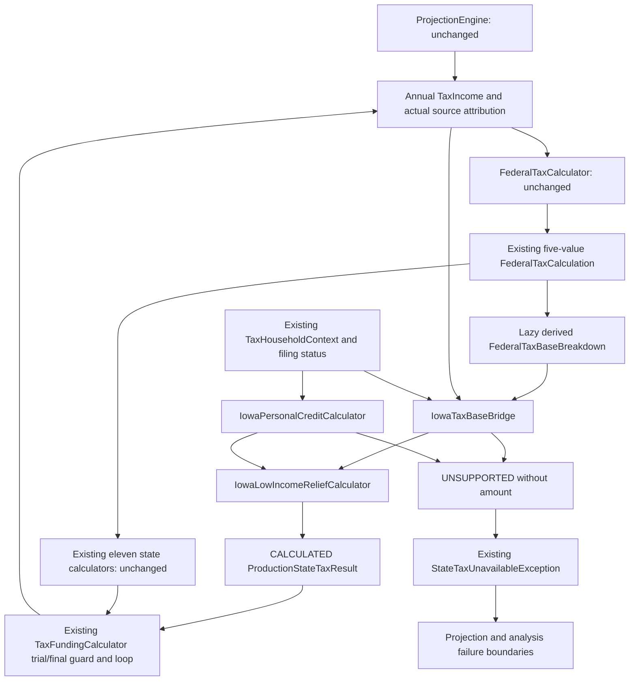

# Phase 6D.5A.1 — Iowa tax-base and relief architecture gate

Design reviewed October 14, 2026. **Design only; implementation is not authorized
by this report.** Iowa and Mississippi remain disabled. Mississippi is outside
this design. No Java, test, rules, worksheet, UI or persistence file is changed.

## 1. Executive Summary

Recommend an **observational federal-base contract plus an explicitly bounded
Iowa planning approximation**, with Iowa-specific relief and credit helpers.
Expose a lazy immutable breakdown from existing federal-result scalars; derive
the signed modeled base without changing the federal calculator. Use the modeled
standard deduction once and disclose omitted federal deductions as omissions,
never as verified legal zeros.

The complete future core design has **7 new top-level production classes and
3 modified production classes**. Nested helper records/enums are not additional
files. Only one existing-class change is needed for the observational foundation:
an additive, nonserialized accessor on FederalTaxCalculation. The other two
changes are the future IA enum/registry admission, explicitly deferred to an
approved Phase 6D.5B. There are **zero executable changes in this phase**.

Federal algorithms, five existing federal result values, the 11 existing state
calculators, funding/Roth/RMD algorithms, rankings and seeded Monte Carlo outputs
remain unchanged. New Iowa selection would naturally affect funding and possibly
later federal income; that is state-selection feedback, not a correction to the
federal engine or preservation claim about an otherwise different plan.

A meaningful own-IRA/SS/cash household can be modeled without new inputs, including
older taxpayers. Missing legal source/basis facts still refuse the complete annual
state estimate. This gate is **implementation-ready for the recommended bounded
convention after approval**, not approval to enable Iowa or certification of a
legally complete Form 1040 base.

Two findings refine the previous audit:

- Single tax reduction occurs **after** nonrefundable credits; the MFJ alternate
  comparison occurs **before** credits. One generic “relief before credits” formula
  would be wrong.
- FilingStatus actually has five values. SINGLE/MARRIED_FILING_JOINTLY are the
  proposed Iowa subset; MFS/HOH/qualifying-surviving-spouse exist in the domain but
  should return UNSUPPORTED_MODEL_RULE initially.

### Review and official sources

All seven requested reports were read completely, including inventories and
historical verification/limitations. Actual source governs: early PA reports'
numeric-only result contract and missing participant dates were superseded; the
current Route A contract and date-aware facts already exist.

Official sources reopened for this gate on October 14, 2026:

| ID / official source | Tax year / date | Verified use and uncertainty |
| --- | --- | --- |
| L — [Iowa Code §422.5](https://www.legis.iowa.gov/docs/code/2026/422.5.pdf) | 2026 codification | Rate, low-income exemption/reduction, MFJ alternate comparison, deduction addbacks. Specialized return cases remain excluded. |
| N — [Iowa Code §422.7](https://www.legis.iowa.gov/docs/code/2026/422.7.pdf) | 2026 codification | Federal §63 starting base and state modifications, including SS/retirement. This is legal law, not evidence the federal MVP is complete. |
| C — [Iowa Code §422.12](https://www.legis.iowa.gov/docs/code/2026/422.12.pdf) | 2026 codification | Nonrefundable personal/age credits and January1-after-year boundary. |
| CR — [IAC 701—304.3](https://www.legis.iowa.gov/docs/iac/rule/02-05-2025.701.304.3.pdf) | February 2025 compilation; rule effective May26,2010 with later editorial changes | Joint personal credit expressly covers spouse death during the year. No explicit late-birthday deceased-person age example was found. |
| R — [IDR 2026 rate announcement](https://revenue.iowa.gov/press-release/2025-10-21/idr-announces-2026-individual-income-tax-and-interest-rates) | Published October21,2025; tax year2026; SF2442 enacted May2024 | Explicit 3.8% 2026 rate; no additional future flat-rate schedule identified. |
| B — [IDR Federal Taxable Income instructions](https://revenue.iowa.gov/taxes/tax-guidance/individual-income-tax/1040-expanded-instructions/federal-taxable-income) | Instruction year2025 | Signed reconstruction when federal taxable income is floored. Final2026 expanded instructions not located. |
| I — [IDR Iowa Taxable Income instructions](https://revenue.iowa.gov/taxes/tax-guidance/individual-income-tax/1040-expanded-instructions/iowa-taxable-income) | Instruction year2025 | State modifications and relief addbacks; distinct relief income measure. |
| A — [IDR Iowa Tax / alternate worksheet](https://revenue.iowa.gov/taxes/tax-guidance/individual-income-tax/1040-expanded-instructions/iowa-tax) | Instruction year2025 | MFJ alternate tax compared with regular tax before credits. |
| S — [2025 Income Tax Reduction Worksheet, 41-146](https://revenue.iowa.gov/media/4387/download?inline=) | Form2025; revision August19,2025 | Single comparison uses IA1040 line12, after credits; ordinary/senior thresholds. |
| P — [IDR Line12 Balance](https://revenue.iowa.gov/taxes/tax-guidance/individual-income-tax/1040-expanded-instructions/line-12-balance) | Instruction year2025 | Credit subtraction floored at zero, followed by Single reduction. |
| E — [IDR Exemption Credits](https://revenue.iowa.gov/taxes/tax-guidance/individual-income-tax/1040-expanded-instructions/exemption-credits) | Instruction year2025 | Per-spouse age credit, distinct from retirement age55. |
| D — [IDR What's New](https://revenue.iowa.gov/taxes/tax-guidance/individual-income-tax/1040-expanded-instructions/whats-new) | Instruction2025 with2026 upcoming changes | Enhanced senior deduction included in FTI, added back for relief/health-income tests. |
| F — [IRS enhanced senior deduction](https://www.irs.gov/newsroom/check-your-eligibility-for-the-new-enhanced-deduction-for-seniors) | February27,2026; applicable2025–2028 | Temporary $6,000 per eligible person; MAGI phaseout begins $75,000/$150,000. No complete federal deduction design attempted here. |
| Q — [IDR retirement guidance](https://revenue.iowa.gov/taxes/tax-guidance/individual-income-tax/retirement-income-tax-guidance) | March13,2025; full exclusion from2023 | December31 age55; owner-specific eligibility; conversion income listed. |
| QR — [IAC 701—302.47](https://www.legis.iowa.gov/docs/iac/rule/02-05-2025.701.302.47.pdf) | February2025 compilation; amendment effective February14,2024 | Own IRA/conversion categories, qualifying arrangements and unavailable survivor/disability facts. |
| H — [IDR Schedule1](https://revenue.iowa.gov/taxes/tax-guidance/individual-income-tax/1040-expanded-instructions/ia-1040-schedule-1) | Instruction year2025 | Special securities, retirement and senior insurance modifications; payer/reimbursement facts not captured. |
| O — [IDR Before You Begin](https://revenue.iowa.gov/taxes/tax-guidance/individual-income-tax/1040-expanded-instructions/you-begin) | Instruction year2025 | Optional whole-dollar return rounding; decimals otherwise retained. Planning cents policy is distinct. |
| X — [IDR expanded-instructions index](https://revenue.iowa.gov/taxes/tax-guidance/individual-income-tax/1040-expanded-instructions) | Currently2025 | Confirms latest located complete instruction year. A2026 posting/filing date does not turn a2025 worksheet into2026 instructions. |

2026 statutes and rate announcement control legal amounts. The2025 worksheets
explain ordering and mechanics, with their year explicitly retained. Recheck final
2026 forms when available; an actual conflicting change must stop admission rather
than silently changing expectations. Proposed conventions below are labeled as
such; they are not quotes from the statutes.

## 2. Existing Federal Tax Data Flow

Paths in this report are relative to
`src/main/java/com/daviddunn/retirementplanner/` unless explicitly identified.

Exact current sequence:

1. ProjectionEngine calculates guaranteed income, authoritative annual SS,
   opening and projection-period RMDs, cash-flow withdrawals and actual conversions.
   RMD processing precedes conversion. Actual conversion replaces the requested
   target before final yearly taxation.
2. TaxFundingCalculator makes a dry allocation for additional tax funding and
   combines it with existing withdrawal sources. TaxIncomeCalculator constructs
   annual pension, gross SS, deferred-distribution, conversion and investment
   scalars. It adds opening deferred RMD to the deferred scalar **once**.
3. TaxIncomeAttribution.attach replaces legacy aggregate metadata with actual
   source records where kinds match. Positive unmatched remainders remain
   unattributed; replacing metadata does not alter income amounts.
4. TaxIncome.getOrdinaryIncomeBeforeSocialSecurity sums pension + deferred
   distributions + conversion + investment scalar. Its current method name
   `taxableInterestIncome` also carries caller-established ordinary investment
   amounts in boundary tests.
5. SocialSecurityTaxCalculator uses ordinary income plus half gross SS and
   projected SS thresholds. Its two-tier result is limited to85% of gross SS.
   This calculated household taxable amount, not individual gross source sums,
   is authoritative for federal inclusion.
6. FederalTaxCalculator sets AGI to ordinary income plus taxable SS and reads the
   projected filing-status standard deduction. No age/household context is passed
   to this calculator.
7. FederalTaxableIncomeCalculator returns zero immediately for AGI≤0. Otherwise
   it computes the local signed difference AGI−standard deduction, then returns
   max(difference,0). The signed local value is discarded.
8. FederalIncomeTaxCalculator sums positive bracket slices of the clamped base.
   No new final rounding operation is applied there.
9. FederalTaxCalculation stores exactly five nonnegative values: AGI, taxable SS,
   standard deduction, clamped taxable income and federal tax.
10. Funding calculates federal + state tax minus available cash, repeats with the
    next proposed withdrawal, and recalculates final federal/state taxes before
    returning. Both state results must be CALCULATED.

| Requested component | Exists now? | Location / precision / limitation |
| --- | --- | --- |
| Gross modeled income | Components yes; no authoritative all-source gross-income total | TaxIncome pension/deferred/conversion/investment/grossSS. Summing all source gross amounts would include principal/transfers and double metadata. |
| Traditional distributions | Annual scalar and actual source records | Deferred scalar includes opening RMD; account/type/owner retained. |
| Roth conversion | Scalar plus actual source/destination allocation records | Final projection scalar is actual executed amount. Hypothetical bracket-fill trials need their own reconciliation guard. |
| Pension | Scalar and original-owner/recipient facts | Legal plan qualification absent. |
| Investment income | Ordinary scalar, optional classifications | Normal projection supplies zero; no yield/realized-gain generator. |
| Taxable SS | Fully modeled result | FederalTaxCalculation.getTaxableSocialSecurity; source records usually retain gross SS with unknown per-source taxable part. |
| Federal AGI | Stored | Current modeled AGI, not complete tax-return AGI. |
| Standard deduction | Stored | Published2026 baseline16100 Single/32200 MFJ, then existing rule projection; no owner-age increment. |
| Additional standard deduction | Not modeled | No result field or computation. Monetary model contribution is omitted; legal amount is not proven zero. |
| Enhanced senior deduction | Not modeled | No field/computation/year schedule in federal calculation. |
| Other deductions | Not modeled as separate components | No itemized/QBI/Schedule1-A/below-line decomposition. |
| Raw federal taxable income | Local only when AGI>0; not returned | At AGI0 the negative difference is never evaluated. A−D can be derived later only under the observed modeled formula. |
| Final federal taxable income | Stored | Zero floor already applied. |
| Federal tax | Stored | Existing bracket arithmetic, unchanged. |

The federal result cannot be renamed “complete federal taxable income.” A new
observer must say **derived modeled raw base**, not claim the signed value is
currently captured.

## 3. Exact Missing Capabilities

Three required capabilities, none requiring a new user input:

- An immutable, explicitly scoped view of the modeled federal base that retains
  signed arithmetic and identifies unmodeled deductions.
- Iowa-specific relief logic with separate pre-credit alternate comparison and
  post-credit Single reduction, using the correct relief-income measure.
- Per-filer Iowa credit/relief age evaluation with different dates and explicit
  deceased-person boundaries.

Existing SimplifiedStateTaxCalculator supports a fixed credit by filing status,
but Senior entries subtract income. Its threshold branch tests the starting base,
and it has no Single post-credit excess-income cap. Reinterpreting those fields
would change the research contract and potentially other states. Leave both that
calculator and StateTaxRules unchanged.

Source qualification, inherited history, basis, uncertain Roth qualification,
special securities and insured-premium deductions are **admission boundaries**,
not invitations to add new fields.

## 4. Federal Tax-Base Reconciliation Design

Recommend a smaller observer than the conceptual seven-amount record:

```java
// Proposed only; domain.tax
public record FederalTaxBaseBreakdown(
        BigDecimal modeledAdjustedGrossIncome,
        BigDecimal modeledStandardDeduction,
        BigDecimal derivedRawTaxableIncome,
        BigDecimal modeledClampedTaxableIncome,
        Coverage coverage) {

    public enum Coverage {
        MODELED_STANDARD_DEDUCTION_ONLY_V1
    }

    public static FederalTaxBaseBreakdown fromModeledResult(
            FederalTaxCalculation result);
}
```

Coverage has a documented fixed meaning: standard deduction is modeled; additional
age deduction, enhanced senior deduction and other legal deductions are not
assessed. No legal amount is supplied for them. There is deliberately no
`getAdditionalDeductionOrZero`, no `LEGALLY_COMPLETE` value and no arbitrary
caller-set completeness boolean. The observer is reusable as factual metadata,
not a nationwide deduction engine.

Factory validation: require all amounts, retain BigDecimal precision/scale,
allow raw<0, require A/D/T≥0, derive raw=A−D, and require
T=max(raw,0) using numeric compareTo. An inconsistent legacy hand-constructed
federal result cannot produce this coverage. The factory does not recalculate SS,
AGI, tax or projected rules.

Proposed additive accessor on FederalTaxCalculation:

```java
@JsonIgnore
public FederalTaxBaseBreakdown getModeledBaseBreakdown() {
    return FederalTaxBaseBreakdown.fromModeledResult(this);
}
```

All five fields/getters and the existing constructor retain their exact semantics,
including accepting legacy fixtures that are not eligible for the new observer.
Do not move factory validations into the existing constructor. The accessor is
lazy; none of the existing state calculators calls it. No new allocation is
required for existing-state federal results, and no new field enters saved plans.
It is not used by funding or bracket targeting.

This is a justified hybrid: Option A supplies one common immutable contract;
its raw value is the narrowly documented scalar derivation from Option B.
FederalTaxCalculator/FederalTaxableIncomeCalculator need **no modification**.
Coverage is a reviewed producer contract, not proof of real-world deduction
eligibility. Future federal model changes must explicitly revise that contract;
numeric equality alone cannot certify legal completeness.

IowaTaxBaseBridge accepts this observer plus the same annual request. It verifies
AGI reconciliation against TaxIncome and taxable SS, the observed standard
deduction against that request's projected rules, and source/category totals.
Required inconsistent input is rejected; materially unavailable compatible base
or an unsupported model revision returns UNSUPPORTED_MODEL_RULE via the adapter.

## 5. Federal Deduction Policy

These classifications describe what Iowa may consume, not new federal deductions:

| Item | Policy class | Recommended handling |
| --- | --- | --- |
| Modeled AGI, taxable SS, applied standard deduction, final taxable base | A — modeled/available | Use exactly the current result. |
| Signed A−D and Iowa relief addback of the applied modeled D | B — reconstructable | Derive under coverage/invariants; do not infer any other deduction. |
| Additional standard deduction | B for ordinary age amount after further published-rule work; C in this design | DOB/status exist, but no modeled federal allowance. Explicitly omit; never certify legal zero. Blindness/dependency facts remain absent. |
| Enhanced senior deduction,2025–2028 | B only in a tightly assessed ordinary MAGI scenario; C here | Explicitly omit; do not infer general MAGI or taxpayer legal eligibility from age alone. |
| Itemization, health coverage, charitable/QBI and other deductions/phaseouts | C outside basic planning scope; D if specifically required | Disclose omission. No real expense, MAGI adjustment or legal claim is synthesized. |
| A requested calculation depending on an unavailable deduction/modification | D — materially uncertain | UNSUPPORTED_MODEL_RULE; do not silently fall back to the approximation. |

Two viable financial policies:

**Strict bounded reconciliation:** independently derive verified age deductions
and any applicable temporary senior deduction for a narrowly proved income shape,
without changing the federal result. This can improve Iowa accuracy but requires
separate published federal parameters, MAGI/eligibility boundaries and an Iowa-only
deduction ledger. General exact Form1040 reconciliation is impossible from current
facts. If strict completeness is required, stop for a separate deduction gate;
do not repair the federal engine or add taxpayer inputs in this phase.

**Explicit planning approximation — recommended:** use the federal model's actual
standard deduction and its modeled included income, apply verified Iowa exclusion,
relief and personal/age-credit mechanics, and expose the limitation in every
calculated Iowa result. Model omissions are intentional C facts, not D missing
data inside the agreed model. Ordinary65+/IRA/SS cases therefore remain useful.

Suggested required result limitation:

> Uses the planner's modeled federal AGI and projected standard deduction, not a
> complete Form1040 taxable base. Federal age additions, enhanced senior deduction,
> itemization and other unmodeled deductions are omitted; their legal amounts are
> not assumed to be zero. Iowa insurance/special adjustments and ancillary credits
> are outside this estimate.

No new selector or user input chooses between policies. The initially admitted
policy would be one immutable rule-version decision. Strict/imported/unsupported
claims are not automatically downgraded to that policy. The present request has
no deduction-claim field; such an external mode is not invented merely to support
hypothetical claims.

This approximation can overstate Iowa tax, and omission of insurance adjustments
can also affect relief. It must not be advertised as legally reconciled FTI.
The existing result limitation tooltip already supports disclosure; CSV/PDF do
not automatically reproduce all individual limitations. Export-disclosure work,
if required for later activation, is a separate presentation scope, not a new
financial algorithm.

## 6. Iowa Taxable-Income Design

Legal base: federal taxable income plus Iowa modifications [N/B]. Recommended
initial model uses the signed **modeled** federal equivalent under section5.

Define, with full precision:

- A = modeled federal AGI.
- D = the applied modeled federal standard deduction.
- S = authoritative household federally taxable SS.
- W = included admitted own-IRA ordinary/RMD/opening distributions.
- K = included admitted generated own-IRA-to-Roth conversions.
- E = W+K.
- J = signed Iowa base after modifications.
- B = max(J,0), nonnegative base for regular tax.
- L = relief income under the selected model, before applying an exemption.

For the ordinary subset with no special additions:

```text
rawFederal = A − D                 // do not start from clamped FTI
J = rawFederal − S − E             // subtract each included amount once
B = max(J, 0)
L = J + D = A − S − E              // addback BEFORE loss of signed information
regularTax = B × IowaRate
```

L retains signed arithmetic; with consistent admitted nonnegative source totals
it is nonnegative and equals remaining ordinary included income. If later special
additions/deductions are required, do not keep applying this simplified identity;
return U until their base/relief effects are independently specified.

Do not calculate L as B+D. A zero floor can hide negative J and inflate the
addback measure. Do not subtract D twice, add E into A a second time, or cap an
income exclusion to the already deduction-reduced FTI. S+E must fit the included
AGI components, not the net post-deduction base. A negative intermediate is valid;
a contradictory exclusion exceeding its included income is not.

Example of arithmetic, not a new golden: with A=X consisting solely of admitted
excluded income and D>0, J=−D, B=0 and L=0. Using clamped B plus D would incorrectly
report relief income D. Final tax is zero without inventing a second deduction.

The initial implementation accepts only the ordinary resident scope. It does not
claim an unrecorded municipal-bond addition is zero because no field stores it.
Ordinary investment amounts are a declared existing boundary-input convention;
a specifically identified special security or unclassified taxable transaction
refuses. Portfolio growth and brokerage principal never enter this equation.

The final sequence is status-specific, described in section8. Iowa taxable-base
zero floor and final nonrefundable-tax floor are independent of federal clamping.
No negative final tax or refund is generated.

## 7. Iowa Retirement Exclusion Boundary

Proposed initial supported source types: active owner's own TraditionalIRA and
RolloverIRA ordinary withdrawals, IRA RMDs/opening RMDs, and generated own-IRA to
same-owner RothIRA conversion allocations, plus authoritative SS and assessed
ordinary investment income. Year-end retirement age is
DOB.plusYears(55)≤December31(taxYear), separately for each actual recipient [Q].

Separation and conditions-met are not required for this ordinary own-IRA rule.
The two date-aware participant assertions neither establish employer/pension legal
qualification nor become Iowa eligibility flags [QR; current code].

Admission algorithm, inside IowaTaxBaseBridge:

1. Reject any positive pension scalar as MISSING_RETIREMENT_QUALIFICATION, even
   if its source list is empty. Scan every positive material source before a
   zero-tax shortcut; missing metadata cannot erase an unsupported scalar category.
2. Verify year, owner/source consistency and a known included amount. A missing
   included amount is not zero. Own retirement sources must belong to an active
   household recipient; never relabel a deceased-owner withdrawal as survivor income.
3. For ordinary/RMD/OPENING_RMD own IRA, accumulate included amount into W.
   Initial boundary is the existing fully pre-tax model; explicitly basis-sensitive
   gross/included differences refuse rather than claiming basis support.
4. For conversion, require CONVERSION purpose, actual own-IRA source, same-owner
   RothIRA destination and a fully attributed executed amount. Accumulate into K.
   Requested shortfall is never a source. Remaining account balance is not a
   retained distribution.
5. Require W equals the deferred scalar, including opening RMD, and K equals the
   conversion scalar. Unattributed positive remainders refuse; duplicates/excess
   or contradictory known source years are malformed contracts, not exemptions.
6. Subtract S from the federal result once. Do not sum gross SS as taxable SS or
   invent owner splits of its federally included portion.
7. Use investment scalar once. Named source records describe/reconcile it; they
   are not a second income total. A residual explicit ordinary scalar is the
   existing boundary convention. Overlapping category metadata must not be silently
   summed or repaired; restrict/refuse the inconsistent boundary.

Initial U cases: employer account distributions/conversions, private/government/
survivor pensions, under55 exceptions, inherited distributions, basis-sensitive
receipts, nonqualified/uncertain Roth, externally incomplete conversions, special
securities/gains and other unclassified income. Known cash/retained post-tax
principal is not income; unknown brokerage gain/basis refuses.

Important current limitations:

- IncomeSourceAttribution carries no federal-qualified-Roth proof. Its factory
  returns modeled zero for Roth, which is insufficient. A positive uncertain Roth
  receipt remains U; IA13's independently established legal premise does not
  create an engine field or a new qualification flag.
- Bracket-fill previews may execute less than their hypothetical conversion scalar.
  TaxIncomeAttribution retains that positive remainder. Iowa must refuse such a
  materially unattributed trial; do not exempt the requested amount or alter the
  optimizer. Fixed requested conversions partially fulfilled **before** final tax
  calculation retain complete actual attribution and can be supported.
- Exact external conversion provenance is not newly modeled. Generated internal
  allocations are the evidence boundary; arbitrary records with similar labels
  do not establish an imported transaction.

RMD labels confer no extra exemption. Opening RMD is in W once, not added again
after its aggregate reconciliation. No RMD factor, snapshot or order changes.

## 8. Iowa Low-Income Relief Design

Verified2026 thresholds [L]: Single9000 / MFJ13500; senior Single24000 / MFJ32000.
Senior relief requires age65 at December31; one qualifying spouse supplies the
senior joint threshold. Deduction addbacks concern the relief income measure,
not regular taxable income. Excluded retirement and SS are not added back as
income simply because deduction components are added back [I].

The2025 alternate worksheet adds applied federal standard/itemized deduction,
personal-exemption deduction, QBI, NOL carryover and taxable separately taxed
lump-sum amounts. Enhanced senior deduction is treated as an addback component
when actually deducted [A/D]. Initial planning mode has only the applied D;
other components remain documented model omissions, not asserted legal zeros.

Let T be the applicable threshold, excess=max(L−T,0), and C the nominal personal
plus age credit. For the agreed ordinary subset:

```text
if L <= T:
    preCreditTax = 0
    finalTax = 0
else if status == MFJ:
    alternativeTax = excess × .043
    preCreditTax = min(regularTax, alternativeTax)
    finalTax = max(preCreditTax − C, 0)
else if status == SINGLE:
    preCreditTax = regularTax
    afterCredits = max(regularTax − C, 0)
    finalTax = min(afterCredits, excess)
```

MFJ's alternate tax already cannot exceed excess; a separate household retention
cap would be redundant within this subset. Single's statutory retention reduction
must compare **after-credit** tax with excess [S/P]. It must not be implemented
as max(min(regularTax,excess)−C,0), which can incorrectly reduce a one-dollar cap
again by the personal credit.

Negative L, if encountered in a future supported shape, is below the threshold;
negative raw bases alone do not create negative tax. Unsupported material sources
are assessed first; low income is not a way to turn a missing pension calculation
into a completed household estimate.

Propose a pure **IowaLowIncomeReliefCalculator**, not a general relief framework.
It accepts nonnegative regular tax, signed relief income, filing status, verified
senior-relief eligibility, nominal credit and IowaTaxRules. Its nested Result
records threshold, excess, exemption flag, optional alternate tax, selected
pre-credit tax, credit actually applied, optional Single reduction and final raw
tax. Empty alternativeTax means “not applicable,” not zero or missing law.

Credit helper derives nominal entitlement; relief helper owns its use at the
correct step. For diagnostics, creditApplied=min(nominalCredit,preCreditTax);
Single reduction is then afterCredits−finalTax. No third successful production
result type is introduced.

**Rounding convention, proposed:** retain raw BigDecimal through base/addbacks,
comparison and credit floors; round only final Iowa tax HALF_UP to cents, consistent
with existing production state estimates. Official optional whole-dollar return
rounding is not adopted [O]. Sub-cent trial inputs are normal in funding; final cent
rounding may differ by less than half a cent from a raw retention cap. Diagnostics
and tests should retain that distinction rather than claim tax-return precision.

### Independent relief test design

All cases assume ordinary nondependent Single/MFJ, no NOL/lump-sum/special claims.
Use an explicitly supplied B/L and deduction provenance; thresholds are not
tests on AGI or clamped federal income.

| Case | Independent expected outcome |
| --- | --- |
| Zero income | Exempt; final0. |
| Single ordinary L=T−1 | Exempt; final0. |
| Single ordinary L=T | Exempt; final0, inclusive. |
| Single ordinary L=T+1 | min(after-credit regular tax,1); not “1 minus40.” |
| Senior Single L=T−1 / T | Exempt0 in both cases. |
| Senior Single L=T+1 | min(after-credit regular tax,1); can be0 if B produces no tax. |
| MFJ ordinary L=T−1 / T | Exempt0. |
| MFJ ordinary L=T+1 | Compare regular tax with .043, then credit floor; nominal80 generally leaves0 in this controlled case. |
| Senior MFJ L=T−1 / T / T+1 | Same mechanics with senior threshold; +1 is not an automatic positive-tax golden. |
| Large positive L | Compute both alternatives where MFJ, never assume regular wins; Single cap cannot increase tax. |
| Excluded IRA500000 with remaining ordinary income near T | Eligible retirement excluded from B and L; huge federal AGI does not deny relief by itself. |
| Same B, different D addbacks | Relief can differ because L differs; D does not get deducted a second time. |
| Negative rawFederal | Reconcile signed raw/J before relief; federal T remains0. |
| Same household, Single versus MFJ | Use separate status formulas/credits, not doubled Single. |
| MFJ ages64/65 | Senior threshold from one living spouse; age credit for that spouse only. |
| Death-year MFJ | Keep configured status; basic80; apply section9 deceased-age boundary/refusal policy. |
| Later survivor year | Single, actual surviving owner; deceased filer does not supply credit or qualify survivor's own IRA. |

Concrete formula-validation fixtures may stipulate B=2000, L=T+1 and nominal
Single credit40: regular76, after-credit36, cap1, final1. This is independent
worksheet arithmetic demonstrating order, **not** a claim that the MVP standard
deduction can generate that exact2026 input pair. Inputs must be labeled accordingly.
Every future golden must cite its legal premise and input provenance.

## 9. Iowa Age-Credit Design

Verified amounts: personal40 Single /80 MFJ; additional20 for each independently
eligible filer. They are nonrefundable and limited by computed tax [C].
Living filer credit eligibility uses DOB.plusYears(65)≤January1(taxYear+1);
retirement exclusion still uses December31 age55, and senior relief December31
age65. Do not reuse one “senior” boolean for all three dates [E].

IowaPersonalCreditCalculator takes status, year, TaxHouseholdContext and rules.
For Single it selects the actual active surviving filer, including SPOUSE where
PRIMARY is deceased. It never counts both people merely because the household
still has two member records. MFJ requires two represented filers; basic80 is
consistent with the death-year joint-return provision [CR].

Proposed deceased-person boundary, explicitly bounded:

- Never let an inactive owner attain a later birthday simply by evaluating DOB
  at next January1. Existing projections map death to January1 of its year.
- A person already65 by that modeled death boundary has an established attained
  age; a person still below65 at the next credit boundary cannot qualify by age.
- If a deceased person's65th birthday lies after the modeled death boundary but
  on/before the credit boundary, the cited material does not settle the exact
  additional-credit treatment. Return UNSUPPORTED_MODEL_RULE rather than invent
  a rule. Do the same for a materially undecidable senior-relief age boundary.
- This refusal is narrow: living senior taxpayers and clearly established age
  cases remain calculable. Inactive retirement receipts themselves may separately
  fail the source-recipient guard.

The helper's nested HouseholdAllowance record contains nominal personal credit,
nominal age credit, represented filer identities, senior-relief eligibility and
the two age boundaries used. Unknown material eligibility yields an internal
refusal, not an assumed false/zero flag. No death date/history field is added.

Dependents, blindness and special credits are outside the initial planning scope.
Do not reinterpret their absence as legal ineligibility. A calculation specifically
requiring them is U; ordinary household estimates disclose omission without new
questions. Existing generic fixed-credit maps cannot supply per-owner January1
eligibility. An Iowa helper is safer than modifying generic Senior income deductions.

## 10. Tax-Year and Effective-Date Policy

No dynamic legislation service, nationwide effective-year registry or schema
migration is proposed.

| Year | Existing federal application | Legally complete federal treatment | Recommended Iowa convention |
| --- | --- | --- | --- |
| 2026 | Projected base standard deduction only | Senior additions and eligible enhanced deduction may apply | Same observed D; omitted deductions explicitly disclosed;2026 Iowa rules. |
| 2027 | Existing federal rule projection | Enhanced deduction still in scheduled term | Do not add or carry an unmodeled amount; same scoped observation. |
| 2028 | Same existing model | Last scheduled enhanced-deduction year | State diagnostics identify applicable-but-unmodeled temporary benefit. |
| 2029 | Same existing model | Reviewed enhanced term expired | Diagnostics say expired under reviewed law, rather than legally zero for unknown future law. No phantom $6000 subtraction/addback. |
| Later | Existing projected federal D/brackets | Future law not forecast | Nominal validated2026 Iowa rates/thresholds/credits, modeled-year warning; no speculative enhanced benefit. |
| Before2026 | Existing states retain their own policy | Candidate historical Iowa law not certified | UNSUPPORTED_MODEL_RULE for Iowa. |

The federal deduction amounts retain the application's existing projection
assumptions; Iowa credit/relief dollar parameters are not inflated by Michigan
or federal growth assumptions. Nominal Iowa baseline reuse is a proposed planning
convention requiring approval. Enhanced omission is explicit in2026–2028 and its
reviewed expiration explicit thereafter [F/D]; no temporary deduction is carried
indefinitely because none is modeled.

If federal outputs later actually include a new deduction, the versioned observer
must not pretend that A−D still fully describes the modeled base. Refuse Iowa on
a mismatched contract until the bridge is separately reviewed. Existing11 states
continue using their unchanged fields. Participant facts remain date-aware and
nonretroactive; no Iowa own-IRA separation-condition inference is added.

## 11. Typed Unsupported Matrix

Only the public existing financial statuses are used: CALCULATED with a whole
household amount, or UNSUPPORTED with no amount. No new reason is necessary.

| Situation | Reason / distinction |
| --- | --- |
| Missing own-IRA owner/DOB/active recipient; under55 disability/survivor alternative unknown | MISSING_RETIREMENT_QUALIFICATION |
| Employer or any pension/survivor legal qualification absent | MISSING_RETIREMENT_QUALIFICATION |
| Required included amount/basis-sensitive withdrawal or conversion unknown | MISSING_DISTRIBUTION_BASIS |
| Positive nonqualified or not-provably-qualified Roth receipt | NONQUALIFIED_ROTH_BASIS_REQUIRED |
| Inherited/successor/election facts not established | INHERITED_DISTRIBUTION_HISTORY_REQUIRED |
| External incomplete conversion, missing actual source/destination, positive unallocated trial conversion, unclassified transaction | UNSUPPORTED_TRANSACTION_TYPE |
| Required compatible federal component/model contract unavailable | UNSUPPORTED_MODEL_RULE |
| Required Iowa modification or relief/alternate input outside agreed scope | UNSUPPORTED_MODEL_RULE |
| Requested exact deduction-dependent treatment not derivable | UNSUPPORTED_MODEL_RULE; no silent approximation fallback |
| Missing valid Iowa year/rule version or unresolved deceased age boundary | UNSUPPORTED_MODEL_RULE |
| Age-related federal deduction deliberately omitted under approved planning policy | CALCULATED with limitation; do not confuse C with D |
| Known malformed source year/duplicate/excess, mismatched request routing | Input-contract exception; preserve existing distinction, never tax0 |

This contract does not pretend that an absent request field lets the adapter detect
every real-world unrecorded tax fact. The agreed ordinary planning scope supplies
that boundary, as it does for existing states. Specifically represented missing/
special facts refuse; unmodeled ancillary deductions remain disclosed omissions.

Material source assessment comes before relief/zero shortcuts. Unsupported is not
a partial household estimate. Helpers may return internal immutable admissions/
diagnostics, but only IowaProductionTaxCalculator creates the public result.
Internal refusal carries stable reason(s) and explanation; the adapter translates
it atomically to ProductionStateTaxResult.unsupported. Reuse existing
StateTaxUnavailableException only at the external calculated guard.

## 12. Proposed Classes and Method Signatures

**Future proposals only.** Package root is
`com.daviddunn.retirementplanner`. Stateless helpers are immutable services;
all nested records defensively copy collections and validate required values.

| New top-level file / package | Responsibility / constructor / public API / dependencies | Kind / necessity |
| --- | --- | --- |
| `domain/tax/FederalTaxBaseBreakdown.java` | Record of A/D/derived raw/T/Coverage; canonical constructor; static fromModeledResult(FederalTaxCalculation). BigDecimal/Objects only. | Generic observational contract; not new federal math. |
| `domain/tax/state/iowa/IowaTaxBaseBridge.java` | Stateless no-argument helper; Admission reconcile(StateTaxCalculationRequest,FederalTaxBaseBreakdown,IowaTaxRules). Uses source/type/owner facts and current aggregate getters. | Iowa-specific reconciliation and exclusion boundary. |
| `domain/tax/state/iowa/IowaLowIncomeReliefCalculator.java` | Stateless no-argument helper; Result calculate(Inputs,IowaTaxRules). Inputs include status, signed L, regular tax, senior eligibility and nominal credit. No request/plan/UI access. | Iowa-specific ordering; generic framework unnecessary. |
| `domain/tax/state/iowa/IowaPersonalCreditCalculator.java` | Stateless no-argument helper; Admission calculate(int year,FilingStatus,TaxHouseholdContext,IowaTaxRules). Nested HouseholdAllowance supplies credits and distinct relief-age result. | Iowa-specific age/filing-person evaluation; no mutable Person. |
| `domain/tax/state/iowa/IowaTaxRules.java` | Immutable record of validatedYear/version, ordinary rate, alternate rate, threshold/credit maps, retirementAge, reliefAge, creditAge and basePolicy. Canonical validation and named year-policy method. | Small fixed Iowa parameter object; numerical law belongs in rules resource, not funding/code constants. |
| `persistence/IowaTaxRulesRepository.java` | Stateless class; IowaTaxRules load(), package-local parse(InputStream) for future tests. Cached immutable classpath load once with Jackson. | Keeps resource parsing in persistence; does not change eight-state repository. |
| `domain/tax/state/IowaProductionTaxCalculator.java` | Implements StateIncomeTaxCalculator; public no-argument constructor loads rules once, injectable constructor(IowaTaxRules); calculate(StateTaxCalculationRequest). Owns pure helpers, validates routing/year and returns common result. | One future production entry point; no other dispatch path. |

Proposed nested signatures:

```java
// IowaTaxBaseBridge
record BaseAmounts(
        BigDecimal modeledAgi,
        BigDecimal modeledDeduction,
        BigDecimal derivedRawFederalBase,
        BigDecimal taxableSocialSecurityExcluded,
        BigDecimal iraWithdrawalsExcluded,
        BigDecimal iraConversionsExcluded,
        BigDecimal signedIowaBase,
        BigDecimal nonnegativeIowaTaxableIncome,
        BigDecimal reliefIncome) {}

record Admission(
        Optional<BaseAmounts> amounts,
        List<StateTaxUnavailableReason> reasons,
        List<String> diagnostics) {}
// Exactly one of usable amounts or refusal reasons; no partial amounts on refusal.

// IowaPersonalCreditCalculator
record HouseholdAllowance(
        Set<AccountOwnership> filers,
        BigDecimal personalCredit,
        BigDecimal ageCredit,
        boolean seniorReliefEligible,
        LocalDate reliefAgeBoundary,
        LocalDate creditAgeBoundary) {}
// Nested Admission wraps complete allowance or reason(s), never unknown=false.

// IowaLowIncomeReliefCalculator
record Inputs(
        FilingStatus filingStatus,
        BigDecimal regularTax,
        BigDecimal signedReliefIncome,
        boolean seniorReliefEligible,
        BigDecimal nominalNonrefundableCredit) {}

record Result(
        BigDecimal threshold,
        BigDecimal excessIncome,
        boolean lowIncomeExempt,
        Optional<BigDecimal> alternativeTax,
        BigDecimal selectedPreCreditTax,
        BigDecimal creditApplied,
        Optional<BigDecimal> singlePostCreditReduction,
        BigDecimal finalRawTax) {}
```

Adapter pseudocode:

```text
validate IA routing / supported year and status
derive and validate lazy modeled federal breakdown
baseAdmission = bridge.reconcile(request, breakdown, rules)
allowanceAdmission = creditHelper.calculate(year, status, household, rules)
if either refuses: return UNSUPPORTED with accumulated reasons; no amount
regular = base.nonnegativeIowaTaxableIncome × rules.rate
relief = reliefHelper.calculate(regular, base.reliefIncome,
                               status, allowance.seniorReliefEligible,
                               allowance.personalCredit + allowance.ageCredit)
return CALCULATED roundCents(relief.finalRawTax)
       with source/base/relief/credit/year/coverage limitations
```

Exact proposed existing core-class modifications:

1. `domain/tax/FederalTaxCalculation.java`: additive lazy accessor only;
   constructor/getter financial semantics unchanged.
2. `domain/model/StateTaxJurisdiction.java`: future IA member, only in explicitly
   approved production integration; never MS.
3. `domain/tax/state/ProductionStateTaxService.java`: future single IA registration,
   preserving all existing entries/calculators.

Future resource:
`src/main/resources/tax/state/iowa-tax-2026.json`, dedicated simple schema and
source metadata. Do not edit `state-tax-2026.json`, StateTaxRules,
StateTaxDatasetRepository or government-rules2026. A small repository and fixed
record avoid forcing Iowa into an incompatible eight-state dataset schema.

No proposed changes to StateTaxCalculationRequest, TaxHouseholdContext, TaxIncome,
TaxIncomeAttribution, participant/account/pension fields, federal calculators,
funding, optimizer, projection, analyzers, Monte Carlo or persisted plans.
All helper facts are per-call, not cached across funding trials.

## 13. Integration Data-Flow Diagram



The observer travels through the existing federal-result reference in the request.
There is no new funding argument or branch. Diagram's Iowa path is a future
registered calculator; it does not exist or run in this phase.

RothConversionBracketFillCalculator continues targeting the **existing** federal
getTaxableIncome value. It never uses Iowa's signed base or a reconciled strict
deduction amount. Tax-funding changes are ordinary selected-state feedback.
Source-capacity/unsupported cases stop at the existing guard, not a new optimizer
fallback. Each trial recomputes the base and eligibility; final only supplies the
successful annual result.

ProjectionEngine rethrows non-FundingConstraint failures; state unavailability is
not InsufficientFunds. Integrated candidate boundaries retain EVALUATION failure
without metrics/rank; a required failed baseline aborts. Weighted evaluation does
not renormalize failed scenarios into a successful expected value. Fixed/longevity
MonteCarloAnalyzer wraps a runtime simulation failure and returns no completed
percentiles/success statistics. No analyzer, scoring or trial-count change.

## 14. Test and Golden-Regression Plan

**Design only: no tests added, edited or executed in this phase.** Existing
`phase6d5a-admission-worksheets.json` has26 Iowa rows:13 numeric,13 proposed
refusals. Their amounts/reasons must remain unchanged.

Test layers: U=unit/pure helper, D=direct calculator with supplied immutable request,
S=source/actual allocation integration, F=funding integration, P=full projection.
Not every worksheet can be recreated by the federal MVP.

| ID(s) | Existing expectation | Future test mapping / provenance constraint |
| --- | --- | --- |
| IA01 | SS-only0 | D/U authoritative taxableSS exclusion; F/P SS-only, no gross subtraction. |
| IA02 | Interest1480 | D/U supplied FTI40000 and coherent implied deduction20000. Not an actual2026 federal-engine deduction golden. F/P companion uses actual modeled D and a separately worked expectation. |
| IA03 | Dividends1480 | Same supplied-base D/U; boundary classification S. No new dividend generator. |
| IA04 | LT gain1480 | Same D/U; assessed positive gain, not brokerage proceeds; no preferential state rate. |
| IA05 | Own IRA age55,0 | D/S/F/P using actual owner and known pre-tax amount; no separation field. |
| IA06 | Missing retirement qualification | D/S/F rejection; under55 alternatives unavailable. |
| IA07 | Own IRA RMD0 | D/S/P, prior snapshot/actual RMD; excluded once. Federal senior deduction omission remains explicit. |
| IA08 | Employer qualification missing | D/F/P U despite affirmative participant statuses. |
| IA09 | Pension qualification missing | D/F/P U; never infer qualification from age/payment. |
| IA10 | Survivor pension qualification missing | D/S/P U with original owner distinct from recipient. |
| IA11 | Actual IRA conversion0 | D/S/F/P fixed/generated execution and actual taxable amount. |
| IA12 | Pre-age conversion qualification missing | D/F U without disability/survivor assumptions. |
| IA13 | Independently federal-qualified Roth0 | U legal-base/zero-credit-floor worksheet only initially. Current attribution cannot prove its qualified premise, so ordinary positive-Roth projection is U, not a changed worksheet golden or invented qualification flag. |
| IA14 | Nonqualified Roth basis required | D/F/P refusal; federal modeled zero alone insufficient. |
| IA15 | Inherited history required | D/S/P U retaining inherited facts but no elections. |
| IA16 | IRA + interest1480 | D/U supplied FTI80000, implied deduction20000; S exclusion once. F/P companion derives actual D independently. |
| IA17 | Pension + dividends qualification missing | D/F U; no partial investment-only household amount. |
| IA18 | Mixed spouse ages qualification missing | D/S/P U; older spouse cannot qualify younger owner's receipt. |
| IA19 | Employer effective-date/qualification missing | D/S U; dates remain nonretroactive and still do not prove plan. |
| IA20 | Large IRA + investments3000 | D/U supplied FTI580000, implied deduction20000; no high-AGI retirement cap introduced. Companion actual-base test separate. |
| IA21 | December31 age55,0 | D/S/P exact birthday; earlier annual receipt boundary must not deny year-end rule. |
| IA22 | January1 next-year age55, U | D/S exact boundary; no retirement eligibility borrowed from credit rule. |
| IA23 | Employer conversion qualification missing | D/S/F/P U; same-owner destination not legal-source proof. |
| IA24 | External basis missing | D/S/F U; no reconstructed transfer/basis. |
| IA25 | Senior relief0 | U/D independent relief income20000; F/P companion with actual federal base, age and omissions. |
| IA26 | Final Iowa base100000, credit60, tax3740 | U/D supplied base/credits; separate observer test shows no extra deduction added. Do not pretend exact full legal FTI was derived. |

A hand-supplied observed standard deduction for a direct unit scenario must agree
with that scenario's supplied projected rules if the adapter checks them. It is a
stipulated modeled input, not a published2026 deduction. Do not alter the JSON
goldens to replace20000 with16100, nor distort real federal rules to reproduce them.
Where only final Iowa base is supplied, test the appropriate pure helper instead
of bypassing source-admission rules.

Additional future test inventory:

| Behavior | Layer / independently specified expectation |
| --- | --- |
| A=0,D>0; A<D; A=D; A>D | Observer U: raw negative/zero/positive; clamped exactly current T. No constructor semantic change. |
| Inconsistent manually constructed federal result | U/D: observer incompatible; existing result still constructs; Iowa U model rule. |
| No observer calls by existing calculators | Regression integration: unchanged fields/results/scales; accessor is optional. |
| Standard deduction double count | U/D: B=A−D−S−E, never minus2D. |
| Relief double-floor/addback defect | U: J<0 retains sign; L=J+D, not max(J,0)+D. |
| SS inclusion limit | U/D: S is federal result value, bounded by gross; exempt gross does not over-subtract. |
| Source/category equality; duplicated and missing records | D/S: malformed excess rejects; positive missing inclusion/qualification returns U. |
| Own IRA owner age55 / spouse younger | D/P: each own owner separately; missing alternative not exempt. |
| December31 versus next January1 age55 | U/D: exact year-end retirement boundary. |
| December31 / next January1 / January2 age65 | U/D: credit20 at first two applicable boundaries, not at January2; relief age remains year-end. |
| MFJ one/both/neither credit eligible | U/D: independent20 credits, one qualifying living senior controls relief threshold. |
| Deceased person's later birthday | U/D/P: no retroactive birthday; materially unresolved case U; surviving Single selects SPOUSE when applicable. |
| Nonrefundable credit exceeds computed tax | U: final0, no refund; applied credit bounded by selected pre-credit tax. |
| Single threshold±1/exact and senior equivalent | U golden formula cases, correct post-credit cap. |
| MFJ threshold±1/exact and senior equivalent | U golden comparison cases; alternate before credits. |
| Alternate regular/alternate win and exact tie | U: minimum, no branch-induced extra credit. |
| Full-precision versus final cent rounding | U/F: raw comparator before final rounding; legitimate sub-cent funding inputs. |
| Mixed IRA/investment funding | F/P: investments remain in base; IRA funding excluded from state but federal feedback unchanged. |
| Multi-owner conversions | S/F/P: actual source/destination order and per-owner age; tax uses executed amount. |
| Partially fulfilled fixed target | S/P: source debit equals credit for actual amount; shortfall not income. |
| Unattributed capacity-limited bracket trial | F/integration: typed refusal, no requested-amount exemption and no optimizer modification. |
| Opening RMD plus ordinary and funding IRA receipts | S/F/P: opening amount in deferred scalar and exclusion once; final source ledger no trial duplicates. |
| Employer, survivor pension, inherited, basis conversion, nonqualified Roth | D/F/P: each exact existing reason, absent amount and complete evaluation refusal. |
| Required unavailable tax-base/relief component | D/F/P: UNSUPPORTED_MODEL_RULE; first and final guards tested. |
| Years2026/27/28/29/later | U/D/P: explicit omission/expiration diagnostics; no temporary deduction invented or carried. |
| MFS/HOH/qualifying-surviving-spouse | D: initial U, despite existing enum support. |
| Integrated/weighted/MC unsupported propagation | Existing injection-based integration: no rank/metrics, partial probability or fabricated percentiles. |

Future test files can mirror observer, bridge, relief, credit, adapter/repository
and projection/funding layers; names and counts are estimates until implemented.
No golden is produced by calling the implementation and saving its output.

Financial freeze for every future foundation/integration step:

- MI targets174.25/348.50/1125.83/2251.65.
- FL20 category fixtures, seven equivalent-state admission cases and every
  existing Florida-equivalence monetary/source comparison.
- IL39 independent fixtures and eight accepted workload hashes.
- PA supported fixtures and U classifications/reasons.
- All16 original financial fingerprints.
- Federal exact result amounts/scales, actual Roth/RMD, funding, rankings and
  seeded fixed/longevity Monte Carlo for existing11 states.

Run relevant new unit/source tests first, targeted freezes next, then complete
non-benchmark/full suite with bundled Maven and project-local repository.
No expectation regeneration. A failure is a stop, not permission to change law.

## 15. Architecture Alternatives

These API choices are separate from strict-versus-planning financial policy:

| Aspect | Option A: immutable federal-base exposure + Iowa bridge | Option B: Iowa-only reconstruction from existing result/income |
| --- | --- | --- |
| Correctness | Central, explicitly versioned modeled formula; signed arithmetic visible | Can be correct for current five scalars but duplicating formula invites drift |
| Missing facts | Coverage identifies legal omissions; bridge refuses required gaps | Must introduce equivalent local omission policy; scalars alone do not establish zero deductions |
| Regression risk | Additive lazy accessor; current11 consumers unaffected | Zero shared changes, but repeated local derivation easier to mislabel complete FTI |
| Complexity | One generic record + accessor; Iowa helpers remain small | One fewer shared record, more Iowa-only checks/documentation |
| Future reuse | Read-only metadata can help another independently admitted state | Every state must reconstruct and re-audit |
| Funding | Existing federal result reference; no new arguments or branches | Same if local helper uses request; cannot reread mutable portfolio/plan |
| Testability | Observer invariants separately testable and regression-frozen | State tests mix base provenance with source/legal classification |
| Performance | Lazy constant-time arithmetic only when Iowa calls it | Similar; either must avoid plan copying and yearly parsing |
| Maintenance | Explicit reviewed coverage/version and one observation formula | Hidden coupling to federal MVP; harder to detect future deduction changes |

Recommend the **lazy Option A / narrowly derived Option B hybrid** described in
section4. It meets the smaller safe extension objective without inserting a new
breakdown-construction path into every federal calculation. Capturing a raw local
value during federal calculation is possible, but would require extra modifications
and change all result construction paths without a present financial need.

Financial-policy comparison:

| Policy | Accuracy / usefulness | Scope / risk |
| --- | --- | --- |
| Strict bounded reconciliation | More accurate age-deduction cases; exact imported bases still require missing facts | More parameters/year eligibility/MAGI work; separate gate if requested; never claim full1040 completeness |
| Approved modeled-base approximation | Useful own-IRA/SS/ordinary investment plans, including seniors; may overstate tax | Minimal observer + Iowa law helpers; transparent omissions and typed refusals; lowest freeze risk |

Neither policy changes federal tax outputs for the same input. Applying strict
Iowa-only deductions is a new state modeling convention, not a hidden federal fix;
it is not the recommended initial implementation.

## 16. Recommended Design

Approve a fixed **MODELED_STANDARD_DEDUCTION_ONLY_V1** Iowa approximation:
observe existing A/D/T, retain raw arithmetic, apply owner-age55 own-IRA exclusion,
authoritative taxable-SS subtraction, correct status-specific relief, and nominal
personal/age credits. Add no federal deductions, qualification flags or user inputs.

Use the seven proposed top-level classes, one optional derived accessor, dedicated
Iowa rules resource/repository and unchanged Route A. Keep the generic research
calculator/dataset untouched. Defer registry/enum enabling to a separately approved
implementation phase.

Treat known missing material facts as U. Preserve the qualified-Roth worksheet
without pretending the domain can derive its premise. Preserve capacity-limited
fixed actual conversions; refuse unattributed hypothetical bracket trials. Retain
the narrow unresolved deceased-age boundary rather than changing mortality or
ownership semantics.

Readiness: **yes, conditionally for implementation of this bounded planning
subset after architecture approval; no, for strict federal reconciliation or
unrestricted Iowa production admission.** No additional law blocker prevents a
living own-IRA/SS/cash senior case from producing an honest disclosed estimate.

## 17. Implementation Scope Estimate

Estimated small implementation sequence, not work started:

1. Observational foundation:1 new record +1 additive existing accessor; unit
   invariants and existing11 freezes. Can remain unconsumed with IA still disabled.
2. Iowa pure calculation/rule layer:6 additional classes,1 dedicated JSON resource,
   source/relief/credit/year tests, direct calculator admission tests.
3. Separately approved production integration:2 enum/registry modifications plus
   normal persistence/selector/report compatibility verification; no new inputs,
   algorithms or basis/history subsystem.
4. New-state funding/projection/analysis refusal tests, frozen hashes and full suite.

Approximately3–5 focused development/review days including independent fixtures
and regression verification; not a performance or calendar guarantee.
Core totals:7 new top-level classes,3 modified classes,1 new rule resource,
approximately7–9 future focused test classes. Nested records are included in
their owning files. Export wording/presentation work, if separately required,
would be additional scope and must not be hidden in these counts.

No runtime network, repeated JSON parsing, shared mutable tax cache, plan deep copy
or deduction engine. Iowa classification is linear in source records; observer,
age and relief arithmetic is constant-time. Performance is a design expectation,
not a measured result in this phase.

## 18. Risks and Stop Conditions

| Risk / trigger | Smallest next step |
| --- | --- |
| Strict legally complete FTI demanded | Separate deduction/MAGI/provenance gate. No repair of federal calculator. |
| Proposed new accessor changes existing result fields/constructor validation | Stop; retain old semantics and make observation lazy/opt-in only. |
| Generalized rules change affects existing states | Stop; keep Iowa-specific helpers/resource. |
| Omitted legal deductions relabeled zero | Stop; retain coverage and result limitations. |
| Required relief/addition input cannot be derived under agreed ordinary scope | Typed U; separate scoped research before expansion. |
| Deceased age-credit/relief boundary unresolved | U for material disputed case; seek official clarification before extending. |
| Qualified Roth or external transfer cannot be established | Preserve pure legal worksheet; current positive uncertain source U, no new flag. |
| Bracket-trial actual/source scalar mismatch would require optimizer change | Keep bounded refusal; separate Roth/funding gate if wider coverage wanted. |
| Exact insurance deduction introduces cash/Medicare/tax circularity | Omit with disclosure or U for requested exact treatment; no jurisdiction branch. |
| New source assertion/UI/history/basis needed | Stop expansion; initial subset must use existing facts. |
| Final2026 instructions conflict with reviewed formula | Reconcile official law/worksheet before admission, preserve existing goldens. |
| Existing-state financial expectation changes | Stop and diagnose; do not update goldens. |

The user-approved planning convention, not silent absence of a deduction field,
is what makes a normal senior scenario usable. If that convention is rejected,
the strict-policy dependency remains open; this report cannot authorize a
financial change to satisfy it.

## 19. Approval Questions

These concern the concrete reviewed design above, not permission to implement now.

1. **Approve the bounded modeled-base approximation? Recommended: yes.** Use the
   existing projected standard deduction, disclose omitted additional/enhanced/
   other deductions, and avoid strict Form1040 reconciliation in the initial Iowa
   subset. Choosing strict reconciliation instead requires a separate deduction gate.
2. **Approve the lazy observational contract and Iowa-specific helper scope?
   Recommended: yes.** Seven new core classes, one additive federal-result accessor,
   dedicated Iowa parameters, no change to shared calculator/funding/Roth semantics;
   registry/enum enabling remains a later approved phase.
3. **Approve the explicit admission limits? Recommended: yes.** Refuse the listed
   legal/basis/qualified-Roth gaps, uncertain deceased-age boundaries and unallocated
   bracket trials rather than add inputs or alter algorithms; preserve every audit
   worksheet and existing golden.
4. **Approve nominal2026 Iowa future reuse with explicit federal omission/expiration
   diagnostics? Recommended: yes.** No enhanced deduction is modeled or carried
   forever; no law forecast or temporary-deduction engine is added.

## 20. Exact File Inventory

Created in **this phase**, and only this file:

- `PHASE-6D5A1-IOWA-TAX-BASE-RELIEF-ARCHITECTURE.md`

Modified existing files: **none**. Implemented production/test classes: **zero**.
No diagrams/notes outside this report. Nothing staged, committed or pushed.

The working tree already contained three untracked Phase6D.5A artifacts at entry:
its report, IowaMississippiAdmissionWorksheetTest.java and
phase6d5a-admission-worksheets.json. They are preserved, not new changes of this
phase. SHA256 checks before/after protect all three, including the worksheet oracle.

Verification in this design-only phase: git diff --check and independent new-file
whitespace/final-newline checks; git status, tracked diff and staged diff reviewed.
No tracked production, tests, rule JSON, UI or persistence files changed. The enum
and registry remain11 states, excluding IA/MS.

**Tests newly run: none.** No executable artifact changed, so no Maven suite was
required. Historical Phase6D.5A successful baseline only (not new verification):

| Historical selection | Run | Passed | Failed | Errors | Skipped |
| --- | ---: | ---: | ---: | ---: | ---: |
| Full suite, Phase6D.5A | 2666 | 2642 | 0 | 0 | 24 |

PHASE-6D5A1-IOWA-TAX-BASE-RELIEF-ARCHITECTURE-COMPLETE
