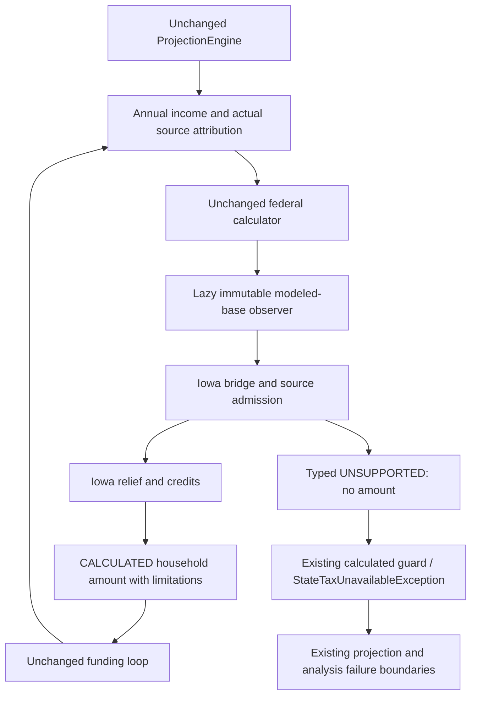

# Phase 6D.5B — Iowa bounded production integration

Completed October 14, 2026. Iowa is production state **12**. Mississippi remains
disabled. No staging, commit or push; no Phase 6D.5C or Mississippi implementation.

## 1. Executive Summary

Admitted Iowa for the approved **MODELED_STANDARD_DEDUCTION_ONLY_V1** planning
estimate. Its useful subset is own pre-tax traditional/rollover IRA receipts,
RMDs and actual same-owner IRA-to-Roth transfers for recipients 55 by year-end,
authoritative modeled Social Security, and assessed ordinary investment income.
Material source, qualification and basis gaps stop the complete annual estimate
through existing typed unavailability. Registration does not certify every plan.

Federal algorithms and the financial behavior of the existing eleven states are
unchanged. No funding, RMD, Roth, projection, analyzer or Monte Carlo algorithm
was modified. The final full suite passed **2790 run / 2762 passed / 0 failures /
0 errors / 28 skipped**. All 26 Iowa worksheet outcomes are preserved, with their
different input provenance made explicit. The separate 500-trial benchmarks passed.

This is a disclosed planning approximation, not a complete federal or Iowa return.
Additional/enhanced federal senior deductions, itemization and other unmodeled
deductions have unknown legal amounts; omission never certifies legal zero.

## 2. Approved Architecture Reconciliation

The controlling Phase 6D.5A.1 design is implemented with exactly seven new production
classes and three modified core classes. Predecessor audit, participant-fact,
attribution and integration findings were reconciled with actual source. The
current Route A contract governs; historical reports' disabled-state counts do
not describe the newly admitted registry.

| Approved decision | Implementation |
| --- | --- |
| A — modeled federal base | Observe existing AGI/applied projected standard deduction; retain signed arithmetic and coverage. No legal deduction reconstruction. |
| B — minimal architecture | Lazy immutable observer; Iowa-specific bridge, relief, credit and immutable rules helpers. No nationwide framework. |
| C — narrow boundary | Account/owner/year/inclusion/purpose reconciliation before relief or zero shortcuts. Stable existing refusal reasons. |
| D — future convention | Before 2026 unsupported; 2026 onward uses nominal Iowa 2026 rules with disclosure. Federal rule projection stays unchanged. |

There are separately identified changes to **seven presentation classes** for
selection-independent disclosure and frozen export metadata. None changes financial
inputs or amounts. The Iowa calculator additionally exposes a pure
`planningLimitations(firstYear, lastYear)` presentation method, avoiding duplicated
warning text. This is Iowa-specific metadata, not an additional calculation path.
Relief diagnostics include the extra components explicitly required by this phase.
No material architectural substitution or new user input was necessary.

### Official source verification

Official material was reopened October 14, 2026. No material contradiction with
the approved rules was found. The expanded-instruction index still identifies
**2025**; final 2026 expanded instructions were not located. The 2026 statutes
and explicit rate announcement establish the validated baseline; 2025 instructions
and worksheets establish the reviewed mechanics. Recheck final 2026 forms when
published; this report does not relabel the 2025 worksheet as 2026.

| Official source | Year/date | Verified use / remaining boundary |
| --- | --- | --- |
| [Code §422.5](https://www.legis.iowa.gov/docs/code/2026/422.5.pdf) | 2026 codification, generated December 2025 | 3.8%, ordinary/senior thresholds, retention relief, 4.3% alternate rate and addbacks. Specialized returns excluded. |
| [Code §422.7](https://www.legis.iowa.gov/docs/code/2026/422.7.pdf) | 2026 | Federal §63 base and Iowa modifications; SS/retirement included-portion exclusions. The planner base is expressly narrower. |
| [Code §422.12](https://www.legis.iowa.gov/docs/code/2026/422.12.pdf) | 2026 | Nonrefundable personal and age credits, including first day after the year. |
| [2026 rate announcement](https://revenue.iowa.gov/press-release/2025-10-21/idr-announces-2026-individual-income-tax-and-interest-rates) | October 21, 2025; tax year 2026 | Confirms 3.8%; no further enacted Iowa flat-rate reduction schedule identified in the reviewed material. |
| [Retirement guidance](https://revenue.iowa.gov/taxes/tax-guidance/individual-income-tax/retirement-income-tax-guidance) | March 13, 2025; full exclusion from 2023 | December 31 age 55, individual spouse eligibility, IRA conversion category. Unavailable alternate eligibility stays unsupported. |
| [IAC 701—302.47](https://www.legis.iowa.gov/docs/iac/rule/02-05-2025.701.302.47.pdf) | February 2025 compilation; amendment effective February 14, 2024 | Qualifying arrangements and conversion categories; employer/pension labels are insufficient. |
| [Federal taxable-income instructions](https://revenue.iowa.gov/taxes/tax-guidance/individual-income-tax/1040-expanded-instructions/federal-taxable-income) | 2025 | Signed reconstruction where federal taxable income is clamped. |
| [Iowa tax / alternate worksheet](https://revenue.iowa.gov/taxes/tax-guidance/individual-income-tax/1040-expanded-instructions/iowa-tax) | 2025 | MFJ comparison before credits and deduction addbacks. |
| [Income Tax Reduction Worksheet 41-146](https://revenue.iowa.gov/media/4387/download?inline=) | 2025; revised August 19, 2025 | Single comparison uses post-credit IA1040 line 12. |
| [Line 12 Balance](https://revenue.iowa.gov/taxes/tax-guidance/individual-income-tax/1040-expanded-instructions/line-12-balance) | 2025 | Credit floor followed by Single reduction. |
| [Exemption credits](https://revenue.iowa.gov/taxes/tax-guidance/individual-income-tax/1040-expanded-instructions/exemption-credits), [IAC 701—304.3](https://www.legis.iowa.gov/docs/iac/rule/02-05-2025.701.304.3.pdf) | 2025 instructions/rule compilation | Per-filer age credit; joint personal credit includes death year. Late birthday after modeled death remains unresolved and refused. |
| [IRS enhanced senior deduction](https://www.irs.gov/newsroom/check-your-eligibility-for-the-new-enhanced-deduction-for-seniors) | February 27, 2026; scheduled 2025–2028 | Temporary provision and phaseouts; entirely omitted by the approved federal-base model. |
| [Expanded-instruction index](https://revenue.iowa.gov/taxes/tax-guidance/individual-income-tax/1040-expanded-instructions) | Currently 2025 | Confirms source-year limitation rather than final 2026 form certification. |

## 3. Exact Class and Resource Inventory

Package root: `com.daviddunn.retirementplanner`.

| New production class | Responsibility |
| --- | --- |
| `domain.tax.FederalTaxBaseBreakdown` | Immutable observational A/D/raw/T/coverage record; numeric invariants only when requested. |
| `domain.tax.state.iowa.IowaTaxBaseBridge` | Annual reconciliation, source admission and signed Iowa base; complete admission or refusal. |
| `domain.tax.state.iowa.IowaLowIncomeReliefCalculator` | Pure status-specific formulas and immutable diagnostics. |
| `domain.tax.state.iowa.IowaPersonalCreditCalculator` | Represented filers, independent calendar age boundaries and deceased-age refusal. |
| `domain.tax.state.iowa.IowaTaxRules` | Immutable nominal rates, thresholds, credits, ages, policy and source metadata. |
| `persistence.IowaTaxRulesRepository` | Strict dedicated resource parsing and cached immutable classpath load. |
| `domain.tax.state.IowaProductionTaxCalculator` | Common production interface; coordinates helpers and creates CALCULATED/UNSUPPORTED results. |

New resource: `src/main/resources/tax/state/iowa-tax-2026.json`, version
`iowa-bounded-2026-v1`. No existing government/state rule JSON or research schema
changed. Existing core changes: FederalTaxCalculation accessor; IA enum member;
one ProductionStateTaxService registration. IA is appended, preserving the eleven
existing enum positions; selectors retain alphabetical display order.

## 4. Federal Modeled-Base Observer

The unchanged federal sequence sums pension/deferred/conversion/investment income,
calculates household taxable SS, adds it to AGI, applies the projected filing-status
standard deduction, clamps taxable income at zero and applies existing brackets.
FederalTaxCalculation still stores the same five fields with the same constructor
and getter semantics.

The new lazy `@JsonIgnore getModeledBaseBreakdown()` derives `raw=A-D`, retains
negative raw values, and requires stored T numerically equal `max(raw,0)`. Different
BigDecimal scales are accepted without changing stored values. No shared cache,
serialized property or extra federal deduction field is introduced. Incompatible
legacy results still construct, but Iowa refuses their observation with
UNSUPPORTED_MODEL_RULE. Existing-state calculators do not call the accessor;
production source search finds its sole consumer in IowaProductionTaxCalculator.

## 5. Iowa Taxable-Income Bridge

Approved **model** equations, not a claim of complete Form 1040 reconstruction:

```text
A = existing modeled AGI; D = existing applied projected standard deduction
S = authoritative federally taxable SS
W = admitted included own-IRA withdrawals/RMDs/opening RMDs
K = admitted included actual IRA-to-Roth conversions
J = (A-D)-S-W-K                 signed Iowa base
B = max(J,0)                   Iowa taxable income
L = J+D = A-S-W-K              relief income
regular tax = B × .038
```

The bridge checks coverage, AGI against current TaxIncome plus authoritative S,
deduction against the request's projected federal rules, federal SS inclusion limit,
retirement scalar/source totals, investment metadata totals and gross SS source
totals. Exclusions never exceed their included modeled categories. Metadata is
not added to AGI again. Known contradictory years, duplicate positive annual source
keys or excess attribution reject as input-contract errors. Duplicate comparison
normalizes monetary scale and retains actual account identity.

Missing material compatible facts produce refusal, never a repaired base or zero.
The signed J is retained before calculating L; neither clamped federal T nor `B+D`
is used as a substitute. With excluded retirement/SS alone, J=-D, B=0 and L=0.
Positive assessed investments remain included once; cash principal and unrealized
growth do not become income. All positive source categories are scanned before
relief. A positive pension scalar refuses even with absent source metadata.

## 6. Iowa Retirement Exclusion

Own TraditionalIRA/RolloverIRA receipts require actual active owner, DOB, current
source year, correct purpose/type and a fully known pre-tax modeled included amount.
Each owner independently satisfies `DOB.plusYears(55) <= December31(taxYear)`.
December 31 birthdays qualify; January 1 of the next year does not. An older
spouse never qualifies the younger owner's IRA. Own IRA admission does not require
separation or conditions-met assertions.

Employer plans, private/government/survivor pensions, disability/survivor exceptions,
inherited/successor distributions and basis-sensitive receipts are refused. The
existing two participant facts do not certify legal plan eligibility. No new
qualification field or favorable default was added.

## 7. Roth Conversion and RMD Handling

Generated conversion evidence is the actual attributed own-IRA source, same-owner
RothIRA destination, CONVERSION purpose, current year and included executed amount.
Known basis differences refuse. External transfers without complete provenance and
positive unattributed hypothetical conversion remainders refuse.

Fixed targets partially fulfilled before final taxation remain supported when all
actual dollars are attributed. The projection test requests 5 million, verifies
positive primary/spouse execution and shortfall, and reconciles source totals to
actual conversion. It then separately verifies a capacity-limited bracket trial
refuses with UNSUPPORTED_TRANSACTION_TYPE. No optimizer capacity workaround.

Opening RMD uses its actual INCOME-purpose source and appears once in W; ordinary
projection RMD uses CASH_FLOW. Prior December 31 balances, RMD allocation and
RMD-before-conversion order are untouched. RMD labels do not prove qualification.
Positive Roth receipts still require unavailable qualified-distribution/history
facts, regardless of their modeled federal zero.

## 8. Low-Income Relief

Nominal thresholds: Single 9000 / MFJ 13500; senior Single 24000 / MFJ 32000.
Senior relief uses age 65 by December 31. Let `excess=max(L-T,0)` and C be nominal
personal/age credit. At or below T, final tax is zero after source admission.

```text
Single above T:
  afterCredits = max(regularTax-C,0)
  finalRaw = min(afterCredits,excess)

MFJ above T:
  alternative = excess × .043
  selected = min(regularTax,alternative)
  finalRaw = max(selected-C,0)
```

Single reduction follows credits; MFJ comparison precedes credits. Credits are
never applied twice. Diagnostics retain threshold, L, excess, exemption, regular
tax, optional alternate, selected pre-credit tax, nominal/applied credit, optional
Single reduction and final raw tax. Absent alternate means not applicable.
Full precision survives comparison; only final production tax rounds HALF_UP to
cents. Return preparation's optional whole-dollar rounding is not adopted.

## 9. Personal and Age Credits

Nominal personal credit 40 Single / 80 MFJ, plus 20 per eligible represented filer.
Nonrefundable, bounded by selected tax. Credit eligibility uses actual DOB and
January 1 immediately following the tax year; senior relief uses December 31;
retirement exclusion uses December 31 age 55. These are independent evaluations.

Single requires one actual active filer, including SPOUSE as survivor. MFJ uses
two represented filers and existing death-year filing treatment. Inactive filers
do not attain later birthdays: an already attained age at modeled January 1 death
is known; an unresolved later age-65 birthday through the credit boundary refuses
with UNSUPPORTED_MODEL_RULE. No mortality/death-history field changed. Dependent,
blindness, disability and ancillary legal benefits are outside this bounded model,
not assumed legally zero.

## 10. Filing-Status Boundaries

SINGLE and MARRIED_FILING_JOINTLY only. MFS, HOH and qualifying surviving spouse
return UNSUPPORTED_MODEL_RULE at the Iowa boundary, without mapping to another
status. Missing represented filer/DOB or unresolved death-age eligibility also
refuses. Existing annual filing status applies through death year, then Single.

## 11. Future-Year Policy

2026 onward reuses nominal validated Iowa rates/thresholds/credits; no Iowa-specific
inflation or legislation forecast. Before 2026 returns UNSUPPORTED_MODEL_RULE.
The applied federal standard deduction follows the existing federal projection
policy, and must match the current request. In 2026–2028 calculated Iowa results
explain that the enhanced federal senior deduction may legally apply but is omitted.
For 2029 onward they identify its reviewed expiration after 2028 and unknown future
changes. No temporary deduction is created, subtracted, added back or carried.

## 12. Typed Unsupported Matrix

| Material case | Existing reason |
| --- | --- |
| Under-55 alternate eligibility; missing actual owner/active recipient; employer/pension/survivor legal qualification | MISSING_RETIREMENT_QUALIFICATION |
| Missing federally included amount; basis-sensitive receipts/conversions; unknown brokerage gains/basis | MISSING_DISTRIBUTION_BASIS |
| Positive Roth receipt without proven qualification/history | NONQUALIFIED_ROTH_BASIS_REQUIRED |
| Inherited/successor retirement history/elections | INHERITED_DISTRIBUTION_HISTORY_REQUIRED |
| External incomplete transfer, missing source year/destination, unattributed trial remainder or unclassified transaction | UNSUPPORTED_TRANSACTION_TYPE |
| Incompatible modeled base, unavailable required model rule/year/status/filer/relief age fact | UNSUPPORTED_MODEL_RULE |

Multiple relevant existing reasons may coexist, particularly missing inclusion plus
unreconciled aggregate amount. All original worksheet refusal reasons remain present.
No new public status or reason. UNSUPPORTED has no amount and cannot become a
partial investment-only estimate, calculated zero, insolvency or a completed rank.

## 13. Iowa Production Registration

Enabled registry: AK, FL, IL, **IA**, MI, NV, NH, PA, SD, TN, TX, WY.
IA routes only to IowaProductionTaxCalculator; it is not Florida-equivalent and
does not route to Michigan. Mississippi and research-only jurisdictions reject.
The research catalog remains eight states and does not contain IA/MS. Registry
admission assertions were updated without changing numerical oracles.

## 14. Wizard and Persistence

Existing shared alphabetical selectors automatically expose Iowa. Added Single/
couple IA executions to both Wizard save/reload workflows: four new invocations
within the 66-test wizard class. The admitted IRA/cash fixture is used, rather than
pretending a pension fixture qualifies. State assumptions editing uses the same
enum. JSON save/reload, repeated projections and scenario copies preserve IA.
No schema, serializer or UI input field changed. Missing legacy state still defaults
MI; explicit invalid/unadmitted states do not silently default.

## 15. Results, CSV and PDF Disclosure

Every calculated Iowa result carries the full omission statement, nominal-year
policy, temporary-deduction note and current base/relief diagnostics. Year-detail
tooltips wrap at 650 pixels; Results Summary's Iowa subtitle has a wrapped policy
tooltip. Existing-state presentation/exports retain their content.

Only Iowa projection CSV adds `Iowa Planning Limitations`, populated on every row.
PDF prints wrapped Iowa limitations before its state-tax table, including both
temporary-term notes when the projection spans them. Frozen analyzer assumption
rows and Monte Carlo single/comparison metadata carry Iowa's policy into their
existing PDF adapters. No result-time notes are reconstructed from a later edited
plan, and no export reruns analysis.

Positive assessed-interest CSV contains IA and 3128.20 with the disclaimer; ordinary
projection CSV contains IA and 0.00, with appropriate annual notes. Both were opened
and parsed. Projection and fixed/longevity PDF text was checked; pages were rendered
and opened. This includes the explicit expired-after-2028 note in the multi-year
projection PDF and the completed Monte Carlo reports.

## 16. Tax-Funding Integration

The common annual service remains the only boundary:



Six Iowa funding cases cover own-IRA funding, mixed assessed investments, known
cash, missing employer qualification and IRA exhaustion into an employer source.
Exempt IRA funding still increases federal income/tax. The zero-investment worksheet
retains federal-funded withdrawal 11243.59 and next-year RMD 39683.69. With ordinary
interest 100000, D16100, senior Single credit60, Iowa tax is independently
`(100000-16100)*.038-60 = 3128.20`, unchanged as funding IRA receipts grow.
Final source records contain actual funding only, not trial accumulation. No new
threshold, convergence shortcut or mutable cache.

## 17. Deterministic Analyzer Integration

Single current/alternative strategies, couple 81-cell grid and actual integrated
comparison use the same registered state service. Admitted projections carry IA
and calculated tax. Unknown pension baselines abort; unsupported candidates retain
failure explanations with no metrics/differences or successful ranking. Social
Security-only tax scope and ordering are unchanged. The integrated UI was rendered
using an actual deterministic comparison; it does not invent SS expected values.

## 18. Longevity-Weighted Analyzer Integration

An admitted prepared mortality scenario evaluates total probability one. A required
unknown-pension scenario refuses through the existing wrapper, without a completed
expected value or silent probability renormalization. Exact ending/snapshot policy,
continuation, mortality weights, ranking formulas and trial admission are unchanged.
Unresolved death-year age birthdays remain explicit unsupported cases.

## 19. Monte Carlo Integration

Seven new Iowa integration executions cover repeated seeded fixed/longevity worlds,
single-person worlds, unsupported reference and later-world failures, original
younger-cohort death-age refusal, and frozen disclosure/PDF export in both modes.
Unsupported simulations return no success percentages or percentiles. The original
younger fixture fails at seed417 scenario17/year2028 with UNSUPPORTED_MODEL_RULE;
that real boundary is retained, not bypassed.

Supported matched workloads use both people already 65, coherent SS claim dates
and the disclosed 20-million checking buffer, avoiding successor-funded IRA gaps.
This is bounded workload coverage, not admission of every mortality path/plan.
Production random streams, simulation counts and algorithms are unchanged.

## 20. Iowa Worksheet Results

Shared worksheet JSON is byte-for-byte preserved: SHA256
`07205E183572E8BE317E79C737C053098A085D962EA8F3FA67BB738E5C00321A`.
All 26 cases execute in the new adapter/helper mapping: **13 numeric / 13 unsupported**,
26 passed, zero failed/errors/skips. D=20000 cases use explicitly stipulated coherent
test rules, not a changed published federal resource or claimed full projection.

| ID | Preserved outcome | Tested boundary |
| --- | --- | --- |
| IA01 | 0.00 | Direct SS-only calculator |
| IA02 | 1480.00 | Direct assessed interest; stipulated D20000 |
| IA03 | 1480.00 | Direct ordinary dividend; stipulated D20000 |
| IA04 | 1480.00 | Direct positive gain; stipulated D20000 |
| IA05 | 0.00 | Direct own IRA, recipient55 |
| IA06 | Missing retirement qualification | Direct own IRA, recipient54 |
| IA07 | 0.00 | Direct own IRA RMD |
| IA08 | Missing retirement qualification | Employer source with dated participant facts |
| IA09 | Missing retirement qualification | Pension |
| IA10 | Missing retirement qualification | Survivor attribution preserves original owner |
| IA11 | 0.00 | Complete attributed generated own-IRA conversion |
| IA12 | Missing retirement qualification | Pre-age conversion |
| IA13 | 0.00 | Pure legal qualified-Roth premise only; positive domain Roth separately refuses |
| IA14 | Nonqualified Roth basis required | Direct positive Roth receipt |
| IA15 | Inherited history required | Direct inherited IRA with original dates/relationship |
| IA16 | 1480.00 | Direct IRA+interest; stipulated D20000 |
| IA17 | Missing retirement qualification | Pension+dividends; no partial tax |
| IA18 | Missing retirement qualification | Own IRA receipts for55/54 spouses |
| IA19 | Missing retirement qualification | Employer participant events2030 cannot qualify2026 |
| IA20 | 3000.00 | Direct large IRA+investments; stipulated D20000 |
| IA21 | 0.00 | Owner turns55 December31 |
| IA22 | Missing retirement qualification | Owner turns55 next January1 |
| IA23 | Missing retirement qualification | Employer conversion |
| IA24 | Missing distribution basis | Externally recorded unknown included amount |
| IA25 | 0.00 | Direct senior relief, remaining ordinary income20000 |
| IA26 | 3740.00 | Pure final Iowa B100000/credit60 arithmetic |

Direct helper tests do not establish that a production engine can derive stipulated
legal facts. Actual-rule funding/projection/source companions cover owner ages,
opening RMD, taxable SS, mixed income, actual/partial conversions and refusal.
Mississippi's 29 worksheets, including four pending legal cases, are unchanged.
The historical audit test changes only its now-authorized admission assertion.

## 21. Independent Golden Tests

Seven observer executions cover signed/floored bases, scale equality, unchanged
legacy construction, freshness and five-field serialization. Twenty-seven pure
relief/credit executions cover ordinary/senior Single/MFJ threshold ±1/exact,
minimum comparison/tie, credit floor, sub-cent precision, all January/December age
boundaries, independent spouses, survivor selection and deceased-age refusal.

The required stipulated Single example produces regular76, after-credit36, excess1,
final1.00. This is formula validation, not a claimed 2026 federal-engine input.
Twenty-three source contracts cover missing owner/year/inclusion, basis, Roth,
employer/external/trial gaps, duplicates with different scales, excess/contradictory
years/SS, multi-owner actual transfers, unsupported statuses and year policy.
Seven repository executions check immutable caching, parameters/source years and
strict malformed/unknown/duplicate/missing/null rule rejection.

Development fixture/compilation errors were corrected within the new tests: legacy
FilingStatus import ambiguity, coherent SS dates for the supported older cohort,
valid opening RMD prior balances for the capacity test, Single spouse-null display
contract and captured presentation initialization. The original death-age refusal
remains tested. No existing financial expectation was changed to resolve a failure.

## 22. Existing-State Regression Results

| Frozen evidence | Verification |
| --- | --- |
| Michigan | 174.25 /348.50 /1125.83 /2251.65 unchanged |
| Florida | All20 category cases and whole-plan comparisons unchanged |
| Seven other zero-tax jurisdictions | Existing112 category admissions and Florida-equivalent financial/source comparisons unchanged |
| Illinois | All39 fixtures and eight accepted workload hashes unchanged |
| Pennsylvania | Supported amounts and unsupported classifications/reasons unchanged |
| Original cross-state fingerprints | All16 exact matches; no oracle regeneration |
| Federal/RMD/Roth/funding/rankings/seeded MC | Existing expectations pass; algorithms and financial fields unchanged |

Counts include skipped invocations; passed=run-failed-errors-skipped. Selections
overlap and are not summed as unique coverage.

| Executed selection | Run | Passed | Failed | Errors | Skipped |
| --- | ---: | ---: | ---: | ---: | ---: |
| New Iowa/federal/repository focused tests, visual enabled | 118 | 118 | 0 | 0 | 0 |
| Iowa worksheet mapping, subset of preceding | 26 | 26 | 0 | 0 | 0 |
| Focused including prior IA/MS audit class | 177 | 173 | 0 | 0 | 4 |
| Existing-state targeted regressions | 460 | 459 | 0 | 0 | 1 |
| Affected wizard/Monte Carlo PDF/analyzer inputs/visual | 79 | 79 | 0 | 0 | 0 |
| Complete nonbenchmark | 2768 | 2745 | 0 | 0 | 23 |
| Complete full suite | 2790 | 2762 | 0 | 0 | 28 |
| BenchmarkTest subset inside full suite | 22 | 17 | 0 | 0 | 5 |
| Dedicated Iowa performance opt-in | 1 | 1 | 0 | 0 | 0 |

Full-suite skips: four pending Mississippi law cases, existing opt-ins and four
new opt-in invocations (two Iowa production previews, one integrated preview and
one Iowa benchmark). All Iowa previews and its benchmark were actually executed
in separate successful selections. Nonbenchmark excludes BenchmarkTest classes.
The full benchmark subset's fifth skip is the separately executed Iowa benchmark.

Focused log: `target/phase6d5b-focused-final.log`; existing regressions:
`phase6d5b-existing-regressions.log`; affected: `phase6d5b-affected.log`;
nonbenchmark: `phase6d5b-nonbenchmark.log`; full: `phase6d5b-full.log`.
The affected run actually executed Wizard66, MonteCarloPdfExport8, analyzer input4
and Iowa integrated visual1; absent exporter-name selector patterns did not add
tests. Projection exports are covered by the Iowa focused previews and full suite.
Nonbenchmark took3m16s; full took7m16s, both Maven exit0. Full Surefire XML totals
corroborate2790/0/0/28 before the separate benchmark overwrites its own XML.

Every Maven invocation uses IntelliJ's bundled executable and the required
`-Dmaven.repo.local=C:\Users\david\IdeaProjects\retirement-planner\.codex-m2\repository`.
Focused/regression/performance heap512MiB–1536MiB; affected/complete heap512MiB–8GiB.
Full/nonbenchmark selections respectively `test` and `-Dtest=*,!*BenchmarkTest test`.
Historical Phase6D.5A2666/2642/0/0/24 is a separate baseline, not current verification.

## 23. Performance Measurements

Matched Florida/Iowa supported couple fixtures, identical income/assets/cohorts and
seed417, return volatility.12; three warm-up and five measured batches. JDK
25.0.4.1+1-LTS; `-Xms512m -Xmx1536m`, measured maximum heap1610612736 bytes.
No competing Maven workload during measurement. Timing is elapsed computation;
retained heap and exclusive per-method cost were not separately measured.

| Workload | Units per batch | Florida median ms | Iowa median ms | Iowa difference |
| --- | ---: | ---: | ---: | ---: |
| Ordinary30-year projection | 50 | 158.592 | 141.576 | -10.7% |
| Fixed-conversion30-year projection | 50 | 134.456 | 148.768 | +10.6% |
| Fixed-horizon Monte Carlo | 500 trials | 1376.064 | 1540.977 | +12.0% |
| Longevity Monte Carlo | 500 trials | 1000.859 | 1114.097 | +11.3% |

Both500-trial modes completed500; production defaults/counts were not changed.
The short ordinary difference is not claimed as a tax speedup: global JIT/order
variation remains. Iowa performs reconciliation, source qualification, calendar
age evaluations and immutable diagnostics absent from Florida's zero-tax strategy.
These explain added work; the measured12% difference is not an isolated causal
profile. No unexplained algorithm/convergence change or existing-state financial
regression was found. Rules parse once, outside trials; there is no per-trial cache.
No speculative optimization or weakened accuracy was introduced.

Raw40 samples: `target/phase6d5b-performance.csv`; log:
`target/phase6d5b-performance.log`. Dedicated benchmark:1 passed,46.82s JUnit /
54.685s Maven including warm-ups/build. Full suite also exercised its unchanged
existing benchmark workloads; optional historical timing baselines are not reused
as matched Iowa measurements.

## 24. Visual and Export Inspection

Actually opened generated rasters and CSV, not merely asserted artifact existence.
Artifacts under `target/phase6d5b-preview/`:

- `wizard-IA.png`, `assumptions-IA.png`: Iowa selected, normal control layouts.
- `results-IA.png`: calculated zero is displayed under Iowa.
- `positive-assessed-interest-IA.png`: actual annual funding-boundary tax3128.20
  displays as3128 at existing whole-dollar UI precision. This is an assessed-income
  display fixture, not a newly generated investment-yield projection.
- `iowa-limitations.png`: wrapped, readable omission/nominal-year disclosure.
- `state-tax-unavailable-IA.png`: Iowa qualification failure, no calculated-zero
  substitute and no completed projection.
- `results-summary-IA.png`, `report-summary.png`, `report-state-tax.png`: actual
  admitted projection summary/PDF; Iowa identity and full policy text visible.
- `integrated-Iowa.png`, `integrated-Iowa-assumptions.png`: actual deterministic
  comparison and expanded input content; Iowa policy text wraps within its row.
- `iowa-fixed-report.png`, `iowa-longevity-report.png`: rendered completed3-trial
  PDF previews, clearly distinct from the500-trial performance measurements.
- `iowa.csv`, `positive-assessed-interest-iowa.csv`: opened/parsed IA identity,
  exact0.00/3128.20 and limitation column. `iowa.pdf`, `iowa-fixed.pdf`,
  `iowa-longevity.pdf`: text checked and representative pages rendered/opened.

New Iowa names/disclosure were not clipped. Existing compact summary cards and
comparison widgets retain their generic truncation/scroll behavior; no unrelated
layout redesign was claimed or performed. Positive boundary display uses the actual
federal funding result and separately consistent Medicare calculation; its ancillary
cash-flow presentation is not a new full-projection golden.

## 25. Known Limitations

Full-year ordinary resident Single/MFJ planning subset. No comprehensive federal
return reconciliation, additional/enhanced senior deductions, itemization/QBI,
insurance deduction, ancillary credit, disability certification, employer-plan
legal assertion, survivor qualification, basis/history ledger, special securities,
loss reconstruction or state residency timeline. Ordinary investment inputs must
already be assessed; the normal projection still generates no separate yield/gain
income. IRA age does not prove inherited or Roth qualification.

Unsupported paths stop complete dependent calculations. Particularly, a valid
selected Iowa plan may be unavailable for an employer pension, a Roth-funded tax,
a deceased-owner receipt, an unresolved deceased birthday or a capacity-limited
hypothetical conversion. The admitted performance buffer/cohort is not an implicit
relaxation of those boundaries. Final2026 instructions remain a monitoring/review
item; new law or broader legal coverage requires separate authorization.

## 26. Exact Created/Modified File Inventory

**Created21 files**: seven production classes, one production resource, twelve test
classes and this report. **Modified15 existing files**: three core, seven presentation
and five tests; one modified test was already untracked at phase entry.

Created production/resources (paths below `src/main/`):

- `java/com/daviddunn/retirementplanner/domain/tax/FederalTaxBaseBreakdown.java`
- `java/com/daviddunn/retirementplanner/domain/tax/state/IowaProductionTaxCalculator.java`
- `java/com/daviddunn/retirementplanner/domain/tax/state/iowa/IowaTaxBaseBridge.java`
- `java/com/daviddunn/retirementplanner/domain/tax/state/iowa/IowaLowIncomeReliefCalculator.java`
- `java/com/daviddunn/retirementplanner/domain/tax/state/iowa/IowaPersonalCreditCalculator.java`
- `java/com/daviddunn/retirementplanner/domain/tax/state/iowa/IowaTaxRules.java`
- `java/com/daviddunn/retirementplanner/persistence/IowaTaxRulesRepository.java`
- `resources/tax/state/iowa-tax-2026.json`

Created tests (paths below `src/test/java/com/daviddunn/retirementplanner/`):

- `domain/tax/FederalTaxBaseBreakdownTest.java`
- `domain/tax/state/IowaProductionTaxCalculatorTest.java`
- `domain/tax/state/IowaSourceContractTest.java`
- `domain/tax/state/iowa/IowaReliefAndCreditTest.java`
- `domain/projection/IowaFundingTest.java`
- `domain/projection/IowaProductionProjectionTest.java`
- `app/montecarlo/IowaMonteCarloIntegrationTest.java`
- `app/montecarlo/IowaProductionBenchmarkTest.java`
- `app/socialsecurity/IowaIntegratedAnalysisTest.java`
- `persistence/IowaTaxRulesRepositoryTest.java`
- `ui/wizard/IowaProductionVisualTest.java`
- `ui/socialsecurity/IowaIntegratedVisualTest.java`

Created report: `PHASE-6D5B-IOWA-PRODUCTION-INTEGRATION.md`.

Modified core/presentation (paths below `src/main/java/com/daviddunn/retirementplanner/`):

- `domain/tax/FederalTaxCalculation.java`
- `domain/model/StateTaxJurisdiction.java`
- `domain/tax/state/ProductionStateTaxService.java`
- `app/export/ProjectionCsvExporter.java`
- `app/export/ProjectionPdfExporter.java`
- `ui/summary/ProjectionYearDetailsPane.java`
- `ui/views/ResultsSummaryView.java`
- `ui/socialsecurity/SocialSecurityAnalyzerInputSummary.java`
- `ui/montecarlo/MonteCarloRunService.java` — frozen presentation strings only.
- `ui/montecarlo/MonteCarloStrategyComparisonRunService.java` — same; no simulation change.

Modified tests (same test package root as above):

- `domain/tax/state/NoIncomeTaxAdmissionTest.java` — admission count/codes only.
- `domain/tax/state/simplified/PennsylvaniaProductionAdmissionAuditTest.java` — admission list only.
- `domain/tax/state/simplified/PennsylvaniaParticipantFactsAuditTest.java` — admission list only.
- `ui/wizard/StateTaxWizardIntegrationTest.java` — four IA invocations and admitted source fixture choice.
- `domain/tax/state/simplified/IowaMississippiAdmissionWorksheetTest.java` — pre-existing untracked file; current admission assertion only, no worksheet expectation change.

Entry already had the two predecessor reports, preceding audit test and shared
worksheet JSON untracked. Reports/JSON are preserved; the audit test modification
is counted above, rather than falsely calling it newly created. Generated logs,
Surefire/compiled artifacts, PDF/CSV/PNG and performance samples stay ignored under
target. Nothing under existing financial golden resources, federal algorithms,
funding/Roth/RMD/projection/analyzer/Monte Carlo algorithms or plan schemas changed.

Repository verification: `git diff --check`; independent whitespace/final-newline
checks for new files; status and unchanged staged diff. No Mississippi registration,
unexpected production change, existing financial golden change, staging, commit or
push. The only federal file delta is import/accessor and final newline.

## 27. Final Iowa Admission Decision

**ADMIT IOWA AS PRODUCTION STATE12 WITH THE APPROVED BOUNDED MODEL AND EXPLICIT
UNSUPPORTED CASES.** Calculation, source, funding, projection, persistence, UI,
export, analyzer, Monte Carlo, frozen financial and measured performance gates pass.
All original Iowa worksheet values/reasons and Mississippi worksheets remain intact.
The disclosed approximation and unsupported boundaries are part of admission,
not unfinished exceptions silently treated as tax zero. Mississippi remains disabled.

PHASE-6D5B-IOWA-PRODUCTION-INTEGRATION-IMPLEMENTED
