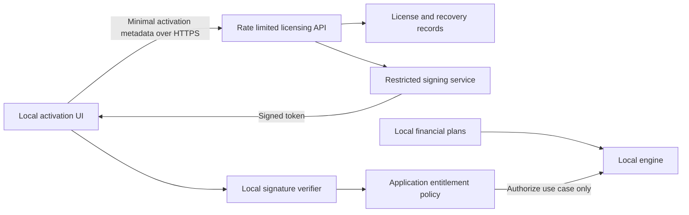

# Phase 7A — Productization architecture audit

Audit date: October 14, 2026. Architecture proposals only. No Phase 7B implementation.

## 1. Executive Summary

Recommend **Option A: a self-contained Windows JavaFX desktop application**, retaining the existing Java financial engine and local JSON plans. Start with a controlled public beta on Windows 11 x64, subject to packaging and usability acceptance tests. Other operating systems and browser delivery should follow demonstrated demand. A bundled runtime removes the requirement for users to install Java or Maven.

The repository has substantial headless calculation and analysis services, typed state-tax refusals, scenario isolation, and report-generation capabilities. It does **not** yet demonstrate a reproducible signed installer, safe transactional plan saves, a versioned plan migration contract, licensing, telemetry consent, secure updates, or a public support/documentation process. Financial validation is substantial; distribution readiness is a separate gate.

Propose signed, versioned offline licenses, with server-issued 30-day trials after one online activation. Keep license identity, edition, entitlements, validity, update eligibility and telemetry consent separate. Expiration must preserve open, backup, save-copy and export access to existing data. Financial services remain deterministic and licensing-independent. Telemetry must use narrowly allowlisted events, separate diagnostics/analytics choices and a disabled implementation when unauthorized. No plan, financial output, raw exception message or full path belongs in either remote service.

Five highest-priority risks:

1. Direct destination writes can damage the user's only plan during interruption; settings corruption can affect startup.
2. No packaged release/signing/recovery pipeline is present; a development launch is insufficient evidence for distribution.
3. Raw exceptions and Iowa diagnostic limitations can contain sensitive information; automatic exception upload would violate the proposed privacy boundary.
4. Mandatory trial telemetry and paid defaults need explicit product decisions and legal review before activation is shipped.
5. Reference-rule reproducibility, planning limitations and complex analyzer explanations need a public-facing contract; a successful projection must not be mistaken for a tax return or financial recommendation.

The recommended first phase is **7B: packaging and local-data hardening**, without licensing or telemetry prerequisites for its engineering work. Do not authorize broad financial refactoring through productization.

## 2. Audit Scope and Evidence

Initial branch: `main`. Initial HEAD: `fc01947e6a4a1119f0c4ec9d41ea3f4e8b39edad`. Initial `git status --porcelain -uall`: empty. This checkout contains completed Iowa integration; preceding conversation descriptions of an uncommitted implementation do not describe this initial working tree.

Evidence consists of source excerpts and call-site searches, resource headers, local dependency POMs, test-source inspection and the completed [Phase 6D.5B report](PHASE-6D5B-IOWA-PRODUCTION-INTEGRATION.md). It is a static architecture audit, not a penetration test, dependency vulnerability scan, installer trial or new financial verification run. Sections below label existing implementation versus proposed behavior. Negative findings mean no matching capability was found in the inspected source/build configuration, not mathematical proof that every possible behavior is absent.

Official external documentation was consulted using generic public queries. No repository files, plans, financial inputs or calculated results were uploaded. External documentation can change; packaging tools, provider plans, supported regions, costs and processor terms require release-time validation. No pricing estimates are invented here.

Path convention: `J/` means `src/main/java/com/daviddunn/retirementplanner/`; `T/` means `src/test/java/com/daviddunn/retirementplanner/`; `R/` means `src/main/resources/`. These prefixes denote actual paths, not proposed packages. Exact inspected evidence is listed in Section 24.

## 3. Existing Repository Architecture

| Boundary | Existing implementation and evidence | Reuse / missing capability / risk |
| --- | --- | --- |
| Desktop startup | `J/ui/MainApplication.java`: `main` calls JavaFX `launch`; `start` constructs `MainWindow`, sets stage/scene/CSS and shows it. `stop` closes the shared Social Security job coordinator. | Reusable launcher lifecycle. No startup recovery or licensing bootstrap exists there. Settings failure can occur before a usable scene. |
| Window composition | `J/ui/MainWindow.java`: constructs controller, household/accounts/income/expense/assumption/results/Roth/non-investable views; wires callbacks; opens last plan and populates views. | JavaFX shell is reusable. Startup combines construction, restoration and rendering; separate recoverable failures later. |
| State/controller | `J/ui/controller/ApplicationController.java`: owns mutable current plan/file, dirty flag, projection/baseline caches, settings and revision listeners. `getCurrentProjection` lazily invokes `ProjectionEngine.project`; `invalidateProjection`, `markModified`, `open`, `save`, `saveAs` manage UI state. | Existing orchestration, not a thread-safe general application API. Methods may calculate synchronously on their caller's thread. |
| UI packages | `ui/views`, `dialogs`, `wizard`, `charts`, `summary`, `socialsecurity`, `montecarlo`, `breakeven`, `controller`, `console`. `NewRetirementPlanWizard` creates household, account, income, expense, assumption and review pages. | Retain editing/callback pattern initially; extracting use cases is preferable to rewriting views. |
| Application services | `app/socialsecurity` supplies isolated strategy evaluation/comparison/search and weighted continuation; `app/montecarlo` supplies seeded stochastic execution; `app/export` supplies report composition. | Partially formed application-service layer already exists. Plan CRUD/projection ownership remains in the UI controller. |
| Domain | `domain/model`, `financial`, `income`, `projection`, `tax`, `roth`, `rmd`, `medicare`, `estate`, `baseline`, `rules`, `socialsecurity/analysis`, `analysis` and `noninvestable`. `ProjectionEngine` uses a separate `ProjectedPortfolio`, projected balances and RMD snapshots. | Preserve BigDecimal arithmetic, ordering and live-account isolation. Engine default construction loads government rules through a persistence repository: headless, but not fully dependency-inverted. |
| Taxes | `J/domain/tax/state/ProductionStateTaxService.java`: immutable calculator registry and routing validation. `StateTaxJurisdiction` has AK, FL, IL, IA, MI, NV, NH, PA, SD, TN, TX, WY. `ProductionStateTaxResult` distinguishes calculated amount from unsupported/no amount. | Twelve states, not nationwide support. Research catalog is not activation registry. Mississippi is absent. No registry changes proposed. |
| Iowa | `IowaProductionTaxCalculator.calculate` observes modeled federal base, reconciles sources/credits before relief, and returns explicit limitations. | Bounded own-IRA/SS/investment estimate; not complete federal/Iowa return. Limitations include actual AGI/base/credit diagnostics, therefore are **financial data**, not safe telemetry strings. |
| Social Security | `IntegratedSocialSecurityStrategyEvaluator.evaluate` deep-copies a plan and projects a supplied strategy; `evaluateCurrentStrategy` extracts current elections. `LongevityWeightedIntegratedStrategyEvaluator` iterates mortality scenarios and refuses a completed expectation after required-scenario failure. | Distinct SS-only, deterministic and weighted scopes must remain visible; do not present one as interchangeable with another. |
| Stochastic execution | `MonteCarloAnalyzer.analyzeMortality` isolates input, generates indexed worlds, checks cancellation in a sequential loop, and reports progress. Runtime failures become `MonteCarloExecutionException`; insufficient funds is a distinct outcome. | Background UI execution does not imply parallel financial trials. Preserve streams, ordering, trial counts and failure semantics. |
| Concurrency | `SocialSecurityAnalysisJobCoordinator` owns one daemon single-thread executor and synchronized lease admission; cancellation is atomic/cooperative. `ui/montecarlo/MonteCarloAnalysisView` owns a single-thread worker/session and shuts it down; PDF export uses a virtual-thread JavaFX Task adapter. | Good foundations; separate coordinators can still compete for CPU/heap. Define whole-application admission/lifecycle before concurrent browser requests. |
| Persistence | `JsonRetirementPlanRepository.save` validates references then Jackson-writes destination directly; `load` reads bytes, checks explicit null state configuration, deserializes original tokens and validates references. JavaTimeModule and formatted JSON are configured. | Numeric precision/scale and legacy state behavior are deliberate. Missing atomic save, backups, migration envelope and bounded import policy. |
| Plan compatibility | `RetirementPlan` uses constructor-based Jackson properties and optional legacy fields; repository treats omitted state configuration differently from explicit null. No top-level plan schema version was found in the inspected model/repository. | Compatibility is distributed across model constructors/defaults and tests; it is not a central migration registry. Unknown future formats need explicit refusal without rewriting originals. |
| Baselines | `RetirementPlanSnapshot` stores supplied household, portfolio and assumptions references; only the non-investable list container is copied. `RetirementPlanScenarioCopyService.copy` independently JSON-round-trips a plan. | A baseline snapshot is not deeply immutable. This is an explicit future correctness review, not permission to alter baseline semantics in packaging. |
| Exports | `ProjectionCsvExporter` uses destination `Files.newBufferedWriter`; `ProjectionPdfExporter` and `BreakEvenPdfExporter` save PDF directly. `MonteCarloPdfExporter` and `IntegratedAnalyzerPdfExporter` write sibling temporary PDFs and replace destination. | Uneven replacement safety. Existing temporary replacement lacks a demonstrated atomic-move guarantee and crash cleanup. |
| Report contracts | `ProjectionPdfReport` is a record but imports `ui.charts.ProjectionChartModel`; Monte Carlo PDF exporter consumes report-only inputs, with no execution service. | Frozen reporting pattern is reusable. UI-named chart DTO leaks architectural ownership into app/export despite not being a JavaFX Node. |
| Settings | `ApplicationSettings` contains auto-open-last-plan and full last-opened path. `JsonApplicationSettingsRepository` uses `${user.home}/.retirement-planner/settings.json`, writes directly and wraps I/O failures in RuntimeException. | No privacy/license preferences or recovery mechanism here; local path is sensitive. |
| Errors/logging | `MainWindow` and `ResultsSummaryView` contain `printStackTrace`; Monte Carlo UI uses `java.util.logging`. `MonteCarloExecutionException` includes seed/model and raw cause message. | No consistent sanitized diagnostic taxonomy, retention or logging sink was found. Console output is not automatically remote telemetry. |
| Security/network | Searches of production Java for networking, crypto/signatures and telemetry found no corresponding licensing, authentication, encryption or telemetry implementation. Classpath resource URL use loads CSS/data, not an identified financial upload path. | Proposed services are missing. Static searches do not replace runtime network observation before release. |
| Build | `pom.xml` targets Java 25, JavaFX 25; Surefire 3.5.3 isolates test `user.home`; JavaFX Maven plugin 0.0.8 launches `ui.MainApplication`. No module-info, installer plugin/profile or checked-in YAML CI workflow was found. | Maven development launch exists; release assembly/signing pipeline is missing. Absence of checked-in CI does not establish absence of external automation. |

The alternate `J/app/RetirementPlannerApplication.java` is a demo-oriented `run` path using `DemoDataFactory`, console printing and `plan.json`; it is not the configured JavaFX entry point. Do not package it as the public launcher or let it write sample data over user data.

More specifically, `J/domain/tax/FederalTaxCalculator.java::calculate` derives taxable Social Security, adds it to modeled ordinary income, retrieves the projected standard deduction, calculates taxable income and progressive tax, then returns five financial fields. This is a modeled base, not a reconstructed Form 1040. `TaxFundingCalculator` owns the federal/state boundary and iterative funding; `J/domain/roth/RothConversionBracketFillCalculator.java` depends on that funding calculator and conversion attribution. Product authorization must wrap those operations without changing their convergence rules. `J/domain/socialsecurity/analysis/SocialSecurityStrategyCalculator.java::calculate` builds monthly own/spousal/survivor results and annual aggregation using immutable request inputs; its documented timing/COLA conventions belong in public model help. `ProjectionPdfCharts` independently renders prepared chart values as vectors, with floating-point conversion for page geometry, rather than re-running financial calculations.

## 4. Current Product Readiness

| Capability | Evidence | Readiness assessment |
| --- | --- | --- |
| Guided creation | `NewRetirementPlanWizard`, `HouseholdWizardStep`, `WizardDialogSupport`: navigation, review, required labels, help installation and validation; `CompleteWizardEndToEndTest` covers single/couple creation, persistence, projection and analysis workflows. | Implemented; external first-time-user usability remains unproven. |
| Field assistance | `WizardDialogSupport` installs InputHelp, marks required fields and validates numbers/dates/selections. | Useful foundation; audit all advanced tabs for consistency, jargon, units and recovery. |
| Single/couple plans | `RetirementPlan`, household ownership validation, integrated evaluator primary-only path, and wizard end-to-end test. | Implemented in bounded shapes; analysis prerequisites and survivor rules still require explanation. |
| Projection | `ProjectionEngine` orchestrates income, growth, expenses, RMD, conversions, tax/funding, Medicare and estate. | Strong modeling breadth; public documentation must describe first-year proration, death timing and approximation boundaries. |
| Social Security | Integrated evaluator, weighted evaluator, job coordinator and analyzer UI packages. | Sophisticated; different objectives, PV dates, mortality assumptions and deterministic ranking need clear labels. |
| Roth/RMD | Engine calls existing domain services; Iowa report documents RMD-before-conversion, executed amounts and funding feedback. | Technically implemented; no promise of full basis/history/qualification support. |
| Monte Carlo | Analyzer, world generator, cancellation/progress and view/session. | Implemented fixed and longevity modes; cancellation latency and low-memory behavior need packaged-hardware testing. |
| Taxes | Production registry/result plus Iowa limitations. | Twelve jurisdictions with distinct admission boundaries; unsupported is a legitimate refusal, not zero. Not a tax-preparation product. |
| Results/reports | Summary/details UI, vector PDF exporters, CSV and frozen report DTOs. | Implemented; accessibility, large reports, print/readability and permission failures need beta acceptance. |
| Portability | Local readable JSON plus CSV/PDF; repository keeps numeric tokens on load. | Useful recovery foundation; no centrally documented schema/migration/data dictionary yet. |
| Accessibility | JavaFX controls, labels and wizard help exist. | No screen-reader, keyboard-only, high contrast, DPI or accessible-PDF conformance verified in this audit. Standard controls alone do not establish compliance. |
| Documentation/first run | Phase reports and mortality README found; startup restores last plan. | Engineering documentation exceeds end-user guidance. No completed public installer/help/support lifecycle demonstrated. |

Do not advertise competitive superiority: this audit performed no independently controlled competitor or accuracy benchmark. A technically completed feature is not automatically suitable for every unsupervised consumer scenario.

## 5. Desktop Packaging Feasibility

**Verified external basis:** JDK 25 `jpackage` supports modular and non-modular applications, generates runtime images, offers EXE/MSI on Windows and requires packaging on the target platform. Its guide lists WiX 3.0 or later; pin and test the exact compatible toolchain rather than treating all later WiX releases as interchangeable. JDK 25 changed automatic service-binding behavior, so test required service providers explicitly. [Oracle packaging overview](https://docs.oracle.com/en/java/javase/25/jpackage/packaging-overview.html), [JDK 25 guide](https://docs.oracle.com/en/java/javase/25/jpackage/index.html).

JavaFX 25 requires JDK 23 or later, compatible with this project's compiler target 25. The local Maven cache includes `javafx-controls-25-win.jar`; platform selection comes from OpenJFX parent POM profiles. Native graphics/base libraries and Ikonli service metadata must survive assembly. [JavaFX 25 highlights](https://openjfx.io/highlights/25/), [OpenJFX setup](https://openjfx.io/openjfx-docs/index.html).

**Proposed minimum build path:** pin a redistribution-approved JDK 25 vendor/build, Maven/plugin versions, Windows architecture and WiX version. Build the ordinary application JAR plus runtime dependencies in a clean staging directory; keep the application non-modular initially. Put JavaFX named modules on an explicitly validated module path/runtime image. Use `jdeps` as an aid, then test reflective Jackson loading, PDF/AWT facilities, resource loading and Ikonli ServiceLoader providers; static dependency analysis alone is insufficient. Use an application-specific runtime supplied to `jpackage`, or its generated runtime after proving equivalent module coverage. `jlink` cannot simply link this unnamed application as a named module. Avoid introducing module-info solely for packaging.

Create and smoke-test an `app-image` first; then produce one signed EXE installer for beta, retaining MSI as a possible enterprise distribution format. Validate whether the existing Application-subclass launcher works under the chosen module/classpath launch configuration. A plain launcher delegating to JavaFX is a possible small packaging adjustment if required by that tested configuration, not an assumed mandatory refactor. Users should need neither IntelliJ nor a separately installed JRE.

| Concern | Proposed policy / acceptance |
| --- | --- |
| Installation | Per-user initially, under `%LOCALAPPDATA%/Programs/<Publisher>/RetirementPlanner`; explicit jpackage per-user settings. Machine-wide `%ProgramFiles%` requires separate administrator/support decision. Never write plans beside installed binaries. |
| User data | `%LOCALAPPDATA%/<Publisher>/RetirementPlanner` for settings/license/consent/logs/queues; financial plans remain user-selected, optionally suggest a Documents folder after explaining possible cloud synchronization. |
| Metadata | Stable product/upgrade identity, non-SNAPSHOT release version, publisher, icon, copyright, EULA/notices, Start Menu shortcut, optional desktop shortcut. File association is optional, with quoted argument handling and import validation. |
| Update/reinstall | Keep stable upgrade identity; never delete user plans/settings/license during reinstall. Uninstall removes application files, with separately explicit opt-in local-data deletion. Test old/new side-by-side and downgrades. |
| Signing | Authenticode-sign appropriate binaries/installer with protected key and trusted timestamp. Verify signature and publisher in release acceptance. Signing does not guarantee SmartScreen reputation or immediate warning-free launches. [Microsoft SmartScreen guidance](https://learn.microsoft.com/en-us/windows/apps/package-and-deploy/smartscreen-reputation). |
| Startup failures | Friendly recovery UI for corrupt settings/reference data; privacy-safe local error code. Do not require a working remote service to open existing files. |
| Reproducibility | Pin inputs, archive dependency graph/checksums, build manifest and unsigned artifact hashes; compare repeat builds. Signing timestamps can prevent byte-identical signed output; distinguish reproducible build contents from signed-release identity. |
| Platforms | Recommend Windows 11 x64 first; validate actual vendor/runtime/JavaFX OS support and supported Windows builds at release. Windows 10/ARM64 are separate decisions. Mac requires its own native artifacts/build/signing/notarization acceptance; Linux needs distro/native graphics/package testing. |
| Hardware | Establish minimums through packaged tests on lower-end machines, including integrated graphics, DPI, long horizons and bounded analysis memory. Previous 8-GiB test heaps are not user minimum RAM evidence. Publish tested limits rather than extrapolating from the developer PC. |
| Redistribution | Bundle exact runtime/module licenses, notices and applicable source availability obligations; generate runtime SBOM. Preserve private app source subject to legal review of bundled components. |

Later likely repository changes: a dedicated release profile/assembly step in `pom.xml`, `packaging/windows` scripts and resources, release workflow, build/version metadata, startup recovery adapter and local-path service. None is created now. Packaging must not change reference rules, state registration or financial expectations.

## 6. Deployment Architecture Comparison

| Dimension | A — Local JavaFX | B — Local Java + browser | C — Cloud financial service |
| --- | --- | --- | --- |
| Effort/reuse | Lowest; current UI/domain/services reusable | High UI/API work; engine reusable | Highest operational/security change; engine reusable behind service |
| Privacy | Plans/calculations local; small remote auxiliary requests | Local only if all browser/API paths remain local | Financial inputs necessarily leave device for remote calculation, even if plan file stays local |
| Installation | Bundled runtime/installer | Still installs Java backend plus browser lifecycle integration | Browser simpler, backend/account operations substantially harder |
| Attack surface | Local files, updater and optional outbound services | Adds listener, web origin/session/CSRF/rebinding risks | Adds internet API, tenant isolation, authentication, sensitive storage/logs |
| Operating costs | Release/support plus optional small services | Similar auxiliary costs; additional local support | Compute, storage, monitoring, incident response and availability |
| Offline | Core fully offline | Possible with locally bundled frontend/assets | Generally unavailable without a separate local engine |
| Updates | Signed native releases | Coordinated API/frontend/backend compatibility | Central rollout plus frontend compatibility, financial reproducibility obligations |
| Performance | Local hardware; existing caches/algorithms | Same engine plus serialization/rendering overhead | Server sizing/network latency; shared-resource admission |
| Support | Installer/runtime/files | Installer plus ports/browser/security software/process lifecycle | Accounts, connectivity, service incidents and privacy requests |
| Maintainability | Incremental boundary extraction | Stable DTOs and local host security required | Strong versioning and tenant-safe service architecture required |
| Commercial use | Private offline licensing straightforward | Similar offline entitlement model possible | Recurring costs may favor recurring revenue, but subscriptions are not assumed |

Recommend A initially. B is a plausible future presentation change, not an installation-free solution. C contradicts the current no-financial-transmission direction unless the user explicitly changes that policy and the product earns appropriate security/legal readiness.

For B, bind only loopback addresses, never `0.0.0.0`; verify Host/Origin against an allowlist to resist DNS rebinding, reject permissive CORS, require per-launch cryptographic session credentials, and protect state-changing requests from CSRF. A loopback listener is not authenticated merely because it is local. Prefer one-use browser bootstrap, then an HttpOnly session mechanism with explicit origin checks; do not leave long-lived secrets in URLs/history. Negotiate ephemeral ports, handle collisions, own child-process shutdown, forbid arbitrary filesystem paths and bound requests/jobs. Local malware remains a residual risk. These are proposed controls, not existing implementation.

## 7. Application-Service Boundary Assessment

The domain/app source searches found no JavaFX imports, while `ProjectionPdfReport` explicitly references a UI chart model. `ApplicationController` itself uses Java types but is UI-owned mutable session state with listener callbacks and lazy computations. Views directly edit domain objects, mark modified, invalidate caches and refresh. This is workable for one FX-thread editing session, not a stable multi-client service contract.

Proposed extraction sequence, preserving tests and current editing behavior:

1. Introduce narrow headless plan storage/validation and projection use cases delegating to current repository/engine. Keep controller session state and FX rendering in place.
2. Capture isolated plan inputs and source revisions at operation start using the existing deep-copy pattern; stale results may remain viewable but must be clearly identified. Do not share mutable current plans with workers.
3. Wrap existing SS, deterministic, weighted and MC services behind bounded jobs with existing neutral progress/cancellation. Limit outstanding jobs and retained details; do not change financial execution order.
4. Define immutable result/export snapshots, including versioned assumptions and complete error/refusal metadata. Move ownership of neutral chart/report DTOs out of `ui` only when the boundary requires it.
5. Introduce versioned transport DTOs only when browser implementation is approved. BigDecimal must serialize without floating-point loss; dates, ownership and unsupported/no-amount must be explicit. Do not expose domain objects or filesystem handles as a web API.

Illustrative documentation, not implemented interfaces:

```java
interface PlanApplicationService {
    ValidationResult validate(PlanSnapshot input);
    PlanLoadResult load(LocalPlanHandle handle);
    SaveReceipt save(LocalPlanHandle handle, PlanSnapshot input);
    JobHandle<ProjectionSnapshot> project(ProjectionRequest request,
            AnalysisProgressListener progress, AnalysisCancellationToken cancellation);
    JobHandle<AnalysisSnapshot> analyze(AnalysisRequest request,
            AnalysisProgressListener progress, AnalysisCancellationToken cancellation);
    ExportReceipt export(ExportRequest request);
    ReferenceManifest referenceData();
}
```

These conceptual type names are not a proposal to create every class at once. Create only boundaries needed by a concrete phase. Include plan creation, scenario comparison and each analysis mode as explicit request variants; scope, ranking objective and PV conventions must not be inferred from one generic result field. Retain unsupported state-tax failure separately from insolvency, invalid input, cancellation, file failure and entitlement denial. A browser DTO should carry source revision, engine/reference versions, results or failure, never a partial successful household tax.

Thread safety: engine inputs, caches, controller callbacks and baseline references require ownership discipline; no blanket thread-safe claim is justified. The coordinator's lease limits SS work, while MC has separate workers. Cooperative cancellation is checked between substantial units; UI request cancellation is not evidence that an individual projection stops immediately. Progress adapters must format/update controls on FX; headless services should remain independent of Node, Stage, Task and observable UI properties.

## 8. Licensing and Trial Architecture

**Missing today:** no license token parser/verifier/store, edition/feature policy or activation flow was identified. Proposed responsibilities:

| Concept | Meaning / proposed boundary |
| --- | --- |
| Authenticity | Signature validates issuer and exact payload; distinct from whether entitlement is currently valid |
| Identity | Random license identifier, optionally bound to random installation identifier; no names/DOB/plan ID |
| Status | Trial, valid paid/free, expired, invalid, not activated, recovery required; these are application authorization states, not financial result statuses |
| Edition | Basic/Pro/trial designation, not a hardcoded algorithm branch |
| Entitlements | Stable named use cases/features; future add-ons supported by policy, no algorithm alterations |
| Expiration | Trial/time-limited entitlement expires; perpetual entitlement need not expire |
| Updates | Independent maintenance-through date/version eligibility; perpetual use may outlive update eligibility |
| Telemetry | Separate locally recorded category consent/policy; not implied by license authenticity or payment |

Use Ed25519 with a pinned algorithm and versioned signed envelope. JDK 25 provides Ed25519 through documented security providers; verify the selected bundled runtime retains it. [JDK provider documentation](https://docs.oracle.com/en/java/javase/25/security/oracle-providers.html). Private signing key remains exclusively server-side. Use separate licensing and release/update signing keys. Include key ID mapped only to trusted embedded verification keys; never fetch arbitrary verification keys from a token URL.

Illustrative envelope: sign the exact UTF-8 payload bytes, encoded as base64url. Avoid reserializing arbitrary JSON for verification. Verify signature, then strictly parse a size-bounded payload, reject duplicate fields/unknown schema or algorithm, validate product/install/time/entitlement claims, and reject impossible timestamps. No encrypted token is required for authenticity; a signature does not conceal its payload.

```json
{
  "format": "rp-license-envelope-v1",
  "algorithm": "Ed25519",
  "keyId": "license-2026-a",
  "payload": "<base64url exact signed UTF-8 bytes>",
  "signature": "<base64url signature>"
}
```

Illustrative decoded payload, values fictional:

```json
{
  "schemaVersion": 1,
  "productId": "retirement-planner-desktop",
  "licenseId": "random-license-id",
  "installationId": "random-installation-id",
  "issuedAt": "2026-10-14T12:00:00Z",
  "trialStartedAt": "2026-10-14T12:00:00Z",
  "expiresAt": "2026-11-13T12:00:00Z",
  "edition": "TRIAL_FULL",
  "entitlements": ["projection", "integrated-analysis", "monte-carlo"],
  "maintenanceThrough": null
}
```

Trial start is server-authoritative; recommended interpretation is 30 elapsed UTC days, not user-editable calendar text. This time convention needs approval. Store signed token atomically outside plan JSON; verify locally at startup and guarded use-case entry. Paid token import/activation replaces entitlements without reinstall or modifying financial data. Invalid signature must not downgrade data access to corruption or deletion.

Always allow existing-plan reading, raw JSON copy/backup, save-copy and practical financial-data export. Distinguish export of existing inputs/previously available results from permission to run new premium calculations; do not promise recomputation of expired premium results unless that policy is chosen. Provide a documented data dictionary/import portability path and, preferably, a permanently usable local data viewer. Ordinary financial calculators do not know about licensing. Authorize premium operations once at application entry; allow an already-running authorized operation to complete coherently rather than changing arithmetic mid-run.

Installation ID: random per OS-user installation, not a hardware fingerprint. DPAPI can protect recovery credentials/high-water time state locally; the signed license itself is not a secret. A server installation registration/device public key can reduce casual copying but cannot prevent patched clients. Copy/reinstall trial reuse, lost state and machine replacement need recovery policies. Avoid collecting MAC addresses, serial numbers or financial facts for fraud prevention.

Clock rollback: compare wall time against signed issuance and persisted highest-observed time; use monotonic elapsed time within a process, tolerate documented small skew and provide recovery. Local state can be restored/deleted and the binary patched; do not claim tamper-proof expiration. Offline revocation/key-compromise remediation requires reconnection or a trusted client update. A perpetual offline token remains usable during server outage. Subscription offline grace/renewal is an unresolved commercial decision, not a continuous verification requirement imposed on the trial.

Rotation: embed current and next trusted keys, retain old keys for valid historical tokens, sign new tokens with new key ID; publish recovery/reissue procedures. Loss of all signing capacity must not destroy plan recovery. Define business-closure export/unlock policy before paid release.

## 9. Licensing Server Design

Proposed smallest service: activation HTTPS endpoint, durable license/activation records, tightly restricted signer, rate controls and support recovery tooling. No financial engine or plan storage. Server compromise still exposes activation identifiers/contact/IP metadata; minimize and retain only what policy requires.

| Hosting option | Verified conceptual basis | Tradeoff / unresolved validation |
| --- | --- | --- |
| Cloudflare Workers/D1 | D1 provides managed serverless SQL with Worker access; Workers have secret bindings. [D1](https://developers.cloudflare.com/d1/), [secrets](https://developers.cloudflare.com/workers/configuration/secrets/). | Small operational footprint; validate Ed25519 API, transaction/idempotency behavior, key isolation and data region. A secret binding is not proof of non-exportable HSM protection. |
| AWS Lambda + managed storage | Lambda supplies managed execution; KMS has an asymmetric Sign API. [Lambda security](https://docs.aws.amazon.com/lambda/latest/dg/security-encryption-at-rest.html), [KMS Sign](https://docs.aws.amazon.com/kms/latest/APIReference/API_Sign.html). | Flexible identity/key controls, more infrastructure choices. Verify exact signing algorithm availability; do not assume managed KMS supports the selected Ed25519 format. Budget requests/storage/logs/key operations. |
| Azure Functions + managed storage | Managed identity can access protected services such as Key Vault. [Functions security](https://learn.microsoft.com/en-us/azure/azure-functions/security-concepts). | Useful managed identity; verify algorithm/key custody, storage consistency, hosting plan and region. |
| Managed licensing, e.g. Keygen | Documented machine activation and cryptographically signed offline license files. [Activation](https://keygen.sh/docs/activating-machines/), [cryptography](https://keygen.sh/docs/api/cryptography/). | Less custom license logic; provider dependency, contract/data processing, export/recovery and precise policy support need evaluation. Signed data integrity does not make the client enforcement tamper-proof. |
| Small dedicated service | Ordinary HTTPS service/database/signer deployment, hypothetical here | Maximum implementation control; owner must maintain patches, backups, availability and security. No existing hosting assumed. |

No vendor selected. Recommend first specifying client token/recovery contracts, then comparing a managed licensing proof of capability with a small serverless implementation. Do not select solely on assumed free-tier cost. Operational cost validation must include traffic, database, signing, monitoring, backups, support and abuse.

Illustrative API:

```http
POST /v1/trial-activations
Idempotency-Key: random-request-id
Content-Type: application/json

{"productId":"retirement-planner-desktop","installationId":"random-id",
 "clientVersion":"release-version","licenseSchema":1,
 "trialPolicyVersion":"trial-policy-v1",
 "consentReceipt":{"policyVersion":"privacy-v1","diagnostics":true,"analytics":false}}

201 Created
{"activationId":"random-id","licenseEnvelope":{},
 "serverTime":"2026-10-14T12:00:00Z","recoveryCode":"shown-once-secret"}
```

Empty envelope above stands for Section 8's signed object. Consent choices are examples, not approval to activate a trial that requires a denied category. The server enforces the chosen trial policy version; paid verification never depends on these flags. Errors use stable codes (`POLICY_CONSENT_REQUIRED`, `TRIAL_ALREADY_ISSUED`, `RATE_LIMITED`, `RECOVERY_REQUIRED`) and retry instructions, without reflecting input or secrets into logs. Idempotent retries recover the same activation, not restart the trial.

Additional future routes: `POST /v1/license-recovery`, `POST /v1/paid-activations`, optional user-requested replacement/deactivation. Recovery must prove a recovery secret, verified email or purchase/support evidence; an installation ID alone is not authentication. Keep administration separate with MFA and audit logs. Later payment webhooks need provider-signature verification, replay protection and idempotency; clients cannot self-assert payment.

Minimal schema: license ID/product/type/edition/entitlements/issued/expiry/maintenance/key ID/status; activation ID/license ID/install ID/created/replaced; hashed recovery credential; optional verified contact; minimal policy receipt; idempotency records with expiration; coarse abuse counters. Do not store raw recovery secrets, plan names, account data or financial results. Short-retention IP/rate data is personal data and must be disclosed. Restrict diagnostic access separately from activation administration.

Anonymous activation is sufficient for signed trial authenticity, but poor at cross-reinstall eligibility and recovery. Optional verified email improves recovery/purchase linkage while adding personal data, deliverability and deletion responsibilities. Mandatory email still cannot eliminate abuse. Recommend anonymous trial plus recovery code, optional recovery email, with documented limited abuse resistance; final eligibility/contact policy needs approval.



## 10. Telemetry Consent Policy

This section proposes enforceable policy boundaries; it does not settle legal basis or mandatory collection.

| User state | Proposed safe behavior | Approval/legal gate |
| --- | --- | --- |
| Unactivated trial | Collect/transmit neither category; show separate affirmative choices and clear necessity/retention details before activation. | Decide whether either/both categories are mandatory. No inference from installation or EULA acceptance. |
| Active trial | Allow only affirmative authorized categories under the activated policy; normal work offline even if delivery fails. | Recommend optional usage analytics; separately decide diagnostics. Required telemetry must not become a continuous connectivity requirement. |
| Paid | Independent controls for diagnostics/analytics; preserve previous denial and withdrawal across upgrades. | Expressed default-on preference remains provisional. Recommend default-off unless affirmative choice/lawful policy has been established; regional prior-consent requirements may prohibit default-on. |
| Expired trial | Stop automatic collection/delivery and purge unauthorized queue entries; no continued collection from historical trial consent alone. | A fresh optional consent, independent of expired access, is needed for continued reporting. |
| Free/basic | Off until independently authorized. | Free use is not consent. |
| Manual diagnostics | User selects report, previews sanitized contents and approves one submission. | Separate consent for this action; must work without automatic telemetry enrollment. |

The ICO explains that conditioning service on processing unnecessary for that service can undermine freely given consent. That is a material concern for mandatory general usage analytics and potentially diagnostic reporting; a checkbox does not resolve necessity or jurisdictional requirements. Professional review must assess actual launch markets, legal basis and any alternatives. [ICO valid consent](https://ico.org.uk/for-organisations/uk-gdpr-guidance-and-resources/lawful-basis/consent/what-is-valid-consent/). This is risk analysis, not a legal determination.

Record local category decision, policy version, time, source (affirmative/withdrawal/manual), applicable edition policy and consent generation. Policy changes requiring broader processing need renewed consent; never silently reenable a category during payment, downgrade, update or reinstall recovery. Immediately disable capture, cancel in-flight requests where possible, purge relevant pending events and increment generation. Recheck authorization when enqueueing and immediately before sending, including retry. Already received server data cannot be unsent; provide a documented deletion process where applicable. Losing/corrupting consent preferences defaults to disabled, not presumed consent.

Future Privacy & Diagnostics screen must explain payload examples, recipients, storage location, queue/retention limits, withdrawal and manual preview. Telemetry connectivity/failure cannot affect license signature validation or successful financial calculations. If required trial consent is withdrawn, pause future gated trial operations only under an explicitly approved/legal policy, while preserving data access and current-operation completion; do not erase plans or secretly keep sending.

## 11. Error Diagnostics Architecture

Current failure boundaries are useful observation points: `MainWindow` open/save/projection handling; controller load/save; `MonteCarloSession`/view completion; integrated comparison failure results; PDF export Tasks. Instrument application-boundary outcome codes, not every arithmetic exception. An unsupported model is an expected product outcome, not necessarily a defect requiring a raw crash report.

Critical existing leak evidence: `MonteCarloExecutionException` embeds raw cause message; `StateTaxUnavailableException` joins limitations; Iowa calculated limitations include modeled amounts; `MainWindow`/summary print stack traces. Therefore neither `Throwable.toString`, `getMessage`, `ProductionStateTaxResult.limitations`, request DTOs nor raw logs are suitable remote fields. Redaction regexes are a secondary defense; construct the payload from an allowlist first.

Illustrative diagnostic event:

```json
{
  "schemaVersion":1,"reportId":"random-event-id","appVersion":"release-version",
  "runtimeMajor":25,"osFamily":"Windows","osReleaseBucket":"11",
  "operation":"PROJECTION","outcomeCode":"STATE_MODEL_UNSUPPORTED",
  "exceptionClass":"StateTaxUnavailableException",
  "frames":[{"class":"ProjectionEngine","method":"project"}],
  "durationBucket":"1_to_5_seconds","stage":"ANNUAL_TAX",
  "occurredAt":"2026-10-14T12:00:00Z","policyVersion":"privacy-v1"
}
```

Even class/method/operation codes must come from stable recognized sets. No plan ID, name, DOB, tax year/scenario seed, financial amounts, SS elections, account references, full path, exception message or request context. Timestamp should be coarsened where exact timing is unnecessary. Fingerprint from app major/version family, operation, outcome code and approved frame identifiers; never hash private messages as a supposed anonymization technique. Deduplicate and aggregate repeated failures locally.

Proposed transport: bounded asynchronous queue, e.g. maximum 100 reports/1 MiB and seven-day expiry as **approval-dependent defaults**, with exponential backoff/jitter, retry ceiling, HTTPS certificate validation and small timeouts. Drop rather than block calculation on saturation. Consent generation travels with each event; sender verifies current permission. Disable disk queue initially if operational need is unproven. Server enforces schema/size/rate limits, strips unnecessary request metadata and has separately approved retention/deletion, e.g. 30 days raw events and aggregate counts later. These are not current implementations or finalized retention promises.

Remote kill switch may disable sending only; it cannot grant consent, enable collection or alter calculations. Manual reports show the exact payload before send, exclude plan attachments by default and require a separate explicit process for any future support attachment. Failure isolation tests must inject DNS/TLS/timeout/disk/full-queue errors and demonstrate identical financial results. Canary tests containing names, paths, DOBs, balances and multiline exceptions must prove absence from serialized events, local privacy logs and server logs.

## 12. Usage Analytics Architecture

Recommend daily aggregate feature counts with coarse duration buckets rather than event-by-event behavioral history: startup, wizard completion, projection invocation/outcome, analyzer mode, MC invocation/outcome and PDF/CSV export. Never send exact claiming ages, conversion targets, mortality factors, tax/asset/income values, seeds, plan inputs or results. Success/failure codes need only high-level categories; do not upload source-specific reasons that identify sensitive circumstances unless separately justified.

Illustrative aggregate:

```json
{"schemaVersion":1,"appVersion":"release-version","period":"2026-10-14",
 "counts":{"projection_completed":3,"csv_export_completed":1},
 "durations":{"projection_1_to_5_seconds":3},"policyVersion":"privacy-v1"}
```

No installation identity is required for basic aggregate adoption/feature counts. Counts do not establish unique users; report that limitation rather than adding tracking by default. If cohort measurement is later approved, use a short-lived randomized telemetry identifier with documented rotation/deletion. Do not reuse license ID, recovery email, hardware ID or authentication credentials; separate stores/permissions. IP/server timestamps can still link events: aggregation/pseudonyms are not a claim of legal anonymity.

Illustrative Java boundary, not implemented:

```java
interface TelemetryService {
    void operationCompleted(AllowedOperation operation, AllowedOutcome outcome,
            DurationBucket duration);
    void diagnostic(ApprovedDiagnosticPayload payload);
}
// Disabled implementation performs no serialization, queueing or networking.
```

Authorization and allowlist construction occur before this boundary; implementation must also enforce consent before sending. No method accepts a RetirementPlan, monetary amount, arbitrary map or Throwable.

| Choice | Role | Evaluation |
| --- | --- | --- |
| Sentry | Error collection/triage service plus SDKs | Good diagnostic workflow candidate; default scrubbers do not prove this financial application's payload safe. Disable automatic breadcrumbs, request/context capture and attachments until individually proven safe. [Sentry scrubbing](https://sentry.io/changelog/default-event-pii-fields-scrubbed/). |
| OpenTelemetry | Instrumentation APIs/SDKs/protocols, not a storage backend | Useful vendor-neutral conventions but excessive automatic traces/resource attributes can leak data and add complexity. Choose collector/backend separately if adopted. [OTel definition](https://opentelemetry.io/docs/what-is-opentelemetry/). |
| PostHog | Product analytics platform | Appropriate explicit aggregate events if contract/location/retention fit; do not enable autocapture, session replay or cross-service identity links. [PostHog analytics](https://posthog.com/docs/product-analytics), [privacy](https://posthog.com/docs/privacy). |
| Custom HTTPS collector | Small explicit schema and aggregate storage | Maximum minimization/control, but schema abuse, dashboards, retention, security and operations become owner responsibilities. |

Recommend no vendor SDK until a privacy testable boundary exists; a no-op baseline and manual diagnostics can precede hosted analytics. Provider Java integration, DPA, subprocessors, hosting regions, deletion capabilities, retention configuration and current costs require later validation. No SDK, agent or collector is installed now.

## 13. Local Storage and Privacy

Existing plans are plaintext user-chosen JSON, not encrypted. Settings store full last-opened path in the home directory. Plan and settings writes are direct; no transaction/backup mechanism is present in the inspected repositories. Controller marks the plan unmodified after plan save, then writes settings: settings failure can make an otherwise successful save look failed. Separate plan-save success from ancillary preference failure in a later data-hardening phase.

Proposed safe save: validate and serialize a captured snapshot into a restrictive sibling temporary file; flush/close, optionally verify parse/hash, preserve a bounded prior valid backup, then atomic replace where supported. Explicitly handle unsupported atomic moves and Windows open-file/antivirus/cloud-sync locks; never silently discard the old file. Delete owned temporary files on normal failure and offer bounded crash recovery without deleting unrelated files. Durability guarantees depend on filesystem/flush behavior; do not promise protection against every power-loss scenario.

Introduce a versioned plan envelope/migration contract only under separate compatibility tests. Read legacy files without modifying them; migrate a copy, retain original, validate ownership/default-state semantics and BigDecimal tokens/scales. Reject unknown future schema with a recoverable message. Bound input sizes/collection counts and JSON depth; inspect Jackson constraints rather than assuming defaults match public-import needs. Keep arbitrary polymorphic type activation disabled unless explicitly safe.

Backups should be user-visible, bounded and separately deletable; autosave must not silently overwrite the explicit saved plan. Raw JSON export/data dictionary offers recovery if maintenance stops. A license or update failure never changes the financial plan schema or ownership. User-chosen export paths may be shared/cloud-synced; explain that this is user-controlled transfer, distinct from application telemetry.

Use Windows account ACL isolation for app data. DPAPI is appropriate for a local recovery secret/device key and clock state, not necessary to protect an authenticity-signed public license. DPAPI normally binds protected data to user/machine; it is not a defense against malware running as that user, nor a portable backup solution. [Microsoft DPAPI example](https://learn.microsoft.com/en-us/windows/win32/SecCrypto/example-c-program-using-cryptprotectdata).

Optional plan encryption is a separate feature decision: authenticated encryption, explicit password/key recovery/export policy, safe migration and understandable lost-key behavior. Do not make DPAPI-only encrypted plans impossible to recover on a replacement computer. Recommend plaintext portable plans with clear local-security guidance initially; assess full-disk encryption and future password-protected files without claiming existing protection. Keep credentials out of plan/settings JSON; consent records need integrity/atomic save and fail-closed defaults, not hidden monitoring.

PDF/CSV include highly sensitive results. Temporary output files inherit destination security; crash can leave sibling PDFs. Future hardening should check ACLs, avoid raw paths in diagnostic logs, use unpredictable names and clean only recognized owned stale files. User-requested local deletion must cover settings, license/recovery, telemetry queue and optional backups separately; deletion on SSD/cloud backup is not guaranteed secure erasure.

## 14. Versioned Tax and Reference Data

Existing shipped resources:

| Resource / loader | Observed metadata and behavior |
| --- | --- |
| `R/rules/government-rules-2026.json`; `GovernmentRulesRepository`; engine default construction | `rulesVersion: 2026.1`, tax year 2026; typed federal/government rules loaded offline by classpath. Engine explicitly names resource. |
| `R/tax/state/state-tax-2026.json`; `StateTaxDatasetRepository` | Schema `1.1-validated-boundaries`, dated dataset version, model scope, provenance/review boundaries; strict field/schema parsing. Research jurisdiction catalog is separate from production registry. |
| `R/tax/state/iowa-tax-2026.json`; `IowaTaxRulesRepository` | Dedicated bounded version, validated year, rates/thresholds/credits/ages/base policy and source URLs; production calculator supports 2026 onward with nominal-rule disclosure. |
| `R/mortality/ssa-period-life-table-2022.csv`; `CsvSocialSecurityMortalityTableLoader`; mortality README | Strict header/row parsing; README identifies SSA 2025 supplement/2022 experience, transformation, hash and period-table limitations. |
| Plan economic/analysis assumptions | `PlanningAssumptions` is carried by plan/controller and analysis requests; these are user scenarios, not downloaded reference law. |

Initial recommendation: ship reviewed rules with versioned application releases. Signed standalone data packs are a possible later phase with compatibility/provenance/schema/effective-year validation, rollback and user opt-in. Remote rule retrieval is least consistent with offline operation and creates availability/integrity risks; no such service assumed.

Historical reproducibility is incomplete if reopening an old plan silently uses the new application's hardcoded default resource. Proposed result/run manifest should record engine version, exact resource versions/hashes, base convention, effective-year/future projection policy and user assumptions. Preserve old packs or provide explicit re-run comparison; never silently reinterpret a saved baseline as a historical proof. Existing baseline reference mutability is a separate issue.

Reference updates must not activate research jurisdictions or expand source qualification automatically. Export human-readable assumption/version metadata without telemetry transmission. A data hash documents bytes, not authoritative correctness; signatures identify approved publisher, not tax-law completeness. Bundle-review remains required. No tax infrastructure redesign or automatic future-law inference is proposed in this audit.

## 15. Secure Application Updates

Recommend manual signed installer downloads for first beta, from a stable HTTPS publisher page with release notes, signature-verification guidance and archived known-good releases. In-app notification can follow; automatic binary replacement should come later, after installer/data recovery tests.

Future signed manifest fields: product/platform/architecture/version/minimum compatible client, installer URL/hash/size, reference manifest, release date and update key ID. Verify manifest signature with embedded update keys, then installer bytes/hash and platform signature before execution. Do not allow arbitrary redirect destinations or scripts. TLS alone is not sufficient if hosting is compromised; signed version metadata needs anti-downgrade policy and explicit rollback exceptions.

Never overwrite binaries while active unsaved work is vulnerable. Stage downloads in restricted app data, request restart, preserve plan/settings/license and provide previous-installer recovery. Server outage means no update, not disabled planning. Perpetual-license maintenance cutoff controls eligibility for new releases separately from existing-use rights; subscriptions require their own grace/expiration policy. Do not implement policy based on release timestamps alone without signed eligibility evidence.

Application and reference-data updates have separate compatibility/trust/version semantics. Neither may silently change saved plan assumptions. Update checks themselves reveal IP/version and need privacy disclosure and a disable/offline setting; distinguish security-update notification from usage analytics without disguising tracking. No updater exists in the inspected build/startup path.

## 16. Authentication Requirements

Recommend **no conventional username/password login for the initial local desktop**. Windows account access controls local files. Activation establishes entitlement, not financial-account authentication. Random installation identity plus recovery code/optional verified email can support license recovery without a permanent cloud session.

If commercial purchase recovery later uses an account, keep it separate from local plan access; authentication outage must not lock existing data. Password management brings resets, account takeover, MFA, identity verification, deletion and support obligations. Prefer a reviewed hosted identity or verified recovery flow when actually needed, rather than inventing password storage now.

Optional local locking is a usability/security feature, not encryption. Encrypted-plan password access has distinct key-recovery semantics. A future local browser needs session authentication even without cloud accounts; cloud financial delivery needs real tenant/session authorization and a separately approved privacy model.

## 17. Security Threat Model

Likelihood labels are qualitative design assessments, not measured incident probabilities. Impact assumes public distribution. Mitigations are proposed unless cited as existing.

| Threat | Likelihood / impact | Mitigation | Residual risk |
| --- | --- | --- | --- |
| License forgery | Medium / revenue | Ed25519 strict verification, server-only key, product/version validation | Patched verifier can bypass checks |
| Clock rollback | Medium / trial abuse | Signed start, local high-water time, skew policy, recovery | Restored/deleted state and patched clock remain possible |
| License copying | Medium / revenue | Random install binding, optional device credential, bounded replacements | Client patch/state copying; no perfect offline binding |
| Reinstall abuse | High / trial abuse | Server eligibility records, recovery continuity, optional contact | Anonymous identities can be recreated |
| Binary patching | Medium / revenue | Signed distribution, proportionate obfuscation only if justified | User controls device; don't promise prevention |
| Malicious update | Medium / critical execution/data | Separate signed manifest and installer, hash verification, secure release access | Compromised trusted keys/build can issue valid malware |
| Signing-key compromise | Low–medium / critical | Isolated signer, restricted roles, MFA, audit, rotation/incident plan | Offline clients cannot immediately revoke trust |
| Telemetry leakage | Medium / high privacy | Allowlisted schemas, no Throwable/plans, consent tests, server limits | IP/timing metadata and misconfiguration remain |
| Sensitive exception text | High if raw upload / high | Existing raw handlers documented; remote reports constructed from codes | Manual screenshots/log attachments can disclose data |
| Local plan theft | Medium / high | OS ACLs, disk security guidance, optional later encryption | Same-user malware/admin access and unprotected backups |
| Accidental financial cloud transfer | Medium / high | Separate local engine, no-plan APIs, network privacy tests | User-selected sync folders/support attachments |
| Dependency vulnerabilities | Medium / high | Release SBOM, advisory scan, patch cadence and regression freeze | Unknown vulnerabilities/native runtime issues |
| Sensitive temp exports | Medium / high | Restrictive destinations, atomic save, recognized crash cleanup | Killed process, shared folders and storage remnants |
| Future loopback exposure | Medium / high | Loopback bind, origin/Host checks, session credential, CSRF, bounds | Same-user malware/browser compromise |
| Activation DoS/abuse | Medium / availability/cost | Rate/size limits, idempotency, abuse budgets, monitoring | New activations fail during outage; don't block activated offline users |
| License server unavailable/lost | Medium / availability | Offline signatures, backups, recovery and business-closure plan | New trial/paid issuance unavailable until recovery |

Import untrusted JSON, report destinations, release secrets and CI artifacts are additional trust boundaries. Do not log personal files into public CI artifacts or include development financial documents in installers. A threat-model review should precede any network service, not merely precede final marketing release.

## 18. Legal and Commercial Readiness

This audit is not legal advice. Professional review is required before distribution or collecting user data. Keep app source private as the proposed direction; dependency use does not itself choose an open-source license for the application.

| Dependency from actual POM | Version / scope | License evidence / action |
| --- | --- | --- |
| OpenJFX controls/base/graphics | 25 / runtime including platform natives | Local OpenJFX parent POM declares GPLv2+CE. Review bundled module/native notices/source obligations. [OpenJFX license](https://github.com/openjdk/jfx/blob/master/LICENSE). |
| Jackson databind/JSR310 and core/annotations transitive | 2.20.0 declared modules / runtime | Databind local POM declares Apache-2.0; inventory exact transitive JAR licenses rather than assume identical version numbering. |
| Ikonli JavaFX/fontawesome5 pack/core | 12.4.0 / runtime | Inspected JavaFX and icon-pack POMs declare Apache-2.0. Embedded font/icon assets have their own upstream terms; verify extracted notices/version-specific Font Awesome Free terms rather than treating wrapper license as exhaustive. [Font Awesome Free](https://fontawesome.com/license/free). |
| PDFBox, FontBox, supporting runtime JARs | PDFBox 3.0.8 / runtime | Local PDFBox parent identifies Apache license. Audit transitive notices and any bundled fonts separately. |
| JUnit Jupiter/platform dependencies | 5.12.2 declared / test | Local Jupiter POM declares EPL-2.0; keep test libraries out of distribution. |
| Bundled JDK | Not yet selected for release | AGENTS references Temurin development setup. Temurin is distributed under GPLv2 with Classpath Exception; exact chosen binary/legal files matter. [Adoptium FAQ](https://adoptium.net/docs/faq). Oracle documentation is not a license grant for arbitrary Oracle binaries. |

This is a declaration-level license inventory, **not** a completed transitive SBOM, notice bundle, source-offer analysis or vulnerability clearance. `pom.xml` has no project EULA/license declaration; tracked-file inventory found no top-level LICENSE artifact. Private-source commercialization needs an explicit proprietary grant, not an assumption that absent licensing text supplies terms.

Review: proprietary EULA, trial feature/activation/expiration/recovery terms, data-access survival, privacy policy and actual telemetry necessity/defaults; processor DPAs/international transfer/retention/deletion; runtime/OSS attribution and redistribution; financial/tax approximation disclosures and liability; consumer refunds/cancellation and future subscription renewal disclosures; accessibility obligations; launch countries/export restrictions where applicable; security incident notification and support processes. Define ownership/publisher identity, purchase/payment/tax handling and business-closure data recovery. No claim of legal compliance is made by this report.

## 19. Testing and Support Readiness

`src/test/java` inventory contains **356 Java files**, not 356 tests or test cases. Existing inspected tests include repository round trips and a JavaFX wizard end-to-end workflow. The Phase 6D.5B report records a historical full suite of **2,790 run / 2,762 passed / 0 failures / 0 errors / 28 skipped**, plus separate benchmarks. These are historical reported results, **not rerun or independently revalidated in Phase 7A**. No tests were executed for this static audit.

Coverage breadth is valuable, but no installer/licensing/telemetry implementation exists to test. Public release adds:

| Test area | Required later evidence |
| --- | --- |
| Distribution | Clean Windows VM without Java, standard user, supported OS/build/DPI, uninstall/reinstall/upgrade, signed artifact/SmartScreen behavior, missing permissions/native graphics failures |
| Licensing | Online activation/idempotency, 30-day UTC boundary/offline use, paid upgrade, corrupted/unknown schema/key/invalid signature, expiry/data access, rollback detection/recovery, machine replacement/server outage |
| Privacy | Consent-before-capture, separate categories, withdrawal/retry races, expiry/upgrade preservation, canary leakage tests, processor/server log inspection, no-plan network assertions |
| Storage | Interruption/full disk/locked file, atomic-move unavailable, backup restore, corrupt settings startup, old/future schema, BigDecimal preservation, user-selected synced paths |
| Operations | Low-memory/low-end hardware, long MC/search cancellation and shutdown, bounded jobs/results, no seed/ranking changes, PDF/CSV permission/temp cleanup |
| Security/release | SBOM/advisory review, import bounds, signature/update tamper tests, release-key recovery, API rate limits, no secrets/test data in installers |
| End-user usability | First plan without developer assistance, unsupported explanation, solo/survivor/couple workflow, keyboard/screen reader/high contrast, readable/portable reports, support recovery |

Preserve all financial golden tests and reference fingerprints. Packaging or authorization must not modify calculators to satisfy installer/UI requirements. Any discovered financial correctness issue is a separately approved change with its own tests. Use the prescribed IntelliJ Maven and project-local repository for future builds; no Maven execution was necessary here.

Support readiness needs a version/diagnostic code screen, installation/recovery guide, privacy-safe bug template, known limitations and tested rollback instructions. Ask for sanitized manual reports first; never routinely request plan JSON or raw logs. Publish support scope, response expectations and model-update cadence before paid sale.

## 20. Recommended Public Beta Scope

Target financially literate US individuals/couples evaluating retirement scenarios, initially willing to work within supported full-year-resident state/source boundaries and review assumptions. Do not initially target tax-return preparation, professional fiduciary advice, all-state/part-year residency, detailed basis/inherited-account planning or enterprise multi-user services.

Beta: Windows 11 x64, local JavaFX UI, user-owned JSON, guided creation, deterministic projections, clearly distinguished SS/integrated/weighted/MC analyses and PDF/CSV with model disclosures. Keep advanced analyses visible with practical workload limits derived from testing, not arbitrary financial changes. Free versus activated trial beta access is a business decision; a restricted external beta may validate packaging before the commercial service is ready if explicitly approved.

Exit gates: signed installer on clean machines; no data loss in storage/update interruption tests; clear unsupported/data-recovery behavior; no financial-regression change; first-time-user task completion; tested cancellation/memory; privacy/legal notices; dependency compliance; documented support/release rollback. Licensing/telemetry must meet their own gates before any activated-trial beta using them.

## 21. Phased Implementation Roadmap

All file/class suggestions below are **future scope estimates**, not artifacts authorized by this audit. `J/` proposed paths share the current package root.

| Phase / complexity | Objective and likely files | Dependencies / decisions | Acceptance and risks |
| --- | --- | --- | --- |
| **7B — medium–high** | Self-contained Windows release and local-data safety. `pom.xml` isolated packaging profile; proposed `packaging/windows`, release workflow, `application/storage/ApplicationPaths`, `persistence/AtomicFileWriter`; modify plan/settings repositories and startup/controller recovery only as scoped. | OS/architecture, publisher/runtime/toolchain/signing, per-user paths, backup/migration policy. Separate packaging from any baseline semantic correction. | Fresh install without Java, reproducible inputs, signed output, interruption/restore/legacy round trips; all financial goldens frozen. Risks native/provider modules, atomic replacement, settings migration. |
| **7C — medium** | License domain/offline verification. Proposed `application/licensing/LicenseVerifier`, `LicensePayload`, `LicenseState`, `EntitlementPolicy`, `LicenseClock`; `persistence/LocalLicenseRepository`; small activation/status UI adapters later. | Token/time/edition/data-access/clock/recovery decisions; 7B paths and crypto runtime proof. Can develop fake signed tokens before server. | Tamper/expiry/skew/corruption/upgrade and data portability tests; no license calls inside financial domain; no successful partial calculations. |
| **7D — medium–high** | Minimal activation/signing service and client. Proposed `application/licensing/ActivationClient`; service in a separately approved deployment boundary/repository, not a backend hidden in domain. | 7C contract; host/contact/eligibility/region/key-custody decisions; payment deferred. | Idempotency, signing/key rotation, rate/abuse limits, recovery/backups/outage, no financial API fields; operations owner/budget ready. |
| **7E — high** | Consent and privacy-safe manual/automatic diagnostics. Proposed `application/privacy/ConsentPolicy`, `ConsentState`; `application/telemetry/TelemetryService`, `NoOpTelemetryService`, allowlist builder/sender; consent repository, privacy settings/dialog; instrument boundary adapters only. | Legal/category/default/retention/vendor decisions. Required-trial consent UX/client receipt must be completed **before 7D activation is enabled publicly**, even if phases are engineered separately. | Canary privacy tests, withdrawal/expiry/upgrade/retry enforcement, fail-open financial operation, reviewed server logging. Analytics may remain disabled pending decision. |
| **7F — medium–high** | Signed update notification then controlled update delivery. Proposed `application/update/UpdateManifestVerifier`, `UpdateCheckService`; release manifest/scripts, UI notification. | 7B signed artifacts/data recovery, 7C maintenance semantics, separate update keys and privacy policy. | Tamper/downgrade/offline/rollback/update preservation tests. Start with manual download; no silent binary replacement. |
| **7G — medium** | Guided public onboarding/explanations/accessibility. Existing wizard, InputHelp, summary/details/analyzer views; proposed help/version/support dialogs and end-user docs. | User research and beta scope; can start independently of server. | Novice completion, unsupported explanations, keyboard/DPI/screen-reader tasks, clear analysis scopes/no advice promises. No financial/UI semantic substitutions. |
| **7H — high** | External beta/support/release readiness. Docs/release checklist, installer matrix, privacy/legal materials and isolated beta fixtures. | 7B/7G mandatory; 7C–7E mandatory if trial licensing/telemetry offered; manual update/recovery policy. | External clean-machine evidence, stable finances, incident/support/rollback ownership, final EULA/processor approvals. |
| **Future browser — high** | Extract only needed app use cases/DTOs, then optional loopback host and browser UI. `application/plan`, `projection`, `analysis` facades; neutral report models; later separately approved local host/frontend. | Measured demand, stable service contracts, threat model; cloud requires new privacy decision. | Contract/golden equivalence, bounded jobs, no mutable shared plan, origin/session/CSRF tests, local-only network proof. |

Order: 7B first; 7C contracts next; design 7D and 7E together so activation cannot ship ahead of required consent. Engineering work on onboarding, dependency/legal inventory and service-boundary contracts can proceed independently. 7F follows reliable packaging; 7H is a release gate, not a substitute for missing earlier acceptance. Packaging does not need a nationwide service framework or a browser rewrite.

## 22. Decision Register

Approval means explicit acceptance before implementing the listed policy; current preferences are direction, not completed commercial terms.

| ID | Question | Recommended option | Alternatives | Rationale / consequences | Approval |
| --- | --- | --- | --- | --- | --- |
| D01 | Initial deployment | A local desktop | B loopback browser; C cloud | Maximum reuse/offline/privacy; installer remains necessary | Confirm scope |
| D02 | UI | Retain JavaFX | Rewrite browser/native UI | Lowest regression/support cost | Direction already expressed; confirm 7B |
| D03 | Initial OS | Windows 11 x64 | Windows 10/ARM64; Mac/Linux | Small test matrix; others need native builds/support | Yes |
| D04 | Source/distribution | Private source, proprietary terms | Open source; dual license | Preserves commercialization; requires EULA/compliance | Direction expressed; legal terms yes |
| D05 | Trial | 30 elapsed UTC days, one activation then offline | Calendar-day trial; periodic checks | Predictable signed expiry; limited abuse resistance | Length/direction expressed; time policy yes |
| D06 | Trial features | Full-feature evaluation | Limited trial | Demonstrates analyses; may increase support/resource load | Yes |
| D07 | Free/basic | Defer entitlement list; preserve recovery/export universally | Defined Basic at launch; no free edition | Avoid arbitrary feature cuts; decide before marketing | Yes |
| D08 | Paid model | Keep payload compatible; defer pricing/model | Perpetual, subscription, hybrid | Update eligibility separate from usage expiry | Yes |
| D09 | Signature | Versioned exact-byte Ed25519 envelope | Reviewed standard token/library format | Native Java support, small trust boundary; key rotation needed | Yes before contract |
| D10 | Install/recovery | Random OS-user ID + recovery secret | Hardware binding/account | Minimizes tracking; allows reinstall abuse | Yes |
| D11 | Hosting | Compare managed licensing vs minimal serverless proof | CF/AWS/Azure/dedicated | No current service or assumed costs; key custody matters | Yes |
| D12 | Email | Optional verified recovery email | Mandatory; entirely anonymous | Better recovery without mandatory account; limited eligibility controls | Yes |
| D13 | Trial diagnostics | Prefer optional; assess necessity if mandatory | Mandatory affirmative condition | Consent legitimacy/data minimization require review | Yes + legal |
| D14 | Trial analytics | Optional initially | Mandatory affirmative condition | Not necessary for local calculation; trust/legal risk | Yes + legal |
| D15 | Paid defaults | Off unless separately authorized; preserve denial | Disclosed default-on where lawful | Expressed preference not final legality; regional handling needed | Yes + legal |
| D16 | Manual report | Previewed user-initiated sanitized payload | Raw log/plan attachment workflow | Safe independent support route; no automatic consent needed | Yes scope/retention |
| D17 | Telemetry hosting | No provider until schema/DPA review | Sentry/PostHog/custom; OTel plus backend | Avoid automatic sensitive capture and premature dependency | Yes |
| D18 | Plan encryption | Portable local JSON initially; clear security guidance | Password encryption/DPAPI-bound files | Easier recovery; theft risk remains | Yes |
| D19 | Updates | Manual signed installers first | Notifications; auto-updater | Low complexity and recoverable beta releases | Yes |
| D20 | Reference updates | Bundle versioned reviewed data | Signed data packs; remote API | Offline/reproducible with later manifest work | Yes |
| D21 | Browser future | Defer; extract incremental use cases only | Local browser now; cloud | No privacy-changing infrastructure assumed | Yes before implementation |
| D22 | Beta gates | Section 20 clean-machine/privacy/data/financial gates | Informal download release | Converts technical breadth into verifiable product readiness | Yes |
| D23 | Expired access | Open/copy/save-copy/export existing data always | Additional free recomputation | Prevents hostage data; define persisted-results behavior | Principle expressed; feature boundary yes |
| D24 | Retention/queues | Bounded, short, off when unauthorized | Disk-free/manual only; longer retained metrics | Operational need and legal retention must be justified | Yes + legal |
| D25 | Closure/key loss | Document data viewer/recovery and licensed-use continuity | Server-dependent recovery | Offline users retain data despite business failure | Yes before paid sale |
| D26 | Install/data paths | Per-user app/install separated; migrate old settings safely | Machine-wide install; portable edition | Avoid admin need and update data loss | Yes |

## 23. Open Questions Requiring User Approval

1. Confirm Windows 11 x64, retained JavaFX, per-user bundled-runtime installation and 7B packaging/data hardening as the first implementation scope; which other Windows variants, if any, must be supported initially?
2. Should the 30-day trial expose all supported features? Which features belong in Basic/Pro, and is launch monetization deferred or perpetual/subscription? Recommended: full trial, defer pricing, universal data recovery.
3. Is anonymous activation with recovery code and optional verified email acceptable despite imperfect reinstall-abuse resistance? Recommended: yes, with no hardware fingerprint.
4. Which telemetry categories, if any, are mandatory for trial activation, and should the paid default-on preference be revised after legal review? Recommended: optional analytics, affirmative category choices, no upgrade reenabling, expired-trial collection off.
5. Approve the release/privacy commitments: portable local JSON initially, manual signed updates, bundled reviewed reference data, short approved diagnostic retention and no financial cloud calculation. Vendor/signing/launch-market/EULA selections remain separate gates.

These questions consolidate the decision register; they do not seek approval for work already performed or authorize subsequent phases automatically.

## 24. Exact Files Inspected

This list distinguishes actual source/resource excerpts from broader inventories and search hits. Inspection was targeted, not a claim that every listed class was read completely. All `J/`, `T/`, `R/` prefixes expand as defined in Section 2.

**Build/context/report and resource contents:**

- `AGENTS.md` (repository excerpt plus complete instructions supplied in the session)
- `pom.xml`
- `PHASE-6D5B-IOWA-PRODUCTION-INTEGRATION.md` (executive/source-register excerpt; historical verification statements)
- `R/rules/government-rules-2026.json` (header/federal-rule excerpt)
- `R/tax/state/state-tax-2026.json` (schema/model header)
- `R/tax/state/iowa-tax-2026.json` (parameters/source metadata)
- `R/mortality/README.md`

**Production source contents or targeted method excerpts:**

- `J/ui/MainApplication.java`
- `J/ui/MainWindow.java`
- `J/ui/controller/ApplicationController.java`
- `J/application/settings/ApplicationSettings.java`
- `J/persistence/JsonRetirementPlanRepository.java`
- `J/persistence/JsonApplicationSettingsRepository.java`
- `J/persistence/GovernmentRulesRepository.java`
- `J/domain/model/RetirementPlan.java` (constructor/version/state searches)
- `J/domain/model/StateTaxJurisdiction.java`
- `J/domain/baseline/RetirementPlanSnapshot.java`
- `J/domain/projection/ProjectionEngine.java`
- `J/domain/tax/TaxFundingCalculator.java`
- `J/domain/tax/FederalTaxCalculator.java`
- `J/domain/roth/RothConversionBracketFillCalculator.java`
- `J/domain/tax/state/ProductionStateTaxService.java`
- `J/domain/tax/state/ProductionStateTaxResult.java`
- `J/domain/tax/state/StateTaxUnavailableException.java`
- `J/domain/tax/state/IowaProductionTaxCalculator.java`
- `J/domain/socialsecurity/analysis/CsvSocialSecurityMortalityTableLoader.java`
- `J/domain/socialsecurity/analysis/SocialSecurityMortalityTables.java`
- `J/domain/socialsecurity/analysis/SocialSecurityStrategyCalculator.java`
- `J/app/RetirementPlannerApplication.java`
- `J/app/socialsecurity/SocialSecurityAnalysisJobCoordinator.java`
- `J/app/socialsecurity/RetirementPlanScenarioCopyService.java`
- `J/app/socialsecurity/IntegratedSocialSecurityStrategyEvaluator.java`
- `J/app/socialsecurity/LongevityWeightedIntegratedStrategyEvaluator.java`
- `J/app/montecarlo/MonteCarloAnalyzer.java`
- `J/app/montecarlo/MonteCarloExecutionException.java`
- `J/app/export/ProjectionPdfExporter.java`
- `J/app/export/ProjectionCsvExporter.java`
- `J/app/export/ProjectionPdfReport.java`
- `J/app/export/ProjectionPdfCharts.java`
- `J/app/export/MonteCarloPdfExporter.java`
- `J/ui/wizard/NewRetirementPlanWizard.java`
- `J/ui/wizard/WizardDialogSupport.java`
- `T/persistence/JsonRetirementPlanRepositoryTest.java`
- `T/ui/wizard/CompleteWizardEndToEndTest.java`

**Call-site/search inspection beyond those excerpts:**

- `J/persistence/StateTaxDatasetRepository.java` schema/validation hits
- `J/ui/wizard/HouseholdWizardStep.java` required-field hits
- `J/ui/montecarlo/MonteCarloAnalysisView.java` worker/progress/cancellation/shutdown/logging hits
- `J/ui/montecarlo/MonteCarloSession.java` executor/session hits
- `J/ui/montecarlo/MonteCarloPdfExportAction.java` Task/virtual-thread hits
- `J/ui/views/ResultsSummaryView.java` exception/output hits
- `J/app/export/IntegratedAnalyzerPdfExporter.java` temporary/replacement hits
- `J/app/export/BreakEvenPdfExporter.java` destination-save hit
- `J/app/export/PdfReportSupport.java` exception handling hit
- `J/app/export/BreakEvenPdfChart.java` search hit (chart tick handling; not financial evidence)

**Local Maven metadata read, not modified:** under `.codex-m2/repository/`:

- `org/openjfx/javafx-controls/25/javafx-controls-25.pom`
- `org/openjfx/javafx/25/javafx-25.pom`
- `com/fasterxml/jackson/core/jackson-databind/2.20.0/jackson-databind-2.20.0.pom`
- `org/kordamp/ikonli/ikonli-javafx/12.4.0/ikonli-javafx-12.4.0.pom`
- `org/kordamp/ikonli/ikonli-fontawesome5-pack/12.4.0/ikonli-fontawesome5-pack-12.4.0.pom`
- `org/apache/pdfbox/pdfbox/3.0.8/pdfbox-3.0.8.pom`
- `org/apache/pdfbox/pdfbox-parent/3.0.8/pdfbox-parent-3.0.8.pom`
- `org/junit/jupiter/junit-jupiter/5.12.2/junit-jupiter-5.12.2.pom`

**Inventory/search scope:** production Java tree, app/analysis/persistence package listings, all resource paths, test Java file inventory, root README/LICENSE/module-info/AGENTS names, tracked YAML/README/LICENSE/module-info files, local JavaFX artifact names. Security/network/logging searches covered production Java; JavaFX import searches covered domain/app. `.github` directory lookup returned absent. A failed early controller lookup was corrected to `ui/controller`; failed shell wildcard lookup was corrected to directory searches. These command failures were inspection-path issues, not build/test failures.

No JAR license extraction, complete transitive dependency resolution, vulnerability scan, installer execution, runtime packet capture, UI rendering or new benchmark/test run was performed. Such evidence belongs in future acceptance work; this audit does not claim it.

## 25. Audit Verification and Git Status

Only created artifact: `PHASE-7A-PRODUCTIZATION-ARCHITECTURE-AUDIT.md`. No other persistent file change is authorized or intended.

Initial branch/HEAD and clean status are recorded in Section 2. Final verification uses `git diff --check`, independent report trailing-whitespace/final-newline checks, `git diff --name-only`, `git diff --cached --name-only`, `git status --porcelain -uall`, branch and HEAD comparison. Since the report is new/untracked, `git diff --check` alone does not check its content; the separate whitespace check is necessary.

Verification result: report whitespace/newline checks pass; `git diff --check` passes; tracked and staged diffs are empty; only this report is untracked; branch and HEAD remain unchanged. No production Java, tests, resources, schemas, Maven configuration, UI, financial goldens or tax registrations changed. Nothing staged, committed or pushed. No test suite executed; historical results are explicitly separated in Section 19. No runtime behavior or dependencies added.

## 26. Final Recommendation

Proceed only to a separately authorized 7B focused on reproducible Windows packaging and recoverable local storage. Retain JavaFX, the local financial engine and bounded state-tax admission. Preserve private-source commercial flexibility through an application-level signed entitlement contract; preserve users' data access independently of commercial status.

Design activation and consent together, while keeping licensing, diagnostics and analytics separate from financial calculations and from each other. Choose vendors and mandatory collection only after explicit product/legal decisions. Keep manual signed updates and bundled reference data initially. Browser/cloud work should remain deferred until a concrete user benefit justifies its security, privacy and support costs.

The application is a credible candidate for a narrow local public beta after distribution/data/privacy/usability gates. It is not yet evidenced as a complete public commercial release merely because its financial suite is extensive. This audit creates no implementation scaffolding and does not start any later phase.
