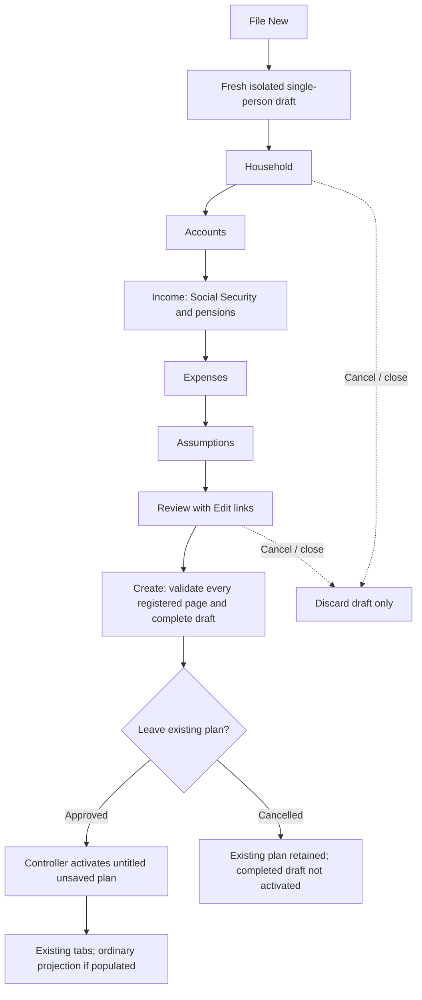
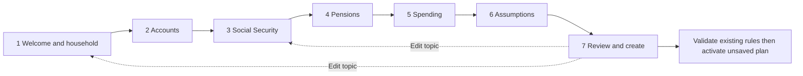

# Phase 7C.1 — Guided wizard UX audit and design

October 16, 2026. **Design only.** No Phase 7C.2 implementation.

## 1. Executive summary

Retain the existing isolated draft, JavaFX dialog, item editors and domain validation. Improve their presentation incrementally rather than replacing the creation architecture. The current wizard already implements six pages, Back/Next, progress, inline feedback, review Edit links, optional financial collections and cancellation isolation. The main opportunity is better explanation, prioritization and navigation—not adding financial rules.

Recommend **seven topics**: Welcome/Household → Accounts → Social Security → Pensions → Spending → Assumptions → Review. Combine welcome with household instead of adding a low-value introductory click. Give Social Security its own page without reproducing the analyzer. Use a compact left step list when space permits, collapsing to a top current-step/step-selector presentation on narrow windows. Keep one scrollable topic and a fixed footer; do not use a giant all-input scrolling form.

Priority improvements:

- Distinguish **required to complete this editor**, **required if an item is added**, **recommended for useful results**, and **advanced**. Empty account, income and expense lists remain legal.
- Explain annual/monthly amounts, dollar base years and percent-versus-decimal conventions at the field, not only on hover.
- Preserve every entered value during navigation. Use explicit confirmation before removing an otherwise removable spouse; never delete/reassign financial dependencies automatically.
- Show existing defaults honestly, especially 8% return, 40-year horizon, Michigan residence and MFJ filing status even for a new single-person draft. They are existing application defaults, not recommendations for the user.
- Preserve review-first creation, unsaved/untitled activation, deferred expensive analysis and Phase 7B.1 transactional persistence/recovery.

Implement in 7C.2 shell/field presentation, 7C.3 household/accounts/income separation, 7C.4 spending/assumptions/SS detail, then 7C.5 review/accessibility/regression acceptance. Changes to default filing status, required mortality policy, unit entry conventions or post-create projection behavior require explicit decisions; none is silently approved by this design.

## 2. Existing wizard architecture

Evidence notation: `J/` = `src/main/java/com/daviddunn/retirementplanner/`; `T/` = `src/test/java/com/daviddunn/retirementplanner/`; `R/` = `src/main/resources/`. Paths below identify actual source, not assumed classes. Section 20 lists inspected files and the limits of inspection.

| Existing component | Actual responsibility | Reuse recommendation |
| --- | --- | --- |
| `J/ui/MainWindow.java::onNew` | Opens wizard first; only after a completed result asks whether to leave the current plan; activates through controller, loads existing tabs and conditionally runs ordinary projection for populated plans. | Preserve departure ordering and current-plan isolation. Do not replace it with early mutation of the active plan. |
| `J/ui/wizard/NewRetirementPlanWizard.java` | `Dialog<RetirementPlan>`; persistent page objects, index navigation, progress, scroll container, result conversion and final all-page validation. | Reuse shell mechanics; add accessible navigation and stable page identity before changing page count. |
| `NewPlanWizardStep` | `title`, `content`, `validateAndApply`, optional `onEntering`. | Retain small contract; avoid an application-wide wizard framework. |
| `NewPlanDraft` | Owns a fresh `RetirementPlanFactory.createSinglePersonPlan`; `complete` checks person-editor and household rules. It never accesses controller or repository. | Preserve single session-local domain draft and pure validation boundary. |
| `HouseholdWizardStep` / `PersonCard(true)` | Primary fields plus conditional spouse; validates both edits before applying either; refreshes derived SS dates. | Reuse person editing and validation; improve surrounding explanations and removal confirmation. |
| `WizardListStep` | Bounded TableView, Add/Edit/Remove, shared ownership validation and modal item editors. | Reuse; improve responsive action layout and summary of selected row. |
| `AccountsWizardStep` | Edits draft portfolio through `AccountDialog`; preserves opening RMD data on same-type/same-owner edits. | Preserve account types, ordering and preservation rule. |
| `IncomeWizardStep` | Adds only Pension and SocialSecurityIncome; owner-specific placement and at most one initial SS source per person. | Separate presentation into SS and pension lists without duplicating records or changing ownership logic. |
| `ExpensesWizardStep` | Uses `ExpenseDialog`; operates on draft household expenses. | Retain annual/one-time model and existing inflation category rules. |
| `AssumptionsWizardStep` | Owns `AssumptionsView(true)`; loads draft, refreshes on entry, applies existing validation. | Do not replace financial parsing/builders with a second implementation. |
| `ReviewWizardStep` | Regenerates summary, Edit links, empty-list/opening-RMD reminders; validates `draft.complete`; can open existing RMD editor. | Reuse sections; replace hardcoded page indices before inserting SS page. |
| `WizardDialogSupport` | Opt-in guided decoration of existing GridPane dialogs, required labels, parsing checks, invalid styling, focus and error label. | Improve opt-in error mapping/help; preserve ordinary dialog behavior. |
| `InputHelp` / `HelpIcon` | Tooltip installation, accessibleHelp where absent, labelFor links; tooltip wraps at 375, short hover delay. | Reuse. A hover-only icon must not become the only way to discover essential information. |

There is **no `PersonView` or `SocialSecurityAssumptionsView`** in the inspected tree. Actual equivalents are `ui/components/PersonCard`, `ui/views/HouseholdView`, `ui/dialogs/SocialSecurityDialog`, and the separate `ui/socialsecurity/SocialSecurityAnalyzerInputView`. The latter is an analyzer assumptions display, not a wizard benefit editor.

`AccountsView` and `ExpensesView` mutate the active domain through dialogs; their `save` methods do nothing because edits are already applied. `IncomeSourcesView` likewise exposes Pension and Social Security editors. Do not embed these active-plan views with their controller callbacks inside the draft. Reuse their dialogs and semantics instead. `AssumptionsView` already has an explicit guided mode.

## 3. Current workflow map



Observed details (`NewRetirementPlanWizard`, `MainWindow::onNew`, `ApplicationController::newPlan`):

1. Sequence is Household, Accounts, Income, Expenses, Assumptions, Review—not the conceptual seven-step workflow in the request.
2. Back moves without validating or applying the current page. Controls/page instances remain alive, preserving uncommitted text. Next validates/applies only the current page and stays on failure.
3. Progress is `(index + 1) / pageCount`, so it describes **position**, not completion: first page is already 1/6 and Review is 100% before Create validation.
4. Review links navigate to integer indices 0–4. Create validates all pages in sequence, visits the first failed page, then calls `draft.complete()`.
5. The shell schedules focus/scroll to a `:invalid` control. Some page errors have only a label and no marked control, so focus targeting is not guaranteed for every domain error.
6. Dialog is resizable, preferred 760×700 and minimum 460×380, with an outer fit-to-width ScrollPane and horizontal bar disabled. List tables prefer height 240/minimum 150. This is not proof that every child editor fits a laptop/high-DPI work area.
7. Cancel returns no result; no controller, saved plan or preference changes are made by draft editing. After Create, a declined departure prompt also preserves the old plan, but the wizard has already closed; its completed draft is not reopened automatically.
8. New activation clears active filename and sets modified false through the existing New lifecycle. Creation does not write JSON. A populated draft triggers one ordinary projection after activation; a legal empty draft defers it. No wizard-time optimizer or Monte Carlo runs.
9. Later Save/Save As uses current Phase 7B.1 transactional repository behavior. A future Save Draft button is **not** a harmless UI addition; omit it in these stages.

## 4. Field inventory and classifications

Legend: **T** technically required by the current completed editor/constructor; **C** conditionally required when the item/person/mode is present; **R** recommended for useful input or explanation, not a new creation blocker; **O** optional; **A** advanced. A field may be C+A. “Required” below distinguishes editor policy from the more permissive legacy model. Required does not mean a user must add that category or accept a financial recommendation.

### Household and setup

| Field / mapping | Classification | Actual rule/default | Proposed presentation |
| --- | --- | --- | --- |
| Dedicated plan name | Not supported | `RetirementPlan` has no plan-name field; current title uses filename or Untitled. Household name is derived, not a plan title. | Omit. Do not add a decorative field that appears saved but is discarded. Filename chosen later in Save As. |
| Household type / spouse presence | T UI choice; spouse O | `NewPlanDraft` starts with primary only; `RetirementPlan.setSpouse` handles explicit changes. | “Just me” / “Me and my spouse”; do not infer filing status or legal eligibility. |
| First/last name, each included person | O | `PersonCard.readValidated` preserves optional strings. | Label optional; blank uses a display fallback “Primary”/“Spouse”, without storing an invented name. |
| DOB, primary | T completed-editor policy | `PersonInformationValidation` checks nonnull; parsing must produce a date. `Person` constructor/setter can hold null for drafts/legacy. | Required for wizard completion, with age-related purpose text. No invented age/minimum/future-date rejection. |
| DOB, spouse | C | Same completed-person rules only if spouse is included. | Hidden/unmanaged when absent; no placeholder spouse. |
| Mortality category, each included person | T/C completed-editor policy | `PersonInformationValidation` requires it; current choices MALE/FEMALE. Legacy `Person` may hold unresolved null; `ProjectionReadiness` itself does not require category. | Explain table category for longevity/SS, not inferred gender identity. No default from name/DOB; do not silently make it optional or add an enum value. |
| Universal retirement age/date | Not modeled on Person | SS claiming age and pension commencement are source-specific; projection start is a separate assumption. | Do not invent a household retirement switch or equate retirement with claiming. |
| Planning purpose | O explanatory text only | No modeled field identified. | Explain scenario planning; do not persist a new purpose field or use it to change assumptions. |

### Accounts (the list itself is O; adding balances is often R)

| Field / mapping | Classification | Actual rule/default | Proposed presentation |
| --- | --- | --- | --- |
| Account type | C | `AccountFactory.getSupportedTypes`, `AccountType`; editor initially selects first supported type (Traditional IRA). | Explicit type choice visible; disclose the preselection, no inferred account classification. |
| Owner | C | Guided single-person choices PRIMARY only. Retirement types disallow JOINT; couple non-retirement types allow it. Switching a Joint account to retirement clears owner for explicit selection. | Use actual owner labels; never silently reassign an invalid owner. |
| Current/opening balance | C | Guided number field required; parsed as BigDecimal; `Account` requires nonnull. No nonnegative rule appears in inspected account constructor/dialog. | Dollars at projection start. Do not invent a new range rule or fabricate zero for blank. |
| Account name | O, R for distinguishing accounts | Guided Name required=false; nonnull string accepted, including blank. | Optional label; show non-persisted fallback in the table if blank. |
| Original owner DOB/death | C for inherited IRAs | Required by dialog and `InheritedAccountInformation`; death must be after DOB. | Reveal only for inherited types; explain these are decedent facts. |
| Beneficiary relationship | C for inherited IRAs | Nonnull; editor selects first enum option initially. | Show and require deliberate review of default; do not infer relationship. |
| Retirement participant facts/status/event dates | C+A only where relevant | `Account` supports facts on employer retirement types; unknown is a real state. Guided AccountDialog hides this editor. | Defer editing to existing tabs initially; warn qualification can limit state estimates. Do not assert “qualified” automatically. |
| Opening RMD history | C for reliable opening-year projection, not creation | `OpeningRmdWorkflowService` determines applicable accounts; prior December 31 balance/distributed amount/distribution year belong to existing history model. Review currently warns and offers dialog. | Offer existing history editor when applicable; never substitute current balance or assume zero previously distributed. |

Actual account choices are Traditional IRA, Rollover IRA, Traditional 401(k), Traditional 403(b), Roth IRA, Roth 401(k), Brokerage, Checking, Savings, Inherited Traditional IRA and Inherited Roth IRA. No generic 457, standalone annuity or new asset subtype is authorized. Retain list order because financial execution can use persisted account order; sorting a table must not reorder the underlying portfolio silently.

### Social Security and pensions (neither list is mandatory)

| Field / mapping | Classification | Actual rule/default | Proposed presentation |
| --- | --- | --- | --- |
| SS source per person | O, R if expected | `IncomeWizardStep.availableSocialSecurityOwners` permits at most one initial SS source for each represented person. | Per-person entry with “Not entered”; do not replace omission with a zero-benefit source. |
| SS name | O | Guided new source supplies “Social Security”; Name required=false. | Hide name under Details or keep optional; preserve existing value when editing. |
| SS owner | C | Person ownership only; actual DOB supplies derived date. | One clear card per actual owner; never spouse-derived eligibility for the primary. |
| FRA monthly benefit | C | Required numeric field; `SocialSecurityIncome` requires nonnull. No nonnegative constraint was found in the inspected constructor. | Gross FRA estimate before claiming adjustments, dollars/month; no estimate fabricated or imported by wizard. |
| SS claiming age | C | Whole-year choices 62–70; constructor checks range; editor default 67. | Explicit provisional election, not a recommendation or assumed FRA. |
| SS benefit start date | Derived, read-only | `SocialSecurityBenefitStartDateCalculator` uses owner's DOB/claim age; dialog disables date input. | Show result and source explanation; not a second editable date. |
| FRA age | Derived by benefit model, not an editable field here | Current dialog accepts FRA benefit, not a user-entered FRA-age assumption. | Explain concept; do not add editable FRA/benefit adjustment formulas. |
| Benefit valuation year | Stored/derived entry context, R review | New SS source uses plan projection-start year at creation; existing source keeps its stored year. Legacy opt-in convention checkbox changes interpretation, not numeric amount. | Always show actual year. “Today's dollars” alone is inadequate. |
| SS COLA | A at plan level | `EconomicAssumptions.socialSecurityColaRate` is authoritative; source `annualColaRate` is legacy compatibility data. New source stores zero there. | One plan COLA control, not a conflicting rate per SS card. |
| SS end date | O legacy/source data | New dialog creates null; existing constructor supports endDate. | Do not introduce a termination input in the initial wizard; preserve modeled existing data when relevant. |
| Pension name | O | Guided Name required=false; IncomeSource requires nonnull, not nonblank. | Optional distinct label. |
| Pension owner/start/monthly benefit | C | Dialog requires person owner, start date and numeric monthly amount; `IncomeSource` requires start/owner/name, Pension nonnull monthly benefit. | Gross monthly dollars at pension start; start date is not household retirement age. |
| Pension end date | O | Null means no scheduled termination. Base IncomeSource does not add an end-after-start invariant in inspected constructor. | Preserve parser/model semantics; don't claim a new date-order block exists. Any new invariant requires separate approval/tests. |
| Pension annual COLA | C field, default available | Dialog initializes `0.0`, decimal fraction; Pension defaults missing rate to zero. | Clearly “decimal, 0.02 = 2%”; no silent percent conversion. |
| Survivor monthly pension amount | O; available only for couple | Blank null means no survivor benefit. Single-person dialog hides field and rejects incompatible edited pension shapes. | Amount/month, not percent. No inferred survivor amount. |
| Pension retirement qualification facts | A | Unknown default; guided editor hides participant facts. | Preserve unknown; do not equate pension label, age or start date with tax qualification. |
| Employment/annuity/other income | Not supported as separate modeled categories | `IncomeSource` registered subtypes and `IncomeSourcesView` choices are Pension and Social Security only. | Do not offer unsupported choices or silently map employment/annuity to pension. State current scope plainly. |

### Spending

| Field / mapping | Classification | Actual rule/default | Proposed presentation |
| --- | --- | --- | --- |
| Expense collection | O; R for meaningful spending scenarios | Empty permitted; Review warns without blocking. | “No spending entered” reminder, not an invalid-plan error. |
| Description | C editor policy | ExpenseDialog rejects blank; Expense constructor only requires nonnull. | Required when adding an item; concise example text, not inserted user data. |
| Expense type | C with default | Recurring default; alternatively One Time. | Plain-language recurring/one-time selection. |
| Annual or purchase amount | C | BigDecimal required by constructor/parser; no nonnegative check found in inspected Expense constructor/dialog. | Recurring dollars/year or one purchase amount. No automatic monthly conversion or hidden rounding. |
| Growth category | C with default; A if deferred | GENERAL default; HEALTHCARE supported for recurring. One-time is forced GENERAL by existing editor. | “Which inflation assumption?”; don't imply a separate healthcare model or allow healthcare inflation on one-time purchases. |
| Recurring effective/end dates | O | Null unrestricted; end cannot precede a supplied start. | Optional schedule; disclose opening-year base amounts still grow from projection base. |
| One-time purchase date | C | Dialog requires it, synchronizes end with start and hides redundant fields. | Required purchase date; no month/date invented. |

Expense amounts use the **projection opening-year spending base**, not automatically the computer's current-year dollars or the nominal amount at a future start date. `ExpenseDialog` help and `ProjectionEngine.calculateProjectedExpense` establish that future amounts grow using the applicable inflation rate and projection year offset. Preserve existing first-year handling; do not add a monthly/annual conversion toggle without explicit semantics and tests. Healthcare expense entries must be explained alongside modeled Medicare premiums to avoid user double entry, not silently netted against them.

### Assumptions and current defaults

| Field / mapping | Classification | Actual rule/default | Initial presentation |
| --- | --- | --- | --- |
| Projection start | T completed editor | Factory LocalDate.now; editor requires parsed nonnull date; legacy constructor may default missing date. | Basic, explicit date; distinct from retirement or SS start. |
| Horizon years | T | Positive integer; factory 40. | Basic with derived end year read-only; not a promise of life expectancy. |
| Investment return | T modeled value; R review | Factory 8%; editor percent text divided by 100; EconomicAssumptions nonnull. | Basic assumption, not guaranteed or recommended return. No invented “safe” range. |
| General inflation | T modeled value; R review | Factory 3%; same percent parsing. | Basic; explain expense base. |
| Healthcare inflation | T modeled value, A placement | Defaults to general inflation, initially 3%; independent field thereafter. | Collapsed advanced with visible summary/value. Still supplied/validated. |
| SS COLA | T modeled value, A placement | Defaults to general inflation, initially 3%; independent thereafter. | Advanced with actual value shown on SS page/review. |
| Filing status | T editor choice | Factory tax constructor defaults MFJ even in single-person plan; UI treats it independently of spouse membership. | Basic, explicit review; **do not auto-correct to Single** in a presentation-only change. |
| State residence | T editor choice | Michigan default; production enum choices only; full-year, one state for all projection years. | Basic; show actual selected state and source-specific approximation scope. No research-state activation. |
| Federal bracket/deduction growth | A | Each 2.5% default in PlanningAssumptions defaults, not linked to new general inflation edits. | Preserve and summarize under advanced/model details. |
| Legacy state/local rate fields | A legacy | Each zero by default; PlanningInputHelp says state field does not override jurisdiction, local field is not applied as extra tax. | Do not market them as operational tax override controls. Initially defer editing to existing tabs. |
| Heir tax assumption | A | Default 25%; TaxAssumptions restricts 0–1. Affects after-tax estate, not annual income tax. | Summarize in advanced defaults, defer editing initially. |
| Future federal rate change/year | C+A if enabled | Both absent by default; paired values required when configured. | Defer initially; never activate a forecast on the user's behalf. |
| Withdrawal strategy | A | TAXABLE_FIRST default. | Preserve/order disclosed in model details; existing tab for editing. |
| Death scenario/survivor election | C+A if used | BOTH_SURVIVE, no death year/election; post-death recurring expense factor defaults 100%. Active death requires year and survivor election under existing rules. | Defer to existing scenario editor; show that initial horizon assumes survival unless configured. |
| Roth conversion request | O+A | Fresh plan request null. | Deferred; no automatic conversion strategy. |
| Longevity/PV/Monte Carlo inputs | C+A for selected analyzer | Separate session/request settings, not all persisted PlanningAssumptions fields. | Defer to analyzers, identify their scope. No new wizard fields or persisted copies. |

Sources for these tables: the actual dialogs/models named in Sections 2 and 20, `RetirementPlanFactory`, `PlanningAssumptions.createDefault*`, `TaxAssumptions`, `EconomicAssumptions`, `DeathScenarioAssumptions`, `PlanningInputHelp`. A star in today's guided assumptions editor marks eight visible inputs, not proof that all must be manually typed. Domain-constructor presence, completed-editor policy and projection readiness are separate facts.

## 5. Current validation and state ownership

Four distinct layers must remain:

1. **Parseable UI input:** date text, BigDecimal text, integer horizon, selected enum.
2. **Completed editor:** PersonInformationValidation requires DOB/category; item builders enforce required fields and conditions.
3. **Valid plan:** `RetirementPlan.validateHouseholdReferences` checks represented owners, single/couple death consistency and baseline references. It does not demand positive balances, spending or SS.
4. **Evaluable projection/analysis:** `ProjectionReadiness` checks represented DOBs and start date, not sufficient funding, opening RMD history or state-tax qualification. Later services can return legitimate unavailability.

Do not call level 4 “guaranteed calculation ready” just because levels 1–3 pass. Keep opening-RMD reminders and empty-list warnings nonblocking for **creation**, while explaining projection may await more facts. No zero tax/funding/success result is invented by the wizard.

Page objects currently own uncommitted text; the draft owns successfully applied domain items. `HouseholdWizardStep` validates primary and spouse before applying either. Modal editor Cancel does not insert/update an item. `AssumptionsView.refresh` preserves dirty controls on re-entry; tests cover invalid pending horizon surviving Back. Review builds a snapshot of applied draft values and final Create reruns page validation.

Risks: Review's integer edit indices become incorrect after a page insertion; shared error labels can clear on any field edit; `WizardDialogSupport` maps builder errors to fields by matching exception text or retaining the last visited field. Hidden full assumptions controls are still read by the existing builder, so a cosmetic hide must not erase their valid values. Keep domain objects authoritative; do not create a second financial draft model.

## 6. Identified usability problems

| Observation | Impact | Design response |
| --- | --- | --- |
| Income combines SS FRA basis and pensions in “Monthly / FRA” column | Similar dollar fields have different meaning/base dates | Separate SS and pension topics; precise column labels |
| Some fallback help says only “field is required” | Gives no units, source or reason | Field help template with units/base/example text |
| Plan rates are percentages; pension COLA is a decimal | A typed 2 could be mistaken for 2% in pension field | Prominent decimal unit/example; preserve current parsing |
| No plan-name property but conceptual workflow suggests one | Potential discarded/unsaved data expectation | Omit name field; explain later Save As |
| Single-person default MFJ, default MI and 8% return | Users may accept unintended assumptions | Display actual defaults, request review; do not change them silently |
| Remove spouse immediately discards dependency-free person entries | Backtracking can lose names/DOB/category | Confirm actual removal and preserve on Cancel; no automatic financial deletion |
| Current Review at 100% before validation | Progress can imply completion | “Step 7 of 7 — Review”; completion only after Create succeeds |
| Footer and modal child editors can compete with small work area | Hidden actions/truncated fields at high DPI | Work-area-bounded sizing, wrapping and one scrollable content area |
| Create/departure prompt occurs after wizard closes | Cancelling departure loses completed draft | Preserve current lifecycle initially; decide explicitly whether to retain/reopen it later |
| Missing RMD/qualification facts only become visible late | Plan can be valid but projection unavailable | Targeted factual reminders and links, not a wizard-time optimizer or invented eligibility |

These are source-based UX risks, not findings from a new user study or rendered screenshots. Existing preview tests and prior reports are not a substitute for new visual acceptance.

## 7. Proposed wizard flow

Recommended seven topics, all still traversable with empty optional lists:



Welcome is a short introduction above household fields: local plan data, editable later, not financial advice, no file saved by Create. It collects no purpose, identity or plan-name metadata. “You can leave optional sections empty and complete them later” reduces pressure to invent values.

SS gets a dedicated topic because its FRA/monthly/base-year/claim-age semantics warrant explanation; pensions remain a separate optional page. Do not offer employment or generic guaranteed-income entries the model cannot represent. If user research rejects a seven-topic flow, retain combined income with two clearly separated groups as the lower-change alternative; finance contracts are identical.

Keep assumptions near Review. SS shows its actual captured valuation year; a later projection-year change creates a review notice and edit link, **not** a monetary conversion or automatic relabeling. Moving start-date entry earlier is an alternative but would require removing the duplicate editable control and preserving current default/validation behavior.

## 8. Screen-by-screen wireframe descriptions

All wireframes are illustrative documentation, not implemented screenshots. “Example” strings are instructions, never automatically entered values.

### Shared wide shell

```text
New retirement plan                         [close]
Your entries remain local. You can edit everything later.
------------------------------------------------------
Steps                  | Step 3 of 7: Social Security
1 Household [reviewed] | Short purpose and units
2 Accounts [visited]  |
3 Social Security    | [one topic; vertical scroll]
4 Pensions           | [field/help/error or item table]
5 Spending           |
6 Assumptions        | No optimizer runs here.
7 Review             |
------------------------------------------------------
[Cancel]                            [Back] [Next]
```

“Reviewed/visited” is UI navigation state, not proof of financial completeness. At narrow widths replace sidebar with `Step 3 of 7` and a keyboard-operable topic selector. Footer is outside the content scroller.

| Screen | Content / wireframe details | Validation/exit |
| --- | --- | --- |
| 1 Welcome/Household | Intro; household choice; Primary card with optional first/last names, required DOB and table category; conditional spouse card below, not a forced wide two-column layout. Brief category explanation and privacy copy. | Existing person validation. Spouse controls only when included; removal guard and confirmation below. |
| 2 Accounts | “Balances at projection start”; table Name/Type/Owner/Balance; Add/Edit/Remove actions that wrap on narrow windows; selected-row detail text for omitted/truncated columns. Explain traditional/Roth/taxable/cash categories without eligibility claims. | Zero rows allowed. Existing AccountDialog; inherited fields conditional. Existing RMD link when applicable. |
| 3 Social Security | One status/card per represented person: Not entered or FRA $/month, valuation year, selected claim age, derived start. Add/Edit opens existing guided SocialSecurityDialog; remove explicit source action. Show plan COLA read-only with link to Assumptions. | Optional source; existing owner/claim rules; one source/person. No calculation/import of benefit estimates. |
| 4 Pensions | Optional table: Name/Owner/Monthly amount/Start; selected detail shows COLA, end and survivor amount. Explain no supported separate employment/annuity source. | Reuse PensionDialog; survivor field only in couple; no auto qualification. |
| 5 Spending | Annual household recurring costs plus one-time purchases using existing table/editor. Display opening-year dollar basis, general/healthcare inflation explanations and Medicare double-entry caution. | Empty allowed with reminder. Purchase date conditional; existing date-order rules. |
| 6 Assumptions | Basic: start, horizon/end year, investment return, general inflation, filing status, state. Advanced disclosure: actual healthcare/SS COLA and preserved model defaults; links to later tabs for complex settings. | Reuse existing assumptions builder. Required model values remain present even collapsed. No new defaults. |
| 7 Review | Section cards for Household, Accounts, SS, Pensions, Spending, Assumptions; every card has a specific accessible Edit action. Separate “Must fix” and “Check before projecting” groups; show default assumptions and missing facts. | All-page and cross-reference validation before Create. No save, optimizer, weighted analysis or MC. |

Illustrative field row:

```text
FRA monthly benefit *                  [Help]
[                    ] dollars/month
At Full Retirement Age, before claiming-age adjustments.
Benefit dollar basis: 2026 (actual source year)
Example: use the FRA estimate from your benefit information.
[error appears here only after validation attempt]
```

For spending, use: “Enter recurring dollars per year in the projection opening-year spending base, before its inflation assumptions. For a one-time purchase, enter one purchase amount.” For return: “Assumed annual investment return, entered as a percentage. It is not a guaranteed result.” No sample numerical benefit, balance or spending amount is inserted.

## 9. Navigation model

| Action/state | Proposed behavior |
| --- | --- |
| Next | Parse/validate current topic; apply valid edits to isolated draft; then advance. Optional empty lists pass. Do not show errors on first untouched load. |
| Back | Preserve raw control text, including invalid in-progress strings; no new blocking validation. On re-entry refresh only derived/ownership views, not user text. |
| Click prior visited topic | Allowed without loss, same as Back, except Review uses the validation gate below. Do not discard invalid pending current edits to rebuild controls. |
| Jump to unvisited future topic | Initially use Next to reach it; no hidden prerequisite bypass. Review Edit returns to a named page. |
| Review after earlier edit | Validate/apply pending edited pages before showing Review; if blocked, visit the failed page and retain its raw input. Regenerate summaries/reminders from actual draft. No stale success badge. |
| Add spouse | Reveal new person card; primary/shared records unchanged. Do not automatically change filing status. |
| Remove spouse | Ask for confirmation without changing draft or controls. On confirmation call existing `setSpouse(null)`, which checks dependencies before mutation. On rejection show its actionable dependency list/edit links and remain couple; on success discard the removed person's entries. Cancel preserves everything. No speculative guard call that already removes the spouse. |
| Change account type/owner | Use existing choices; invalid Joint-to-retirement owner must be explicitly chosen. Preserve opening history only under current same-type/same-owner rule; warn if a change loses applicability. |
| Hide a conditional field | Collapse is presentation only. Apply model builder's existing treatment: pension survivor absent in single; one-time expense end synchronized/general inflation; inherited facts not applied to non-inherited type. No hidden stale financial record in completed plan. |
| Cancel/close | Discard draft only, as today. Do not prompt to save draft or write settings/files. |
| Departure prompt cancelled after Create | Preserve current active plan; initially keep existing behavior and explain unsaved draft loss. A retain/reopen option is a separate lifecycle approval, not silently added. |
| Resize | Reflow sidebar/labels/actions, keep values/focus, scroll focused field into view; never auto-advance. |

Do not persist navigation, visited state or a dormant spouse. Retaining removed spouse data for undo would be a new wizard policy; recommended initial design confirms disposal rather than introducing hidden household objects. A new confirmation changes an existing test expecting immediate removal; update that UX contract explicitly, retaining dependency protections.

Replace Review's index-based links with stable wizard-only keys (for example nested `StepKey` values). Keep registration/order and labels separate. Do not derive identity from localized titles. Preserve the existing small-list constructor/testing use case through an adapter if needed; no persisted schema or domain enum is required.

## 10. Single-person/couple behavior

The domain uses a primary and optional **spouse**, not two mandatory people. Absence differs from death. Retain `Household.members`, `peopleByOwner`, `spouse` and existing owner-aware dialogs; never call required `getSpouse` in an absent-spouse path.

`RetirementPlan.setSpouse` blocks removal/replacement while spouse/joint portfolio records, person-held records, spouse income, positive survivor pension or an active couple death scenario depend on the spouse. Household expenses are transferred to the replacement household; baseline membership is not rewritten. The wizard should surface these rules, not invent cascading deletion. Reassignment/removal remains an explicit edit in the relevant topic.

Adding a spouse changes available account/income ownership and per-person SS cards. It does not infer filing status, mortality category or survivor benefit. Retain valid shared inputs and primary text. If a spouse is successfully removed after explicit confirmation, no placeholder spouse or spouse-owned source may remain in the completed draft.

Protect: `RetirementPlan`, `Household`, `PersonCard`, `PersonInformationValidation`, `AccountType/AccountFactory`, `HouseholdView`, ownership dialogs, `SinglePersonHouseholdTest`, `SinglePersonHouseholdUiTest`, wizard lifecycle/end-to-end tests and single-person persistence/projection plus couple golden suites. “Couple” UI wording must not imply support for unmodeled legal partner/survivor rules; preserve existing SPOUSE semantics and independent tax filing choice.

## 11. Social Security entry design

Initial input is a **user-entered FRA monthly estimate**, a current plan claiming election and the actual owner. There is no benefit-statement importer in the inspected creation path. Do not request already-claimed monthly benefits in the same field, infer an FRA benefit from them, or invent conversion formulas. Users whose information does not match the supported input convention need clear help/scope disclosure.

Use existing `SocialSecurityDialog`: claiming ages 62–70, current default 67, derived date preview, owner DOB prerequisite, actual benefit valuation year. An age-67 election must never be described as automatically this person's FRA. Separate derived display from input. `NewPlanDraft.refreshSocialSecurityDates` rederives starts when DOB changes, preserving amounts, valuation year, owner and other source fields; protect that behavior.

If projection start changes year after SS entry, show both dates/years and a nonblocking discrepancy notice. Preserve the entered dollars/year. Reopening the existing editor may offer its explicit legacy “Use Today's-Dollar Convention” action; explain that this changes the interpretation year **without converting the entered amount**. No automatic rebasing, no zeroed benefit and no double COLA. Plan SS COLA remains the authoritative rate; the legacy source rate is not a second wizard control.

Survivor SS election belongs to existing death-scenario policy; survivor pension is a different input. Initial BOTH_SURVIVE does not require inventing a survivor election. Later SS-only, deterministic integrated, weighted integrated and MC modes have different scenario/date/objective requirements; tell users those are set in the existing analyzers. Do not launch optimization, rank strategies or apply an optimal election during creation.

## 12. Advanced assumption presentation

| Topic | Initially visible | Collapsed/deferred design | Compatibility boundary |
| --- | --- | --- | --- |
| Core projection | Start, positive horizon/end year, return, general inflation | None hidden as unreviewed recommendation | Preserve actual factory values and year counting |
| Tax | Filing status, selected production state and full-year scope | Existing model details/limitations; advanced federal growth and heir values summarized, complex edits later | Never replace unsupported tax with zero or enable research states |
| Healthcare/SS COLA | Actual values summarized | Two existing controls under Advanced if approved | Independent rates after initialization; no permanent binding to general inflation |
| Longevity | Explain horizon vs modeled longevity | Mortality factors/scenario distribution in existing analyzer | DOB/table category here; no new mortality assumptions |
| Valuation/discount | Explain analysis-time settings exist | Conditioning/PV dates and discounts later | Do not equate with plan start or persist duplicate session settings |
| Monte Carlo | Brief later-analysis link only | Trial count/seed/return/inflation models later | No default simulation run or changed streams |
| Roth | Off/not configured in fresh plan | Existing Roth tab | No auto target/bracket selection or new request |
| Medicare/IRMAA | Short model-scope explanation and spending caution | Existing automatic calculation/model inputs, not invented premium user field | No removal/double counting of existing premiums |
| Non-investable assets | Optional “add later” description | Existing asset tab | Do not represent house value as withdrawable brokerage cash |
| Estate | Heir tax assumption disclosed in model details | Existing edit later | Does not change annual tax; no new inheritance/basis assertions |
| Opening RMD | Conditional prompt/link when applicable | Existing OpeningRmdDialog | Required historical facts for projection, not invented from current balance |

An Advanced disclosure is not permission to hide changing defaults. Review must show the selected/basic assumptions and a compact “Other model assumptions retained” summary, with a link to full existing settings after creation. Do not expose a control that appears functional when the current model treats it as legacy/inactive, especially local/state rate fields.

## 13. Reusable JavaFX component recommendations

Keep the smallest set:

1. **One proposed `ui/wizard/WizardFieldRow`**: wraps existing Label/Control, units text, optional example, accessible help and field-local issue. Presentation only; no BigDecimal/date/domain validation implementation. Nested display-requiredness metadata can distinguish Required/Recommended/Optional without adding a financial field. Methods conceptually `setIssue(message)`, `clearIssue`, `focusInput`; retain existing control IDs.
2. **One proposed `ui/wizard/SocialSecurityWizardStep`**: a narrow owner-aware SS topic using existing source dialog and draft. Reuse/refine IncomeWizardStep for pensions. It must filter the same draft sources rather than own another income list.
3. Extend existing shell with a small VBox of navigation controls and nested immutable step registration/state; no standalone nationwide workflow/navigation framework. Keep review sections as existing helper/card construction unless a second real caller justifies extraction.

Reuse `WizardListStep`, `WizardDialogSupport`, `PersonCard(true)`, `InputHelp`, `HelpIcon`, existing money/percent formatters and item dialogs. Do not create separate RequiredFieldIndicator, tooltip manager, account financial model or generalized validation engine merely because those names are possible. Initial estimate: **two new top-level UI classes**, subject to implementation review; most work stays within existing wizard classes/CSS. No component is created by this audit.

## 14. CSS/layout strategy

Current `R/css/new-plan-wizard.css` already scopes background, title/step headings, inline errors, white review cards, warning cards and invalid borders. Preserve its scope so changes do not redesign existing tabs. Introduce only needed named styles for navigation/current/visited, field units/help and focused error summary. Use the existing palette as a starting point, verifying contrast rather than assuming compliance.

Proposed typography/spacing: normal inherited body font, approximately 20–22 title, 16–18 topic heading, 8-unit field spacing and 16-unit group spacing; these are design tokens, not fixed bounds preventing text growth. Prefer labels above controls at narrow widths, top-aligned wrapped descriptions, resizable inputs, natural-height labels and no essential information available only through truncated table cells. Never use color alone to indicate Required/error/visited.

Primary layout is **hybrid navigation plus one scrolling topic**, not a horizontal seven-label strip and not a long all-pages form. Wide sidebar about 168–176 logical units; collapse it before squeezing fields. Keep footer outside scrolling area. Child editors also need work-area-aware sizing/scrolling; changing the shell alone does not fix an inherited-account dialog taller than the screen.

Static fit evaluation (not rendered testing): obtain the screen containing the owner window and cap dimensions against its actual visual bounds, leaving a margin for decorations. Do not assume device pixels equal JavaFX logical coordinates. JavaFX exposes visual work area/output scale through [Screen](https://openjfx.io/javadoc/25/javafx.graphics/javafx/stage/Screen.html). Node layout and scene attachment rules are documented in [JavaFX Node](https://openjfx.io/javadoc/25/javafx.graphics/javafx/scene/Node.html).

| Representative display | Analytical fit case | Proposed response / future acceptance |
| --- | --- | --- |
| 1366×768 at 100% | Current 700 preferred height leaves little decoration/taskbar margin | Cap to visual work area minus margin; typical target around 900–960 wide with scrollable content, not a larger fixed window |
| 1366×768 at 125% | Approximate full-screen logical extent 1093×614 before work-area deductions | Height-capped compact header/footer; collapse sidebar as needed; fields stacked; no horizontal scrolling |
| 1920×1080 at 100% | More room does not justify stretching reading lines indefinitely | Max content width near 1000; bounded forms and natural whitespace |
| 1920×1080 at 200% | Approximate logical extent 960×540 before work-area deductions | Compact mode, content scroll, persistent actions; test all required fields and errors reachable |
| Narrow/resized dialog | Existing minimum 460×380 is not a usability certification | Retain a reachable minimum based on testing; narrow selector, wrapped action bar, row details instead of compressed essential columns |

Illustrative 680-logical-height budget: header/progress 80, footer 56, margins/gaps 40, leaving roughly 504 for content. At a 492-height cap, content may have roughly 316; scrolling is required. These are design calculations, not measured Windows geometry. Implemented screenshots and keyboard tests must demonstrate fit at the requested physical resolutions/scaling; this audit ran no UI and makes no clipping-free claim.

## 15. Accessibility recommendations

Observed: `InputHelp.install` can set accessibleHelp; labels are linked with labelFor; PersonCard uses field errors/invalid pseudo-class; shell uses standard dialog buttons and default Next/Create. `HelpIcon` is a Label with a tooltip and hand cursor, not an explicit keyboard help button. Accessible error announcements, traversal, high contrast and DPI compliance were not verified.

Proposed acceptance:

- Predictable Tab/Shift+Tab order through visible topic fields, actions and footer; hidden/unmanaged spouse/conditional fields absent from traversal.
- Enter invokes Next or Create only where appropriate; table editing/dialog controls must not accidentally trigger parent creation. Escape/close retains existing cancellation behavior.
- Explicit field labels, units and requiredness accessible to assistive technology; meaningful accessible text for “Edit Social Security”, not six identical unlabeled Edit buttons.
- Keyboard-focusable Help action that toggles readable explanatory text, while retaining control tooltip/accessibleHelp. No hover-only essential rules.
- Keep focus rings visible; move to first blocking field and reveal it within scroll after failed Next. Announce a concise error summary through supported accessible properties/notifications, verified with Windows Narrator rather than assuming a label change is announced.
- WCAG-style contrast checks can inform design, but no compliance claim without testing. Verify Windows high contrast, 100/125/150/200% scaling, increased text sizes and multi-monitor resize/move.
- Preserve accessible table selection/details for users who cannot see clipped columns. Ensure errors use text and shape/border, not red alone.

Use documented JavaFX accessible properties and FX-thread scene mutations; do not depend on internal `com.sun.*` traversal/accessibility APIs. [Node API](https://openjfx.io/javadoc/25/javafx.graphics/javafx/scene/Node.html).

## 16. Error handling and validation UX

Timing policy: allow ordinary intermediate typing (`-`, decimal point, partial date) without aggressive domain construction on every keystroke. On blur or explicit submission, detect complete formatting errors; on Next/OK, parse and invoke existing validation/builders. On Create, validate every page and cross-step references again. Do not mark untouched fields invalid on first entry.

Keep field-local messages until that field is corrected or revalidated; editing an unrelated field should not erase another issue. Preserve a summary when there are multiple blockers. Replace exception-text guessing with explicit editor control/error associations at the presentation boundary where possible, without duplicating domain financial rules. Generic cross-step errors belong to an appropriate section summary with links.

Examples (proposed wording, not new rules):

| Situation | Feedback / action |
| --- | --- |
| Blank included-person DOB | “Enter a birth date for this person.” Focus date editor. |
| Blank mortality category | “Choose the table category used for longevity calculations.” No demographic inference. |
| Malformed balance | “Enter dollars as a number, without currency symbols or grouping separators.” Current Money/BigDecimal parsers do not support those decorations. |
| Joint changed to retirement type | “Choose the person who owns this retirement account.” No auto reassignment. |
| One-time expense without date | “Choose the purchase date.” Requiredness must update with type. |
| Missing spending/accounts | Nonblocking reminder with Edit link; allow Create. |
| Opening history incomplete | “You can create the plan, but projection needs opening RMD history for these accounts.” Use existing editor. |
| Qualification facts unavailable | Explain potential state-model unavailability; never infer zero tax or invent legal qualification. |

Existing constructors do not uniformly reject negatives, future DOBs or reversed pension dates. Do not silently add those blocks as UX cleanup. If a financial rule appears necessary, record a separate domain approval/test gate. Similarly, no warning should say “no pension is invalid”; account-funded retirement is a legitimate modeled plan shape.

Performance/lifecycle: no full projection per keystroke/page navigation, no SS optimization during entry and no MC preview. Lightweight summaries/list totals may use entered values but must not masquerade as projected outcomes. Keep current optional RMD preview in its explicitly requested existing dialog; do not duplicate its calculations. Create retains current ordinary post-activation projection behavior until separately approved otherwise. Attach listeners once, avoid repeated registration on onEntering, and release any external listeners on dialog closure; currently draft/page bindings are local, with no wizard-owned executor or network resource identified. Dispose replaced spouse cards without retaining callbacks into abandoned pages.

## 17. Compatibility and regression risks

| Risk | Required protection |
| --- | --- |
| Automatic default “improvement” | Preserve factory values and independent filing status. Default changes are financial behavior changes, not shell work. |
| Losing text during Back/sidebar jumps | Retain controls/raw edits; don't reload dirty forms from applied draft. |
| Page insertion misroutes Review edits | Stable page keys before splitting income; verify every Edit link. |
| Spouse removal/hidden records | Existing dependency guard, explicit disposal confirmation, no auto reassignment; preserve original data on rejection/cancel. |
| Account sorting/replacement | No portfolio reorder; same-type/owner opening-history preservation; no silent migration of participant/inherited facts. |
| SS DOB/year changes | Existing date derivation only; preserve benefit/valuation year and show discrepancy. No reinterpreting money silently. |
| Percent/currency formatting | Preserve BigDecimal input and scale; formatted output is not necessarily acceptable raw input. No display rounding written back merely by navigation. |
| Collapsing advanced controls | Preserve hidden valid defaults/explicit values and existing builders; no reset to guessed zero. |
| Domain validity confused with reliable estimate | Empty-list warnings nonblocking; opening RMD/tax unavailability remains explicit in actual projection. |
| Unsaved/dirty lifecycle | Create does not save; keep current controller new-plan dirty semantics and existing departure prompt until explicit approval. |
| Persistence hardening regression | Use existing Save/Save As, backups and recovery; no draft schema/files/autosave. |
| Existing tabs affected by shared controls | Guided behavior opt-in; no mass label/parser/validation changes to ordinary dialogs/views. |

No tests were run in this audit. Historical Phase 7B.1 report records 2,824 run / 2,796 passed / 0 failures / 0 errors / 28 skipped; those are previous implementation results, not current verification. Existing golden files, financial calculations, tax registry, SS ranking and MC streams must remain unchanged in future UI stages.

## 18. Detailed implementation phases

All paths here are **proposed future changes**, not authorized edits in Phase 7C.1.

| Stage | Likely classes/resources | Dependencies / risks | Tests, visual evidence and acceptance | Complexity |
| --- | --- | --- | --- | --- |
| **7C.2 Shell/navigation/field pattern** | Modify `ui/wizard/NewRetirementPlanWizard`, `NewPlanWizardStep`, `ReviewWizardStep` identity routing; `WizardDialogSupport` opt-in presentation; proposed `WizardFieldRow`; scoped wizard CSS | Approve hybrid layout/visited navigation. Keep six existing topics initially. Avoid resetting page objects or changing application lifecycle. | Extend CompleteWizardTest/NewRetirementPlanWizardTest: Back/Next, stable Edit identity, invalid text preservation, untouched fields, cancel, default buttons. Screenshots wide/narrow household/assumptions/review and error focus at 1366×768/1920×1080/scaling. No financial/default changes. | Medium |
| **7C.3 Household/accounts/income structure** | Modify HouseholdWizardStep, AccountsWizardStep, IncomeWizardStep; add SocialSecurityWizardStep; targeted guided AccountDialog/PersonCard changes only as needed | Stable keys from 7C.2; approve spouse-removal confirmation and seven-topic sequence. Preserve account order, conditional/inherited fields and draft isolation. | Extend AccountsWizardStepTest, IncomeWizardStepTest, NewRetirementPlanWizardTest, NewPlanWizardLifecycleTest and single-person UI/model tests. New SS-topic tests for owner cards/no duplicates/filter separation. Screenshots single/couple, blocked removal, inherited editor, narrow table, SS/pension empty/populated. | Medium–high |
| **7C.4 Spending/assumptions/SS clarity** | Modify ExpensesWizardStep, AssumptionsWizardStep, guided AssumptionsView/ExpenseDialog/SocialSecurityDialog/PensionDialog; relevant InputHelp wording | No automatic unit/default/base-year changes. Approve advanced disclosure grouping; preserve actual rate/model values. Do not alter analyzers. | Extend ExpensesWizardStepTest/AssumptionsWizardStepTest/IncomeWizardStepTest: decimal vs %, annual vs purchase, dates, year mismatch and DOB-derived start, preserved dormant/default fields. Screenshots Basic/Advanced, purchase error, SS valuation-year notice and narrow editors. | Medium |
| **7C.5 Review/validation/usability gate** | Modify ReviewWizardStep, shell focus/error summary and guided helpers; minimal MainWindow integration only if approved lifecycle change | Prior pages stable; explicit decision for declined departure prompt behavior. No persistence/schema redesign. | Extend CompleteWizardTest/CompleteWizardEndToEndTest and preview tests; new keyboard/focus/scale acceptance. Single/couple create → tabs → Save As → reload → exact projection comparisons; Phase 7B.1 recovery tests unchanged. Screenshots all Review sections/error/warning, keyboard help and high-DPI/footer. Full established suite, no golden regeneration. | Medium–high |

Protect existing tests by purpose, not by preserving obsolete literal “six steps” assertions after an approved seven-topic change. Update navigation expectations explicitly; never weaken financial or empty-plan/cancellation assertions. Extend the existing preview fixtures instead of creating a competing screenshot harness. Existing preview tests are opt-in; report actual execution separately from skipped defaults.

Future test matrix:

- Unit/presentation: field requiredness/help/units/error association, stable key/order routing and one-time conditional metadata.
- FX interaction: every required/conditional field, first-error focus, visited navigation, keyboard Help/Enter/Escape, primary/spouse changes, editor Cancel, invalid raw text retention and review refresh.
- Domain/integration: exact entered values and ownership, all existing account types, no duplicate SS, projection year/DOB changes, no fabricated balances/history, single/couple JSON tree and financial output equivalence.
- Persistence regression: transactional Save As path/dirty/cancel, existing null-vs-omitted compatibility, precision, backups and review-first recovery; no wizard writes before explicit save.
- Lifecycle: active-plan identity/file/dirty/cache/revision/tab drafts unchanged on cancel or declined departure; no optimizer/MC invocation; one existing ordinary projection only under current populated-plan transition.
- Visual/manual: requested resolutions plus scaling/high contrast/Narrator, long names, many rows, both owners, long errors, nested editor and review; footer reachable without horizontal scroll. Timing thresholds come from actual measurements, not arbitrary sleeps.

`T/domain/model/SinglePersonHouseholdTest`, `T/ui/views/SinglePersonHouseholdUiTest`, existing single-person persistence/projection tests, couple golden suites and state-tax wizard integrations remain regression gates. No financial-test expectations may be regenerated to accommodate presentation work.

## 19. Decision register

| ID | Decision | Recommended default | Alternatives / approval impact |
| --- | --- | --- | --- |
| W01 | Flow | Seven topics, welcome inside household, separate SS/pensions | Combined income with clearer groups is smaller; approve before 7C.3 changes order |
| W02 | Navigation | Hybrid sidebar/compact selector, prior visited steps clickable | Existing top progress only; approve 7C.2 layout |
| W03 | Required vs recommended | Preserve existing editor/domain rules; nonblocking financial completeness reminders | New blocking policies need separate approval; no mandatory accounts/spending/SS |
| W04 | Filing/defaults | Show existing MFJ/MI/8%/40-year defaults and require review | Auto-Single/new return assumptions are separate financial/default decisions, not approved here |
| W05 | Mortality category | Preserve required completed-editor policy; explain table semantics | Deferral/unknown category requires a separate policy/domain compatibility gate |
| W06 | Spouse removal | Guard dependencies, confirm loss of removable person's entries | Retain undo/dormant spouse is more state logic; no automatic deletion/reassignment |
| W07 | Pension COLA units | Keep decimal entry, explicit 0.02 = 2% | Uniform percent entry is possible only with approved conversion/precision tests |
| W08 | Projection-year/SS basis | Preserve actual source year/amount and show notice | Moving date earlier or explicit reinterpretation requires deliberate UX; no silent rebasing |
| W09 | Advanced assumptions | Basic six inputs; actual healthcare/SS COLA accessible collapsed; summarize/defer complex settings | Keeping all eight current inputs expanded is lower change; approve grouping |
| W10 | Plan naming/draft saving | No unsupported name field and no Save Draft | Persistent name/draft format requires another scope approval |
| W11 | Post-create lifecycle | Preserve untitled/unsaved and existing ordinary projection policy | Reopen draft on declined departure or explicit Run Projection button requires targeted approval/tests |
| W12 | Household terminology | Just me / Me and my spouse, retaining SPOUSE model | Generic partner terminology must not promise unmodeled legal/tax benefits |
| W13 | Extra range/date rules | No invented negatives/DOB/pension blocks | A discovered financial correctness gap requires a separately reviewed domain change |

Major approvals before implementation: W01/W02 layout/sequence, W06 destructive-action confirmation, W07 units and W09 disclosure grouping. W04/W05/W11 are particularly sensitive compatibility choices; recommended default is **preserve behavior**. This report does not authorize 7C.2.

## 20. Exact files inspected

Actual contents, targeted excerpts or method-level searches were inspected as noted; this is not a claim that every source file below was read in full. Prefixes expand exactly as defined in Section 2.

**Wizard and shared UI:**

- `J/ui/wizard/NewRetirementPlanWizard.java`
- `J/ui/wizard/NewPlanWizardStep.java`
- `J/ui/wizard/NewPlanDraft.java`
- `J/ui/wizard/HouseholdWizardStep.java`
- `J/ui/wizard/AccountsWizardStep.java`
- `J/ui/wizard/IncomeWizardStep.java`
- `J/ui/wizard/ExpensesWizardStep.java`
- `J/ui/wizard/AssumptionsWizardStep.java`
- `J/ui/wizard/ReviewWizardStep.java`
- `J/ui/wizard/WizardListStep.java`
- `J/ui/wizard/WizardDialogSupport.java`
- `J/ui/components/PersonCard.java`
- `J/ui/controls/InputHelp.java`
- `J/ui/controls/HelpIcon.java`
- `J/ui/dialogs/AccountDialog.java`
- `J/ui/dialogs/PensionDialog.java`
- `J/ui/dialogs/SocialSecurityDialog.java`
- `J/ui/dialogs/ExpenseDialog.java`
- `J/ui/dialogs/OpeningRmdDialog.java` (constructor/field excerpt)
- `J/ui/views/AssumptionsView.java` (guided layout, load/refresh and validation excerpts)
- `J/ui/views/HouseholdView.java` (state/editing excerpt)
- `J/ui/views/AccountsView.java` (load/save/edit call sites)
- `J/ui/views/IncomeSourcesView.java` (supported choices and editor call sites)
- `J/ui/views/ExpensesView.java` (load/save/edit call sites)
- `J/ui/help/PlanningInputHelp.java`
- `J/ui/rmd/OpeningRmdWorkflowService.java` (applicability/stale/preview excerpt)
- `J/ui/socialsecurity/SocialSecurityAnalyzerInputView.java` (display excerpt)
- `J/ui/controller/ApplicationController.java` (new-plan lifecycle excerpt)
- `J/ui/MainWindow.java` (New/activation/departure call sites)
- `R/css/new-plan-wizard.css`

**Domain/persistence and numeric rules:**

- `J/domain/factory/RetirementPlanFactory.java`
- `J/domain/model/RetirementPlan.java`
- `J/domain/model/Household.java`
- `J/domain/model/Person.java`
- `J/domain/model/PersonInformationValidation.java`
- `J/domain/model/AccountType.java`
- `J/domain/model/PlanningAssumptions.java`
- `J/domain/model/EconomicAssumptions.java`
- `J/domain/model/TaxAssumptions.java`
- `J/domain/model/DeathScenarioAssumptions.java`
- `J/domain/model/StateTaxAssumptions.java`
- `J/domain/financial/Account.java`
- `J/domain/financial/AccountFactory.java`
- `J/domain/financial/InheritedAccountInformation.java`
- `J/domain/financial/Expense.java`
- `J/domain/income/IncomeSource.java`
- `J/domain/income/Pension.java`
- `J/domain/income/SocialSecurityIncome.java`
- `J/domain/projection/ProjectionReadiness.java`
- `J/domain/projection/ProjectionEngine.java` (expense growth excerpt/search)
- `J/persistence/JsonRetirementPlanRepository.java` (transactional save excerpt)
- `J/util/Money.java`

**Tests and project context:**

- `T/ui/wizard/NewRetirementPlanWizardTest.java`
- `T/ui/wizard/NewPlanWizardLifecycleTest.java`
- `T/ui/wizard/AccountsWizardStepTest.java`
- `T/ui/wizard/IncomeWizardStepTest.java`
- `T/ui/wizard/ExpensesWizardStepTest.java`
- `T/ui/wizard/AssumptionsWizardStepTest.java`
- `T/ui/wizard/CompleteWizardTest.java`
- `T/ui/wizard/CompleteWizardEndToEndTest.java`
- `T/ui/wizard/CompleteWizardPreviewTest.java`
- `T/ui/views/SinglePersonHouseholdUiTest.java`
- `T/domain/model/SinglePersonHouseholdTest.java`
- `T/ui/wizard/StateTaxWizardIntegrationTest.java` (method inventory)
- `T/persistence/PersistenceControllerRecoveryTest.java` (method inventory)
- `pom.xml` (Java/JavaFX properties)
- `PHASE-7B1-LOCAL-DATA-HARDENING.md` (scope/historical verification context)

Additional file/method inventories covered wizard preview tests, single-person/couple regression file names and missing suggested view names. An initial lookup for a nonexistent HouseholdWizardStepTest was corrected to actual NewRetirementPlanWizardTest coverage; PowerShell wildcard path searches were corrected to `rg` directory/glob searches. These were inspection-path errors, not test failures. No screenshot artifacts were generated/opened and no tests/builds were executed. Generic official JavaFX 25 documentation informed only proposed layout/accessibility mechanics; no financial/project data was transmitted.

## 21. Verification and Git status

Initial branch `main`, HEAD `8892c2b19b6105a04c4db75f37418f5092ecb9f4`, clean working tree. The earlier Phase 7B.1 implementation is already present in this checkout; there were no uncommitted Phase 7B.1 changes to isolate or overwrite.

Only created artifact: `PHASE-7C1-GUIDED-WIZARD-UX-AUDIT.md`. Final checks: `git diff --check` passes; independent report trailing-whitespace/final-newline checks pass; tracked and staged diffs empty; final status contains only this new untracked Markdown file. Branch and HEAD unchanged.

No production Java, tests, CSS/resources, schemas, rules, state registry, Maven dependencies, persistence or financial expectations changed. No test run was necessary for this static design audit; historical counts above are labeled historical. Nothing staged, committed or pushed.

## 22. Final recommendation

Approve a narrow 7C.2 shell/field presentation stage first, retaining today's six registered pages and behavior while making navigation/error targets stable. Then separate SS from pensions and improve household/accounts, followed by spending/assumption clarity and final review/accessibility acceptance. Preserve the isolated draft and existing model/editor contracts throughout.

The largest UX gains come from explaining what the program already means: optional collections, ownership, dollar base years, units, defaults and incomplete projection facts. They do not require a second financial model, a new plan schema or an analyzer rewrite. Financial-default/validation changes remain separate approval gates. Do not begin 7C.2 until approved.
