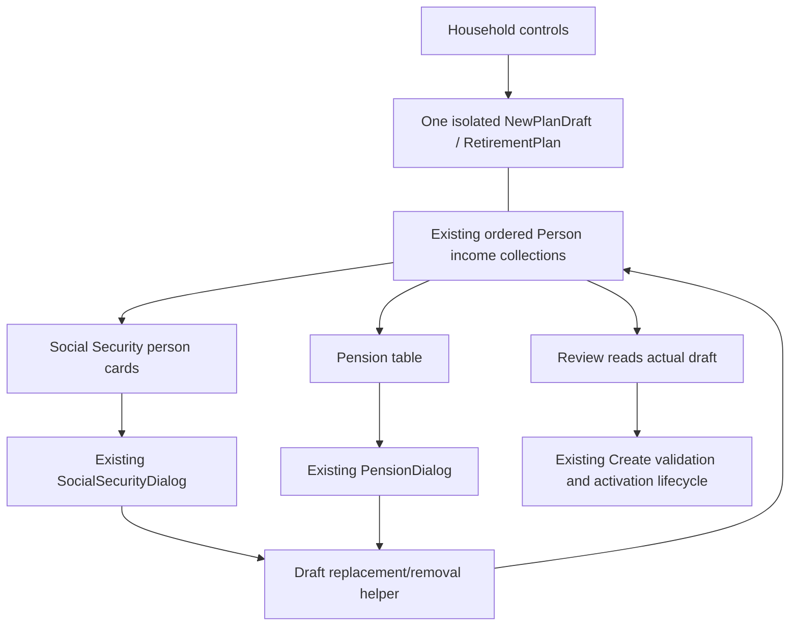

# Phase 7C.3 — Seven-Step New Plan Wizard

## 1. Executive summary

Implemented the approved seven-topic workflow on the Phase 7C.2 responsive shell. Social Security now has person-specific cards; the existing IncomeWizardStep is pension-only. Both edit the existing person-owned income collections in the same isolated NewPlanDraft through the original dialogs and builders.

Household now introduces local, unsaved plan creation, distinguishes optional names from required DOB/table category, and presents Just me / Me and my spouse choices. Removing a spouse requires explicit confirmation before the existing domain guard runs. Cancellation and blocked removal preserve entered controls and financial records. Accounts and pensions provide selected-row details, including exact monetary strings and their units. Review has six separately editable sections.

No financial calculations, defaults, ownership rules, persisted models, JSON schemas, tax rules, analyzer algorithms, Monte Carlo settings, PDF export or application activation/departure semantics were changed. Phase 7C.4 has not begun.

## 2. Initial architecture confirmation

Read repository AGENTS.md, Phase 7C.1 audit/design and Phase 7C.2 implementation report; inspected the current wizard, draft, shared field/list/help infrastructure, item dialogs, relevant domain classes and wizard/integration tests.

The working tree already contained the completed, uncommitted Phase 7C.2 work and both earlier reports. Initial branch was `main`, HEAD `8892c2b19b6105a04c4db75f37418f5092ecb9f4`. A local SHA-256 inventory under ignored `target/phase7c3-initial-hashes.json` distinguishes this phase's edits from that starting state. Neither earlier report was edited.

Confirmed implementation boundaries:

- NewRetirementPlanWizard retained six persistent page instances, stable local keys, visited navigation, Review reconciliation and a fixed DialogPane action bar.
- NewPlanDraft owns a fresh single-person factory plan; there is no active-controller or repository dependency.
- IncomeWizardStep previously combined Pension and SocialSecurityIncome, using each actual person's ordered source list. Same-owner edits used Person.replaceIncomeSource; intentional owner changes removed from the old person and appended to the chosen person's list.
- RetirementPlan.setSpouse checks existing person/portfolio accounts, spouse income, primary survivor pension and couple-scenario dependencies before replacing household membership. It does not automatically remove or reassign those records. No pre-confirmation trial mutation is necessary.
- AccountDialog already implements actual owner choices, Joint-to-retirement owner clearing, inherited fields and existing parsing. AccountsWizardStep already preserves opening-RMD history for same-type/same-owner edits.
- SocialSecurityDialog preserves the FRA amount, supported claiming-age choices/default, DOB-derived date and stored benefit valuation year. PensionDialog retains decimal COLA and existing optional survivor/qualification data.
- MainWindow::onNew and ApplicationController own activation/departure/save behavior. They remain untouched.

## 3. Files modified and created

**Phase-local inventory: 25 files — 22 existing files modified and 3 created.** This counts changes relative to the starting Phase 7C.2 working tree, not the older Git HEAD.

Prefixes: `J = src/main/java/com/daviddunn/retirementplanner`; `T = src/test/java/com/daviddunn/retirementplanner`.

| File | Phase 7C.3 change |
| --- | --- |
| `J/ui/wizard/NewRetirementPlanWizard.java` | Register seven persistent pages in approved order |
| `J/ui/wizard/SocialSecurityWizardStep.java` **new** | Owner-specific optional Social Security cards and existing editor integration |
| `J/ui/wizard/IncomeWizardStep.java` | Pension-only table, actions, filtering and details |
| `J/ui/wizard/NewPlanDraft.java` | Minimal shared source replacement/removal helpers using existing Person operations |
| `J/ui/wizard/HouseholdWizardStep.java` | Welcome/local-data guidance, household choices, confirmation, blocked-removal focus and retained raw state |
| `J/ui/wizard/AccountsWizardStep.java` | Opening-balance/owner guidance, selected details, refresh-on-entry and retained valid selection |
| `J/ui/wizard/ExpensesWizardStep.java` | User-facing title becomes Spending; model/editor unchanged |
| `J/ui/wizard/ReviewWizardStep.java` | Separate Social Security/Pensions, Spending title, optional-section text and stable Edit keys |
| `J/ui/wizard/WizardListStep.java` | Small reusable selected-row detail label helper |
| `J/ui/wizard/WizardDialogSupport.java` | Visible, opt-in editor guidance helper without reparenting inputs |
| `J/ui/dialogs/AccountDialog.java` | Two lines adding guided units/requiredness explanation only |
| `J/ui/dialogs/SocialSecurityDialog.java` | Two lines adding guided FRA/monthly/valuation explanation only |
| `J/ui/dialogs/PensionDialog.java` | Two lines adding guided monthly/decimal-COLA explanation only |
| `T/ui/wizard/SevenStepWizardTest.java` **new** | Eleven registration, spouse, integrity, precision and opening-RMD cases |
| `T/ui/wizard/CompleteWizardTest.java` | Seven titles/progress, seven Cancel positions; existing financial assertions retained |
| `T/ui/wizard/GuidedWizardShellTest.java` | Six stable Review routes, reordered seven-page registry and new positions |
| `T/ui/wizard/GuidedWizardLayoutPreviewTest.java` | Seven-step Assumptions position; phase-specific logical-size artifact folder |
| `T/ui/wizard/CompleteWizardFixtures.java` | Separate Social Security and Pensions navigation; explicit person-card actions |
| `T/ui/wizard/CompleteWizardPreviewTest.java` | Separate income pages, empty/compact states, confirmation/blocked/long-table snapshots and geometry assertions |
| `T/ui/wizard/IncomeWizardStepTest.java` | Existing SS Add/Edit/Remove assertions now target person cards; confirmation answered explicitly |
| `T/ui/wizard/AccountsWizardStepTest.java` | Answer new removal confirmation; retain dependency/ownership assertions |
| `T/ui/wizard/NewRetirementPlanWizardTest.java` | Explicit confirmation in removal tests and approved Welcome heading |
| `T/ui/wizard/CompleteWizardEndToEndTest.java` | Seven Cancel positions and explicit blocked-removal confirmation |
| `T/ui/wizard/NewPlanWizardTestSupport.java` | Seven-page lifecycle traversal and focused modal-answer helper |
| `PHASE-7C3-SEVEN-STEP-WIZARD.md` **new** | This implementation report |

Existing 7C.2 changes to PersonCard, AssumptionsView, WizardFieldRow, NewPlanWizardStep and wizard CSS are preserved without additional edits in this phase. Generated logs/images/geometry remain under ignored `target/`.

## 4. Seven-step registration

| Position | Display title | Existing wizard-local key |
| ---: | --- | --- |
| 1 | Welcome and Household | HOUSEHOLD |
| 2 | Accounts | ACCOUNTS |
| 3 | Social Security | SOCIAL_SECURITY |
| 4 | Pensions | PENSIONS |
| 5 | Spending | EXPENSES |
| 6 | Assumptions | ASSUMPTIONS |
| 7 | Review and Create | REVIEW |

The INCOME enum value remains available but is not registered. No new domain/persisted enum was introduced. Welcome is inside Household. The shell derives count, headings, navigation position and disabled future states from registration; its sidebar/compact/footer mechanisms are retained.

Intentional old-test changes are presentation/workflow assertions: six becomes seven; Income becomes two topics; Expenses displays Spending; Review displays Review and Create; Review indices shift only in tests that inspect position. Production Review callbacks continue to use keys. Reordered registration tests cover every one of the six links. Exact financial assertions and goldens were not relaxed.

## 5. Social Security/Pensions shared-draft design

There is no migrated income, shadow model, second draft or new income subtype. Table items/card summaries are disposable UI views of actual source objects. The existing IncomeWizardStep name is deliberately retained for the pension-only topic to avoid a redundant new class/controller.

NewPlanDraft.replaceIncomeSource centralizes the former combined editor's behavior: append a new source to its actual person, replace a same-owner source in place, or explicitly remove/append when the user chooses a different valid owner. Unrelated sources keep their order and identity. Removing a source removes exactly that record. The inspected IncomeSource model has no independent source-ID field to regenerate.

Social Security Add is specific to the chosen person's card. Existing-source Edit retains the earlier permitted-owner rule: owners already containing another SS record are excluded; an intentional owner change remains possible where valid. There is no silent ownership transfer. Navigation merely rereads the draft and never creates a source.

## 6. Household and spouse-removal behavior

Welcome explains creation, later editing, optional financial sections, local storage and the fact that Create does not save. Household choices appear near the top as the current household status plus the action to choose the other supported shape. Names remain optional; DOB and mortality category retain existing completed-editor requirements. Table-category purpose and independent filing status are explicit. No generic partner model, inferred category, fabricated person data or plan-name field was added.

Removal sequence:

1. The included spouse's **Just me** action opens a standard owned JavaFX confirmation dialog. It describes discarding person information and preserving financial dependencies. Cancel is the default action.
2. Before confirmation there is no call to setSpouse, no simulated removal and no draft mutation. Cancel/window close leaves the same card, person, raw text and records.
3. Only explicit Remove Spouse invokes the existing RetirementPlan.setSpouse(null).
4. A dependency exception is shown with the existing named records and directions to Accounts, Social Security and Pensions. The same card/raw entries and household remain. The message is revealed/focused; navigation does not advance.
5. On success, only the spouse/card is removed through the existing operation, the visible choice becomes Just me, and the same primary data/records remain. No dormant spouse/undo state is retained. Adding a spouse later creates a blank person under existing defaults.

Buttons avoid toggle-restoration listener recursion entirely. Neither shape choice changes filing status. Five new blocked-removal cases cover Joint account, spouse account, spouse SS, spouse pension and primary survivor pension. Existing dependency cases and successful-removal tests remain, now explicitly answering the confirmation. A separate test inspects the draft while confirmation is open and cancels with malformed raw DOB still present.

## 7. Account presentation changes

Accounts guidance distinguishes optional name, actual type, owner and opening dollars at projection start, without asserting tax eligibility. The table keeps these four columns and original domain insertion order. Selected-row details reveal full names/types/owners, exact toPlainString balance, projection start and presence of opening-RMD history. No displayed value is written back by selection.

The view refreshes on entry and retains selection when the selected account remains present. This also reflects changes elsewhere in the same draft. A long-list preview exposed the previous constructor-only refresh; fixing the presentation refresh does not reorder or mutate the portfolio. Add/Edit/Remove keep the wrapping action layout and have clear account-specific accessible names.

AccountDialog, supported types, parsing, inherited fields, actual owner choices, Joint-to-retirement clearing and participant facts remain unchanged except visible guided units. A new UI edit test verifies the same opening-RMD history object survives a same-type/same-owner edit, exact balance scale survives, and the unrelated last account retains its position. Existing Review opening-RMD reminders/editor remain; no prior-year facts are invented.

## 8. Social Security presentation

One card is shown for each represented person; single-person plans show no spouse card. Empty cards state Not entered (optional) and offer Add. A populated card offers Edit/Remove and displays actual owner, exact gross FRA dollars/month, claiming age, DOB-derived start and prominent stored benefit valuation year. No second Add is offered for that owner.

Guidance distinguishes FRA from the provisional claiming election, notes that 67 is not assumed to be everyone's FRA, and explains later analysis and plan-level COLA. Existing dialog ages 62–70/default, monthly basis, derived read-only date, precision and legacy explicit valuation-year convention remain. Existing DOB refresh is unchanged. Editing a 2024-valued source in a later plan preserves its year and amount unless the existing explicit legacy action is selected.

No estimate is imported/fabricated/rebased; no source-level COLA control or analyzer launch was added. Detailed year-mismatch warning design is deferred to 7C.4.

## 9. Pension presentation

The pension-only table displays name, owner, gross dollars/month and start date. Empty is valid. Selected details show full name/owner, exact monthly amount, start/end, actual decimal COLA with **0.02 = 2% annually**, and optional survivor monthly amount. Guidance distinguishes commencement from a universal retirement date and pension survivors from Social Security survivors.

Existing PensionDialog and builders handle all edits. Optional names/end/survivor amounts, actual person ownership, gross monthly parsing, decimal COLA, single-person survivor restriction, retirement facts and unknown defaults are retained. No employment, annuity or other unsupported source category is offered.

## 10. Review integration

Review regenerates six sections from actual draft data: Household, Accounts, Social Security, Pensions, Spending, Assumptions. Each has a distinct accessible Edit action and stable key. SS and pension summaries are filtered views of the same source collections; empty sections show None entered (optional).

The Phase 7C.2 reconciliation path remains: entering Review validates/applies pending earlier edits, visits the first failing page without destroying raw input, reveals its error and regenerates only after successful reconciliation. Account/spending/opening-RMD warnings remain nonblocking under the existing rules. Final Create still validates all registered pages and draft completion.

## 11. Accessibility changes

Retained standard keyboard navigation, current/visited text states, disabled unvisited steps, compact selector, default/cancel footer behavior, focus borders, linked labels and deferred invalid-field reveal.

New person-card actions identify their owner in accessible text. Pension actions identify the source kind; account actions explicitly identify the selected account context. Empty SS status is accessible text, and all optional status is textual rather than color-only. Removal uses an owned, labeled standard confirmation with Cancel as default; hidden spouse controls are removed on success. Blocked-removal explanation receives focus and is scrolled into view.

Existing WizardFieldRow stays in place for assumptions. For representative Household/account/SS/pension input help, smaller visible labels/guidance were chosen instead of wrapping every conditional modal control: reparenting those inputs would interfere with existing GridPane-based conditional visibility/error association. This is presentation-only, preserving current control IDs/parsers and keyboard label links. No new component framework was added.

Windows Narrator, high contrast, physical Tab order across every control and actual mixed-DPI behavior remain manual acceptance checks; this report does not claim compliance certification.

## 12. Draft and lifecycle preservation

All seven page objects remain persistent. Household/Assumptions preserve raw invalid text across Back and visited navigation. SS cards and list summaries reread actual records on entry without reconstructing person inputs or mutating finances. Same-owner edits preserve collection position. Canceling modal editors returns no source/account update.

MainWindow, ApplicationController, plan repositories, financial algorithms and persisted models are unchanged. The wizard still precedes active-plan departure confirmation. Cancel or declined departure leaves the old plan untouched. Create remains untitled/unsaved under the existing convention, writes no plan/settings file, and preserves conditional ordinary projection after activation. No optimizer, Monte Carlo or expensive analysis is called by step changes.

Existing end-to-end tests cover exact single/couple records, Save As/reload, deterministic integrated evaluation, seeded Monte Carlo, cancellation and dependency rejection. Only their page traversal and explicit removal-confirmation responses changed. Financial assertions remain.

## 13. Focused test results

All executions used IntelliJ bundled Maven with the mandated project-local repository. No dependencies/build settings/goldens were changed.

| Executed check | Run | Passed | Failed | Errors | Skipped |
| --- | ---: | ---: | ---: | ---: | ---: |
| Wizard-only intermediate verification | 171 | 167 | 0 | 0 | 4 |
| Final wizard plus selected financial/persistence integration | 305 | 301 | 0 | 0 | 4 |
| Enabled preview/navigation/seven-step verification | 32 | 32 | 0 | 0 | 0 |

Final focused selector: `*Wizard*Test,SinglePersonCoreProjectionTest,SinglePersonHouseholdTest,HouseholdSocialSecurityIncomeCalculatorTest,SocialSecurityIncomeTest,PensionTest,OpeningRmdProjectionTest,OpeningRmdWorkflowServiceTest,JsonRetirementPlanRepositoryTest,SinglePersonPlanPersistenceTest,TransactionalPlanPersistenceTest,TransactionalSettingsTest,SinglePersonStage3CoupleGoldenTest,SinglePersonStage4ACoupleGoldenTest,SinglePersonMonteCarloTest`.

The final combined execution includes the subsequently added opening-RMD account-edit case; it covers 172 wizard cases (168 passed/4 skipped) and 133 selected domain/integration cases (all passed). The intermediate 171-case result predates that final additional test. Logs: `target/phase7c3-focused-final.log` and `target/phase7c3-focused-financial.log`.

Eleven new SevenStepWizardTest cases cover exact keys/six optional Review sections, pre-confirmation/canceled raw-state preservation, five dependency rejections, income edit/removal order and precision, single/couple stored SS summaries, and opening-RMD edit preservation. GuidedWizardShellTest now tests six reordered-key Edit destinations. Existing cancel tests now cover all seven positions. No financial assertion was removed.

During development an old six-page heading assertion and previously unhandled new confirmation required fixture updates. An initial enabled long-list preview exposed the Accounts refresh-on-entry omission, which was corrected. Final successful runs supersede those attempts; no financial rule or golden was changed to resolve them.

## 14. Full suite results

Established command: bundled Maven, mandated local repository, `test -DargLine=-Xmx8g`. No test filter, benchmark exclusion, trial/seed change or golden update. **BUILD SUCCESS**, 7 minutes 28 seconds; completed October 16, 2026, 09:57:16 EDT. Log: `target/phase7c3-full.log`.

| Run | Passed | Failed | Errors | Skipped |
| ---: | ---: | ---: | ---: | ---: |
| 2,853 | 2,823 | 0 | 0 | 30 |

The existing financial, tax, Social Security, deterministic/weighted, seeded Monte Carlo, RMD, Roth and Phase 7B.1 persistence/recovery expectations passed unchanged. Default skips include opt-in preview/benchmark cases; relevant wizard previews were enabled separately rather than represented as passed here. One additional skipped preview method accounts for the skip-count increase from Phase 7C.2.

Historical Phase 7C.2 baseline: 2,838 run / 2,809 passed / 0 failures / 0 errors / 29 skipped. This is not the new execution result.

## 15. Rendered preview evidence

Actual JavaFX dialogs were rendered and screenshots opened locally with synthetic fixture data. Host output scale is 1.0; screen visual work area is 1920 × 1032 logical units. Relevant opt-in commands use `-Dcomplete.wizard.preview=true -Dguided.wizard.preview=true` with CompleteWizardPreviewTest, GuidedWizardLayoutPreviewTest, GuidedWizardShellTest and SevenStepWizardTest.

`target/phase7c3-wizard-preview/` contains 25 topic states, five contact sheets, selected-pension/Review bottom views, direct input-hover help, spouse confirmation, blocked removal, long Accounts and geometry. Evidence covers:

- Seven-step wide sidebar and compact selector, current/visited/future text states.
- Single/couple Household, top household choice, confirmation and actionable blocked-removal text.
- Empty/populated Accounts and a 21-row narrow table with full selected details and wrapping actions.
- Single/couple SS cards with actual monthly benefit/claim/date/year and empty optional SS.
- Populated/empty Pensions, selected COLA/survivor details and narrow presentation.
- Separate populated/empty Review sections, all Edit routes, error/warning states and footer visibility.

`target/phase7c3-layout-preview/` retains the five Phase 7C.2 logical fit probes: 980 × 700, 980 × 560, 980 × 740, 980 × 620 and 900 × 480 outer windows, representing the requested 1366/1920 scaling budgets. Household, invalid-Assumptions focus and bottom views are rendered for each. Footer/input bounds are asserted after real FX pulses; this simulates logical work area, not actual OS DPI changes.

Images inspected include wide Household, owner-specific SS, selected pension details, confirmation/blocked status, contact sheets, compact income views, Review and small-budget errors. Long-table selection/detail layout is allowed to settle before scrolling/capturing; action bounds are checked inside the viewport. Rendered inspection is distinct from the manual Narrator/high-contrast/native DPI checklist below.

## 16. Known limitations

- Real 125/150/200% Windows DPI, mixed monitors, Narrator and high-contrast acceptance remain manual. No accessibility certification is claimed.
- Long table text may truncate in cells; the selected-row details expose full values without changing underlying records. Bounded TableView scrolling remains inside the existing topic scroller.
- Very short windows require vertical scrolling, including to spouse fields and selected-row/action details. Existing minimum sizing and footer semantics remain.
- Modal input controls retain their established layout. Visible guidance was added without a wholesale field-row conversion; broader input grouping is deferred.
- Existing advanced dependency types remain guarded; no new wizard input is introduced to bypass them and no financial records are automatically changed.
- The old IncomeWizardStep class name is retained internally for the pension-only topic. INCOME key remains unregistered; it is not a combined page.
- Reference rules, tax availability limitations, original planning defaults and existing financial model scope are not changed by these UX improvements.

## 17. Deferred Phase 7C.4 work

Spending/editor clarity beyond the approved title, broader assumptions/Basic–Advanced grouping, detailed SS projection-year/valuation-year mismatch warnings and wider field/help conversion remain deferred. No 7C.4 logic, new default, automatic SS rebasing or analyzer launch was added.

## 18. Manual Windows acceptance checklist

1. Exercise actual 1366 × 768 and 1920 × 1080 displays at requested scaling where available; resize/move across monitors. Verify seven navigation items, compact selection, scrolling and footer reachability.
2. Create Just me and couple drafts with optional blank names. Check required DOB/category and table explanation; verify household choice never changes filing status.
3. Enter spouse raw text, choose Just me, then Cancel. Confirm the same card and text remain. Accept removal without dependencies; confirm no phantom spouse and no automatic advance.
4. In disposable drafts add spouse/Joint accounts, spouse SS/pension and primary survivor pension. Confirm removal is blocked, names/directions readable and records/owners/order unchanged. Resolve manually in the relevant topic.
5. Add/edit all supported account types, including Joint-to-retirement owner clearing and inherited metadata. Check full selected details and exact balance. Verify existing opening-RMD history through same-type/owner edits.
6. Add SS for each represented person. Check one source per person, actual monthly FRA amount, claiming age, derived date/year, owner-specific accessible actions and no analyzer activity. Change DOB and verify dates refresh without benefit/year changes.
7. Add/edit/remove pensions around SS sources. Check gross monthly units, 0.02 decimal COLA, optional end/survivor values and no unrelated source mutation.
8. Inspect all six Review sections/Edit links, empty optional statuses and opening-RMD reminders. Leave malformed raw input on an earlier visited page and confirm Review returns to that blocker.
9. Use keyboard Tab/Shift+Tab, arrows, Enter and Escape; verify default Cancel in removal confirmation, hidden-control exclusion, focus indicators/help and first-error reveal. Test Narrator/high contrast separately.
10. Cancel with a dirty active plan; complete and decline departure; then accept Create in a disposable scenario. Confirm existing unsaved activation/projection behavior and ordinary transactional Save As/reload. Never corrupt a user's only plan for testing.

## 19. Git status

Initial Phase 7C.2 tracked/untracked work is preserved. Phase-local inventory is derived from the initial content hashes; both prior report hashes remain unchanged. Nothing was staged, committed or pushed, and HEAD/branch remain unchanged.

Final checks: `git diff --check` returned 0; an explicit trailing-whitespace scan of all 25 phase files found zero issues. `git status --short` and `git diff --stat` were reviewed, including untracked files. The cumulative working tree contains 25 modified tracked files and eight untracked files, including preserved Phase 7C.1/7C.2 work; the **phase-local** change remains the 25-file inventory in section 3, not a claim that all cumulative changes originated here. The index is empty (`git diff --cached --name-only`).

Protected-path diff checks returned 0 for production financial/domain Java, persistence, MainWindow/controller lifecycle, tax/reference resources, Maven configuration and test/golden resources. Analyzer implementations, PDF export, schemas and financial golden resources were not edited. Both prior report hashes match their initial values. No staging, commit, push or history change was performed.
