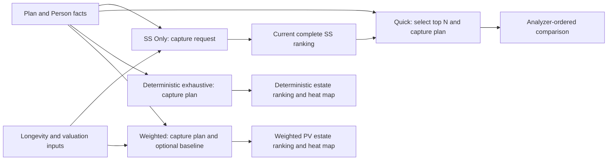

# Phase 8A — Social Security Analyzer Navigation and UX Architecture Audit

## 1. Executive summary

Recommend **Option C: four direct analysis choices**, with a consistent Configure → Run → Results arrangement within each workspace. Use a vertical analysis selector when space permits and a compact selector at smaller widths. Retain existing result tabs, controls, metrics, ordering, heat maps, details and PDF capture paths. Configure/Run/Results are visible regions, not three new mandatory navigation pages.

The principal obstacle is analysis navigation: the couple interface nests analysis choices three levels deep, while Quick Comparison additionally requires a current result from another branch. A large shared assumptions header separates execution from results and displays longevity controls even for a search that does not use them. These are presentation problems; no financial-engine changes are recommended.

Important current capability distinction: **single-person plans have three analysis tabs, not the couple interface's four choices**. They offer nine-strategy deterministic, SS-only and longevity-weighted analyses. There is no single-person Quick Comparison UI, couple heat map or survivor input. Preserve this distinction; a common selector must explain that Quick Comparison is unavailable for this household rather than inventing a new analysis.

This is static repository evidence and proposed design, not rendered usability acceptance. No tests or previews were run, no financial output was generated, and no runtime change was made. Initial tree was clean, branch `main`, HEAD `bbc7bb07ecb54d58e9457f98e33a1bd9779f9c51`. Only this report is authorized for creation.

## 2. Current UI navigation map

Paths below are relative to the repository root. In this report **UI/** means `src/main/java/com/daviddunn/retirementplanner/ui/socialsecurity/`; **APP/** means `src/main/java/com/daviddunn/retirementplanner/app/socialsecurity/`; **TEST/** means `src/test/java/com/daviddunn/retirementplanner/ui/socialsecurity/`.

Observed entry: `src/main/java/com/daviddunn/retirementplanner/ui/MainWindow.java`, `createMenuBar`: Analysis → Social Security Strategy Analyzer… → new dialog bound to `ApplicationController`. The stage is window-modal and `show()` uses `showAndWait()`; it is read-only, not a strategy editor for the active plan.

```text
Couple: Social Security Strategy Analyzer window
  Shared household identity summary
  Analysis Inputs and Plan Assumptions [collapsed initially]
    Objective explanations; dependency matrix; current values and sources
  Longevity and Valuation Assumptions [editable, shared across modes]
  Shared Cancel / status / progress [shown while busy]
  Social Security Only [initial mode]
    Run Social Security Analysis / local Cancel / status / stale notice
    Recommendation [initial result tab]
    Claiming Grid → select cell → grid details
    Top Strategies → select row → strategy details
    Assumptions [read-only result-time text]
  Integrated Retirement Plan
    Deterministic [initial integrated tab]
      Quick Comparison [initial deterministic tab]
        Candidate count / Run Quick Comparison / Cancel / status
        Current Plan Baseline + Selected Candidate [split pane]
        Candidate Comparison table; Methodology and Assumptions
      Deterministic Exhaustive Search
        Run / Cancel / status / stale notice / Export PDF
        Ranked Strategies [initial result tab]
          Search Summary and Current Plan + Selected Outcome [split pane]
          Grouped Top Tested Outcomes; Methodology
        Claiming-Age Heat Map
          Display metric; grid; selected details; View Full Strategy Analysis
    Longevity-Weighted
      Current Strategy Baseline [expandable, initially expanded]
      Run Longevity-Weighted Exhaustive Search / status / stale / limitation
      Export PDF
      Ranked Strategies [initial result tab]
        Highest and Current Strategy [collapsed]
        Ranked table
        Compare Analysis Outcomes [collapsed]
        Selected Strategy Details [collapsed]
        Methodology and Result-Time Assumptions [collapsed]
        Technical Details [collapsed]
      Claiming-Age Heat Map → existing selected-strategy navigation
  Fixed bottom read-only scope / Close

Single person: same dialog class, different scene branch
  Deterministic Integrated [initial tab]
    Optional primary death year; Run Nine Claiming Strategies; Cancel; PDF
    Progress/status; summary; ranked table; details; Break-Even vs Current Plan
  Social Security Only
    Primary longevity factor; conditioning date; valuation date; discount rate
    Run Nine Claiming Strategies; Cancel; PDF; summary/table/details
  Longevity-Weighted Integrated
    Separate controls with the same four kinds of input
    Run Nine Claiming Strategies; Cancel; PDF; summary/table/details
```

Evidence: **UI/**`SocialSecurityStrategyAnalyzerDialog.java`, constructor, `content`, `socialSecurityContent`, `integratedContent`, `deterministicIntegratedContent`, `quickComparisonContent`, `exhaustiveSearchContent`; **UI/**`LongevityWeightedIntegratedView.java`, constructor; **UI/**`SinglePersonIntegratedView.java` and `SinglePersonMortalityView.java`, constructors. No FXML is involved in these construction paths. The dialog has no analyzer-wide stylesheet attachment in `content`; heat-map styling is explicitly loaded by **UI/**`ClaimingStrategyHeatMapView.java` from `src/main/resources/css/claiming-strategy-heat-map.css`.

## 3. Four analysis workflow maps

Interaction counts are source-derived minimum explicit selections, not measured task timings. They exclude typing, scrolling, validation repair, result inspection, and waiting. Count opening the Analysis menu plus selecting its item as two interactions. Defaults mean initially selected tabs require no click.

| Couple analysis | From freshly opened dialog, valid inputs | Including menu entry | Required preparation | Results / additional navigation |
|---|---|---|---|---|
| Social Security Only | Run: 1 | 3 | Inspect inherited SS/Person facts; shared longevity/valuation values | Recommendation appears in same workspace; Claiming Grid, Top Strategies or Assumptions costs one result-tab selection each |
| Deterministic Quick Comparison | Integrated tab + Run: 2 **if SS result already current** | 4 with existing prerequisite | First run SS Only: 1 extra Run and completion wait; optionally adjust candidate count | Baseline, selected candidate and table on same Quick page; scroll between sections |
| Deterministic Exhaustive Search | Integrated + Exhaustive + Run: 3 | 5 | Valid captured full plan and existing current-strategy inputs; no SS-only run | Ranked result on same page; Heat Map one result-tab click; cell selection and View Full Strategy Analysis are further actions |
| Longevity-Weighted Search | Integrated + Longevity-Weighted + Run: 3 | 5 | Shared longevity/valuation; optional baseline survivor fields | Ranked result on same page; expand details/comparison or switch to heat map |

For Quick from a fresh dialog: SS Run → wait → Integrated → Quick Run = **3 actions within the dialog**, or 5 including menu entry. Starting from another tab can require returning to SS first. Do not describe Quick as independently runnable or as an exhaustive full-plan ranking.



Execution evidence: **UI/**`SocialSecurityStrategyAnalyzerDialog.java`, `runAnalysis`, `runIntegratedAnalysis`, `runExhaustiveSearch`, `runWeightedAnalysis`. Quick calls `IntegratedSocialSecurityCandidateSelector.select` on the current precise SS ranking, then captures a copied plan through `SocialSecurityAnalyzerInputs.quick`. Exhaustive uses `SocialSecurityAnalyzerInputs.exhaustive`. Weighted uses `LongevityWeightedAnalysisRequestFactory.capture/create`; candidate enumeration and mortality preparation occur under job admission. Each workspace displays its completed result without requiring a separate Configure/Results page, but the outer scroller may require substantial movement between inputs and output.

Single-person counts from its initial deterministic tab: deterministic Run = 1; SS-only or weighted tab + Run = 2. Its deterministic optional death year is session input, not the couple's persisted death-scenario UI. Evidence: **UI/**`SinglePersonIntegratedView.start`, `SinglePersonMortalityView.start`.

## 4. Complete input and control inventory

### 4.1 Editable analysis inputs

| Input/control | Owner and current location | Used by | Requiredness / semantics to preserve |
|---|---|---|---|
| Primary and spouse mortality adjustment | Couple shared header; text initially `1.00` | SS; Quick candidate generation; Weighted | Both needed for couple mortality requests; dialog validates 0.50–3.00; hazard multiplier, not a life-expectancy percentage |
| Real discount rate (%) | Couple shared header; text initially `1.0` | SS; Quick SS-PV/candidate selection; Weighted | Percent text converted with `movePointLeft(2)`; existing downstream validation remains authoritative; not portfolio return |
| Mortality conditioning date | Couple shared DatePicker | Same three paths | Independent of PV date and financial projection start; survival conditioning and remaining SS start |
| Valuation date | Couple shared DatePicker | Same three paths | PV-dollar date, not claiming date or projection start |
| Candidate count | Quick page Spinner 1–20, initial 10 | Quick only | Selects top SS candidates; no limit on exhaustive/weighted universe |
| Primary survivor baseline age | Weighted Current Strategy Baseline | Weighted optional comparison only | Whole-year age at least 60 per current validation; no new upper age bound; missing/invalid omits baseline, not candidate run |
| Spouse survivor baseline age | Same | Same | Separate recipient-specific election; do not substitute retirement claiming age |
| Primary death year | Single deterministic page, initially blank | Single deterministic | Optional, existing request rejects year before projection start; blank means survival through configured horizon |
| Primary factor, conditioning, valuation, discount | Each single SS/weighted page has its own controls | Its respective individual request | Independent pending values; factor/rate validation remains the actual individual factory/value-object contract, not automatically the couple dialog's parser |

The controller-bound couple constructor initializes factor/conditioning from `ApplicationController.getLongevitySessionSettings()` and shares later **valid** edits with that session setting. The standalone constructor initializes both dates to projection start; PV date is not part of `LongevitySessionSettings`. Single-person mortality pages initialize dates from plan start and keep separate controls. Do not unify these differing defaults/ownership as an incidental navigation change. Evidence: **UI/**`SocialSecurityStrategyAnalyzerDialog.java`, constructors; `SinglePersonMortalityView`; **TEST/**`SocialSecurityStrategyAnalyzerDialogStateTest.longevitySessionSettingsAreSharedWithoutPlanWritesOrAnalysisJobs`.

### 4.2 Inherited inputs and read-only assumptions

| Source | Facts displayed/consumed | Proposed presentation |
|---|---|---|
| Person | DOB, name, mortality category for each represented person | Read-only “From Person information”; identify missing facts without adding duplicate editable DOB/category controls |
| Correctly owned SS records | FRA monthly benefit, benefit valuation year, persisted claim age/date | Read-only “From Social Security record”; retirement searches enumerate candidate ages 62–70, not a new editable search-age range |
| Plan economic settings | SS COLA, general/healthcare inflation, portfolio return | Show relevant inherited values; no analyzer COLA override |
| Planning assumptions | Projection start, configured calendar horizon, death scenario/year, post-death expense factor, survivor policy | Distinguish deterministic configured horizon from weighted second-death horizon |
| Portfolio and financial plan | Accounts/ownership/balances, expenses, pensions, tax assumptions/state, Medicare/IRMAA, RMD/opening history, Roth schedule, estate treatment | Collapsible existing complete input summary; full plan copied for integrated runs |
| Shipped mortality model | SSA 2022 period table metadata, independent household mortality, next complete birthday intervals | Reference, not editable table selection |
| Weighted current baseline | Persisted retirement records plus legitimate plan survivor election or session overrides | Label Plan / Analyzer / Analyzer override and completeness separately from search readiness |

Evidence: **UI/**`SocialSecurityAnalyzerInputSummary.from/identity`, `SocialSecurityAnalyzerInputMatrix.rows`; `SocialSecurityStrategyAnalysisRequestFactory.create/source/requireBenefit`; `CurrentStrategyBaseline.capture/planSurvivorAge`. Couple SS requires DOB, authoritative Person mortality categories, exactly one correctly owned SS source per owner, positive FRA benefit and a valid valuation year. Do not promote this list to new universal financial-plan validation: integrated request and projection checks remain their existing contracts. Quick consumes the current SS result; exhaustive does not require mortality inputs. Weighted missing optional survivor baseline is not a fatal request error.

`SocialSecurityAnalyzerInputMatrix` groups deterministic outputs in one column and explains Quick's mortality dependency in prose. Its rows include both search elections and current reference facts; they are not all editable prerequisite controls. Preserve the complete matrix but surface a four-analysis applicability summary so Quick's special dependency is visible.

### 4.3 Execution, results and secondary controls

| Control family | Existing functionality to retain |
|---|---|
| Run buttons | Four couple actions; three individual actions; no automatic execution on selection |
| Cancel/status/progress | Couple shared Cancel and per-page Cancel controls for SS/Quick/Exhaustive; shared progress above analysis tabs; phase, count, percent, activity; weighted uses shared Cancel |
| Close/window close | Job cancellation and listener cleanup; no plan writes |
| SS result controls | Recommendation, grid buttons/details, Top Strategies row selection, result assumptions |
| Quick results | Candidate table selection, current-plan baseline, candidate details, methodology split-pane layout |
| Exhaustive results | Grouped table selection, current reference, selected outcome, methodology, ranked/heat-map tabs |
| Weighted results | Ranked table including sortable metric columns; five expandable sections; cross-analysis comparison; selected details |
| Heat-map controls | Display metric ComboBox; all cell toggle buttons; legend/tooltips; selected elections, rank and values; View Full Strategy Analysis |
| PDF | Couple deterministic-exhaustive and weighted Export PDF; individual deterministic, SS-only and weighted PDF actions; chooser, readiness checks, background writing, success/failure alerts |
| Break-even | Single deterministic selected completed strategy vs frozen current-plan comparison opens existing BreakEvenAnalysisDialog |

No couple SS-only or Quick PDF button is wired in the inspected dialog. Preserve actual export coverage; do not invent a missing export or remove individual SS-only PDF. Evidence: **UI/**`SocialSecurityStrategyAnalyzerDialog.content/capturePdfReport/exportPdf`, `IndividualPdfExportAction`, `SinglePersonIntegratedView`.

## 5. Usability issues ranked by severity

| Priority | Observed implementation and impact | Proposed correction |
|---|---|---|
| High | Four couple capabilities hidden behind mode → integrated type → deterministic subtype; depth depends on chosen task | Four direct named choices |
| High | Quick disabled until a current SS run; its prerequisite and Run are in different branches | Visible prerequisite status and explicit “Go to Social Security Only” navigation; retain two separate user-run operations |
| High | Shared longevity header precedes every mode although exhaustive ignores it | Contextual relevance explanation and relevant controls beside selected task; preserve shared pending values |
| High | Current settings, result-time settings, persisted “current strategy” and selected candidate have distinct meanings | Separate “Inputs for next run”, “Completed result assumptions”, and “Selected result strategy” labels |
| Medium | Large collapsed matrix expands above all analysis content; Run/progress can be separated from tables by scrolling | Keep full matrix available under reference details; compact action/progress region remains reachable |
| Medium | Multiple nested result and task tabs look similar; “Integrated” does not describe an action | Separate task selector visually from unchanged result tabs |
| Medium | Fixed stage minimum 900×650 and initial 1180×820; multi-column grids/HBox actions; no screen-work-area sizing in constructor | Fit logical work area and wrap contextual inputs/actions; preserve table horizontal scrolling where already needed |
| Medium | Different household paths have different navigation and input-sharing behavior | Consistent workspace vocabulary, household-aware availability; preserve branch-specific contracts |
| Medium | Run failures often modal and generic across couple modes; weighted failures use inline status | Name active operation and focus existing failure presentation; do not change failure classification |
| Medium | HelpIcon is a Label with tooltip and no explicit keyboard action | Keyboard-readable visible help and descriptive accessibleHelp using supported APIs |
| Low | Cancel duplicated at shared header and local pages; weighted cancellation is distant from its Run | In initial implementation retain all handlers; make active job owner explicit; consolidate visible placement only after approval |

These are source-based usability risks, not claims of observed clipping or measured user failure. The existing heat-map accessibility markers and bounded table/natural-content sizing are strengths to preserve.

## 6. Alternative design comparison

Scores below are architectural judgments based on inspected containment and state, not user-study results.

| Criterion | A: single selector workspace | B: task panel + separate Configure/Run/Results pages | C: four direct analysis workspaces |
|---|---|---|---|
| Discovery | Clear selector, options hidden when closed | Excellent descriptive task cards | Excellent visible choices on wide window |
| Interactions | Select + Run; Quick prerequisite remains | Task + configure + results transitions can add actions | Select + Run; initial task only Run |
| Required inputs | Strong if contextual | Strong guided preparation | Strong with contextual input region |
| Consistency | High, but risks over-generalizing controls | High workflow structure | High shell consistency without forcing identical controls |
| Specific controls | Must preserve long-lived panels | Requires splitting current content and routing | Existing panels largely retained |
| Revisit/compare | Selector remembers last result | Needs explicit back/history navigation | Direct switch preserves result selections; existing weighted comparison stays intact |
| 1920×1080 | Useful but underuses task discoverability | Task cards + workspace fit | Vertical selector + broad existing results |
| 1366×768 | Good compact selector | Multi-stage flow costs vertical space | Compact selector; wrapped configure region |
| Narrower | Strong | Good if no fixed step sidebar | Strong with compact alternative; four long horizontal tabs alone are poor |
| Keyboard | ComboBox straightforward | More focus transitions | ListView/ToggleButtons plus compact ComboBox; stable focus targets |
| Complexity | Medium | High: split configure/results ownership and transitions | Low–medium for couple navigation; medium for preserving individual branch |
| State risk | Recreating panel on selection is a pitfall | Highest: new lifecycle between stages | Lowest if retaining page nodes and request callbacks |
| Future stored results | Can add separate history selection | Natural but invites premature history implementation | Explicit selected analysis distinct from selected completed run |

Recommend **C with B's task-oriented descriptions and A's compact selector**, not a literal four-long-tabs strip at every width. Keep all result views functionally unchanged. First implementation should flatten couple task containers before any optional extraction of existing result blocks.

## 7. Recommended architecture

Retain `SocialSecurityStrategyAnalyzerDialog` as session owner and `SocialSecurityAnalyzerJobController.Mode` as execution identity. Use a small UI-local choice descriptor that maps the four choices to existing mode callbacks, title, explanation, availability and retained workspace Node. No domain enum, financial DTO or persisted schema is needed for navigation.

Proposed UI-only additions, subject to implementation approval:

- **UI/**`AnalyzerNavigationView.java`: wide/compact choice controls exposing one selected choice; no calculation, request parsing or result ownership.
- **UI/**`AnalyzerWorkspace.java`: lightweight layout host for existing configure/actions/results blocks, only if extraction avoids duplication. It must not become a generalized application framework.
- Modify **UI/**`SocialSecurityStrategyAnalyzerDialog.java`: replace nested task containers, preserve run/render/capture methods and existing persistent controls. Keep `SinglePersonIntegratedView`/`SinglePersonMortalityView` intact initially; adapt their outer host without merging their input models.

No new task executor, financial controller, search abstraction or automatic pipeline. Do not call `runAnalysis` as a side effect of selecting Quick. Instead show its missing prerequisite and offer navigation to the existing SS Run action; return to Quick explicitly. This avoids changing scheduling, candidate selection or cancellation semantics.

## 8. Proposed navigation hierarchy

```text
Social Security Strategy Analyzer
  Analysis choice [always reachable; describes objective and availability]
    Social Security Only
      “Compare claiming choices using expected Social Security present value.”
    Deterministic Quick Comparison
      “Evaluate a small set from a completed SS-only analysis through your plan.”
    Deterministic Exhaustive Search
      “Test all existing candidate strategies using configured plan assumptions.”
    Longevity-Weighted Search
      “Rank expected PV after-tax investable estate across modeled lifetimes.”
  Selected workspace
    Inputs for next run [existing contextual controls and inherited values]
    Run / Cancel / actual active-job progress
    Results [existing result content and internal result tabs unchanged]
  Read-only scope / Close
```

Preserve current initial selection for each household: SS Only for couples, deterministic for individuals. A single-person Quick entry may be disabled with an accessible “Not available for single-person plans” explanation; do not add a new path. Keep the actual deterministic action's “Nine Claiming Strategies” identity and individual Break-Even/PDF controls.

## 9. Proposed input grouping

1. **From your retirement plan**: compact identity/SS-record summary and plan start/horizon; full existing assumptions matrix and source rows remain expandable. Missing plan facts explain where they are edited in the application; no duplicate birthdates or benefits in analyzer forms.
2. **Longevity and valuation**: existing factors, conditioning date, PV date and discount controls for SS, Quick's candidate-generation context and Weighted. For exhaustive show “Uses the configured plan death scenario; longevity/PV inputs do not affect this search” and read-only configured scenario. Do not reset hidden inputs.
3. **Analysis-specific**: Quick candidate count and explicit SS prerequisite; Weighted optional Current Strategy Baseline; individual deterministic optional primary death year. A missing weighted baseline displays “Search can run; comparison unavailable.”
4. **Execution**: current task name, Run, actual active-job owner, Cancel, phase/count/percent and status. Keep progress visible while another analysis's existing results are being reviewed. No second simultaneous job.
5. **Completed results**: unchanged output plus current/stale/busy indicators and frozen result-time assumptions. Inputs can differ from the displayed completed run; editing marks the affected result stale and preserves the snapshot.

Required markers describe existing request requirements, not new bounds. Source-owned inputs get a “From plan” label rather than an editable-looking disabled field. Retain full explanatory survivor terminology: primary survivor election means primary surviving spouse's death, not primary's retirement age. Do not remove the current complete dependency matrix because the compact summary exists.

## 10. Desktop and compact wireframes

Illustrative layout only; no screenshot or implementation claim:

```text
Desktop (1920×1080 work-area dependent)
+--------------------------------------------------------------------------+
| Social Security Strategy Analyzer — read-only                            |
| Analyze                          | Deterministic Quick Comparison        |
| > Social Security Only           | Short task description                |
| * Quick Comparison               | From plan: people / SS records        |
| > Deterministic Exhaustive Search | [Full plan assumptions >]             |
| > Longevity-Weighted Search       | Inputs for next run                   |
|                                  | [existing longevity controls]         |
|                                  | Candidates [10] SS result: Current    |
|                                  | [Run Quick Comparison] [Cancel]       |
|                                  | Active job / phase / count / progress |
|                                  | Results: existing baseline/details    |
|                                  | Existing candidate comparison table   |
|                                  | Existing methodology                  |
| Read-only; no strategy applied                                    Close |
+--------------------------------------------------------------------------+

Compact (1366×768 or smaller logical work area)
+--------------------------------------------------------------+
| Social Security Strategy Analyzer                            |
| Analysis [Longevity-Weighted Search                       v]  |
| Objective; household availability                            |
| Inputs for next run [expand/collapse, retained controls]      |
| From plan [summary >] / optional current baseline [>]         |
| [Run] [Cancel]  Active: Weighted / phase / count / progress    |
| Results (current / stale)                     [Export PDF]    |
| [Ranked Strategies] [Claiming-Age Heat Map]                   |
| Existing result view in vertical content viewport            |
| Existing table may retain its own horizontal scrollbar       |
| Read-only                                             Close  |
+--------------------------------------------------------------+
```

Use actual scene logical width and content fit, not physical monitor resolution, to select layout. Initial design budget: sidebar only when enough width remains for the existing result workspace; determine breakpoint by rendered fit in implementation. At 1366×768 use compact by default if work-area/DPI leaves inadequate room. Narrower windows retain vertical scrolling and wrapped actions; no promise that unchanged wide metric tables fit without their existing horizontal scrolling. Do not narrow or remove result columns to meet a shell target. Keep action/progress region reachable and bound height so a large expanded input reference cannot consume the whole viewport.

## 11. Results-view preservation strategy

| Existing result | Reuse boundary and invariants |
|---|---|
| Couple SS Only | Keep `socialSecurityContent` result TabPane: recommendation, claiming grid, precise ranked strategy presentation and assumptions; do not replace grid with integrated heat map |
| Quick | Keep current baseline, candidate details, comparison table and methodology; preserve SS analyzer order, no new winner |
| Exhaustive | Keep `deterministicResultTabs`, `deterministicRankedContent`, grouped rows, `deterministicHeatMap`, summary and detail callbacks; bounded top display is not the full search universe |
| Weighted | Keep `LongevityWeightedIntegratedView`, resultTabs, rankedContent, all five folds, compare-outcomes view and heat map intact |
| Individual | Keep three existing view instances, nine-row metrics/ranks/current markers, individual PDF and deterministic Break-Even dialog |

Most can be hosted intact under a different task parent; JavaFX Nodes have a single parent, so attach once or deliberately move existing nodes without recreating them. The couple dialog currently mixes actions and results inside each page factory. Split only container assembly if necessary; leave renderers and financial adapters untouched.

Heat-map selection preserves original generation/input-order identity. `openDeterministicHeatMapStrategy` and `LongevityWeightedIntegratedView.openHeatMapStrategy` route to ranked strategy details, including outcomes absent from a limited grouped display. `IntegratedAnalysisResultTabs.reveal` scrolls to result/detail targets. Preserve this callback path when changing ancestry. Keep every display metric, optimal marker, unavailable state, exact tie rule and current difference; never infer a new strategy from an age pair.

PDF readiness and selection are tied to actual result-tab selection, heat-map cell, ranked table order and frozen report context. Retain `capturePdfReport`, `IntegratedAnalyzerReportAdapter`, `IndividualAnalyzerReportAdapter`, `IndividualPdfExportAction` and exporter behavior; do not replace PDF state with the new analysis selector. Evidence: **TEST/**`IntegratedAnalyzerPdfStateTest`, `IntegratedAnalyzerPdfReportTest`, `ClaimingStrategyHeatMapViewTest`, `DeterministicHeatMapAdapterTest`.

## 12. State-management considerations

### Existing ownership

- Dialog owns retained input controls, `plan`, plan/assumptions revisions, selected tab nodes and completed presentation objects. Tab changes have no financial request side effect. Heat-map metric changes use captured values; a newly rendered heat map resets metric to percent-of-optimal and selects an optimal/first cell. Ordinary tab switching preserves its selection (**TEST/**`ClaimingStrategyHeatMapViewTest.newResultResetsMetricButTabSwitchingPreservesPresentationState`).
- `SocialSecurityAnalyzerJobController` owns session UUID, generation, mode-specific revisions, job state and progress. `SocialSecurityAnalysisJobCoordinator` admits one application-level analysis lease on a dedicated single-thread executor. Cancellation retains admission through worker cleanup; invalid/obsolete callbacks cannot publish. Closing detaches listeners and cancels without blocking FX.
- Coupled shared assumptions are locked during work. Existing results remain in controls on failed/cancelled reruns; publication is all-or-nothing for the job. Weighted explicitly labels a previous successful result during rerun. Individual views set their current flag false when starting; do not assume their export eligibility during rerun matches the couple branch.
- Controller-bound plan revision listener invalidates requests/results. Weighted baseline overrides survive reload of the same plan object, reset for a different plan, and are not persisted. Household shape selects a scene branch at construction; individual start explicitly asks to reopen if it becomes a couple. There is no audited dynamic rebuilding contract to reuse silently.
- PDF has its own exportBusy state and frozen metadata. Analysis result availability and analysis-running state are separate from export-running state.

### Existing couple invalidation matrix

| Change | SS | Quick | Exhaustive | Weighted |
|---|---|---|---|---|
| Plan revision | stale / reject old publication | stale | stale | stale |
| Mortality factors / discount / conditioning / valuation | stale | stale because candidate basis changed | preserved | stale |
| Quick candidate count | preserved | stale | preserved | preserved |
| New SS result | current new result | stale | result retained; SS cross-reference refreshed | preserved |
| Weighted baseline survivor fields | preserved | preserved | preserved | stale comparison/run context |
| Pure navigation / selection | preserved | preserved | preserved | preserved |

Evidence: **UI/**`SocialSecurityAnalyzerJobController.invalidate`, dialog `markStale`, `baselineChanged`, `refreshWeightedComparison`, `canExportPdf`; **TEST/**`SocialSecurityAnalyzerJobControllerTest`, `SocialSecurityStrategyAnalyzerDialogStateTest`, `IntegratedAnalysisComparisonPresentationTest`.

### Proposed ownership and risks

Keep session state in its current owners initially. Navigation owns only selected task, per-workspace focus/scroll and availability. It must not recreate controls, invalidate calculations, trigger a run, reset PDF flags or manufacture completion state. If presentation state is later extracted, use one session-owned record per analysis holding existing presentation, frozen source revisions, selection and stale indication; do not duplicate mutable plan facts or introduce a second job controller.

Switching plans must retain visibly stale old results only under unmistakable frozen-plan labeling, never present them as the new plan's results. Current plan identity updates, `planRevision` and report capture must stay authoritative. Switching household shape should continue to require reopening in the initial navigation phase; any smoother transition is a separate approved lifecycle change. Pending invalid text remains text, not a fallback default. Changing one individual mortality page currently invalidates all non-exhaustive job revisions through `ASSUMPTIONS`, even though its controls are separate; preserve this conservative behavior until a separately tested state-policy change is approved.

Cross-analysis comparisons require matching source revision and complete elections, not just matching retirement ages. Weighted aggregates remain bounded; navigation must not introduce per-scenario detail reruns or unbounded full projection retention.

## 13. Accessibility considerations

Observed strengths: `InputHelp.linkGridLabels` associates labels with controls; `InputHelp.install` supplies accessibleHelp; individual controls/tables have explicit accessible names; heat-map cells announce ages, metric and optimal text; CSS includes selected/focused borders and an optimal star. Weighted fold keyboard/geometry coverage exists in **TEST/**`LongevityWeightedIntegratedLayoutTest`.

Observed gaps/risks: `HelpIcon` is a Label with a tooltip, not an explicit keyboard help action. Much couple progress/status is ordinary Labels; no inspected code establishes screen-reader live announcements. Long HBoxes/grid rows and the 900×650 minimum need rendered fit testing. No explicit analyzer-wide keyboard shortcuts/default/cancel-button scheme is installed in the inspected couple constructor; do not claim Enter/Escape behavior beyond native controls.

Proposed acceptance: named task selector with current/available state; predictable Tab order from choice to configure to Run to results; keyboard expandable inputs/help; persistent focus after task switching; Cancel targets actual running job even while another result is visible. Accessible names distinguish current plan, selected result and highest tested strategy. Hidden configure content must be unmanaged and out of traversal without destroying its controls. Preserve standard table/TabPane keys and visible focus. Provide explicit focus/scroll to an invalid input when reliable control mapping exists; do not invent domain validation.

No Narrator, high-contrast, native DPI or keyboard checks were executed in this audit. Future acceptance must test Windows 100/125/150/200% scaling, small work areas and screen-reader announcements separately from logical-size previews.

## 14. Compatibility with future persisted analysis results

Current dialog says analyses are not applied or saved; completed presentations are session memory and PDF is an export, not reloadable analysis storage. Do not implement persistence or a result-history selector in the navigation phase.

Reserve a clean distinction between **selected analysis type** and **selected completed run**. A future approved result store would need immutable source-plan fingerprint/revision, household shape, exact elections, input and reference-data versions, objective, completion/failure status and frozen report metadata. Runtime revision numbers alone are not durable cross-session identity. Serialize domain/report contracts only after a separate design gate; JavaFX Nodes, row positions and session UUIDs are not durable result identities. Existing generation/input-order IDs are meaningful within a captured run and must not be replaced with display row indices.

A future history control can attach above the unchanged results host. Loading a historical result must not overwrite current configure controls or imply current-plan compatibility. This proposal reserves that attachment point without defining a schema or increasing retained detail.

## 15. Recommended implementation stages

| Proposed stage | Changes / boundaries | Acceptance | Complexity |
|---|---|---|---|
| 8B: direct task navigation | Couple dialog `content/integratedContent/deterministicIntegratedContent`; small navigation control; retain view instances and initial selections | Four direct choices; Quick prerequisite navigation; no new execution; all current result routes and individual capability limits preserved | Medium |
| 8C: contextual configure/action layout | Container assembly in dialog and optional workspace helper; reuse existing controls/summary; responsive selector/action placement | Correct applicability; no lost raw text; current defaults and invalidation unchanged; visible active-job progress across modes | Medium |
| 8D: input/help/accessibility polish | Scoped label/help/focus work in analyzer package; household-aware names; work-area sizing | No semantic/range/default changes; keyboard and rendered fit acceptance; preserve all folds and controls | Medium |
| 8E: final regression and usability acceptance | Extend existing tests/previews and perform manual Windows task walkthroughs | Identical requests/results/PDF capture, rankings and selection; no financial goldens changed; test suite green; manual limitations recorded | Medium |

Sequence 8B before 8C; 8D may proceed for isolated accessibility defects once navigation contracts stabilize. Do not combine with financial changes, persistence of results or a single/couple engine unification. Initial extraction should move containment only, avoiding a broad rewrite of the large dialog.

## 16. Regression-test strategy

Tests were **inspected, not run**. No executable change makes a full suite necessary for this audit.

Future implementation should extend existing test infrastructure rather than replace it:

| Area | Existing evidence / future checks |
|---|---|
| Request identity | `SocialSecurityStrategyAnalysisRequestFactoryTest`, `LongevityWeightedAnalysisRequestFactoryTest`, `SocialSecurityAnalyzerDateRequestTest`: same plan copy, exact values, independent dates, complete candidate universe and optional baseline |
| Ranking precision | `QuickComparisonPrecisionTest`, presentation and heat-map adapter/model tests: precise PV cutoff, ties, input/generation order, missing values not zero |
| Mode navigation | `SocialSecurityStrategyAnalyzerDialogStateTest`: replace containment-index assumptions only; assert stable mode routing, retained controls, all result selections and no job/revision changes on switch |
| Jobs | `SocialSecurityAnalyzerJobControllerTest`: same admission across modes/sessions, cancellation cleanup, obsolete callback rejection, progress coalescing, close and fatal failure isolation |
| Inputs | `SocialSecurityStrategyAnalyzerDialogInputTest`, `SocialSecurityAnalyzerInputPresentationTest`: existing bounds, source labels, full dependency matrix, malformed pending values not defaults |
| Date semantics | `SocialSecurityAnalyzerDateSemanticsTest`: valuation changes preserve underlying cash flows; conditioning legitimately changes distributions; no change to plan start |
| Result access | `ClaimingStrategyHeatMapViewTest`, `SocialSecurityStrategyAnalyzerDialogStateTest`: all cells, metric changes, full-detail callback for nonlisted strategy, return to ranked detail and scroll reveal |
| Layout | `LongevityWeightedIntegratedLayoutTest`, `SinglePersonIntegratedViewTest`, existing heat-map geometry tests: wide/compact selector, retained table sizes, all folds and actions reachable, no navigation-state resets on resize |
| PDF | `IntegratedAnalyzerPdfStateTest`, `IntegratedAnalyzerPdfReportTest`: exact active selection/metric/table order and frozen metadata; stale/busy disabled exports; individual PDF checks retained |
| Household | `SinglePersonIntegratedViewTest`, individual mortality views: three supported paths, nine ages, no spouse/survivor or invented Quick; reopen policy when shape changes |

Render complete windows at 1920×1080, 1366×768, 1180×820 and 900×650 logical budgets plus a compact smaller work area, populated and empty/stale/error/busy. Existing layout tests include 1180×820, 900×650 and 1366×768; dialog heat-map test uses 1880×1000. These are source-read test configurations, not new executed results. Preserve existing heat-map/table horizontal scroll where part of the results experience.

For each mode: run once, select a strategy/metric, switch modes, edit relevant/unrelated input, cancel a rerun, trigger validation/error, export if supported, switch plan and close during work. Verify retained frozen output and exact invalidation matrix. Run focused UI/request/job/PDF tests then established financial regression/full suite in implementation; do not regenerate goldens. No new analysis calculation is needed to navigate or inspect existing results.

## 17. Risks and unresolved design decisions

| Decision | Recommended default | Approval implication |
|---|---|---|
| Primary navigation | Four direct choices with vertical/compact selector; retain result tabs | Approve before UI implementation |
| Quick prerequisite | Explicit Go to SS Only link and current-result readiness; separate manual runs | Any one-click automatic pipeline requires a separate lifecycle decision |
| Single-person choices | Three working paths; explained unavailable Quick if common selector shows all four | Do not implement unsupported capabilities |
| Shared controls | Preserve couple shared settings and individual independent controls; contextual visibility only | Merging/synchronizing individual inputs is outside this proposal |
| Cancel presentation | Make actual job owner/progress visible; initially retain all existing actions/handlers | Consolidating/removing duplicate controls needs explicit approval |
| Historical results | Preserve session snapshots and stale labeling; no persistence yet | Durable result schema/history is a separate gate |
| Household shape change | Keep reopen requirement initially | Automatic scene rebuilding needs separate lifecycle tests and approval |

Main risks are accidental control recreation, altered invalidation, misidentifying a heat-map strategy, changing PDF selection capture, and conflating optional baseline readiness with search readiness. Stop implementation if the navigation needs algorithm changes, new financial defaults, different candidate ordering or result semantics. The recommended work is feasible as containment and presentation changes with existing financial services unchanged.

### Evidence inventory and verification

Inspected repository instruction: `AGENTS.md` (also supplied in the session). Inspected entry point: `src/main/java/com/daviddunn/retirementplanner/ui/MainWindow.java` (analyzer menu wiring).

Inspected production source under **UI/**, either complete small classes or relevant constructor/method sections of larger classes:

- `SocialSecurityStrategyAnalyzerDialog.java`
- `SocialSecurityAnalyzerJobController.java`
- `SocialSecurityAnalyzerInputMatrix.java`
- `SocialSecurityAnalyzerInputSummary.java`
- `SocialSecurityAnalyzerInputView.java`
- `SocialSecurityAnalyzerInputs.java`
- `SocialSecurityStrategyAnalysisRequestFactory.java`
- `LongevityWeightedAnalysisRequestFactory.java`
- `LongevityWeightedIntegratedView.java`
- `CurrentStrategyBaseline.java`
- `CurrentStrategyBaselineView.java`
- `SinglePersonIntegratedView.java`
- `SinglePersonMortalityView.java`
- `ClaimingStrategyHeatMapView.java`
- `ClaimingStrategyHeatMapProfile.java`
- `IntegratedAnalysisResultTabs.java`
- `AnalysisProgressView.java`
- `IndividualPdfExportAction.java`

Other inspected source: **APP/**`SocialSecurityAnalysisJobCoordinator.java`, `IntegratedSocialSecurityCompleteStrategySearchRequest.java`; `src/main/java/com/daviddunn/retirementplanner/domain/estate/EstatePresentValueCalculator.java`; `src/main/java/com/daviddunn/retirementplanner/ui/controls/InputHelp.java`, `HelpIcon.java`; `src/main/resources/css/claiming-strategy-heat-map.css`.

Inspected tests under **TEST/** by relevant bodies and/or test-method inventories: `SocialSecurityStrategyAnalyzerDialogStateTest.java`, `SocialSecurityStrategyAnalyzerDialogInputTest.java`, `SocialSecurityAnalyzerJobControllerTest.java`, `SocialSecurityAnalyzerInputPresentationTest.java`, `SocialSecurityAnalyzerDateRequestTest.java`, `SocialSecurityAnalyzerDateSemanticsTest.java`, `LongevityWeightedAnalysisRequestFactoryTest.java`, `LongevityWeightedIntegratedLayoutTest.java`, `CurrentStrategyBaselineTest.java`, `IntegratedAnalyzerPdfStateTest.java`, `IntegratedAnalyzerPdfReportTest.java`, `IntegratedAnalysisComparisonPresentationTest.java`, `ClaimingStrategyHeatMapViewTest.java`, `ClaimingStrategyHeatMapModelTest.java`, `DeterministicHeatMapAdapterTest.java`, `SinglePersonIntegratedViewTest.java`, `QuickComparisonPrecisionTest.java`. Referenced financial services and report adapters were traced at UI call sites; no claim of re-auditing their financial algorithms is made.

Verification: static inspection only; no Maven tests or visual rendering performed. `git diff --check` passed after report creation. Final Git status contains only this untracked Markdown report; no production, test, resource, dependency, schema or golden changes. Nothing staged, committed or pushed. No implementation phase begun.

**Recommendation:** approve the direct-analysis workspace design and a narrowly scoped navigation implementation first; preserve current computation, session ownership and result containers as the acceptance baseline.
